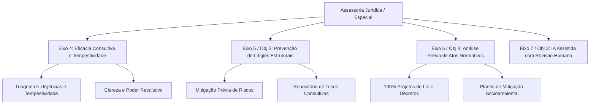

# Relatório Sintético de Ajustes Pós-Manifestação Processual SEI
## Assessoria Jurídica / Especial (PGE-MA)

**Processo de Referência SEI:** 2026.11103.07181  
**Documento de Encaminhamento:** Despacho nº 222/2026 (Doc. SEI 017903308)  
**Interlocutor:** Dr. Victor Paiva Gomes Marques do Rosário (Procurador-Geral Adjunto da Consultoria-Geral)  
**Data de Consolidação:** Outubro de 2026 – Ciclo PGE-MA 2026–2030  

---

### 1. Contexto e Manifestação Formal no SEI
No âmbito do planejamento estratégico 2026–2030, a Assessoria Jurídica / Especial manifestou-se no Processo SEI nº 2026.11103.07181 por meio do Despacho nº 222/2026. A manifestação estabeleceu parâmetros conceituais fundamentais para a atuação consultiva complexa, saneando distorções de minutas anteriores e formulando um plano estratégico focado em tempestividade, poder resolutivo e segurança jurídica.

---

### 2. Saneamento Metodológico e Fundamentação do Setor

| Meta Original (Minuta Inicial) | Tratamento no Despacho SEI nº 222 | Fundamentação Técnica do Setor | Harmonização na Lista Mestre |
| :--- | :--- | :--- | :--- |
| **KR1/KR2/KR3 Eixo 5 / O1**: Metas contenciosas (Monitor, audiências e êxito judicial) | **Totalmente Expurgadas** | Ausência de governabilidade; matérias típicas de defesa judicial | **Suprimidas** do plano da Assessoria |
| **KR1/KR2 Eixo 5 / O2**: Redução de ações e recursos em tribunais superiores | **Expurgadas da esfera contenciosa** | Foco redirecionado para a prevenção consultiva na origem | **Aprovada** como Eixo 5 / Obj 3 / KR1 |
| **KR1 Eixo 4 / O1**: Responder consultas no prazo regulamentar | **Aprovada com 2 ações** | Foco na tempestividade e priorização de processos de alto impacto | **Mantida** com triagem de urgência |
| **KR2 Eixo 4 / O1**: 90% de satisfação do usuário externo | **Aprovada com 2 ações** | Medição focada em clareza, resolutividade e linguagem acessível | **Mantida** com foco em qualidade resolutiva |
| **KR2 Eixo 7 / O1**: Automatizar 30% dos pareceres com IA | **Rejeitada no formato massivo** | Matérias complexas e não-padronizáveis; foco em pesquisa assistida | **Readequada** para Eixo 7 / Obj 3 / KR1 |

---

### 3. Pilares Doutrinários da Manifestação
1. **Atuação Consultiva Singular e Complexa**: Matérias não repetitivas que demandam análise detalhada de riscos e soluções jurídicas individualizadas.
2. **Tempestividade vs. Pressa Cronológica**: O tempo consultivo deve respeitar a profundidade técnica indispensável para conferir segurança aos atos administrativos.
3. **Indicador de Satisfação**: Não pode ser confundido com concordância com o órgão consulente, medindo clareza, poder resolutivo e segurança jurídica.
4. **Inteligência Artificial Assistida com Revisão Humana**: Participação em pilotos de pesquisa jurisprudencial e busca semântica, repudiando automação sem supervisão.

---

### 4. Síntese do Plano de Ação 5W2H (10 Ações Prioritárias)
- **Ação 1 (E4 / KR1)**: Aprimoramento da tempestividade da atuação consultiva com triagem qualificada (Imediato / Contínuo).
- **Ação 2 (E4 / KR1)**: Identificação e acompanhamento de processos consultivos de maior impacto econômico/institucional (Até dez/2027).
- **Ação 3 (E4 / KR2)**: Orientação das manifestações para identificar problemas, riscos e alternativas viáveis (Contínuo).
- **Ação 4 (E4 / KR2)**: Adoção de linguagem clara, conclusiva e acessível nas manifestações jurídicas (Contínuo).
- **Ação 5 (E5 / Obj 3 / KR1)**: Atuação jurídica preventiva contra nulidades e passivos administrativos no Executivo (Contínuo).
- **Ação 6 (E5 / Obj 3 / KR1)**: Prevenção de litígios de grande impacto econômico e social em consultas estruturantes (Contínuo).
- **Ação 7 (E5 / Obj 3 / KR1)**: Sistematização de entendimentos consolidados em repositório interno compartilhado de teses (Até dez/2027).
- **Ação 8 (E5 / Obj 4 / KR1)**: Análise prévia de constitucionalidade e legalidade de 100% dos projetos de lei e decretos com a PGARI (Fluxo Contínuo).
- **Ação 9 (E5 / Obj 4 / KR2)**: Subsidiar planos de mitigação jurídica em macrotemas socioambientais e fundiários estratégicos (Até 2030 / Anual).
- **Ação 10 (E7 / Obj 3 / KR1)**: Participação em projetos-piloto de IA assistida sob supervisão humana estrita (Conforme cronograma TIC).

---

---
*São Luís/MA, Outubro de 2026. Assessoria de Planejamento e Gestão Estratégica – PGE-MA.*
