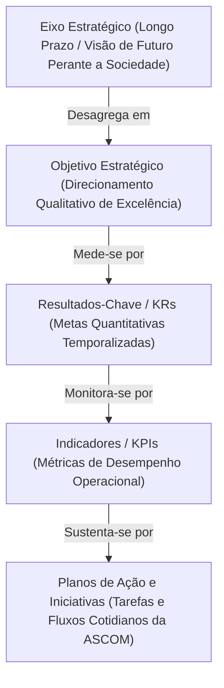
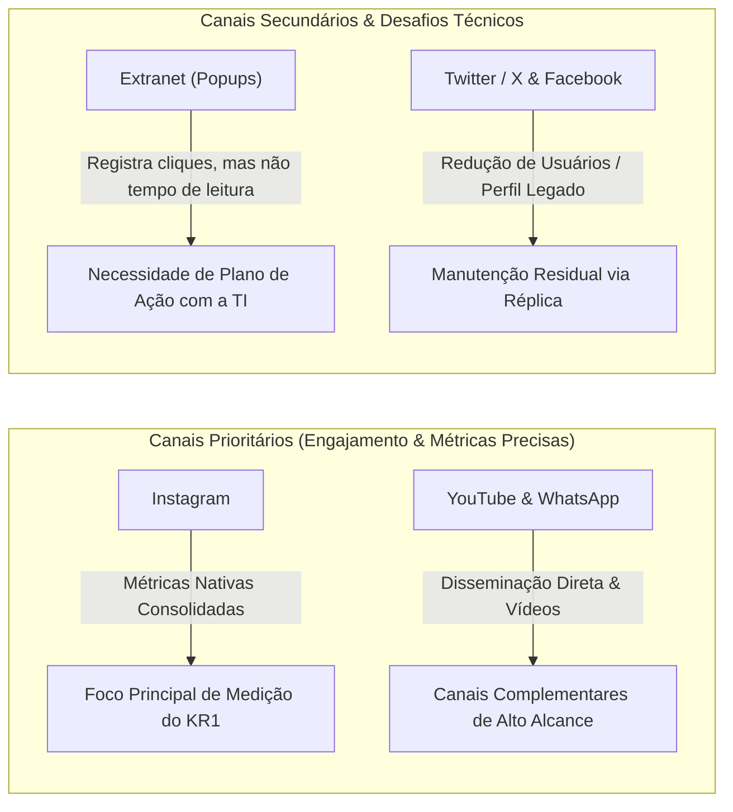
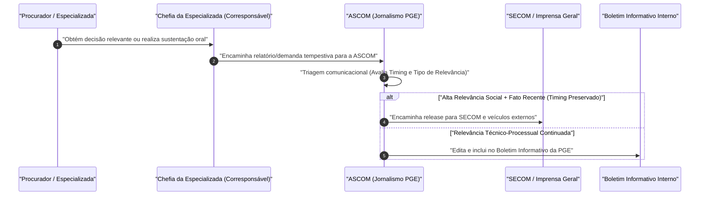
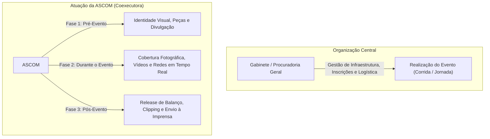

# Resumo de Reunião do Planejamento Estratégico: Outubro de 2026 - Eixos Estratégicos, Objetivos, Metas (KRs) e Planos de Ação da Assessoria de Comunicação (PGE-MA)

## Ideia Central (Tese)
A reunião de alinhamento do planejamento estratégico da Assessoria de Comunicação (ASCOM) da Procuradoria Geral do Estado do Maranhão (PGE-MA) reestrutura os eixos institucionais, objetivos e Resultados-Chave (KRs) para o ciclo 2027-2030, resolvendo gargalos históricos de mensuração de alcance e de fluxo de dados procedimentais entre as Procuradorias Especializadas e a equipe de imprensa [1, 5, 8]. O encontro estabelece novos direcionamentos metodológicos fundamentados em métricas realistas e responsabilidades setoriais compartilhadas, garantindo a ampliação do reconhecimento externo da PGE-MA por meio da criação de atos normativos regulamentares, integração direta com a TI e aprimoramento contínuo dos canais comunicacionais institucionais [6, 11, 16, 29].

---

## Desenvolvimento Detalhado e Estruturado

### 1. Contextualização Institucional e Metodologia do Planejamento Estratégico

#### 1.1 O Histórico do Planejamento Estratégico e as Considerações Críticas Anteriores
O processo de construção do Planejamento Estratégico da PGE-MA vem sendo desenvolvido continuamente ao longo dos últimos ciclos institucionais [4]. Contudo, na etapa de elaboração dos planos de ação proposta pelo comitê de estratégia, a Assessoria de Comunicação (ASCOM) apresentou considerações críticas substanciais em relação às propostas originais [5]. 

As principais fragilidades identificadas no modelo anterior foram:
* **Limitações Severas de Recursos:** Carência de recursos humanos e materiais específicos voltados à mensuração e produção contínua em larga escala [5].
* **Ausência de Linha de Base (Falta de Dados Históricos):** Dificuldade e impossibilidade técnica de fixar metas percentuais rígidas (ex.: "alcançar 100% de alcance") quando não existe um histórico prévio confiável de medição contínua [5, 35].
* **Imprecisão Metodológica:** Falta de clareza conceitual entre o papel de execução direta da comunicação e o papel consultivo ou dependente de outros setores [5, 6].

Diante disso, a reunião teve como propósito central filtrar as atribuições da ASCOM, mantendo no seu plano de ação estritamente aquilo que possui relação direta com as suas atividades operacionais do dia a dia, eliminando sobrecargas indevidas [6].

#### 1.2 A Arquitetura Metodológica: Eixos, Objetivos, KRs e KPIs
Para uniformizar o entendimento da equipe, o representante do grupo de planejamento estratégico (Bruno) detalhou a pirâmide metodológica adotada na instituição [7, 8]:

* **Eixo Estratégico (Longo Prazo):** Representa a visão de futuro da instituição e a forma como a sociedade enxergará a PGE-MA no longo prazo. Trata-se do nível mais elevado de diretrizes e princípios institucionais [7]. Exemplo abordado: *Eixo Estratégico 6 — "Obter um maior reconhecimento externo"* [1, 7].
* **Objetivo Estratégico (Médio/Longo Prazo):** É a desagregação qualitativa do eixo em direcionamentos mensuráveis que a instituição busca atingir para concretizar sua visão de futuro [7]. Exemplo abordado: *Objetivo 1 — "Fortalecer a imagem e o reconhecimento da PGE como referência de excelência"* [1, 7].
* **Resultados-Chave / KRs (*Key Results*):** São as metas quantitativas com horizontes temporais definidos que indicam concretamente se o Objetivo Estratégico está sendo alcançado [8].
* **Indicadores de Desempenho / KPIs (*Key Performance Indicators*):** São as métricas e pontos de controle (*key points*) que medem o desempenho contínuo das ações [8, 9].
* **Planos de Ação e Iniciativas:** Consistem no conjunto de tarefas cotidianas, projetos operacionais e fluxos de trabalho do dia a dia realizados pela ASCOM (ou de forma compartilhada com outros setores) para atingir os KRs [6, 8].

---

### 2. Análise Exaustiva e Ajustes dos Resultados-Chave (KRs) da ASCOM

#### 2.1 KR1: Crescimento Progressivo do Alcance em Redes Sociais Institucionais
* **Redação do KR1 no Documento:** *"Alcançar, até 2027, crescimento progressivo e documentado da média mensal de visualizações/alcance nas redes sociais institucionais (Incluir %)"* [1, 9].

##### A) Ajuste Metodológico do Indicador
A inclusão do termo **"Média Mensal"** foi a principal modificação introduzida para fechar o indicador [10]. Deixar o indicador aberto em números absolutos impediria a mensuração comparativa [10]. Com a média mensal, estabelece-se um divisor fixo padrão para comparação ano a ano [10].

##### B) Diagnóstico Detalhado dos Canais Comunicacionais da PGE-MA
A chefia da ASCOM (Dra. Marta) e as assessoras realizaram uma análise crítica sobre os canais oficiais disponíveis [28, 29, 48, 51]:

1. **Instagram:** É a principal rede social da instituição, concentrando o maior engajamento, número de usuários e métricas de visualização/alcance consolidadas e fáceis de extrair via *insights* nativos [29, 50, 52].
2. **YouTube e Canal do WhatsApp:** Apresentam bom desempenho na disseminação de vídeos institucionais, transmissões de eventos e alertas diretos, possuindo métricas fáceis de acompanhamento [49, 51].
3. **Twitter (atual X):** Sofreu queda drástica no número de usuários ativos após mudanças de gestão e perda de uso por órgãos institucionais. Atualmente funciona apenas como réplica de conteúdos lançados em outras redes [51].
4. **Facebook:** Registra utilização residual, restrita a um público mais antigo ("galera das antigas"), mantendo-se apenas como canal secundário de espelhamento [51].
5. **Site Institucional e Extranet:** A mensuração do site da PGE depende da área de TI [28]. Já na Extranet, os *popups* institucionais registram a quantidade de cliques (através do suporte da TI/Jean), mas a equipe destacou que o número de cliques não garante que o procurador ou servidor de fato leu o conteúdo [28].

##### C) Coleta da Linha de Base e Definição Realista de Metas
Para que a meta quantitativa seja válida, definiu-se a necessidade imperativa de coletar previamente a **Linha de Base** [35].
* **Desconto de Períodos Defesos:** A análise do histórico do Instagram deve desconsiderar formalmente o período de 3 meses em que as redes sociais ficaram fora do ar por razões de defesa/legislação eleitoral [24, 38]. A média será calculada dividindo as visualizações pelo número efetivo de meses em atividade (ex.: 9 meses em vez de 12) [38].
* **Proposta de Escalonamento da Meta:** Em vez de metas irrealistas ou infladas (como 250%), sugere-se um crescimento sustentável, por exemplo, alcançar 10% de aumento até 2028, sendo divididos em 5% ao ano [37, 44, 45].

##### D) Planos de Ação Tecnológicos Propostos para o KR1
1. **Aprimoramento da Extranet com a TI (Jean):** Elaboração de um plano de ação conjunto (coexecução ASCOM + TI) para desenvolver uma ferramenta que meça o tempo de permanência/visualização dos *popups* na Extranet, e não apenas o clique [29, 30, 32].
2. **Adoção de Ferramenta de Análise de Sentimento:** Inclusão de uma nova ferramenta tecnológica gratuita (apresentada por Bruno) voltada à interpretação automatizada do sentimento dos comentários recebidos nas postagens (classificando reações positivas, neutras ou críticas) [32, 33].

---

### 3. O Fluxo da Informação Processual e a Governança das Procuradorias Especializadas (KR2)

#### 3.1 KR2: Divulgação Mensal de Matérias sobre Atuação Processual
* **Redação do KR2 no Documento:** *"Divulgar mensalmente ao menos 2 matérias sobre a atuação processual da PGE-MA (plano de ação)"* [1, 25].

#### 3.2 O Gargalo do Fluxo Comunicacional Interno
A ASCOM ressaltou que o cumprimento do KR2 não depende unicamente da equipe de jornalismo, mas sim do recebimento tempestivo das matérias e decisões oriundas dos procuradores que atuam na ponta [11, 12]. Identificou-se que a cultura institucional de repasse espontâneo de informações pelas Procuradorias Especializadas ainda é frágil [12, 13].

#### 3.3 A Distinção entre "Interesse Público" e "Interesse Jurídico"
A chefia da ASCOM explicitou a diferença crucial entre as demandas para delimitar os canais de difusão [21, 23, 24]:

* **Matérias de Interesse Público (Imprensa Geral / SECOM):** Exigem cumprimento rigoroso do *"timing jornalístico"* [21]. Uma vitória processual relevante comunicada duas semanas após o ocorrido perde o valor de imprensa e não é aproveitada pela SECOM ou veículos externos [21].
* **Matérias de Interesse Jurídico (Boletim Informativo da PGE):** Decisões técnicas, teses inéditas, teses de repercussão geral ou novas legislações estaduais/federais que possuem relevância jurídica continuada para os procuradores, mesmo sem apelo para a imprensa geral [24]. Essas decisões abastecem o Boletim Informativo periódico [24].

#### 3.4 Planos de Ação Estruturantes Propostos para o KR2

1. **Edição de Portaria pelo Procurador-Geral da PGE-MA:**
   * Instituição de um ato normativo (Portaria PGE) formalizando a obrigação de envio regular de decisões favoráveis, sustentações orais e atos relevantes à comunicação [13, 16].
   * Escolheu-se a forma de Portaria do Procurador-Geral por ter tramitação rápida e eficácia imediata, sem necessidade de passar pelo Conselho Superior [16].

2. **Atribuição Formal de Corresponsabilidade às Chefias:**
   * Fixar as **Chefias das Procuradorias Especializadas** como corresponsáveis formais no Plano de Ação [11, 13, 17].
   * As chefias assumem o papel de filtrar e cobrar internamente dos procuradores de suas equipes o envio dos relatórios de processos estratégicos [13, 17].

3. **Acesso ao Fluxo de Pauta no SPA e Integração com a Subadjunta:**
   * Estabelecer um fluxo com a Subadjunta Judicial (SDAJ / Uberlândio) para que a ASCOM receba semanalmente ou quinzenalmente a pauta de sustentações orais deferidas [18, 19].
   * Concessão de acesso de visualização à caixa de pautas do SPA (Sistema de Processos Administrativos) para que a comunicação possa se planejar com antecedência para coberturas presenciais [18, 19, 21].

4. **Inclusão do KR2 como Iniciativa do KR1:**
   * O representante do planejamento (Bruno) sugeriu que o KR2 pode ser enxugado, transformando-se em uma ação/iniciativa prioritária dentro do KR1, visto que a divulgação de matérias processuais é um dos meios para alavancar as visualizações das redes sociais [6, 25, 36].

---

### 4. Redefinição do Papel da ASCOM em Eventos Institucionais (KR3)

#### 4.1 KR3: Realização de Eventos Institucionais
* **Redação do KR3 no Documento:** *"Realizar 2 eventos anuais de impacto positivo para a imagem da PGE-MA (Plano de ação)"* [1, 26].

#### 4.2 Ajuste do Escopo Operacional e Coexecução
A chefia da ASCOM reforçou que a responsabilidade de *realizar* e *organizar* grandes eventos institucionais (como a Corrida da PGE e a Jornada Jurídica) pertence ao Gabinete do Procurador-Geral e às comissões organizadoras [26].

O papel da ASCOM é estritamente de **coexecutora responsável pela Cobertura Comunicacional** [26, 27]:
* **Pré-Evento:** Produção de peças publicitárias, identidades visuais, vídeos de convocação e matérias de divulgação [26, 59].
* **Durante o Evento:** Cobertura fotográfica, gravação de entrevistas, publicação em tempo real nas redes sociais [26].
* **Pós-Evento:** Redação de *releases* de balanço, clipping de imprensa e galerias de fotos [26].

---

### 5. Diretrizes de Gestão, Prazos e Assuntos Administrativos Operacionais

#### 5.1 Regras de Atribuição de Responsabilidades nos Planos de Ação
Ficou pactuado que a identificação de responsáveis e corresponsáveis nos documentos de planejamento estratégico deve **evitar estritamente o uso de nomes próprios de servidores** (ex.: Beatriz, Raíssa) [47, 48].
* **Formatação Correta:** Utilizar a designação por **Setor** ou **Cargo/Função** (ex.: "Assessoria de Comunicação", "Chefia da Procuradoria Judicial", "Assessor de Comunicação") [47, 48].
* **Justificativa:** Garantir a continuidade administrativa e a validade jurídica dos planos frente a alterações de chefia, férias, licenças ou rotatividade de pessoal [46, 47].

#### 5.2 Cronograma de Prazos e Entrega das Propostas
* **Prazo Formal Inicial (SEI):** O prazo formal indicado no sistema era dia 09 de outubro [39, 40].
* **Flexibilização Acordada:** Reconhecendo a sobrecarga dos setores, o grupo de planejamento adotou reuniões individuais para ajustar prazos customizados com cada chefia [40, 41].
* **Prazo Final Definido para a ASCOM:** A entrega dos formulários ajustados da comunicação será realizada **até o final de outubro**, permitindo a consolidação e publicação oficial em novembro [41, 42].
* **Ciclo do Planejamento:** Os horizontes das metas estendem-se até o ciclo 2027–2030 [44].

#### 5.3 Ponto Eletrônico e Alinhamento com a TI
Durante a reunião, a equipe tratou de uma demanda operacional urgente referente à transição do sistema de registro de frequência [52, 53]:
* **Instabilidade Temporária:** A TI (Jean) subiu uma atualização no ponto eletrônico que gerou instabilidade e impediu o login de alguns servidores [53, 55].
* **Instrução de Contingência:** Durante todo o mês de transição, a folha de ponto física permanecerá disponível na portaria/entrada [53, 55, 56].
* **Regra de Registro:** O servidor que conseguir registrar no sistema eletrônico (entrada e saída) fica **dispensado de assinar a folha física** [56]. A folha impressa será consultada pelo RH exclusivamente para cobrir inconsistências ou falhas pontuais do sistema [56, 57].
* **Férias no Sistema:** Foi esclarecido que ausências marcadas como faltas durante o período de férias no sistema decorrem do fato de o ponto eletrônico ter entrado em vigor recentemente, e as inconsistências serão corrigidas administrativamente pela TI e RH [57, 58].

#### 5.4 Alinhamentos Operacionais dos Eventos (Corrida e Jornada da PGE)
* **Identidade Visual:** As peças da Jornada Jurídica e da Corrida da PGE foram finalizadas e enviadas pela ASCOM [59].
* **Patrocinadores e Backdrops:** A equipe alinhou a necessidade de obter as logomarcas definitivas dos patrocinadores para aplicação nos painéis de fundo (*backdrops*) da corrida [60].

---

## Explicações Numeradas e Complementares (Notas Explicativas)

Para garantir a rastreabilidade total do conteúdo e complementar de forma pedagógica o resumo, detalham-se abaixo os apontamentos e fundamentos de cada citação numérica utilizada ao longo do documento:

1. **[1] Excerpts from "Assessoria de Comunicação - Eixos Objetivos e Metas (KRs) 1.pdf":** Texto oficial do Eixo Estratégico 6 ("Obter um maior reconhecimento externo"), Objetivo 1 ("Fortalecer a imagem e o reconhecimento da PGE como referência de excelência") e as redações originais dos KRs 1, 2 e 3.
2. **[2] Excerpts from "Assessoria de Comunicação - Eixos Objetivos e Metas (KRs) 1.pdf":** Documento em PDF referente à folha de planejamento estratégico da Assessoria de Comunicação.
3. **[3] Excerpts from "Rua Fortaleza, 25 11.m4a":** Diálogo inicial entre os participantes buscando localizar os arquivos das considerações críticas feitas no ano anterior.
4. **[4] Excerpts from "Rua Fortaleza, 25 11.m4a":** Abertura oficial da reunião por Bruno Marques, contextualizando que o planejamento estratégico é um processo em construção contínua na PGE.
5. **[5] Excerpts from "Rua Fortaleza, 25 11.m4a":** Explicação detalhada da Dra. Marta sobre as considerações críticas anteriores: limitações de pessoal e material, ausência de linha de base e falta de clareza metodológica para medir metas de 100%.
6. **[6] Excerpts from "Rua Fortaleza, 25 11.m4a":** Bruno explica a proposta de enxugar as metas e concentrar na ASCOM apenas atividades diretamente ligadas à sua execução diária.
7. **[7] Excerpts from "Rua Fortaleza, 25 11.m4a":** Explicação pedagógica de Bruno sobre os conceitos de Eixo Estratégico (visão de futuro no longo prazo) e Objetivos Estratégicos (desagregação qualitativa de excelência).
8. **[8] Excerpts from "Rua Fortaleza, 25 11.m4a":** Definição da metodologia OKR na PGE: diferenciação entre KRs (*Key Results* / Resultados-Chave) e KPIs (*Key Performance Indicators* / Indicadores de Desempenho).
9. **[9] Excerpts from "Rua Fortaleza, 25 11.m4a":** Discussão sobre o KR1 (alcançar crescimento do alcance em redes sociais até 2027) e a flexibilidade dos valores quantitativos até a publicação final.
10. **[10] Excerpts from "Rua Fortaleza, 25 11.m4a":** Introdução da exigência da "média mensal" no texto do KR1 para permitir o fechamento e a mensuração exata do indicador.
11. **[11] Excerpts from "Rua Fortaleza, 25 11.m4a":** Debate sobre a atribuição de responsável e corresponsável no plano de ação, ressaltando o papel das Procuradorias Especializadas no repasse de demandas.
12. **[12] Excerpts from "Rua Fortaleza, 25 11.m4a":** Dra. Marta relata a dificuldade na cultura institucional da PGE no que tange aos procuradores lembrarem de enviar proativamente notícias e decisões importantes para a ASCOM.
13. **[13] Excerpts from "Rua Fortaleza, 25 11.m4a":** Proposta de criação de um ato normativo interno e definição de corresponsabilidade das chefias para criar uma obrigação formal de envio de informações à ASCOM.
14. **[14] Excerpts from "Rua Fortaleza, 25 11.m4a":** Sugestão de aproveitar os relatórios periódicos dos setores e as pautas de sustentação oral distribuídas pela Subadjunta como filtro de demandas relevantes.
15. **[15] Excerpts from "Rua Fortaleza, 25 11.m4a":** Bruno confirma a inclusão dessas propostas na planilha do plano de ação para posterior ajuste fino pela chefia.
16. **[16] Excerpts from "Rua Fortaleza, 25 11.m4a":** Definição de que o ato normativo ideal é uma Portaria do Procurador-Geral, dada a rapidez e facilidade de publicação frente a uma Resolução do Conselho Superior.
17. **[17] Excerpts from "Rua Fortaleza, 25 11.m4a":** Definição de que as Chefias das Procuradorias Especializadas devem ser fixadas como corresponsáveis, pois possuem a visão geral do que é processado em seus setores.
18. **[18] Excerpts from "Rua Fortaleza, 25 11.m4a":** Discussão sobre como a ASCOM não pode triar milhares de processos diretamente, sendo necessário que o procurador atuante ateste a relevância e faça o direcionamento.
19. **[19] Excerpts from "Rua Fortaleza, 25 11.m4a":** Proposta de conceder acesso à ASCOM ao fluxo de pautas de sustentações orais deferidas (gerido pela Subadjunta / Uberlândio) para antecipação do planejamento comunicacional.
20. **[20] Excerpts from "Rua Fortaleza, 25 11.m4a":** Relato sobre o acúmulo de demandas de última hora enviadas à ASCOM por falta de aviso prévio dos setores, sobrecarregando a equipe.
21. **[21] Excerpts from "Rua Fortaleza, 25 11.m4a":** Conceito de "timing jornalístico": a perda de oportunidade de divulgação na imprensa externa quando uma notícia é informada com semanas de atraso.
22. **[22] Excerpts from "Rua Fortaleza, 25 11.m4a":** Discussão sobre a funcionalidade no SPA de registrar decisão favorável e os desafios de triagem de um volume massivo de vitórias judiciais cotidianas.
23. **[23] Excerpts from "Rua Fortaleza, 25 11.m4a":** Diferenciação entre decisões sem relevância para a sociedade externa, mas com relevância jurídica para o boletim interno da PGE.
24. **[24] Excerpts from "Rua Fortaleza, 25 11.m4a":** Funcionamento e papel do Boletim Informativo da PGE para a divulgação periódica de legislações e teses jurisprudenciais.
25. **[25] Excerpts from "Rua Fortaleza, 25 11.m4a":** Análise do KR2 (divulgar mensalmente ao menos 2 matérias processuais) e sua dependência direta da regulamentação do fluxo normativo.
26. **[26] Excerpts from "Rua Fortaleza, 25 11.m4a":** Esclarecimento de que a ASCOM não é a organizadora principal de eventos como a Corrida e a Jornada, cabendo a ela estritamente a cobertura comunicacional.
27. **[27] Excerpts from "Rua Fortaleza, 25 11.m4a":** Acordo para definir a ASCOM como coexecutora responsável pela cobertura prévia, simultânea e posterior dos eventos.
28. **[28] Excerpts from "Rua Fortaleza, 25 11.m4a":** Relato sobre a dificuldade técnica de mensurar leituras efetivas em popups da Extranet e visualizações do site institucional.
29. **[29] Excerpts from "Rua Fortaleza, 25 11.m4a":** Desempenho positivo de alcance verificado no Instagram (ex.: postagem da corrida) e sugestão de plano de ação em conjunto com a TI para a Extranet.
30. **[30] Excerpts from "Rua Fortaleza, 25 11.m4a":** Proposta de plano de ação tecnológico em coexecução com o desenvolvedor Jean para medir o tempo de permanência de visualização na Extranet.
31. **[31] Excerpts from "Rua Fortaleza, 25 11.m4a":** Orientação de discriminar no relatório as redes cujas métricas são mensuráveis (Instagram) e justificativa para as que não possuem ferramentas nativas adequadas.
32. **[32] Excerpts from "Rua Fortaleza, 25 11.m4a":** Apresentação por Bruno de uma ferramenta gratuita de interpretação de sentimentos em comentários de redes sociais.
33. **[33] Excerpts from "Rua Fortaleza, 25 11.m4a":** Dra. Marta manifesta interesse na ferramenta de análise de sentimento e relata episódios de dúvidas do público externo sobre atribuições da PGE.
34. **[34] Excerpts from "Rua Fortaleza, 25 11.m4a":** Debate sobre a necessidade de ter uma linha de base histórica antes de aceitar metas percentuais de crescimento.
35. **[35] Excerpts from "Rua Fortaleza, 25 11.m4a":** Definição do conceito de "Coletar a Linha de Base" como a primeira ação do plano de ação quando não há métricas prévias disponíveis.
36. **[36] Excerpts from "Rua Fortaleza, 25 11.m4a":** Proposta de enxugar o texto das metas e transformar os KRs 2 e 3 em iniciativas/ações vinculadas ao KR1.
37. **[37] Excerpts from "Rua Fortaleza, 25 11.m4a":** Orientação de Marcos para fixar metas de crescimento realistas e factíveis para evitar descumprimentos injustificados.
38. **[38] Excerpts from "Rua Fortaleza, 25 11.m4a":** Regra de cálculo para a média mensal: descontar os 3 meses em que as redes sociais ficaram suspensas por vedação eleitoral.
39. **[39] Excerpts from "Rua Fortaleza, 25 11.m4a":** Ajuste da redação do prazo da meta para "alcançar até o final de 2027" ou "até 2028".
40. **[40] Excerpts from "Rua Fortaleza, 25 11.m4a":** Discussão sobre o vencimento do prazo formal do SEI (dia 09 de outubro) e a estipulação de novos prazos em reuniões setorizadas.
41. **[41] Excerpts from "Rua Fortaleza, 25 11.m4a":** Acordo do prazo de envio para a ASCOM: entrega das propostas até o final de outubro e consolidação em novembro.
42. **[42] Excerpts from "Rua Fortaleza, 25 11.m4a":** Confirmação de que a ASCOM possui o plano de ação da comunicação e das contas para revisar até o fim do mês.
43. **[43] Excerpts from "Rua Fortaleza, 25 11.m4a":** Explicação de que os planos de ação passarão por acompanhamento e monitoramento periódico, e não por punições coercitivas.
44. **[44] Excerpts from "Rua Fortaleza, 25 11.m4a":** Sugestão de fracionar a meta de crescimento ao longo dos anos do ciclo estratégico (ex.: 5% em 2027 e 5% em 2028).
45. **[45] Excerpts from "Rua Fortaleza, 25 11.m4a":** Exemplo de acontecimentos imprevisíveis que alteram drasticamente o alcance (ex.: abertura de concursos públicos).
46. **[46] Excerpts from "Rua Fortaleza, 25 11.m4a":** Questão apresentada sobre a rotatividade nas chefias e a forma adequada de registrar a responsabilidade no plano de ação.
47. **[47] Excerpts from "Rua Fortaleza, 25 11.m4a":** Orientação categórica para registrar como responsável o SETOR ou CARGO (ex.: PGE-AJ, ASCOM), e jamais o nome nominal do servidor.
48. **[48] Excerpts from "Rua Fortaleza, 25 11.m4a":** Alinhamento sobre a verificação das métricas do Instagram, YouTube e do canal da PGE no WhatsApp.
49. **[49] Excerpts from "Rua Fortaleza, 25 11.m4a":** Confirmação de que o YouTube e o canal do WhatsApp oferecem boas ferramentas de acompanhamento de audiência.
50. **[50] Excerpts from "Rua Fortaleza, 25 11.m4a":** Consulta técnica à equipe da TI sobre a viabilidade de relatórios de audiência na Extranet.
51. **[51] Excerpts from "Rua Fortaleza, 25 11.m4a":** Diagnóstico sobre o comportamento dos públicos nas redes: migração do Instagram, redução do X (Twitter) e envelhecimento da base do Facebook.
52. **[52] Excerpts from "Rua Fortaleza, 25 11.m4a":** Encerramento do bloco de planejamento e transição para os pontos de pauta administrativos e operacionais da PGE.
53. **[53] Excerpts from "Rua Fortaleza, 25 11.m4a":** Relato de problemas enfrentados pelas servidoras da ASCOM com o sistema de registro eletrônico de ponto.
54. **[54] Excerpts from "Rua Fortaleza, 25 11.m4a":** Esclarecimento de divergências sobre o memorando do RH acerca da impressão da folha física de ponto.
55. **[55] Excerpts from "Rua Fortaleza, 25 11.m4a":** Explicação sobre a atualização de software subida pela TI que causou instabilidade pontual no ponto eletrônico.
56. **[56] Excerpts from "Rua Fortaleza, 25 11.m4a":** Definição da regra de convivência dos sistemas: o ponto impresso na portaria serve de retaguarda, dispensando assinatura de quem bateu o ponto eletrônico regularmente.
57. **[57] Excerpts from "Rua Fortaleza, 25 11.m4a":** Esclarecimento sobre o procedimento de conferência pelo RH do espelho de ponto eletrônico confrontado com a folha física em caso de falha.
58. **[58] Excerpts from "Rua Fortaleza, 25 11.m4a":** Regularização das marcações automáticas de inconsistência decorrentes do período recente de implantação e férias de servidoras.
59. **[59] Excerpts from "Rua Fortaleza, 25 11.m4a":** Confirmação do envio dos materiais gráficos da identidade visual da Jornada Jurídica e da Corrida da PGE.
60. **[60] Excerpts from "Rua Fortaleza, 25 11.m4a":** Alinhamento sobre a inserção das marcas dos patrocinadores no painel de fundo (*backdrop*) dos eventos.
61. **[61] Excerpts from "Rua Fortaleza, 25 11.m4a":** Organização dos horários das próximas reuniões e do envio das mensagens de confirmação aos gestores.
62. **[62] Excerpts from "Rua Fortaleza, 25 11.m4a":** Encerramento da gravação e direcionamento da equipe para a reunião na Ouvidoria da PGE.
