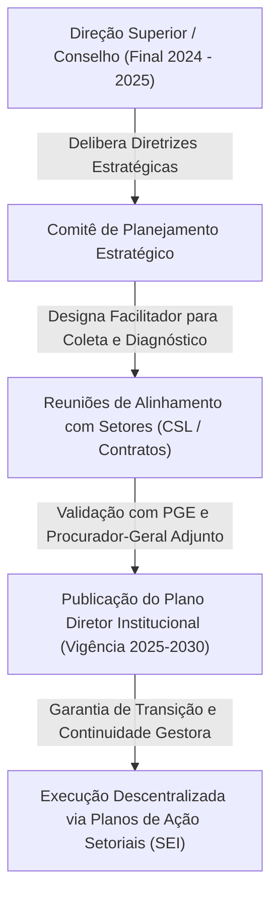
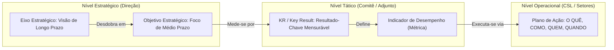
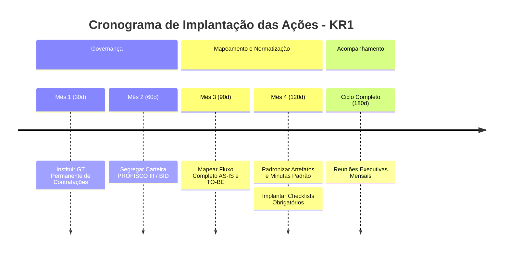
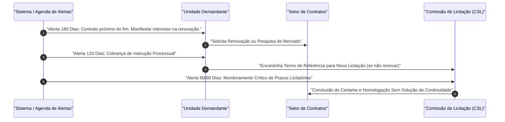
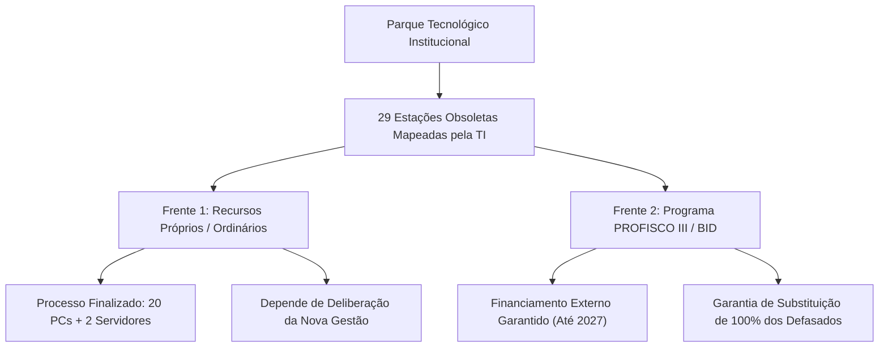
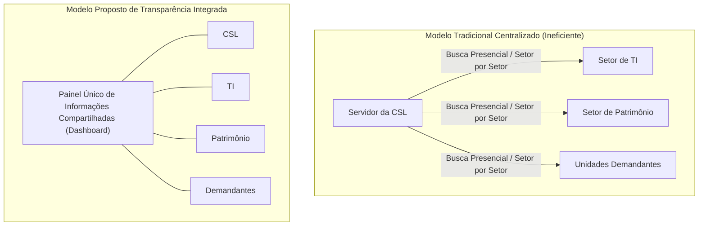
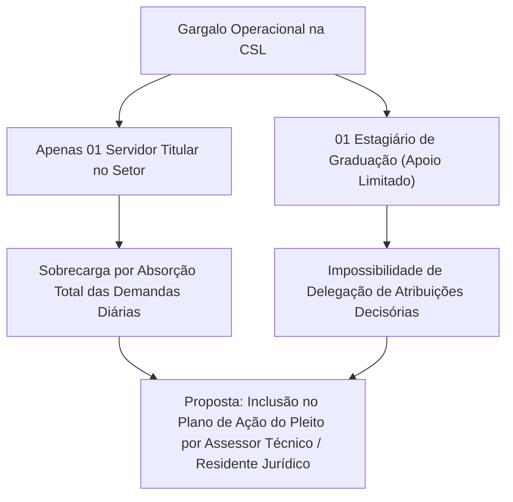
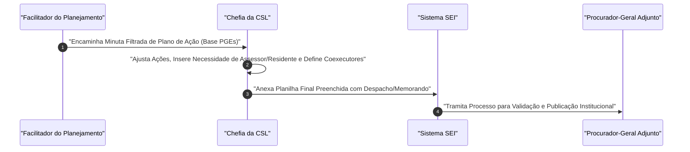

# Resumo de Reunião de Alinhamento do Planejamento Estratégico - CSL: Final de 2024 / Início de 2025 - Definição de Metas (OKRs), Indicadores e Planos de Ação da Comissão Setorial de Licitação

---

## Ideia Central (Tese)
Este documento apresenta o detalhamento exaustivo e a estruturação pedagógica das diretrizes do Planejamento Estratégico Institucional (2025–2030) voltadas à Comissão Setorial de Licitação (CSL), combinando o modelo conceitual do plano institucional com os alinhamentos operacionais colhidos na reunião de trabalho realizada entre o setor de planejamento e a chefia da CSL [1, 12]. A tese central fundamenta-se na necessidade de transição de uma gestão reativa e centralizada para um modelo estratégico baseado na metodologia OKR (*Objectives and Key Results*), sustentado pelo mapeamento de fluxos, integração sistêmica intersetorial, conformidade preventiva e fortalecimento da capacidade operacional do setor [1, 3, 16, 31]. O objetivo precípuo é garantir a continuidade administrativa frente às mudanças de gestão, otimizar o uso dos recursos públicos e eliminar gargalos históricos no ciclo de compras e contratualizações institucionais [2, 12, 19, 25].

---

## 1. Contexto Institucional, Gênese e Metodologia do Planejamento Estratégico (2025–2030)

### 1.1 Gênese da Iniciativa e Continuidade Administrativa
A concepção do Planejamento Estratégico Institucional teve origem entre o final de 2024 e o início de 2025, impulsionada por deliberação do Conselho e da Direção Superior da instituição [12]. O propósito primordial foi instituir um plano diretor robusto que transcenda mandatos individuais de gestão, assegurando um horizonte de previsibilidade, continuidade e aprimoramento administrativo com vigência projetada até pelo menos o ano de 2030 [12, 13]. 

Para operacionalizar essa construção, designou-se um facilitador/coordenador responsável pela coleta de dados, realização de reuniões setoriais de diagnóstico, alinhamento com o Comitê de Planejamento e validação direta com o Procurador-Geral Adjunto e o Procurador-Geral do Estado (PGE) [12, 15].

### 1.2 Estrutura Metodológica: O Mecanismo OKR e Cascateamento
A metodologia adota a lógica de OKRs (*Objectives and Key Results*), estruturando a estratégia em camadas encadeadas que conectam visões de longo prazo às rotinas operacionais diárias dos setores [1, 13, 14, 15]:

1. **Eixos Estratégicos (Longo Prazo / Visão Subjetiva)**: Representam os ideais da instituição para o futuro (ex.: Garantir a eficiência dos gastos públicos e Incentivar a inovação tecnológica) [13, 14].
2. **Objetivos Estratégicos (Médio Prazo / Concretização do Eixo)**: Metas intermediárias que, ao serem concluídas, sinalizam o atingimento do eixo correspondente (ex.: Otimizar a gestão de contratos e licitações) [14].
3. **Metas Quantificadas / OKRs / KRs (*Key Results*)**: Resultados-chave mensuráveis, dotados de percentuais, prazos e indicadores de desempenho claros (ex.: Reduzir em 30% o tempo médio dos processos) [14, 15, 16].
4. **Planos de Ação Operacionais (Matriz O QUÊ, COMO, QUEM, QUANDO)**: Ações práticas do dia a dia setorial formuladas em planilhas tramitadas via Sistema Eletrônico de Informações (SEI) [1, 2, 17].

| Nível Metodológico | Temporalidade | Natureza | Exemplo Prático Institucional | Referência |
| :--- | :--- | :--- | :--- | :--- |
| **Eixo Estratégico** | Longo Prazo (2030) | Direcionamento Abstrato / Subjetivo | Eixo 2: Garantir a eficiência dos gastos públicos | [13] |
| **Objetivo Estratégico** | Médio Prazo | Desdobramento Temático | Objetivo 2: Otimizar a gestão de contratos e licitações | [14] |
| **OKR / Key Result (KR)** | Quantificado (2027-2028) | Métrica Mensurável / Indicador | KR1: Reduzir em 30% o tempo médio de licitação até jan/2028 | [2, 16] |
| **Plano de Ação (Matriz)** | Operacional / Curto Prazo | Ação e Subação Executiva | Mapear fluxo AS-IS e TO-BE do pedido ao pagamento | [1, 3] |

---

## 2. Eixo Estratégico 2: Garantir a Eficiência dos Gastos Públicos

O Eixo Estratégico 2 engloba a otimização dos recursos e o combate ao desperdício na administração institucional [2, 13]. No âmbito da CSL e do setor de contratos, esse eixo se materializa no Objetivo Estratégico 2 ("Otimizar a gestão de contratos e licitações"), desdobrado em três KRs essenciais [2, 13, 14].

### 2.1 KR1: Redução de 30% no Tempo Médio dos Processos Licitatórios até Janeiro de 2028

#### 2.1.1 Diagnóstico do Indicador e Relevância Prática
O indicador central desta meta é o **"Tempo Médio do Processo Licitatório"**, calculado desde a autuação do pedido de contratação até a homologação/conclusão do certame e formalização do contrato [3, 16]. Durante a reunião, a chefia da CSL ratificou a viabilidade e a pertinência desse controle, ressaltando que, embora os percentuais e prazos sejam parâmetros ajustáveis pelo Comitê, a capacidade de mensurar o fluxo temporal é totalmente compatível com a realidade do setor [15, 16, 17].

#### 2.1.2 Plano de Ação para Racionalização do Ciclo de Compras
Para alcançar a redução do tempo médio, o Plano de Ação estabelece seis frentes de trabalho estruturadas [3-7]:

1. **Instituição de Grupo de Trabalho (GT) Permanente de Contratações**:
   - *O QUÊ*: Formalizar comitê multidisciplinar de governança de compras [3].
   - *COMO*: Integrar representantes do Procurador-Geral Adjunto (PGA), CSL, Serviço de Controle de Contratos, Finanças, Material e Patrimônio, e Unidades Demandantes [3].
   - *QUEM*: Liderança do Procurador-Geral Adjunto. Prazo: 30 dias [3].
2. **Mapeamento do Fluxo Completo de Contratação (AS-IS e TO-BE)**:
   - *O QUÊ*: Mapear a jornada do processo do pedido inicial ao pagamento final [3].
   - *COMO*: Desenhar o diagnóstico atual (*AS-IS*) e o modelo otimizado (*TO-BE*), mensurando a duração em cada fase crítica: demanda, Estudo Técnico Preliminar (ETP), Termo de Referência (TR), pareceres jurídicos, sessão licitatória, celebração contratual, empenho e execução [3, 4].
   - *QUEM*: Procurador-Geral Adjunto. Prazo: 90 dias [4].
3. **Padronização de Artefatos e Manifestações**:
   - *O QUÊ*: Minimizar retrabalhos e exigências de diligências saneadoras [4].
   - *COMO*: Elaborar modelos-padrão institucionais para ETP, TR, pesquisas de preços, despachos de motivação de demanda, pareceres jurídicos de conformidade e cronogramas de fiscalização [4].
   - *QUEM*: Procurador-Geral Adjunto. Prazo: 120 dias [4].
4. **Implantação de Checklists Obrigatórios por Etapa**:
   - *O QUÊ*: Criar barreira de controle preventivo de admissibilidade [5].
   - *COMO*: Estabelecer listas de verificação obrigatórias para admissibilidade da demanda, fase interna, fase externa/habilitação, celebração contratual, fiscalização e encerramento [5].
   - *QUEM*: Procurador-Geral Adjunto. Prazo: 120 dias [5].
5. **Segregação da Carteira Estratégica (PROFISCO III / BID)**:
   - *O QUÊ*: Tratar de forma diferenciada as contratações estruturantes de grande porte [6].
   - *COMO*: Criar trilha customizada de acompanhamento intensivo com matriz de riscos dedicada, marcos do Banco Interamericano de Desenvolvimento (BID) e fiscal técnico especializado designado [6].
   - *QUEM*: Procurador-Geral Adjunto. Prazo: 60 dias [6].
6. **Reuniões Executivas Mensais do Ciclo de Compras**:
   - *O QUÊ*: Monitoramento contínuo de gargalos [6].
   - *COMO*: Avaliar durações atípicas, não conformidades recorrentes, vencimentos próximos e andamento do PROFISCO III [6, 7].
   - *QUEM*: Procurador-Geral Adjunto. Frequência: Mensal [7].

---

### 2.2 KR2: Manutenção em Zero de Irregularidades e Falhas em Auditorias Internas até 2030 (sugestão de retirada do rol da CSL)

#### 2.2.1 Escopo do Indicador e Distribuição de Competências Setoriais
Ainda que a meta tenha como premissa zerar o índice de apontamentos, ressalvas e sanções decorrentes de auditorias internas e externas nos processos de contratação e gestão contratual até 2030 [7], ela não tem pertinência com as atribuições da CSL. Na deliberação entre os interlocutores, esclareceu-se a divisão de atribuições:
- **Setor de RH / Gestão de Pessoas**: Responsável pelas metas de auditoria de admissão de pessoal [17, 18].
- **Setor de Contratos (Clarice) e CSL**: Responsáveis diretos pela conformidade documental e instrução processual dos contratos e licitações [17, 18].

### 2.3 KR3: Zero Contratos Emergenciais por Falha de Planejamento de Renovação até 2028

#### 2.3.1 Análise Conceitual e Causa Raiz das Emergências
Os interlocutores debateram a distinção crucial entre:
- **Emergências Reais e Imprevisíveis**: Fenômenos imprevisíveis ou de força maior que não derivam de incúria administrativa [18].
- **Emergências Fabricadas / Evitáveis**: Decorrentes do descontrole temporal do vencimento de contratos vigentes, resultando na necessidade de dispensa emergencial por ausência de tempo hábil para licitar [9, 18, 19].

A meta KR3 foca estritamente na eliminação das emergências evitáveis [9, 19]. A chefia da CSL pontuou que zerar esse índice é **plenamente viável**, desde que haja uma **atuação compartilhada e contínua** entre CSL, Contratos e as Unidades Demandantes [19, 20].

#### 2.3.2 Mecanismo de Integração: Plano Anual de Contratações e Sistema de Alertas
A CSL destacou que já vem participando da construção do Plano Anual de Contratações da instituição, o que conferiu maior previsibilidade sobre as necessidades dos diversos setores [20]. Contudo, para garantir o cumprimento do KR3, faz-se indispensável aperfeiçoar o modelo [22].

1. **Sistema de Alerta Automatizado de Vencimentos**:
   - Configuração de gatilhos temporais nos sistemas institucionais com avisos com antecedência mínima de **180, 120, 90 e 60 dias** antes do término vigência contratual [9].
   - Liderança: Procurador-Geral Adjunto. Prazo: 60 dias [9].
2. **Vinculação Obrigatória ao Calendário Institucional**:
   - Inserção de cada contrato no calendário institucional unificado, notificando automaticamente a unidade demandante para emitir o termo de repactuação, aditivo de prorrogação ou a abertura de novo certame licitatório [10].
   - Liderança: Procurador-Geral Adjunto. Prazo: 90 dias [10].

---

## 3. Eixo Estratégico 7: Incentivar a Inovação Tecnológica e Modernização

### 3.1 KR1 do Eixo 7: Renovação de 100% dos Equipamentos Defasados até 2027
O Eixo 7 visa assegurar a infraestrutura digital indispensável à eficiência administrativa [10, 14, 23]. O Objetivo Estratégico 2 ("Modernizar a infraestrutura tecnológica") estabelece como KR1 a substituição integral dos ativos obsoletos até 2027, vinculada aos recursos do programa PROFISCO III (financiado pelo Banco Interamericano de Desenvolvimento - BID) [10, 23, 24].

### 3.2 Alinhamento Operacional: Diagnóstico da TI vs. Dinâmica de Licitações
Na reunião, a CSL e o facilitador analisaram o cenário real de tecnologia da informação [23, 24, 25]:
- **Levantamento do Setor de TI**: Mapeou-se a existência de **29 estações de trabalho obsoletas** na instituição [25, 26].
- **Ações em Andamento**: Foi liberado orçamento próprio para a aquisição imediata de **20 novos computadores** e **2 servidores** de alto desempenho, cujos processos já se encontram na fase final de recebimento [25].
- **Impacto das Transições de Gestão**: Esclareceu-se que os processos movidos por recursos ordinários dependem de confirmação da próxima gestão, ao passo que as contratações do **PROFISCO III / BID** possuem execução garantida por se tratarem de compromissos externos contratualizados mediante empréstimo [24, 25].

### 3.3 Gestão do Conhecimento e Transparência Integrada entre Setores
Um dos pontos mais expressivos debatidos pelos interlocutores foi a **necessidade de integração sistêmica** entre a CSL, o Setor de Patrimônio e a TI [26, 27].
- **Gargalo Identificado**: Ausência de visibilidade direta sobre o inventário de bens, necessidades locais dos setores e status de processos de TI, forçando os servidores a peregrinarem presencialmente de setor em setor para coletar informações [26, 27].
- **Proposta Estratégica**: Criação ou liberação de **ferramentas/painéis de acesso compartilhado**, onde informações sobre demandas, equipamentos e contratos fiquem disponíveis de forma transparente e impessoal, independentemente das pessoas que ocupem os cargos temporariamente [26, 27].

---

## 4. Gargalos Operacionais, Gestão de Pessoas e Adaptação dos Planos de Ação

### 4.1 O Gargalo Estrutural de Recursos Humanos na CSL
Durante a reunião, a chefia da CSL apresentou um diagnóstico franco das limitações operacionais da unidade:
- **Sobrecarga Extrema**: O setor é operado por **apenas um servidor titular**, resultando na absorção contínua da execução direta das demandas do dia a dia e inviabilizando o tempo necessário para ações de planejamento e gestão ("O setor sou eu... fico o tempo inteiro na demanda") [30].
- **Insuficiência do Suporte de Estágio**: A unidade conta com apenas um estagiário de graduação recém-chegado (remanejado para o turno da tarde), o qual, embora preste auxílio valioso, não possui competência legal ou técnica para assinar manifestações, pareceres ou conduzir fases complexas do certame [30, 31].

### 4.2 Proposta de Fortalecimento da Capacidade Operacional
Para tornar viável o cumprimento de qualquer meta do Planejamento Estratégico, convencionou-se inserir formalmente no Plano de Ação da CSL, no campo de recursos necessários (Subação / COMO), a demanda por **ampliação do quadro funcional**, mediante a alocação de um **Assessor Técnico** de provimento efetivo/comissionado ou a contratação de um **Residente Jurídico** [31].

### 4.3 Mapeamento de Necessidades Locais e Unidades Demandantes
Em convergência com tratativas anteriores realizadas com a Dra. Socorro, a CSL enfatizou a urgência de realizar uma **pesquisa de campo continuada junto às unidades demandantes** [21]. Embora a alta gestão possua uma visão global, as peculiaridades diárias de cada setor requerem escuta ativa para que os Termos de Referência reflitam a exata necessidade do serviço público [21].

### 4.4 Filtragem, Customização e Tramitação do Plano de Ação
- **Ajuste das Sugestões Externas**: As minutas iniciais do Plano de Ação foram elaboradas com base em experiências de outras Procuradorias-Gerais (PGEs) [1, 28, 29]. Após consulta aos chefes de setor, eliminaram-se sugestões impertinentes ou incompatíveis, consolidando um conjunto reduzido e factível de ações [32, 33].
- **Descentralização de Responsabilidades**: O facilitador reforçou que os planos não devem centralizar atribuições em uma única pessoa, devendo prever coexecutores e atores consultivos (PGA, Contratos, Finanças, Patrimônio) [34].
- **Procedimento de Conclusão**: A chefia da CSL realizará a revisão final dos campos da planilha, anexando-a ao processo no Sistema Eletrônico de Informações (SEI) acompanhada do devido despacho/memorando de encerramento [1, 35].

---

## 5. Tabela Síntese do Plano de Ação Institucional da CSL encaminhada (com ajuste da reunião)

A tabela a seguir consolida a matriz completa de planejamento da CSL, integrando os Eixos, Objetivos, KRs, Indicadores, Ações (O QUÊ), Subações (COMO), Responsáveis (QUEM), Prazos (QUANDO) e Recursos Institucionais [1-11, 31].

| Eixo Estratégico            | Objetivo Estratégico                       | OKR / Meta (KR)                                              | Ação (O QUÊ)                            | Subação e Recursos (COMO)                                                                    | Responsáveis (QUEM)                         | Prazo (QUANDO)      |
| :-------------------------- | :----------------------------------------- | :----------------------------------------------------------- | :-------------------------------------- | :------------------------------------------------------------------------------------------- | :------------------------------------------ | :------------------ |
| **Eixo 2: Gastos Públicos** | **Obj 2: Otimizar Licitações e Contratos** | **KR1**: Reduzir em 30% tempo de licitação até jan/2028      | Instituir GT Permanente de Contratações | Formalizar GT com PGA, CSL, Contratos, Finanças, Patrimônio e Demandantes.                   | Líder: PGA. Integrante: CSL                 | 30 dias             |
| **Eixo 2: Gastos Públicos** | **Obj 2: Otimizar Licitações e Contratos** | **KR1**: Reduzir em 30% tempo de licitação até jan/2028      | Mapear fluxo completo de contratação    | Desenhar etapas AS-IS e TO-BE do pedido ao pagamento (demanda, ETP, TR, licitação, empenho). | Líder: PGA. Coexecutores: CSL e Contratos   | 90 dias             |
| **Eixo 2: Gastos Públicos** | **Obj 2: Otimizar Licitações e Contratos** | **KR1**: Reduzir em 30% tempo de licitação até jan/2028      | Padronizar artefatos e manifestações    | Criar modelos-padrão de ETP, TR, pesquisa de preços, despacho e pareceres.                   | Líder: PGA. Coexecutores: CSL e Setores     | 120 dias            |
| **Eixo 2: Gastos Públicos** | **Obj 2: Otimizar Licitações e Contratos** | **KR1**: Reduzir em 30% tempo de licitação até jan/2028      | Implantar checklists obrigatórios       | Definir checklists de admissibilidade, fase interna, habilitação e fiscalização.             | Líder: PGA. Coexecutores: CSL e Contratos   | 120 dias            |
| **Eixo 2: Gastos Públicos** | **Obj 2: Otimizar Licitações e Contratos** | **KR1**: Reduzir em 30% tempo de licitação até jan/2028      | Segregar carteira PROFISCO III / BID    | Criar trilha de acompanhamento estruturante com matriz de riscos e fiscal técnico.           | Líder: PGA. Coexecutor: CSL                 | 60 dias             |
| **Eixo 2: Gastos Públicos** | **Obj 2: Otimizar Licitações e Contratos** | **KR1**: Reduzir em 30% tempo de licitação até jan/2028      | Reunião mensal do ciclo de compras      | Revisar duração de processos, gargalos, vencimentos e carteira PROFISCO III.                 | Líder: PGA. Participante: CSL               | Mensal              |
| **Eixo 2: Gastos Públicos** | **Obj 2: Otimizar Licitações e Contratos** | **KR3**: Zero emergenciais por falta de renovação até 2028   | Sistema de alertas de vencimento        | Configurar agenda de alertas automáticos com antecedência de 180, 120, 90 e 60 dias.         | Líder: PGA. Coexecutores: Contratos e CSL   | 60 dias             |
| **Eixo 2: Gastos Públicos** | **Obj 2: Otimizar Licitações e Contratos** | **KR3**: Zero emergenciais por falta de renovação até 2028   | Vincular renovações ao Plano Anual      | Calendário institucional unificado com cobrança preventiva das áreas demandantes.            | Líder: PGA. Coexecutores: CSL e Demandantes | 90 dias             |
| **Eixo 2: Gastos Públicos** | **Obj 2: Otimizar Licitações e Contratos** | **Fortalecimento Institucional da CSL**                      | Ampliar capacidade operacional da CSL   | Pleitear contratação/alocação de **Assessor Técnico** ou **Residente Jurídico**.             | Liderança: CSL. Aprovação: PGA / PGE        | Contínuo / Imediato |
| **Eixo 7: Inovação Tech**   | **Obj 2: Modernizar Infraestrutura Tech**  | **KR1**: Substituir 100% dos equipamentos defasados até 2027 | Renovação tecnológica PROFISCO III      | Concluir artefatos, licitar e implantar equipamentos (29 estações mapeadas).                 | Coexecutores: PGA e PGAAE. Apoio: CSL e TI  | Cronograma BID      |

---

## 6. Lista de Explicações e Complementos das Citações Numeradas

Conforme diretriz pedagógica institucional, apresenta-se a seguir a fundamentação detalhada de cada índice numérico de citação utilizado no texto, explicitando o contexto exato e a relevância das fontes normativas e orais subjacentes:

1. **Explicativo da Citação [1]**: Refere-se à introdução do documento "Comissão Setorial de Licitação - Planos de Ação.pdf", que conceitua o Plano de Ação como a metodologia estruturada para planejar a execução das metas/OKRs através dos vetores O QUÊ, COMO, QUEM e QUANDO, definindo a obrigatoriedade de autuação e trâmite no processo SEI.
2. **Explicativo da Citação [2]**: Refere-se ao detalhamento das colunas da planilha institucional no documento PDF, especificando o Eixo Estratégico 2 ("Garantir a eficiência dos gastos públicos"), o Objetivo 2 ("Otimizar a gestão de contratos e licitações") e o OKR / KR1 de redução do tempo médio dos processos em 30% até janeiro de 2028.
3. **Explicativo da Citação [3]**: Refere-se às Ações 1 e 2 do KR1 no documento PDF, que formalizam a criação do Grupo de Trabalho Permanente de Contratações (prazo de 30 dias) e o mapeamento dos fluxos AS-IS e TO-BE da demanda ao pagamento (prazo de 90 dias), sob liderança do Procurador-Geral Adjunto.
4. **Explicativo da Citação [4]**: Refere-se às Ações 2 e 3 do KR1 no documento PDF, que detalham as etapas do ciclo de compras (demanda, ETP, TR, pareceres, licitação, contratação, empenho, execução) e a padronização obrigatória de artefatos (modelos de ETP, TR, pesquisa de preços e pareceres) no prazo de 120 dias.
5. **Explicativo da Citação [5]**: Refere-se à Ação 4 do KR1 no documento PDF, estipulando a implantação de checklists obrigatórios por etapa (admissibilidade, fase interna, habilitação, contratação, fiscalização e encerramento) com prazo de execução de 120 dias.
6. **Explicativo da Citação [6]**: Refere-se às Ações 5 e 6 do KR1 no documento PDF, que estabelecem a segregação da carteira estratégica PROFISCO III / BID com matriz de riscos dedicada (prazo de 60 dias) e a instituição de reuniões executivas mensais do ciclo de compras.
7. **Explicativo da Citação [7]**: Refere-se ao escopo das reuniões mensais e ao início do KR2 ("Manter em zero o número de irregularidades e falhas após auditorias internas até 2030"), prevendo a criação de rotina preventiva de conformidade antes da assinatura e do empenho contratual.
8. **Explicativo da Citação [8]**: Refere-se ao detalhamento das subações do KR2 no documento PDF, que englobam a revisão prévia de documentos essenciais e a realização de trilhas de capacitação para fiscais e gestores (prazo inicial de 180 dias e periodicidade anual).
9. **Explicativo da Citação [9]**: Refere-se ao KR3 ("Manter em zero o número de contratos emergenciais por falta de planejamento de renovação até 2028") no documento PDF, especificando a implantação de um sistema automatizado de alertas de vencimento com gatilhos de 180, 120, 90 e 60 dias (prazo de 60 dias).
10. **Explicativo da Citação [10]**: Refere-se à vinculação da renovação contratual ao Plano Anual de Contratações (prazo de 90 dias) e ao Eixo Estratégico 7 ("Incentivar a inovação tecnológica"), Objetivo 2, KR1, referente à substituição de 100% dos equipamentos defasados até 2027.
11. **Explicativo da Citação [11]**: Refere-se à definição dos coexecutores do KR1 do Eixo 7 no documento PDF (Procurador-Geral Adjunto e Procuradora-Geral Adjunta para Assuntos Estratégicos - PGAAE), operando em estrita consonância com o cronograma do programa PROFISCO III.
12. **Explicativo da Citação [12]**: Refere-se ao trecho inicial do áudio "Rua Fortaleza, 25 14.m4a", em que o facilitador do planejamento relata o histórico da iniciativa desde o final de 2024 / início de 2025 por decisão da Direção da Casa, visando construir um plano com vigência duradoura até 2030.
13. **Explicativo da Citação [13]**: Refere-se à fala do facilitador no áudio explicando a conceituação teórica dos Eixos Estratégicos como visões ideais e subjetivas de longo prazo, citando expressamente o Eixo 2 (Eficiência dos Gastos Públicos) e sua conexão com as atividades da CSL.
14. **Explicativo da Citação [14]**: Refere-se à explicação no áudio sobre o desdobramento dos Eixos em Objetivos Estratégicos (médio prazo) e a estratificação posterior em Metas quantificadas (prazos e percentuais), exemplificando com o Eixo 7 de Inovação Tecnológica.
15. **Explicativo da Citação [15]**: Refere-se ao trecho do áudio no qual o facilitador esclarece que os percentuais e prazos sugeridos no documento derivam de reuniões prévias com o Comitê, o Adjunto e o PGE, sendo textos editáveis até a publicação oficial.
16. **Explicativo da Citação [16]**: Refere-se à explicação no áudio sobre o significado de KR (*Key Results*) e a conceituação do indicador de desempenho "Tempo Médio do Processo Licitatório", ressaltando que o ponto crítico é validar a viabilidade de sua mensuração.
17. **Explicativo da Citação [17]**: Refere-se ao diálogo no áudio em que se discute a aplicação dos indicadores no setor, esclarecendo que a verificação de admissão de pessoal pertence ao RH, enquanto a conformidade contratual é compartilhada com a servidora Clarice (Contratos).
18. **Explicativo da Citação [18]**: Refere-se à discussão no áudio sobre contratos emergenciais, na qual se alude a conversas prévias com Soraya e à diferenciação entre emergências reais imprevisíveis e dispensas causadas por falta de planejamento prévio.
19. **Explicativo da Citação [19]**: Refere-se ao momento do áudio em que a chefia da CSL afirma que eliminar emergências por falta de planejamento de renovação é plenamente possível, desde que haja uma atuação conjunta e articulada entre os setores.
20. **Explicativo da Citação [20]**: Refere-se à declaração da servidora da CSL informando que a CSL e o Setor de Contratos participaram ativamente da elaboração do Plano Anual de Contratações da instituição, o que melhorou substancialmente a orientação sobre as necessidades gerais da casa.
21. **Explicativo da Citação [21]**: Refere-se ao trecho do áudio em que a chefia da CSL cita conversas com a Dra. Socorro sobre a necessidade de realizar pesquisas diretas junto às unidades demandantes para mapear peculiaridades e necessidades diárias locais.
22. **Explicativo da Citação [22]**: Refere-se à concordância dos interlocutores no áudio de que, embora já exista um plano de necessidades de contratação, ele precisa e pode ser aprimorado para reforçar a previsibilidade institucional.
23. **Explicativo da Citação [23]**: Refere-se à transição na conversa gravada para o Eixo 7 (Tecnologia), abordando a modernização da infraestrutura e o papel do financiamento do PROFISCO III no processo de substituição de equipamentos.
24. **Explicativo da Citação [24]**: Refere-se ao esclarecimento no áudio sobre a tramitação de licitações tecnológicas, diferenciando processos movidos por orçamento ordinário da instituição daqueles vinculados ao contrato de empréstimo do PROFISCO III.
25. **Explicativo da Citação [25]**: Refere-se às informações fornecidas na reunião de que existem 29 estações de trabalho obsoletas mapeadas pela TI, e que a instituição já está finalizando a aquisição de 20 novos computadores e 2 servidores.
26. **Explicativo da Citação [26]**: Refere-se ao debate no áudio sobre a falta de integração de dados entre CSL, TI e Patrimônio, defendendo a urgência de ferramentas compartilhadas para evitar deslocamentos presenciais setor por setor.
27. **Explicativo da Citação [27]**: Refere-se ao consenso entre os interlocutores no áudio de que as informações institucionais não devem ser centralizadas em pessoas, devendo ser disponibilizadas em plataformas acessíveis a todos os gestores.
28. **Explicativo da Citação [28]**: Refere-se à explicação do facilitador sobre a origem das sugestões de ações na planilha, as quais foram extraídas de modelos de outras Procuradorias-Gerais (PGEs) para servir de inspiração inicial.
29. **Explicativo da Citação [29]**: Refere-se à solicitação do facilitador para que a chefia da CSL analise se as ações sugeridas fazem sentido para a rotina prática do setor, ajustando, excluindo ou incluindo novas propostas conforme a realidade local.
30. **Explicativo da Citação [30]**: Refere-se ao diagnóstico crítico apresentado pela chefia da CSL no áudio, revelando a escassez extrema de pessoal ("O setor sou eu") e a absorção integral do seu tempo pelo fluxo diário de demandas institucionais.
31. **Explicativo da Citação [31]**: Refere-se à pactuação no áudio para incluir no Plano de Ação da CSL o pleito por reforço de recursos humanos, sugerindo a contratação/alocação de um Assessor Técnico ou Residente Jurídico para dar vazão à carga de trabalho.
32. **Explicativo da Citação [32]**: Refere-se ao momento do áudio em que os interlocutores abrem o arquivo atualizado no sistema, verificando que o número de metas e ações foi significativamente reduzido e purificado após as contribuições dos chefes de setor.
33. **Explicativo da Citação [33]**: Refere-se à constatação visual no sistema de que restaram apenas as metas mais pertinentes (redução para três KRs principais), removendo duplicidades e impertinências das minutas iniciais.
34. **Explicativo da Citação [34]**: Refere-se ao alinhamento do facilitador de que os papéis e lideranças nas ações devem ser compartilhados com outros setores consultivos e de suporte, evitando a centralização de responsabilidades em um único servidor.
35. **Explicativo da Citação [35]**: Refere-se à orientação final do processo no áudio, definindo que a chefia da CSL deve salvar as alterações na planilha, inserir um despacho/memorando de conclusão e tramitar o processo SEI para encerramento do ciclo de alinhamento.
36. **Explicativo da Citação [36]**: Refere-se ao encerramento cordial da gravação áudio, no qual os interlocutores agradecem a colaboração mútua e colocam-se à disposição para desdobramentos e esclarecimentos futuros.
