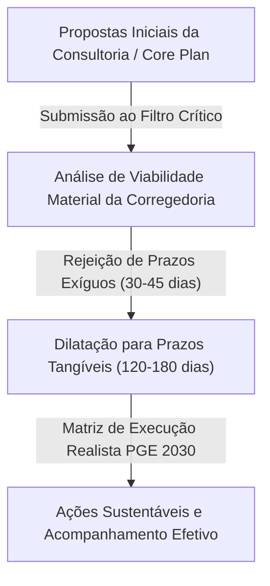
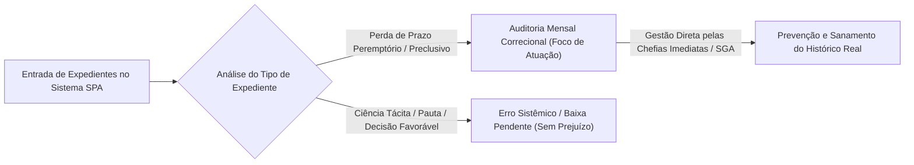
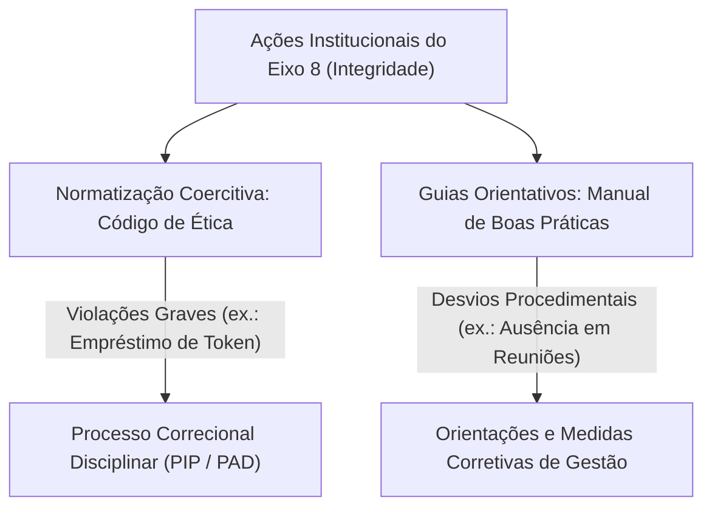

# Resumo de Reunião: 2024 - Planejamento Estratégico PGE 2030: Gestão de Metas e Governança na Corregedoria-Geral

## Ideia Central (Tese)
Este resumo exaustivo consolida o alinhamento estratégico entre a diretoria e a assessoria da Corregedoria-Geral da Procuradoria-Geral do Estado (PGE), reestruturando as metas institucionais para o horizonte 2030 a partir da filtragem crítica das diretrizes propostas na planilha oficial de ação [1, 9, 34, 98]. A reunião estabelece a transição de um modelo burocrático engessado para uma governança realista e focada na integridade preventiva, formalizada pela futura edição do Regimento Interno da Corregedoria, pela redefinição pragmática do programa de gestão de prazos processuais e pela atuação coexecutiva e integrada entre Corregedoria, Ouvidoria e Unidade Gestora de Integridade (UGI) [11, 28, 103, 137, 150].

---

## Tópico I: Contextualização e Alinhamento Metodológico do Planejamento PGE 2030

### 1.1. Diálogo Preliminar e Filtro de Exequibilidade Operacional
A exposição inicia-se com discussões informais sobre a rotina administrativa e a infraestrutura tecnológica disponível, destacando o acesso a arquivos de planejamento disponibilizados no serviço de nuvem da instituição [34]. Os interlocutores estabelecem imediatamente a premissa de que a proposta inicial formulada pela consultoria externa/PGA (Core Plan) consiste em uma **matriz de sugestões genéricas** — inspiradas em modelos de outras Procuradorias e órgãos judiciais —, exigindo uma curadoria rigorosa para adequar as metas à realidade material e de pessoal da Corregedoria-Geral [9, 35, 118, 125].

É enfatizado que metas estipuladas sem viabilidade prática geram desestímulo e descrédito institucional [36]. Dessa forma, prazos operacionais extremamente curtos (ex.: 30 ou 45 dias) previstos na minuta original foram estendidos para **120 a 180 dias**, garantindo que as ações sejam alcançáveis, tangíveis e mensuráveis sem comprometer o fluxo ordinário de trabalho [35, 36, 48, 84].

### 1.2. Hierarquia Estrutural do Planejamento Estratégico
Os interlocutores detalham a cadeia metodológica que conecta a visão de longo prazo às rotinas de trabalho das especializadas e da Corregedoria [9, 100]:

1. **Visão Estratégica (Horizonte 2030):** Declaração de valor institucional de alto nível (ex.: garantir a integridade, a transparência e a eficiência funcional) [100].
2. **Objetivos Estratégicos:** Desdobramentos temáticos de médio prazo formulados nos Eixos Estratégicos (Eixo 3 - Orçamento; Eixo 5 - Eficiência e Prazos; Eixo 8 - Integridade e Governança) [1, 5, 10, 21].
3. **Resultados-Chave (OKRs / KRs):** Metas quantitativas ou qualitativas com prazos determinados até 2030 que medem o sucesso dos objetivos [1, 10, 21, 100].
4. **Planos de Ação (Ações e Subações):** O nível operacional detalhado na planilha de execução, definindo **O Quê** (ação), **Como** (subação/recursos), **Quem** (responsáveis/coexecutores) e **Quando** (prazos) [9, 37, 50].

---

## Tópico II: Governança de Prazos Processuais e o Programa "Prazo Zero Perdido" (Eixo 5 - KR1)

### 2.1. Redefinição do Verbo da Meta e Conceito de Linha de Base
Na análise do KR1 do Eixo Estratégico 5, a redação original estipulava *"Manter em zero o número de prazos processuais judiciais peremptórios perdidos mensalmente"* [10, 35]. O Corregedor e a assessoria ajustaram formalmente o verbo para **"Reduzir a zero"** [35, 136]. A justificativa baseia-se na constatação de que a linha de base atual não se encontra zerada, sendo metodologicamente incorreto falar em "manter" um resultado ainda não atingido [35, 37, 136].

A **linha de base** foi conceituada como o levantamento do referencial histórico e estatístico que consolida falhas passadas de registro, prazos efetivamente perdidos e inconsistências do sistema [37, 115, 127].

### 2.2. Desmistificação das Estatísticas e Auditoria Focada em Prazos Peremptórios
Os interlocutores examinam o relatório do sistema SPA, que apontava superficialmente mais de 1.300 expedientes com "prazos vencidos" [42, 122]. O exame minucioso revelou que **mais de 90% desses registros não constituem perdas reais de prazos processuais** [42]. Trata-se de:
* **Falhas de captura ou de integração do sistema:** Falhas temporárias na rotina de recebimento de intimações automáticas [38, 42, 115].
* **Intimações inócuas ou sem carga probatória/preclusiva:** Meras ciências de inclusão de processos em pauta de julgamento, ciência de decisões favoráveis à Fazenda Pública ou intimações direcionadas à parte contrária [42, 43].
* **Ciência Tácita não baixada no sistema:** Situações em que o procurador toma conhecimento, mas deixa de armazenar/encerrar o expediente no sistema, gerando pendência fictícia [42, 43].

Por essa razão, descartou-se a proposta de realizar "auditoria mensal de perdas evitadas" — considerada uma métrica confusa e subjetiva (ex.: ligar para um procurador lembrando do prazo não permite quantificar com precisão científica uma "perda evitada") [40, 41, 122, 123]. Decidiu-se restringir o escopo do monitoramento para a **"auditoria/relatório mensal de prazos peremptórios e preclusivos efetivamente perdidos"** [42, 43, 44, 135].

### 2.3. Rejeição Veemente de Alertas Intrusivos (WhatsApp) e Descentralização da Responsabilidade
A minuta de planejamento sugeria a implantação de regimes de alerta via WhatsApp e notificações diretas ao Gabinete do Procurador-Geral e à Corregedoria sobre prazos prestes a vencer (métrica de "farol vermelho" / D1) [17, 18, 40, 120, 129, 130]. 

A proposta foi **rejeitada de forma contundente pelo Corregedor** pelos seguintes fundamentos [40, 124, 130, 132]:
1. **Dinâmica de Trabalho por Volume e Estratégia:** Procuradores que lidam com contencioso de massa costumam acumular e protocolar suas peças no último dia do prazo (D1), sem que isso signifique risco de perda [124, 130].
2. **Ambiente Hostil e Ineficiência:** O envio automatizado de mensagens de cobrança via WhatsApp gera irritação, clima de desconfiança e atrito desnecessário entre os órgãos de controle e os executores [66, 124, 130].
3. **Atribuição Correta da Gestão de Prazos:** O acompanhamento diário das caixas de processos é responsabilidade primária do **próprio procurador e da chefia imediata de cada Especializada/Subprocuradoria (SGA)** [15, 16, 44, 132]. A Corregedoria não deve funcionar como "central de alarmes", mantendo uma atuação correcional e consultiva focada no mapeamento de reincidências graves [44, 119, 128, 132].

---

## Tópico III: Governança de Integridade, Código de Ética e Boas Práticas (Eixo 8 - KR1 & KR2)

### 3.1. Distinção Conceitual: Código de Ética vs. Manual de Boas Práticas
Uma das contribuições mais profundas do debate refere-se à clara separação conceitual e jurídica entre o **Código de Ética** e o **Manual de Boas Práticas** [46, 50, 51, 143, 145, 148]:

| Dimensão | Código de Ética | Manual de Boas Práticas |
| :--- | :--- | :--- |
| **Natureza Jurídica** | Normativo, coercitivo e disciplinar [50, 145]. | Orientativo, educacional e de convivência [51, 148]. |
| **Foco de Atuação** | Ilícitos funcionais, infrações éticas e condutas sujeitas a sanções [50, 145]. | Recomendações procedimentais, boas rotinas de trabalho e ambiente saudável [51, 148]. |
| **Exemplos Práticos** | Proibição de compartilhamento de token de assinatura; vedação ao exercício da advocacia privada contra o Estado; vedação de residir fora do domicílio legal sem autorização [144, 145, 148]. | Obrigatoriedade de assiduidade e pontualidade em reuniões convocadas pela chefia; urbanidade no tratamento; uso adequado dos canais institucionais [147, 148]. |
| **Consequência da Violação** | Abertura de Processo Investigativo Preliminar (PIP) ou PAD/Sindicância [82, 106, 138, 145]. | Recomendações de saneamento, alinhamento institucional e medidas corretivas de gestão [22, 138, 148]. |

### 3.2. Fluxo Integrado de Denúncias (Ouvidoria, Corregedoria e UGI)
Debateu-se o fluxo de entrada de denúncias e representações relativas a desvios de conduta [28, 47, 64, 66, 149]. Ficou assentado que:
* O canal principal de entrada ativa e passiva para o público externo e formal é a **Ouvidoria-Geral** (via sistema e-Ouv / e-mail) [64, 67, 68, 74].
* Reclamações internas e informais sobre paralisia de processos entre procuradores costumam chegar diretamente à Corregedoria para resolução imediata [65, 66, 68]. O Corregedor destacou que muitas controvérsias operacionais são resolvidas por contato direto entre chefias sem a necessidade de instauração de procedimentos rígidos, o que evitaria a criação de um clima de hostilidade [65, 66].
* Para fins de governança, definiu-se a necessidade de alinhar uma **central de triagem** que classifique adequadamente o que é denúncia formal, reclamação de serviço ou pedido de orientação [47, 49, 64, 142].

### 3.3. Modelo de Coexecução Compartilhada e Escala Brasil Transparência (EBT)
Em relação aos responsáveis pela execução das ações de integridade (KR1 e KR2 do Eixo 8), o Corregedor rejeitou a indicação isolada da Corregedoria como "Líder Único" [38, 52, 140, 153]. Definiram-se como **coexecutores integrados**: Corregedoria-Geral, Ouvidoria-Geral, Unidade Gestora de Integridade (UGI) e o Comitê Permanente de Riscos Institucionais [28, 52, 150, 154].

Quanto à **Escala Brasil Transparência (EBT)** (Meta KR2 - pontuação mínima de 90 até 2030), foram explicadas as vertentes de **Transparência Ativa** (publicação espontânea de relatórios e dados institucionais no portal) e **Transparência Passiva** (atendimento às solicitações formuladas pela sociedade via LAI/Ouvidoria) [30, 74, 75, 83].

---

## Tópico IV: O Regimento Interno da Corregedoria e a Arquitetura Normativa Institucional

### 4.1. A Tese do Regimento Interno Único
O Corregedor apresentou como compromisso central de governança a elaboração do **Regimento Interno da Corregedoria-Geral** [102, 103, 104, 111]. O objetivo é unir e sistematizar em um único texto normativo os três eixos regulatórios fundamentais do órgão correcional [104, 111]:

```mermaid
graph TD
    A["Futuro Regimento Interno da Corregedoria-Geral"] --> B["1. Ritos dos Processos Correcionais (PIP + Punitivos + TAC)"]
    A --> C["2. Regulamento Atualizado do Estágio Probatório"]
    A --> D["3. Normatização de Correições Ordinárias e Extraordinárias"]
```

1. **Ritos do Processo Correcional e TAC:**
   - Formalização do **Processo Investigativo Preliminar (PIP)**: procedimento de apuração sumária e sigilosa, de caráter informativo e não punitivo [82, 103, 106].
   - Formalização dos procedimentos punitivos (Sindicância e Processo Administrativo Disciplinar - PAD) [82, 106].
   - Regulamentação do **Termo de Ajustamento de Conduta (TAC)** em matéria disciplinar funcional, conforme autorização deliberada pelo Conselho Superior da PGE [111].
2. **Estágio Probatório dos Procuradores:** Atualização da resolução interna para aprimorar os critérios de avaliação de desempenho, acompanhamento e adaptação funcional dos novos procuradores [104, 105, 111].
3. **Regulamentação das Correições Ordinárias e Extraordinárias:** Definição clara dos fluxos de inspeção, elaboração de relatórios estatísticos, matrizes de risco correcionais e prazos para saneamento pelas unidades correicionadas [31, 32, 81, 107].

### 4.2. Análise Comparativa de Estrutura Material e Pessoal
Durante a reunião, os interlocutores contrastaram a estrutura da Corregedoria-Geral da PGE-MA com a realidade de outros Estados (ex.: Rio Grande do Sul e Rondônia) [85, 86, 87, 94]:
* **Outros Estados:** Possuem prédios ou andares exclusivos para a Corregedoria, corpo numeroso de Corregedores Auxiliares dedicados, equipes extensas de assessores, auditórios modernos e salas de conselho estruturadas [86, 87, 94].
* **Realidade Local (PGE-MA):** A Corregedoria opera com estrutura extremamente enxuta (o próprio Corregedor com apoio direto reduzido), acumulando a realização de correições presenciais, instrução de processos disciplinares, gestão administrativa e rotinas operacionais de RH (aprovação de férias e substituições de procuradores) [93, 94, 95, 96].

Diante desse cenário, reiterou-se que o planejamento estratégico deve focar no automonitoramento viável e na padronização de fluxos via SEI, sem criar obrigações que superem a capacidade operacional do órgão [108, 116, 126].

---

## Tópico V: Matriz Completa do Plano de Ação Oficial (Eixos Estratégicos 3, 5 e 8)

A tabela abaixo consolida a totalidade dos dados contidos no documento de origem (`Plano_Acao_Corregedoria-Geral.pdf`), incorporando pontualmente todas as alterações, supressões de burocracia e redefinições de responsabilidades acertadas na reunião [1, 5, 10, 21, 35, 42, 52, 136]:

| Eixo Estratégico | Objetivo Estratégico | OKR / Meta (Ajustada) | Ação (O Quê) | Subação (Como) | Responsáveis (Quem) | Prazo (Quando) |
| :--- | :--- | :--- | :--- | :--- | :--- | :--- |
| **Eixo 3** – Orçamento Institutional | **Obj. 1** – Ampliar receitas e otimizar orçamento | **KR1:** Captar R$ 2 mi em recursos externos até 2029 [1]. | Auditar anualmente a aderência do eixo às metas de financiamento [1]. | Verificar captação, execução financeira, conformidade e PROFISCO III [2]. | **Coexecutores:** PGARI, Prof. Brasília, PGAAE, PGA, ESAP [2]. | Anual [2] |
| **Eixo 3** – Orçamento Institutional | **Obj. 1** – Ampliar receitas e otimizar orçamento | **KR2:** Executar 100% do orçamento anual planejado até 2030 [3]. | Auditar anualmente a aderência do eixo [3]. | Verificar execução orçamentária e alocação prioritária até o 3º tri [3]. | **Coexecutores:** PGARI, Prof. Brasília, PGAAE, PGA, ESAP [3]. | Anual [4] |
| **Eixo 3** – Orçamento Institutional | **Obj. 1** – Ampliar receitas e otimizar orçamento | **KR3:** Executar 100% dos recursos do PROFISCO III até 2030 [4]. | Auditar anualmente a aderência aos projetos do programa [4]. | Monitorar cumprimento dos marcos de investimento do PROFISCO III [4]. | **Coexecutores:** PGARI, Prof. Brasília, PGAAE, PGA, ESAP [5]. | Anual [5] |
| **Eixo 5** – Eficiência e Resolutividade | **Obj. 3** – Fortalecer a atuação preventiva | **KR1:** Reduzir em 15% novos litígios de grande impacto até 2030 [5]. | Criar normas internas de conformidade e compliance [6]. | Formalizar parâmetros de conduta administrativa para evitar erro repetitivo [6]. | **Coexecutores:** PGAAE, PGAAJ, Dívida Ativa, Contencioso, Execuções, Especializadas [6, 7]. | 180 dias [7] |
| **Eixo 5** – Eficiência e Resolutividade | **Obj. 3** – Fortalecer a atuação preventiva | **KR2:** Reduzir em 30% litígios evitáveis em 5 secretarias até 2030 [7]. | Criar orientação interna de conformidade para temas recorrentes [8]. | Elaborar manuais de orientação jurídica e padronização de condutas [8]. | **Coexecutores:** PGAAE, PGAAJ, Dívida Ativa, Especializadas, Regionais [8, 9]. | 180 dias [9] |
| **Eixo 5** – Eficiência e Resolutividade | **Obj. 6** – Tratamento dos prazos processuais | **KR1:** Reduzir a zero os prazos peremptórios perdidos mensalmente até 2030 [10, 35]. | Instituir o Programa "Prazo Zero Perdido" [11, 35]. | Editar ato interno formalizando a governança de prazos por unidade [11]. | **Coexecutores:** Chefias de Especializadas, Subprocuradoria, Corregedoria, PGAAJ [12, 132]. | 120 dias [35] |
| **Eixo 5** – Eficiência e Resolutividade | **Obj. 6** – Tratamento dos prazos processuais | **KR1:** Reduzir a zero os prazos peremptórios perdidos mensalmente até 2030 [10, 35]. | Levantar a linha de base real de prazos perdidos [13, 37]. | Consolidar histórico mensal de perdas reais e falhas de captura [13, 37]. | **Coexecutores:** SGA, Corregedoria, PGAAJ, Chefias de Unidades [14, 44]. | 120 dias [35] |
| **Eixo 5** – Eficiência e Resolutividade | **Obj. 6** – Tratamento dos prazos processuais | **KR1:** Reduzir a zero os prazos peremptórios perdidos mensalmente até 2030 [10, 35]. | Implantar conferência diária por unidade dos atos pendentes [15, 39]. | Criar rotina diária na agenda/caixa de processos e supervisão pela chefia [15, 132]. | **Coexecutores:** Procuradores executores e Chefias Imediatas de Unidades [16, 132]. | Após o programa [39] |
| **Eixo 5** – Eficiência e Resolutividade | **Obj. 6** – Tratamento dos prazos processuais | **KR1:** Reduzir a zero os prazos peremptórios perdidos mensalmente até 2030 [10, 35]. | Realizar relatório/auditoria mensal de prazos preclusivos perdidos [20, 42]. | Verificar causa-raiz de perdas efetivas (falha humana ou sistêmica) [20, 43]. | **Coexecutores:** Corregedoria-Geral, Subprocuradoria, Chefias [21, 44]. | Mensal [21, 40] |
| **Eixo 8** – Integridade e Resp. Social | **Obj. 2** – Governança, Integridade e Transparência | **KR1:** Apurar 100% dos desvios de conduta reportados no prazo legal até 2030 [21, 45]. | Estabelecer ato normativo com critérios objetivos de conduta [22, 50]. | Formalizar norma distinguindo denúncia, reclamação e desvio funcional [22, 49, 51]. | **Coexecutores:** Corregedoria-Geral, Ouvidoria-Geral, UGI, Comitê de Riscos [22, 52]. | 180 dias [48] |
| **Eixo 8** – Integridade e Resp. Social | **Obj. 2** – Governança, Integridade e Transparência | **KR1:** Apurar 100% dos desvios de conduta reportados no prazo legal até 2030 [21, 45]. | Coletar linha de base de desvios e ocorrências registradas [23, 54]. | Levantar dados históricos disponíveis, classificando recorrência e desfecho [23, 54]. | **Coexecutores:** Corregedoria, Ouvidoria, UGI [23, 52]. | 180 dias [48] |
| **Eixo 8** – Integridade e Resp. Social | **Obj. 2** – Governança, Integridade e Transparência | **KR1:** Apurar 100% dos desvios de conduta reportados no prazo legal até 2030 [21, 45]. | Elaborar e implantar o Manual de Boas Práticas da PGE [24, 58]. | Consolidar diretrizes de convivência, urbanidade e rotinas funcionais [24, 58, 148]. | **Coexecutores:** UGI, Ouvidoria, Corregedoria, ASCOM [24, 60, 139]. | 150 dias [32] |
| **Eixo 8** – Integridade e Resp. Social | **Obj. 2** – Governança, Integridade e Transparência | **KR1:** Apurar 100% dos desvios de conduta reportados no prazo legal até 2030 [21, 45]. | Realizar campanha institucional de integridade [25, 60]. | Difundir o Manual de Boas Práticas e o Código de Ética via ASCOM [25, 60]. | **Coexecutores:** ASCOM, Ouvidoria, UGI, Corregedoria (Consultivo) [25, 60, 62]. | 180 dias [25] |
| **Eixo 8** – Integridade e Resp. Social | **Obj. 2** – Governança, Integridade e Transparência | **KR1:** Apurar 100% dos desvios de conduta reportados no prazo legal até 2030 [21, 45]. | Implantar trilha formativa obrigatória em integridade [26, 61]. | Ofertar workshops e capacitações curtas sobre ética e prevenção [26, 61, 149]. | **Coexecutores:** ESAP, ASCOM, UGI, Ouvidoria, Corregedoria [26, 62, 63]. | Semestral [26, 63] |
| **Eixo 8** – Integridade e Resp. Social | **Obj. 2** – Governança, Integridade e Transparência | **KR1:** Apurar 100% dos desvios de conduta reportados no prazo legal até 2030 [21, 45]. | Integrar Ouvidoria, Corregedoria, UGI e Comitê de Riscos [28, 150]. | Realizar reuniões periódicas para alinhar riscos e ações preventivas [28, 150]. | **Coexecutores:** Comitê Permanente de Riscos, UGI, Ouvidoria, Corregedoria [29, 150, 154]. | Bimestral [29] |
| **Eixo 8** – Integridade e Resp. Social | **Obj. 2** – Governança, Integridade e Transparência | **KR2:** Atingir nota 90 no ranking de transparência EBT até 2030 [30, 83]. | Instituir painel executivo de transparência e integridade [29, 73]. | Consolidar dados de transparência ativa/passiva, EBT e relatórios [30, 74, 80]. | **Coexecutores:** PGA/SGA, Ouvidoria, Corregedoria, UGI [30, 76, 80]. | 180 dias [30] |
| **Eixo 8** – Integridade e Resp. Social | **Obj. 2** – Governança, Integridade e Transparência | **KR3:** Reduzir em 40% a reincidência de não conformidades nas correições [31]. | Coletar linha de base dos achados de correição [31, 88]. | Sistematizar achados históricos por tipo, frequência e unidade [31, 88]. | **Coexecutores:** Corregedoria-Geral [31, 91]. | 180 dias [84] |
| **Eixo 8** – Integridade e Resp. Social | **Obj. 2** – Governança, Integridade e Transparência | **KR3:** Reduzir em 40% a reincidência de não conformidades nas correições [31]. | Criar matriz de risco correcional e plano por unidade [32, 89]. | Classificar impactos e probabilidades para gerar planos de contingência [32, 89, 90]. | **Coexecutores:** Corregedoria-Geral e Chefias de Unidades [32, 91, 93]. | 150 dias [32] |
| **Eixo 8** – Integridade e Resp. Social | **Obj. 2** – Governança, Integridade e Transparência | **KR3:** Reduzir em 40% a reincidência de não conformidades nas correições [31]. | Monitorar a execução das recomendações correcionais [33, 92]. | Acompanhar o saneamento de pendências em até 90 dias pós-correição [33, 92]. | **Coexecutores:** Corregedoria-Geral [33, 91, 92]. | 90 dias pós-correição [92] |

---

## Anexo: Explicações Detalhadas de Todas as Citações Numeradas

Abaixo segue o rol explicativo individualizado para cada um dos índices numéricos citados ao longo deste documento, assegurando total rastreabilidade com as fontes originais (`Plano_Acao_Corregedoria-Geral.pdf`, `Rua Fortaleza, 25 8.m4a` e `Rua Fortaleza, 25 10.m4a`):

1. **[1]** Refere-se à estrutura do Eixo Estratégico 3 (Orçamento), Objetivo 1, e KR1 (captação de R$ 2 milhões em recursos externos até 2029) na planilha oficial.
2. **[2]** Indica a subação de verificação de captação, regularidade e PROFISCO III, sob coexecução da PGARI, Procuradoria de Brasília, PGAAE, PGA e ESAP.
3. **[3]** Refere-se ao KR2 do Eixo 3, focado em garantir 100% de execução do orçamento anual planejado da PGE com alocação no 3º trimestre.
4. **[4]** Refere-se ao KR3 do Eixo 3, voltado para a execução integral do programa PROFISCO III até 2030.
5. **[5]** Refere-se ao Eixo Estratégico 5, Objetivo 3, KR1 (redução de 15% em novos litígios de grande impacto econômico e social).
6. **[6]** Detalha a ação de criação de normas e orientações de conformidade/compliance para matérias sensíveis e recorrentes.
7. **[7]** Define o prazo de 180 dias e os coexecutores das procuradorias especializadas e regionais para o fortalecimento da atuação preventiva.
8. **[8]** Refere-se ao KR2 do Eixo 5 (redução de 30% em litígios evitáveis em 5 secretarias estratégicas via padronização de condutas).
9. **[9]** Apresenta o trecho conceitual do Plano de Ação (O Quê, Como, Quem e Quando) como metodologia para atingimento das metas OKR.
10. **[10]** Refere-se ao KR1 do Objetivo 6 do Eixo 5 na redação original da planilha ("Manter em zero o número de prazos processuais perdidos").
11. **[11]** Detalha a proposta inicial de instituição do Programa "Prazo Zero Perdido" mediante ato de governança.
12. **[12]** Aponta o rol extenso de coexecutores propostos para a governança de prazos na planilha original.
13. **[13]** Refere-se à subação de levantamento da linha de base real de prazos perdidos e falhas de captura de expedientes.
14. **[14]** Indica a lista de unidades responsáveis pela consolidação do histórico mensal de falhas e prazos no planejamento inicial.
15. **[15]** Refere-se à subação de criação de rotina diária de conferência em agenda/caixa de processos do procurador.
16. **[16]** Aponta a responsabilidade compartilhada pela supervisão diária dos atos pendentes.
17. **[17]** Refere-se à proposta original de instalação de regime de alerta escalonado para chefias e Administração Superior.
18. **[18]** Detalha o mecanismo de escalonamento para casos críticos de perda de prazo em até 120 dias.
19. **[19]** Aponta as unidades envolvidas no regime de alerta escalonado.
20. **[20]** Refere-se à proposta de realização de auditoria mensal de prazos críticos e perdas evitadas.
21. **[21]** Aponta a periodicidade mensal da auditoria correcional e introduz a meta KR1 do Eixo Estratégico 8 (100% de apuração dos desvios reportados).
22. **[22]** Refere-se à subação de revisão metodológica do indicador de desvios de conduta e edição de nota técnica em 90 dias.
23. **[23]** Detalha a subação de coleta da linha de base de desvios de conduta e ocorrências confirmadas.
24. **[24]** Refere-se à ação de elaboração e implantação do Manual de Boas Práticas da PGE em 150 dias.
25. **[25]** Detalha a ação de realização de campanha institucional de integridade e convivência em 180 dias.
26. **[26]** Refere-se à implantação de trilha formativa obrigatória em integridade oferecida semestralmente.
27. **[27]** Detalha a criação de rotina de análise preventiva de reincidência de desvios com monitoramento trimestral.
28. **[28]** Refere-se à integração periódica (bimestral) da Ouvidoria, Corregedoria, UGI e CEDI em circuito preventivo.
29. **[29]** Detalha a criação do painel executivo do eixo de integridade para reunir indicadores institucionais.
30. **[30]** Refere-se ao KR2 do Eixo 8 (atingir pontuação 90 na Escala Brasil Transparência - EBT) e à produção de relatório semestral.
31. **[31]** Refere-se ao KR3 do Eixo 8 (redução de 40% na reincidência de não conformidades identificadas em correições ordinárias).
32. **[32]** Detalha a criação de matriz de risco de correição com plano corretivo por unidade em 150 dias.
33. **[33]** Refere-se ao monitoramento semestral da execução das recomendações correcionais e saneamento de riscos.
34. **[34]** Transcreve o início do áudio `Rua Fortaleza, 25 10.m4a`, registrando o diálogo informal prévio e o acesso aos arquivos no OneDrive.
35. **[35]** Registra a alteração fundamental da meta de prazos de "manter em zero" para "reduzir a zero", além da estipulação de prazos de 120 dias.
36. **[36]** Destaca o debate sobre a necessidade de metas tangíveis e alcançáveis para evitar desestimular a equipe.
37. **[37]** Explica o conceito técnico de "linha de base" como o referencial histórico indispensável quando não se possui histórico estruturado.
38. **[38]** Registra a discussão sobre falhas de captura no sistema SPA/Core Plan e a rejeição da figura de um "Líder Único".
39. **[39]** Registra o ajuste do prazo de implementação de imediato para "após a implementação efetiva do programa".
40. **[40]** Aborda a rejeição de alertas automatizados por WhatsApp e a dificuldade conceitual de medir "perdas evitadas".
41. **[41]** Registra a constatação de que mensurar "prazo evitado" é excessivamente subjetivo, sugerindo a remoção do termo.
42. **[42]** Esclarece que a imensa maioria dos 1.300 prazos "vencidos" no sistema decorre de erros de sistema ou ciências irrelevantes.
43. **[43]** Define que a auditoria deve focar exclusivamente em "prazos preclusivos/peremptórios" onde houve efetiva perda com prejuízo.
44. **[44]** Define a substituição do termo auditoria por "consolidação em relatório" e afasta a chefia do contencioso judicial da liderança direta dessa ação.
45. **[45]** Transiciona a discussão no áudio para as metas do Eixo 8 (Integridade) e supressão da vinculação exclusiva ao manual.
46. **[46]** Discute a necessidade de conceituar objetivamente o que é desvio de conduta versus práticas que não se alinham ao manual.
47. **[47]** Menciona a experiência de triagem unificada de manifestações na Ouvidoria do Tribunal de Justiça.
48. **[48]** Registra o ajuste do prazo da revisão metodológica e nota técnica de integridade para 180 dias.
49. **[49]** Sugere simplificar a norma para um ato regulamentar interno com critérios objetivos que distinga denúncia de mera orientação.
50. **[50]** Estabelece a ligação direta entre o ato normativo interno e o Código de Ética da instituição.
51. **[51]** Explica a diferença prática: Código de Ética para ilícitos sancionáveis e Manual de Boas Práticas para diretrizes de convivência.
52. **[52]** Define a inclusão de coexecutores integrados (Corregedoria, Ouvidoria e UGI) para as ações de integridade.
53. **[53]** Registra a observação do Corregedor de que a responsabilidade pela liderança deve ser bem definida e compartilhada.
54. **[54]** Aborda a relação cronológica entre levantar a linha de base histórica de ocorrências e editar o ato normativo.
55. **[55]** Registra o debate sobre a campanha de comunicação e o papel puramente consultivo da Corregedoria em ações educativas.
56. **[56]** Discute o preenchimento da coluna de recursos/insumos (pessoal, tempo e financeiro) exigidos nas subações.
57. **[57]** Alerta para o risco de redundância ao citar atos específicos na subação antes da consolidação do manual.
58. **[58]** Debate a ordem cronológica entre a aprovação do normativo de critérios e a edição final do Manual de Boas Práticas.
59. **[59]** Conclui que a coleta prévia de dados é o insumo principal para embasar a elaboração do manual e do ato.
60. **[60]** Define que a ASCOM e a Ouvidoria devem liderar a campanha institucional, cabendo à Corregedoria papel consultivo.
61. **[61]** Explica o conceito de "trilha formativa" como capacitações curtas, workshops e cursos contínuos em integridade.
62. **[62]** Registra a inclusão da ASCOM como coexecutora para garantir a divulgação e cobertura das trilhas formativas.
63. **[63]** Estabelece que ações recorrentes (como a trilha formativa) devem ter periodicidade definida (ex.: semestral).
64. **[64]** Discute a necessidade de estabelecer um fluxo centralizado de recepção de denúncias pela Ouvidoria para triagem.
65. **[65]** O Corregedor relata que reclamações de procuradores sobre atrasos de colegas costumam ser resolvidas informalmente por telefone.
66. **[66]** Explica que a formalização excessiva de pequenas reclamações entre colegas pode gerar um ambiente de trabalho hostil.
67. **[67]** Sugere que a formalização via sistema deve focar principalmente nas demandas oriundas do público externo.
68. **[68]** Esclarece que manifestações externas entram pelo sistema e-Ouv, enquanto contatos internos ocorrem por e-mail e contatos diretos.
69. **[69]** Discute a tentativa de criar um indicador de satisfação do usuário para o atendimento de reclamações.
70. **[70]** Conclui que a ideia central é gerar relatórios estatísticos de reclamações para subsidiar medidas de prevenção.
71. **[71]** Garante que o levantamento de reclamações internas deve ser sigiloso, sem expor os nomes dos procuradores envolvidos.
72. **[72]** Menciona a proposta prévia de criar um módulo sigiloso no sistema para registro correcional do dossiê funcional.
73. **[73]** Transiciona para a discussão sobre a instituição do Painel Executivo do Eixo de Integridade com gráficos visuais.
74. **[74]** Conceitua a Escala Brasil Transparência (EBT) e explica as diferenças entre Transparência Ativa e Transparência Passiva.
75. **[75]** Detalha os critérios de avaliação da EBT aplicados aos relatórios anuais da Procuradoria-Geral.
76. **[76]** Compara a avaliação da EBT ao prêmio de transparência do CNJ e define a PGA/SGA como liderança do painel.
77. **[77]** Esclarece que a TI/Informática possui papel estritamente de suporte e infraestrutura tecnológica, não de liderança estratégica.
78. **[78]** Confirma que a criação de dashboards e relatórios de dados será executada pelas próprias equipes de gestão (Core Plan/PGA).
79. **[79]** Define que o painel de integridade deve abranger indicadores de conformidade de toda a PGE, e não apenas da Corregedoria.
80. **[80]** Consolida a produção do relatório semestral integrado reunindo dados estatísticos da UGI, Ouvidoria e Corregedoria.
81. **[81]** Esclarece a diferença conceitual crítica: Correção Ordinária (inspeção no setor) versus Processo Correcional (apuração de infração).
82. **[82]** Define que o Processo Correcional é gênero que abrange o Processo Investigativo Preliminar (PIP) e os processos punitivos (Sindicância/PAD).
83. **[83]** Reitera que a meta EBT de 90 pontos é uma diretriz de conformidade legal ampla para a instituição.
84. **[84]** Registra a alteração de prazos das ações de correição para 180 dias e sugere a criação de premiação/selo de eficiência interna.
85. **[85]** Menciona o exemplo de uso dos Objetivos de Desenvolvimento Sustentável (ODS/ONU) em outras Procuradorias.
86. **[86]** O Corregedor destaca a discrepância entre o volume de trabalho realizado localmente e a estrutura enxuta disponível.
87. **[87]** Relata a infraestrutura diferenciada observada em visitas institucionais a Procuradorias de outros Estados.
88. **[88]** Define a ação de sistematizar dados históricos das correições a partir de 2022/2023 para montar a linha de base.
89. **[89]** Explica a estrutura da Matriz de Risco Correcional, cruzando probabilidade de ocorrência e impacto institucional.
90. **[90]** Explica que falhas recorrentes de baixo impacto ficam na zona amarela da matriz, enquanto alto impacto exige plano de contingência.
91. **[91]** Define a Corregedoria-Geral como executora direta das ações do KR3 (redução de não conformidades correcionais).
92. **[92]** Estabelece que o monitoramento pós-correição deve ocorrer em até 90 dias após a entrega do relatório à unidade.
93. **[93]** O Corregedor relata a rotina de solicitar planos de ação às unidades correicionadas e a necessidade de prazos delimitados.
94. **[94]** Registra a comparação com a Corregedoria do RS, que conta com prédio próprio, diversos corregedores auxiliares e estrutura dedicada.
95. **[95]** Defende a sistematização dos planos de ação correcionais via SEI para que o sistema notifique automaticamente os prazos.
96. **[96]** Registra o acúmulo de atribuições na Corregedoria local, incluindo a gestão administrativa de férias e substituições de procuradores.
97. **[97]** Conclui a sessão de trabalho registrada no áudio `Rua Fortaleza, 25 10.m4a`, com o encaminhamento da planilha ajustada.
98. **[98]** Transcreve o início do áudio `Rua Fortaleza, 25 8.m4a`, registrando o trabalho de curadoria anterior realizado com a assessoria.
99. **[99]** Registra o enxugamento e redução do número excessivo de metas que constavam da proposta original.
100. **[100]** Explica a encadeamento lógico do planejamento: princípio/visão de futuro \(\rightarrow\) objetivos de médio prazo \(\rightarrow\) KRs e ações diárias.
101. **[101]** O Corregedor manifesta o desejo pragmático de encerrar a fase de planejamento e focar na execução real.
102. **[102]** Destaca a importância de focar a governança em elementos práticos e necessários para a Corregedoria.
103. **[103]** Apresenta a tese da criação do Regimento Interno da Corregedoria-Geral como legado estruturante de governança.
104. **[104]** Detalha os três pilares do Regimento: normas de processos correcionais, estágio probatório e correições ordinárias.
105. **[105]** Explica a necessidade de atualizar a resolução vigente sobre o Estágio Probatório dos Procuradores.
106. **[106]** Esclarece a distinção entre a fase investigativa preliminar (PIP, sem caráter punitivo) e a fase disciplinar punitiva.
107. **[107]** Registra a ausência de normas procedimentais explícitas na legislação estadual para a fase investigativa, exigindo regulamentação própria.
108. **[108]** Menciona a obrigatoriedade de tramitação dos processos administrativos no sistema SEI por força de Instrução Normativa estadual.
109. **[109]** Afirma a necessidade de a Procuradoria-Geral possuir um Código de Ética próprio alinhado ao eixo de integridade.
110. **[110]** Registra a tentativa prévia de elaborar a minuta do Código de Ética junto à Unidade Gestora de Integridade.
111. **[111]** Anuncia a inclusão da regulamentação do Termo de Ajustamento de Conduta (TAC) em matéria disciplinar por delegação do Conselho Superior.
112. **[112]** Reitera que o Código de Ética deve constituir documento autônomo, não devendo ser fundido ao Regimento Interno.
113. **[113]** Explica como as metas gerais são desdobradas em ações concretas do dia a dia na planilha de trabalho.
114. **[114]** Revisa a subação do programa de governança de prazos e o papel de orientação da Corregedoria.
115. **[115]** Aborda a dificuldade de obter dados históricos de falhas do sistema SPA junto à TI sem a colaboração dos procuradores.
116. **[116]** O Corregedor aponta que a escassez de recursos humanos impede a assunção de rotinas burocráticas excessivas.
117. **[117]** Mostra a tela de acompanhamento de prazos e a sobrecarga de trabalho absorvida pela equipe correcional.
118. **[118]** Defende a formação de grupos de trabalho preventivos para evitar a atuação meramente reativa de "enxugar gelo".
119. **[119]** O Corregedor ressalta que a Corregedoria não deve assumir a liderança da cobrança diária de prazos individuais.
120. **[120]** Discute a existência de ferramentas nativas no sistema SPA para controle de prazos pelos próprios procuradores.
121. **[121]** Analisa a minuta do Eixo Estratégico 5 trazida pela consultoria e realiza os cortes necessários.
122. **[122]** O Corregedor expressa rejeição a conceitos vagos ou gerados por ferramentas automatizadas sem explicitação clara.
123. **[123]** Aponta que ligar no último dia do prazo para avisar um procurador não é uma prática viável na rotina real do contencioso.
124. **[124]** Explica que procuradores experientes gerenciam estrategicamente suas bancas e protocolam nos momentos finais por volume.
125. **[125]** Reitera que as propostas trazidas na planilha eram sugestões de consultoria que exigiam aprovação ou rejeição fundamentada.
126. **[126]** Elimina sugestões burocráticas sem aderência prática e aprova a manutenção de fluxos simplificados no SEI.
127. **[127]** Afirma que a responsabilidade primária pelo acompanhamento de prazos de cada setor é do respetivo Procurador-Chefe.
128. **[128]** Define que o papel da Corregedoria na gestão de prazos das especializadas deve ser estritamente consultivo.
129. **[129]** Discute a proposta de "regime de alerta escalonado" e sinalização por cores (verde, amarelo e vermelho).
130. **[130]** Rejeita o envio de alertas por WhatsApp para procuradores, prevendo reação negativa e ineficácia da medida.
131. **[131]** Rejeita o envio de alertas de "casos críticos" para o Gabinete do Procurador-Geral, por gerar sobrecarga desnecessária.
132. **[132]** Define que o controle de prazos críticos deve restringir-se ao âmbito interno das chefias imediatas de cada especializada.
133. **[133]** Confirma que o sistema SPA já possui painel nativo de prazos, dispensando novas ferramentas intrusivas.
134. **[134]** O interlocutor relata a preferência do Procurador-Geral por painéis de controle, mas concorda com a restrição dos alertas.
135. **[135]** Mantém a ação de auditoria/relatório mensal de prazos perdidos já realizada no âmbito do Comitê de Riscos.
136. **[136]** O Corregedor determina formalmente a alteração da redação da meta para "Reduzir a zero" os prazos perdidos até 2030.
137. **[137]** Esclarece a diferença entre aplicação de sanção disciplinar correcional e adoção de medidas corretivas de gestão.
138. **[138]** Explica que a medida corretiva no Manual de Boas Práticas visa sanar a irregularidade procedimental sem necessariamente punir.
139. **[139]** Define a Unidade Gestora de Integridade (UGI) como responsável principal pela elaboração do Manual de Boas Práticas.
140. **[140]** O Corregedor rejeita a indicação de "Líder Único" para as ações de integridade, preferindo a coexecução colegiada.
141. **[141]** Relata com humor as interações operacionais e a dinâmica de comunicação interna com a Ouvidoria-Geral.
142. **[142]** Reafirma que o Manual de Boas Práticas definirá os critérios objetivos para diferenciar erro formal de conduta ilícita.
143. **[143]** Esclarece que o Manual de Boas Práticas e o Código de Ética são documentos distintos, porém complementares.
144. **[144]** Exemplifica condutas a serem regulamentadas, como o uso estritamente pessoal e intransferível do token de assinatura.
145. **[145]** Explica que a violação das vedações do Código de Ética sujeita o infror às sanções disciplinares previstas em lei.
146. **[146]** Enfatiza a necessidade de estabelecer critérios claros e objetivos para evitar julgamentos subjetivos em matérias éticas.
147. **[147]** Exemplifica regras de boas práticas, como o dever de comparência e participação ativa em reuniões de alinhamento.
148. **[148]** Define o Manual de Boas Práticas como uma "cartilha de convivência e urbanidade" para o ambiente de trabalho.
149. **[149]** Defende a realização de cursos e workshops instrutivos para apresentar os manuais e códigos a toda a carreira.
150. **[150]** Apoia a integração sistêmica das rotinas da Corregedoria, Ouvidoria e UGI no âmbito do Comitê de Riscos.
151. **[151]** O Corregedor ratifica que a atuação em integridade deve ser formalizada como coexecução colegiada.
152. **[152]** Explica o conceito de "Líder" na metodologia como o responsável por prestart contas do andamento da ação.
153. **[153]** Aponta que designar a Corregedoria como "Líder Único" faz com que os demais setores se isentem da execução.
154. **[154]** Registra que o Comitê Permanente de Riscos Institucionais é presidido pelo Procurador-Geral do Estado.
155. **[155]** Acorda com a assessoria o encerramento da revisão e a consolidação final dos documentos no processo SEI.
156. **[156]** Define o cronograma de reuniões subsequentes para formalização do despacho e envio ao Gabinete.
157. **[157]** Conclui a gravação do áudio `Rua Fortaleza, 25 8.m4a`, selando o alinhamento do planejamento estratégico da Corregedoria-Geral.
