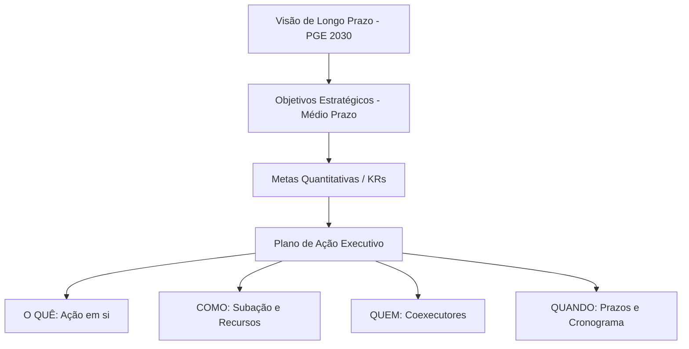
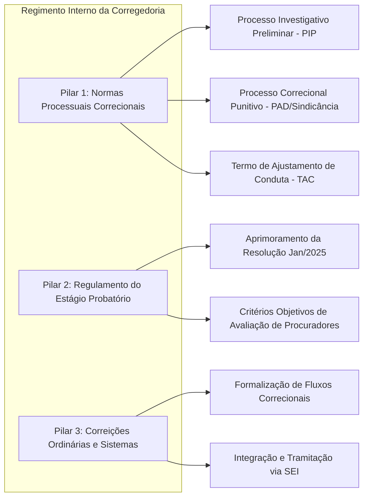
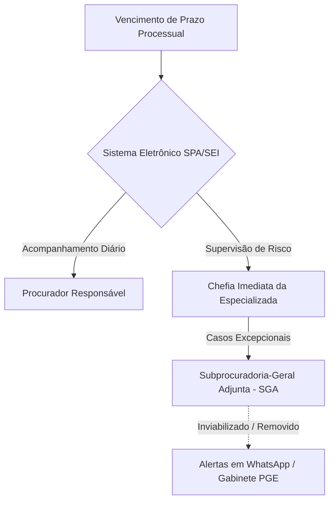

# Resumo do Evento: Planejamento Estratégico 2030 e Governança da Corregedoria-Geral da PGE

## Ideia Central (Tese)
A reunião de alinhamento estratégico entre a Corregedoria-Geral e a equipe de assessoria de planejamento buscou harmonizar as metas institucionais do Plano PGE 2030 com a realidade pragmática dos serviços correcionais e processuais, enxugando compromissos burocráticos excessivos para focar em entregas de alto impacto [34, 35]. O encontro delibera sobre a estruturação do futuro Regimento Interno da Corregedoria [38, 40], a distinção normativa entre o Código de Ética e o Manual de Boas Práticas [45, 79, 81], e a redefinição do programa "Prazo Zero Perdido" [50, 72], substituindo alertas intrusivos por governança preventiva descentralizada e coexecução intersetorial [68, 88].

---

## Desenvolvimento Detalhado e Estruturado

### Tópico I: Curadoria de Metas, Arquitetura do Planejamento PGE 2030 e Papel da Corregedoria

#### 1. Metodologia de Curadoria e Enxugamento
O planejamento estratégico da Procuradoria-Geral do Estado (PGE-MA) rumo a 2030 passou por um rigoroso filtro de viabilidade promovido pela equipe técnica [34]. O interlocutor técnico (Bruno) relata que reuniões prévias com diversas lideranças da casa — como Dr. Denis, Dr. Marcos, Dr. Marcelo e Dr. Céu — resultaram no corte substancial de metas redundantes ou irrealistas [34, 57, 58]. O objetivo foi evitar o estrangulamento operacional dos setores e garantir que cada compromisso assumido possua correspondência direta com a rotina funcional [37, 52].

#### 2. Hierarquia Conceitual do Planejamento
A estrutura metodológica apresentada desdobra-se em quatro níveis encadeados de forma lógica [36, 49]:
* **Visão de Longo Prazo (2030):** Princípios norteadores e aspirações institucionais de caráter qualitativo e abrangente (ex.: "Garantir a integridade e a responsabilidade social") [36].
* **Objetivos Estratégicos (Médio Prazo):** Desdobramentos temáticos que direcionam a atuação institucional (ex.: "Fortalecer a Governança, a Integridade e a Transparência") [36].
* **Resultados-Chave / Metas (KRs - Key Results):** Indicadores quantitativos temporais que mensuram o sucesso dos objetivos (ex.: "Reduzir em 40% a reincidência de não conformidades") [36, 31].
* **Planos de Ação (Ações e Subações):** O nível operacional detalhado na planilha de execução, definindo **O Quê** (ação), **Como** (subação/recursos), **Quem** (responsáveis/coexecutores) e **Quando** (prazos) [9, 37, 50].

#### 3. Caráter Transversal e Função Consultiva da Corregedoria
Ficou estabelecido que nenhuma das metas estratégicas pertence de forma exclusiva e isolada à Corregedoria-Geral [38]. As metas perpassam múltiplos setores da Procuradoria [38]. Em diversas frentes — especialmente no tocante ao controle de prazos processuais e integridade —, a Corregedoria atuará precipuamente em caráter **consultivo, orientativo ou coexecutor**, sem assumir a carga operacional primária de competência das Procuradorias Especializadas ou da Subprocuradoria-Geral Adjunta (SGA) [38, 64].

---

### Tópico II: O Regimento Interno da Corregedoria e seus Três Pilares Fundamentais

#### 1. Necessidade de Consolidação Normativa
O Corregedor-Geral destacou que a consolidação de um **Regimento Interno da Corregedoria** é a principal entrega estruturante de governança a ser inserida no Plano de Ação [38, 39, 40]. Atualmente, a normatização interna encontra-se fragmentada ou ausente em pontos críticos, sendo imperativo reunir as regras correcionais em um único instrumento regulatório robusto até 2030 [40, 41, 47].

#### 2. Os Três Pilares do Regimento Interno
O Regimento Interno abrangerá três eixos temáticos essenciais [40, 42, 43]:

* **Pilar 1: Normas Processuais Correcionais (Código Processual Interno):**
  * *Distinção de Fases:* Normatização clara da **fase investigativa preliminar (PIP)** — voltada à apuração sumária sem caráter punitivo imediato — e da **fase punitiva formal** (processos administrativos disciplinares e sindicâncias) [42].
  * *Lacuna Normativa:* O Corregedor ressalta que o processo investigativo preliminar não possui previsão na Lei Estadual nº 6.107/94 (Estatuto dos Servidores) ou em normas locais, sendo executado de forma ad hoc com base em diretrizes da CGU ou jurisprudência de outras Procuradorias Estaduais [42, 43].
  * *Inclusão do TAC:* Regulamentação do **Termo de Ajustamento de Conduta (TAC)** no âmbito correcional [47]. Embora dependa idealmente de reserva legal, o Conselho Superior da PGE deliberou pela normatização regulamentar interna prévia [47].
* **Pilar 2: Regulamento do Estágio Probatório dos Procuradores:**
  * Revisão e aprimoramento da Resolução editada em janeiro de 2025 [40, 41]. A atualização visa conferir maior rigor, transparência e objetividade à avaliação do desempenho funcional dos novos Procuradores do Estado [40, 47].
* **Pilar 3: Normatização das Correições Ordinárias:**
  * Formalização dos procedimentos, rotinas e fluxos de correição nas unidades da PGE [40, 43].
  * *Limitação Tecnológica e Trâmite no SEI:* Questionado sobre a adoção de sistemas informatizados próprios para agendamentos correcionais, o Corregedor esclareceu que a Instrução Normativa da Secretaria de Estado da Transparência e Controle (STC) obriga que todos os processos administrativos corram exclusivamente dentro do Sistema Eletrônico de Informações (SEI) [44]. Eventuais ferramentas tecnológicas deverão atuar apenas como interfaces geradoras de documentos para inserção no SEI [44].

---

### Tópico III: Integridade Institucional – Código de Ética vs. Manual de Boas Práticas

#### 1. Diferenciação Conceitual e Normativa
Um dos pontos de maior densidade conceitual da reunião foi a distinção entre o **Código de Ética e Conduta** e o **Manual de Boas Práticas** [45, 74, 79, 81]. Ficou demonstrado que, embora complementares no âmbito do Programa de Integridade, os documentos possuem naturezas jurídicas e objetivos pedagógicos distintos [78, 79, 81]:

| Critério | Código de Ética e Conduta | Manual de Boas Práticas |
| :--- | :--- | :--- |
| **Natureza Jurídica** | Normativa, coercitiva e disciplinar [81]. | Pedagógica, orientativa e comportamental [24, 84]. |
| **Foco de Atuação** | Ilícitos funcionais, proibições legais e sanções [74, 81]. | Convivência institucional, respeito e rotinas [24, 84]. |
| **Linguagem / Estilo** | Formal, vinculada à legalidade e deveres [81]. | Acessível ("cartilha do óbvio"), direta e instrutiva [84]. |
| **Exemplos Práticos** | Vedação ao uso compartilhado de token; proibição de advocacia privada simulada; sanções por assédio [81, 84]. | Dever de assiduidade a reuniões de chefia; urbanidade interpessoal; orientação sobre uso de sistemas [80, 83]. |

#### 2. Trilha Formativa e Difusão Cultural
Para evitar que o Manual de Boas Práticas e o Código de Ética se tornem meras declarações formais sem eficácia prática, o plano estabelece [25, 26, 49, 85]:
* **Trilha Formativa Obrigatória em Integridade:** Capacitação semestral promovida em parceria com a Escola Superior da Advocacia Pública (ESAP), abordando ética, prevenção ao assédio e responsabilidade funcional [26, 49, 85].
* **Campanhas de Difusão:** Divulgação contínua dos canais de orientação e cultura de prevenção [25, 49].
* **Análise Preventiva de Reincidência:** Monitoramento trimestral dos padrões de ocorrência para atuar preventivamente antes da instauração de processos disciplinares [27, 49].

---

### Tópico IV: Governança de Prazos Processuais e o Programa "Prazo Zero Perdido"

#### 1. Diagnóstico da Realidade Operacional ("Enxugar Gelo")
O Corregedor apresentou um panorama franco sobre a carga de trabalho das unidades jurídicas [52]. Com um acervo sob sua responsabilidade de aproximadamente 1.300 prazos em aberto e a necessidade contínua de atuar no contencioso, o órgão opera no limite da capacidade ("enxugando gelo") [52, 53, 68]. Para executar o nível ideal de acompanhamento preventivo projetado nos modelos teóricos de outras Procuradorias, seriam necessários no mínimo mais 3 Procuradores e 2 Assessores dedicados exclusivamente à Corregedoria [52].

#### 2. Rejeição de Alertas Intrusivos (WhatsApp e Gabinete)
O plano original previa a instalação de um regime de alerta escalonado que enviaria notificações de prazos críticos via WhatsApp para os Procuradores e escalonaria alertas para o Gabinete do Procurador-Geral [17, 18, 56, 65]. O Corregedor rejeitou categoricamente essa proposta com base nas seguintes razões práticas [56, 60, 66, 68]:
* **Estratégia Processual de Peticionamento:** Muitos Procuradores, especialmente em especializadas de grande volume (como a Procuradoria de Assuntos Estratégicos), optam por protocolar suas peças no último dia do prazo por estratégia defensiva ou gerenciamento de acervo [60, 61].
* **Inconveniência e Ruído Operacional:** O envio de mensagens de WhatsApp às 17h do dia do vencimento causaria atrito desnecessário com Procuradores experientes que já possuem o controle da demanda [60, 66].
* **Sobrecarga da Administração Superior:** Notificar o Gabinete ou o Corregedor sobre centenas de prazos vencendo no dia geraria um volume inmanejável de alertas paralelos, inviabilizando a gestão [67, 68].

#### 3. Ajuste Redacional da Meta e Governança Descentralizada
* **Alteração do Verbo da Meta (KR1 - Objetivo 6 / Eixo 5):** Ajustou-se a redação de *"Manter em zero o número de prazos perdidos"* para **"Reduzir a zero o número de prazos processuais judiciais peremptórios perdidos"**, reconhecendo a existência de uma linha de base histórica que precisa ser sanada gradualmente até 2030 [72, 73].
* **Atribuição da Responsabilidade:** Ficou deliberado que a gestão direta e diária dos prazos cabe ao próprio Procurador e à sua **Chefia Imediata**, com apoio da Subprocuradoria-Geral Adjunta (SGA) [53, 63, 68, 69]. A Corregedoria manterá papel de auditoria e acompanhamento do indicador global no Comitê de Riscos [20, 63, 71].

---

### Tópico V: Governança, Liderança Coexecutiva e Dinâmica Interpessoal

#### 1. Redefinição do Conceito de "Líder" vs. "Coexecutor"
A reunião promoveu uma alteração filosófica na gestão das ações estratégicas [88, 89, 90]. O Corregedor observou que rotular um único setor como "Líder" gera uma cultura de desresponsabilização dos demais órgãos ("se ele é o líder, ele faz e a gente não faz nada") [89]. Ficou acordado substituir a figura do líder individual pela **coexecução compartilhada** [88, 90]. 

Nas ações de integridade e governança, a responsabilidade será dividida conjuntamente entre **Corregedoria-Geral, Unidade de Gestão da Integridade (UGI), Ouvidoria e Comitê Permanente de Riscos Institucionais (CPRI)** [28, 75, 86, 88].

#### 2. Mapeamento de Perfis e Contribuições das Lideranças
Durante a conversa, foram repassadas as posições e contribuições de diversos membros da Administração Superior [55, 57, 58, 70, 71, 76, 77]:
* **Dr. Denilson e Dr. Valder:** Entusiastas do controle rigoroso de prazos, atuando na defesa de dashboards automatizados, painéis em tempo real e rotinas de acompanhamento presencial nos tribunais [65, 70, 71].
* **Dr. Marcelo e Dr. Céu:** Adotaram postura pragmática de simplificação, efetuando cortes significativos em propostas burocráticas durante suas respectivas reuniões de alinhamento [57, 58].
* **Dr. Marcos:** Atuou na revisão técnica e estruturação formal do fluxo de metas e memorandos institucionais [34, 90, 92].
* **Dra. Marta (Ouvidoria):** Destacada pela intensidade e zelo na gestão de suas demandas, demandando agendamentos prévios estruturados para alinhamento das ações conjuntas da Ouvidoria [76, 77, 93].

---

### Tópico VI: Matriz Completa e Detalhada dos Planos de Ação (Plano PGE 2030)

A tabela a seguir consolida a totalidade das metas, objetivos, ações, subações, responsáveis e prazos analisados na reunião e documentados no Plano de Ação Oficial da Corregedoria-Geral:

| Eixo Estratégico | Objetivo Estratégico | OKR / Meta (KR) | Ação (O QUÊ) | Subação (COMO) | Responsáveis (QUEM) | Prazo (QUANDO) |
| :--- | :--- | :--- | :--- | :--- | :--- | :--- |
| **Eixo 3:** Incrementar e executar integralmente o orçamento institucional [1] | **Obj 1:** Ampliar fontes de receita e otimizar a execução orçamentária [1] | **KR1:** Captar R$ 2 milhões em recursos externos (emendas, parcerias, editais) para projetos estratégicos até 2029 [1]. | Auditar anualmente a aderência do eixo às metas de financiamento e execução [1]. | Verificar captação, execução, regularidade financeira, conformidade e avanço do PROFISCO III [2]. | Coexecutores: PGA-Relacionamento Institucional, Procuradoria de Brasília, PGAAE, PGA, ESAP [2]. | Anual [2] |
| **Eixo 3:** Incrementar e executar integralmente o orçamento institucional [3] | **Obj 1:** Ampliar fontes de receita e otimizar a execução orçamentária [3] | **KR2:** Garantir a execução de 100% do orçamento anual inicialmente planejado da PGE até 2030 [3]. | Auditar anualmente a aderência do eixo às metas de financiamento e execução [3]. | Verificar captação, execução, regularidade financeira, conformidade e avanço do PROFISCO III [3]. | Coexecutores: PGA-Relacionamento Institucional, Procuradoria de Brasília, PGAAE, PGA, ESAP [3]. | Anual [4] |
| **Eixo 3:** Incrementar e executar integralmente o orçamento institucional [4] | **Obj 1:** Ampliar fontes de receita e otimizar a execução orçamentária [4] | **KR3:** Executar 100% dos projetos e recursos previstos para a PGE no programa PROFISCO III até 2030 [4]. | Auditar anualmente a aderência do eixo às metas de financiamento e execução [4]. | Verificar captação, execução, regularidade financeira, conformidade e avanço do PROFISCO III [4]. | Coexecutores: PGA-Relacionamento Institucional, Procuradoria de Brasília, PGAAE, PGA, ESAP [4, 5]. | Anual [5] |
| **Eixo 5:** Alcançar maior eficiência e resolutividade nos processos [5] | **Obj 3:** Fortalecer a atuação preventiva [5] | **KR1:** Reduzir em 15% o surgimento de novos litígios de grande impacto econômico, político e social até 2030 [5]. | Criar normas e orientações internas de conformidade e compliance para temas recorrentes [6]. | Formalizar parâmetros de conduta administrativa para reduzir erro repetitivo em matérias sensíveis [6]. | Coexecutores: PGAAE, PGAAJ, Dívida Ativa, Contencioso Fiscal, Execuções, Saúde, Educação, Segurança, Trabalhista, Patrimônio, Juizados, Judicial, Brasília, Imperatriz, Timon [6, 7]. | 180 dias [7] |
| **Eixo 5:** Alcançar maior eficiência e resolutividade nos processos [7] | **Obj 3:** Fortalecer a atuação preventiva [7] | **KR2:** Reduzir em 30% o volume de litígios evitáveis em 5 secretarias estratégicas até 2030 [7, 8]. | Criar normas e orientações internas de conformidade e compliance para temas recorrentes [8]. | Formalizar parâmetros de conduta administrativa para reduzir erro repetitivo em matérias sensíveis [8]. | Coexecutores: PGAAE, PGAAJ, Dívida Ativa, Contencioso Fiscal, Execuções, Saúde, Educação, Segurança, Trabalhista, Patrimônio, Juizados, Judicial, Brasília, Imperatriz, Timon [8, 9]. | 180 dias [9] |
| **Eixo 5:** Alcançar maior eficiência e resolutividade nos processos [10] | **Obj 6:** Garantir o tratamento adequado dos prazos processuais [10] | **KR1:** Reduzir a zero o número de prazos processuais judiciais peremptórios perdidos mensalmente até 2030 [10, 72]. | Instituir programa "Prazo Zero Perdido" [11]. | Editar ato interno formalizando governança específica para prevenção de perda de prazo, com responsabilidades por unidade [11]. | Coexecutores: PGAAE, Dívida Ativa, Contencioso Fiscal, Execuções, Saúde, Educação, Segurança, Trabalhista, Patrimônio, Juizados, Judicial, Brasília, Imperatriz, Timon, SGA, Corregedoria, PGAAJ [11, 12]. | 45 dias [12] |
| **Eixo 5:** Alcançar maior eficiência e resolutividade nos processos [12] | **Obj 6:** Garantir o tratamento adequado dos prazos processuais [12, 13] | **KR1:** Reduzir a zero o número de prazos processuais judiciais peremptórios perdidos mensalmente até 2030 [13, 72]. | Levantar a linha de base real de prazos perdidos e falhas de captura de expediente [13]. | Consolidar histórico mensal de prazos peremptórios perdidos, falhas de registro, expedientes não capturados e sistemas paralelos [13]. | Coexecutores: PGAAE, Dívida Ativa, Contencioso Fiscal, Execuções, Saúde, Educação, Segurança, Trabalhista, Patrimônio, Juizados, Judicial, Brasília, Imperatriz, Timon, SGA, Corregedoria, PGAAJ [13, 14]. | 60 dias [15] |
| **Eixo 5:** Alcançar maior eficiência e resolutividade nos processos [15] | **Obj 6:** Garantir o tratamento adequado dos prazos processuais [15] | **KR1:** Reduzir a zero o número de prazos processuais judiciais peremptórios perdidos mensalmente até 2030 [15, 72]. | Implantar conferência diária por unidade sobre atos processuais pendentes [15]. | Criar rotina diária em agenda/caixa de processos do procurador e supervisão imediata pela chefia [15]. | Coexecutores: PGAAE, Especializadas, SGA, Corregedoria, PGAAJ (Gerenciamento pelas Chefias Imediatas) [15, 16, 63]. | Imediato após ato do programa [17] |
| **Eixo 5:** Alcançar maior eficiência e resolutividade nos processos [17] | **Obj 6:** Garantir o tratamento adequado dos prazos processuais [17] | **KR1:** Reduzir a zero o número de prazos processuais judiciais peremptórios perdidos mensalmente até 2030 [17, 72]. | Instalar regime de alerta escalonado para chefias e SGA (Ajustado na Reunião) [17, 68, 69]. | Escalonar situações de risco de perda de prazo exclusivamente para chefias imediatas e SGA (removido WhatsApp/Gabinete) [18, 68, 69]. | Coexecutores: Chefias Imediatas das Especializadas, SGA e PGAAJ [18, 68, 69]. | 120 dias [19] |
| **Eixo 5:** Alcançar maior eficiência e resolutividade nos processos [19, 20] | **Obj 6:** Garantir o tratamento adequado dos prazos processuais [20] | **KR1:** Reduzir a zero o número de prazos processuais judiciais peremptórios perdidos mensalmente até 2030 [19, 72]. | Realizar auditoria mensal de prazos críticos e perdas evitadas [20]. | Verificar causas-raiz, reincidência, falha sistêmica ou humana e plano corretivo por unidade [20, 71]. | Coexecutores: Corregedoria-Geral, SGA, PGAAE, PGAAJ e Comitê de Riscos [20, 21, 71]. | Mensal [21] |
| **Eixo 8:** Garantir a integridade e a responsabilidade social [21] | **Obj 2:** Fortalecer a Governança, a Integridade e a Transparência [21, 22] | **KR1:** Garantir que 100% dos desvios de conduta e manifestações sejam formalmente apurados dentro do prazo legal até 2030 [21, 22]. | Revisar metodologicamente o indicador de desvios de conduta para fins de governança [22]. | Formalizar nota técnica que distinga reporte, ocorrência confirmada, reincidência e inconformidade procedimental [22, 78]. | Coexecutores: Corregedoria-Geral, UGI, Ouvidoria [22, 75]. | 90 dias [22] |
| **Eixo 8:** Garantir a integridade e a responsabilidade social [22, 23] | **Obj 2:** Fortalecer a Governança, a Integridade e a Transparência [23] | **KR1:** Garantir que 100% dos desvios de conduta e manifestações sejam formalmente apurados dentro do prazo legal até 2030 [23]. | Coletar linha de base de desvios, ocorrências confirmadas e reincidências [23]. | Levantar dados históricos disponíveis, classificando natureza, recorrência, unidade e desfecho [23, 80]. | Coexecutores: Corregedoria-Geral, UGI, Ouvidoria [23, 75]. | 90 dias [23] |
| **Eixo 8:** Garantir a integridade e a responsabilidade social [23, 24] | **Obj 2:** Fortalecer a Governança, a Integridade e a Transparência [24] | **KR1:** Garantir que 100% dos desvios de conduta e manifestações sejam formalmente apurados dentro do prazo legal até 2030 [24]. | Elaborar e implantar Manual de Boas Práticas [24]. | Consolidar diretrizes éticas, comportamentais, procedimentais e de convivência institucional [24, 79]. | Coexecutores: UGI, Ouvidoria, Corregedoria-Geral, CPRI [24, 75, 86]. | 150 dias [24] |
| **Eixo 8:** Garantir a integridade e a responsabilidade social [24, 25] | **Obj 2:** Fortalecer a Governança, a Integridade e a Transparência [25] | **KR1:** Garantir que 100% dos desvios de conduta e manifestações sejam formalmente apurados dentro do prazo legal até 2030 [25]. | Realizar campanha institucional de integridade e convivência [25]. | Difundir manual, canais de orientação e cultura de prevenção, com foco em respeito, não discriminação e integridade relacional [25, 84]. | Coexecutores: UGI, Ouvidoria, Corregedoria-Geral, ESAP [25, 49]. | 180 dias [25] |
| **Eixo 8:** Garantir a integridade e a responsabilidade social [25, 26] | **Obj 2:** Fortalecer a Governança, a Integridade e a Transparência [26] | **KR1:** Garantir que 100% dos desvios de conduta e manifestações sejam formalmente apurados dentro do prazo legal até 2030 [26]. | Implantar trilha formativa obrigatória em integridade [26]. | Ofertar formação sobre boas práticas, assédio, discriminação, ética, reporte e responsabilidade funcional [26, 85]. | Coexecutores: ESAP, UGI, Corregedoria-Geral, Ouvidoria [26, 49]. | Semestral (1ª em 180 dias) [26] |
| **Eixo 8:** Garantir a integridade e a responsabilidade social [26, 27] | **Obj 2:** Fortalecer a Governança, a Integridade e a Transparência [27] | **KR1:** Garantir que 100% dos desvios de conduta e manifestações sejam formalmente apurados dentro do prazo legal até 2030 [27]. | Criar rotina de análise preventiva de reincidência [27]. | Monitorar ocorrências repetidas, padrões de comportamento e unidades críticas para atuação corretiva [27, 49]. | Coexecutores: Corregedoria-Geral, UGI, Ouvidoria [27, 85]. | Trimestral [28] |
| **Eixo 8:** Garantir a integridade e a responsabilidade social [28] | **Obj 2:** Fortalecer a Governança, a Integridade e a Transparência [28] | **KR1:** Garantir que 100% dos desvios de conduta e manifestações sejam formalmente apurados dentro do prazo legal até 2030 [28]. | Integrar Ouvidoria, Corregedoria, UGI/CPRI e CEDI em circuito preventivo de integridade [28]. | Criar reunião periódica para alinhar achados, denúncias, riscos, cultura institucional e ações corretivas/preventivas [28, 86]. | Coexecutores: Ouvidoria, Corregedoria, UGI, CPRI, CEDI [28, 88]. | Bimestral [29] |
| **Eixo 8:** Garantir a integridade e a responsabilidade social [29] | **Obj 2:** Fortalecer a Governança, a Integridade e a Transparência [29] | **KR1:** Garantir que 100% dos desvios de conduta e manifestações sejam formalmente apurados dentro do prazo legal até 2030 [29]. | Instituir painel executivo do eixo de integridade e transparência [29, 30]. | Reunir indicadores de manual, capacitação, ocorrências, EBT, correições e planos corretivos [30]. | Coexecutores: UGI, Corregedoria-Geral, Ouvidoria, CEDI [30]. | 180 dias [30] |
| **Eixo 8:** Garantir a integridade e a responsabilidade social [30] | **Obj 2:** Fortalecer a Governança, a Integridade e a Transparência [30] | **KR2:** Atingir uma pontuação de 90 no ranking de transparência EBT para os relatórios anuais da PGE até 2030 [30]. | Produzir relatório semestral integrado de integridade, transparência e correição [30]. | Consolidar desvios, EBT, riscos, medidas adotadas, reincidências e recomendações estratégicas [30, 31]. | Coexecutores: UGI, Corregedoria-Geral, Ouvidoria [30, 31]. | Semestral [31] |
| **Eixo 8:** Garantir a integridade e a responsabilidade social [31] | **Obj 2:** Fortalecer a Governança, a Integridade e a Transparência [31, 32] | **KR3:** Reduzir em 40% a reincidência de não conformidades identificadas nas correições ordinárias semestrais da Corregedoria-Geral até 2030 [31]. | Coletar linha de base dos riscos encontrados nas últimas correições [31]. | Sistematizar achados por tipo, frequência, unidade e gravidade [31]. | Coexecutores: Corregedoria-Geral e Unidades Corregidas [31]. | 90 dias [31] |
| **Eixo 8:** Garantir a integridade e a responsabilidade social [32] | **Obj 2:** Fortalecer a Governança, a Integridade e a Transparência [32] | **KR3:** Reduzir em 40% a reincidência de não conformidades identificadas nas correições ordinárias semestrais da Corregedoria-Geral até 2030 [32]. | Criar matriz de risco de correição com plano corretivo por unidade [32]. | Classificar achados, atribuir responsáveis, definir medidas mitigadoras e prazos de saneamento [32]. | Coexecutores: Corregedoria-Geral e Unidades Corregidas [32]. | 150 dias [32] |
| **Eixo 8:** Garantir a integridade e a responsabilidade social [32, 33] | **Obj 2:** Fortalecer a Governança, a Integridade e a Transparência [33] | **KR3:** Reduzir em 40% a reincidência de não conformidades identificadas nas correições ordinárias semestrais da Corregedoria-Geral até 2030 [33]. | Monitorar a execução das recomendações correcionais [33]. | Acompanhar cumprimento das providências, reincidência e redução do risco em ciclos semestrais [33]. | Coexecutores: Corregedoria-Geral e Unidades Corregidas [33]. | Semestral [33] |

---

### Tópico VII: Anexo de Citações Numeradas e Explicações Detalhadas

A seguir, apresenta-se a fundamentação e explicação contextualizada para cada uma das citações numeradas utilizadas ao longo deste relatório:

1. **[1] Eixo Estratégico 3 e Objetivo 1 (KR1):** Define a diretriz de ampliação orçamentária e captação de R$ 2 milhões em recursos externos (editais, parcerias, emendas) para fortalecer projetos estratégicos da PGE até 2029.
2. **[2] Subação e Coexecução do KR1 (Eixo 3):** Detalha a auditoria anual do fluxo orçamentário e avanço do programa PROFISCO III, sob coexecução da PGA-Relacionamento Institucional, Procuradoria de Brasília, PGAAE, PGA e ESAP.
3. **[3] KR2 do Eixo 3 (Execução Orçamentária Íntegra):** Estabelece a meta de garantir 100% de execução do orçamento planejado da PGE, priorizando alocações até o terceiro trimestre de cada ano até 2030.
4. **[4] KR3 do Eixo 3 (PROFISCO III):** Fixa a obrigatoriedade de executar integralmente (100%) os projetos e recursos alocados para a Procuradoria no âmbito do programa PROFISCO III até 2030.
5. **[5] Eixo Estratégico 5 e Objetivo 3 (Atuação Preventiva - KR1):** Trata do fortalecimento da atuação consultiva e preventiva para reduzir em 15% o surgimento de litígios de grande impacto social, político e econômico.
6. **[6] Ação e Subação de Compliance (KR1 / Eixo 5):** Determina a publicação de normas internas, cartilhas de conformidade e pareceres estruturantes para padronizar condutas administrativas em matérias sensíveis e repetitivas.
7. **[7] Coexecutores e Prazo do KR1 (Eixo 5):** Estipula o prazo de 180 dias para edição das diretrizes preventivas, envolvendo todas as Procuradorias Especializadas e Regionais (Imperatriz, Timon, Brasília).
8. **[8] KR2 do Objetivo 3 (Eixo 5 - Litígios Evitáveis):** Meta de redução de 30% do volume de litígios evitáveis em 5 Secretarias de Estado estratégicas por meio de manuais jurídicos e padronização administrativa.
9. **[9] Prazos e Executores do KR2 (Eixo 5):** Fixa o prazo de 180 dias para a construção conjunta dos manuais jurídicos orientativos com as secretarias estaduais.
10. **[10] Eixo Estratégico 5 e Objetivo 6 (Governança de Prazos Processuais):** Define a diretriz estratégica de tratamento adequado dos prazos judiciais para eliminar a perda de expedientes peremptórios na PGE-MA até 2030.
11. **[11] Programa "Prazo Zero Perdido" (Ação 1):** Prevê a edição de ato normativo interno para regulamentar a governança de prevenção de perda de prazos, estabelecendo responsabilidades por unidade no prazo de 45 dias.
12. **[12] Responsáveis e Prazos do Ato "Prazo Zero Perdido":** Envolve a Subprocuradoria-Geral Adjunta, Corregedoria, PGAAJ e Especializadas para a publicação do ato regulamentar em 45 dias.
13. **[13] Mapeamento de Linha de Base (Ação 2 - Prazos):** Determina o levantamento histórico mensal dos prazos peremptórios perdidos, falhas de registro no sistema e uso de expedientes não capturados no prazo de 60 dias.
14. **[14] Coexecutores da Linha de Base de Prazos:** Envolve Corregedoria, SGA e Chefias das Especializadas no levantamento dos dados históricos de perda de prazos.
15. **[15] Conferência Diária por Unidade (Ação 3 - Prazos):** Determina a criação de rotina diária obrigatoriamente integrada à agenda do Procurador e supervisionada pela chefia imediata, com início imediato após o ato do programa.
16. **[16] Supervisão Imediata das Chefias:** Reforça que o acompanhamento do cumprimento da pauta diária é atribuição direta da chefia imediata da especializada, e não da Corregedoria.
17. **[17] Alerta Escalonado de Prazos Críticos (Ação 4):** Previa originalmente um sistema de alerta escalonado para chefias, PGAAJ e Gabinete no prazo de 120 dias.
18. **[18] Readequação do Escalonamento na Reunião:** O Corregedor deliberou pela exclusão de notificações via WhatsApp e do escalonamento ao Gabinete/PGE, restringindo os alertas às chefias imediatas e à SGA.
19. **[19] Prazo de Implementação do Regime de Alertas:** Definido em 120 dias para adequação dos fluxos do sistema oficial (SPA/SEI).
20. **[20] Auditoria Mensal de Prazos Críticos e Perdas Evitadas (Ação 5):** Estipula a análise mensal das causas-raiz de falhas sistêmicas ou humanas e verificação de reincidência por unidade.
21. **[21] Acompanhamento pelo Comitê de Riscos:** Define que a verificação de prazos e perdas evitadas será realizada mensalmente no âmbito do Comitê de Riscos.
22. **[22] Eixo Estratégico 8, Objetivo 2 e KR1 (Apuração de Desvios):** Estabelece a meta de apurar 100% dos desvios de conduta e manifestações formalizadas até 2030 no prazo legal, com aplicação do Manual de Boas Práticas.
23. **[23] Linha de Base de Desvios funcionais (Ação 2 - Eixo 8):** Mapeamento do histórico de denúncias, ocorrências confirmadas e reincidências nos últimos anos, no prazo de 90 dias.
24. **[24] Elaboração do Manual de Boas Práticas (Ação 3 - Eixo 8):** Criação de documento normativo/pedagógico consolidando diretrizes éticas e de convivência institucional em 150 dias.
25. **[25] Campanha Institucional de Integridade (Ação 4 - Eixo 8):** Difusão do manual, dos canais de orientação e da cultura de prevenção e respeito interpessoal no prazo de 180 dias.
26. **[26] Trilha Formativa Obrigatória em Integridade (Ação 5 - Eixo 8):** Implementação de cursos periódicos semestrais via ESAP sobre ética, assédio, discriminação e deveres funcionais.
27. **[27] Análise Preventiva de Reincidência (Ação 6 - Eixo 8):** Monitoramento trimestral de unidades ou servidores reincidentes para intervenção educativa antes do processo punitivo.
28. **[28] Circuito Preventivo de Integridade (Ação 7 - Eixo 8):** Reunião bimestral integrada entre Corregedoria, Ouvidoria, UGI/CPRI e CEDI para alinhar denúncias, riscos e ações corretivas.
29. **[29] Painel Executivo de Integridade e Transparência (Ação 8 - Eixo 8):** Criação de dashboard consolidado reunindo indicadores do manual, capacitações e correições no prazo de 180 dias.
30. **[30] KR2 do Eixo 8 (Ranking de Transparência EBT):** Meta de atingir nota 90 na Escala Brasil Transparente (EBT) até 2030, mediante emissão de relatório semestral integrado.
31. **[31] KR3 do Eixo 8 (Redução de Reincidência em Correições):** Meta de reduzir em 40% a reincidência de não conformidades apontadas nas correições ordinárias semestrais da Corregedoria até 2030.
32. **[32] Matriz de Risco de Correição (Ação 2 - KR3):** Classificação dos achados correcionais por gravidade, com atribuição de plano corretivo e prazos de saneamento por unidade em 150 dias.
33. **[33] Monitoramento Semestral de Recomendações:** Acompanhamento periódico da execução das medidas corretivas formuladas nos relatórios de correição ordinária.
34. **[34] Curadoria de Metas por Bruno e Reuniões Prévias:** Relato sobre o processo de alinhamento e redução do volume de metas em conversas com Dr. Marcos, Dr. Denis e demais chefias.
35. **[35] Enxugamento do Anexo de Metas:** Confirmação de que o anexo de planejamento da Corregedoria foi simplificado para refletir apenas as atribuições reais e executáveis.
36. **[36] Explicação da Lógica de Planejamento da PGE 2030:** Bruno explica a cadeia metodológica que conecta Visão de Longo Prazo $
ightarrow$ Objetivos Médio Prazo $
ightarrow$ Metas (KRs) $
ightarrow$ Planos de Ação.
37. **[37] Estratificação das Ações no Dia a Dia:** Apresentação da planilha de execução onde se detalha como a rotina de trabalho contribui para o alcance dos KRs.
38. **[38] Transversalidade das Metas e Papel da Corregedoria:** Corregedor e Bruno registram que nenhuma meta é exclusiva da Corregedoria, atuando esta majoritariamente de forma consultiva e coexecutora.
39. **[39] Proposta do Regimento Interno como Plano de Ação:** Acordo para incluir a criação do Regimento Interno da Corregedoria como plano de ação estratégico de longo prazo (PGE 2030).
40. **[40] Os Três Eixos do Regimento Interno:** Definição dos pilares do Regimento: normas processuais correcionais (investigativas e punitivas), regulamento do estágio probatório e regulação de correições ordinárias.
41. **[41] Atualização da Resolução de Estágio Probatório:** Necessidade de revisar a norma editada em janeiro de 2025 para aprimorar os critérios de avaliação dos novos Procuradores.
42. **[42] Distinção entre Processo Investigativo Preliminar e Punitivo:** Esclarecimento de que a fase investigativa (PIP) não possui rito na Lei 6.107/94, diferentemente do PAD/Sindicância punitivos.
43. **[43] Aplicação Subsidiária de Normas e Dificuldade Técnica:** Ausência de regramento do PIP em lei estadual, exigindo busca de precedentes na CGU e em outras Procuradorias Estaduais.
44. **[44] Obrigatoriedade do SEI (Instrução Normativa da STC):** O Corregedor esclarece que a STC exige que todos os processos corram no SEI, vedando sistemas paralelos autônomos para tramitação.
45. **[45] Proposta de Código de Ética para a PGE:** O Corregedor defende que a PGE precisa de um Código de Ética formal, associado ao eixo de integridade institucional.
46. **[46] Discussão sobre Consultoria Externa e UGI:** Histórico de reuniões sobre a contratação de consultoria para o Programa de Integridade e a criação pela UGI do Código de Ética.
47. **[47] Termo de Ajustamento de Conduta (TAC) e Deliberação do Conselho:** Inclusão do TAC correcional por orientação do Conselho Superior, com posterior consolidação no Regimento Interno.
48. **[48] Amplitude da Matriz de Governança:** Bruno observa que a inclusão de TAC, Estágio Probatório e Código de Ética expande a relevância do plano de ação da Corregedoria.
49. **[49] Sugestões Metodológicas da Planilha Executiva:** Discussão sobre a coleta de linha de base, trilhas formativas com a ESAP e análise preventiva de reincidências.
50. **[50] Explicitação da Planilha de Ações (O Quê, Como, Quem, Quando):** Bruno detalha que a coluna de ações e como executá-las é o núcleo decisório a ser assinado no memorando.
51. **[51] Dificuldades de Captura nos Sistemas Oficiais:** Registro de conversas com Dr. Marcelo sobre histórico de eventuais falhas na captura de intimações no SPA/SEI.
52. **[52] Realidade Operacional e "Enxugar Gelo":** O Corregedor desabafa que a carga de trabalho atual impede a assunção de tarefas teóricas complexas sem aporte de pessoal (mínimo de 3 procuradores e 2 assessores).
53. **[53] Mapeamento de Prazos no SPA e Sigla SGA:** Esclarecimento sobre acervo sob controle e correção de sigla na planilha (Subprocuradoria-Geral Adjunta - SGA).
54. **[54] Importância de Ações Preventivas:** Bruno argumenta que sem medidas preventivas estruturadas, o órgão continuará perpetuamente "enxugando gelo".
55. **[55] Liderança das Chefias nas Especializadas:** Confirmação de que o controle ostensivo e cobrança direta do cumprimento de prazos cabe aos chefes imediatos e não à Corregedoria.
56. **[56] Crítica aos Alertas Automatizados por WhatsApp:** O Corregedor e Bruno concluem que notificações de prazos via WhatsApp seriam intrusivas e mal recebidas pelos Procuradores.
57. **[57] Postura de Dr. Marcelo e Dr. Céu:** Registro de que Dr. Marcelo e Dr. Céu promoveram cortes significativos e simplificaram suas respectivas planilhas de planejamento.
58. **[58] Resistência ao Uso Descontextualizado de IA:** O Corregedor expressa ressalva em assinar conceitos ou relatórios gerados por IA sem compreensão exata do significado técnico (ex.: "prazos críticos").
59. **[59] Definição Conceitual de Prazo Crítico e Perda Evitada:** Bruno explica que perda evitada seria a intervenção feita no dia do vencimento que impede a perda efetiva do prazo.
60. **[60] Prática de Deixar Peças para o Último Dia:** O Corregedor explica que Procuradores deixam petições para o último dia por estratégia processual ou volume de massa, tornando o alerta no último dia inútil ou irritante.
61. **[61] Filtro de Cobrança para Reincidentes:** A orientação da Corregedoria é para que contatos telefônicos ocorram apenas em relação a Procuradores que possuem histórico de perda de prazos.
62. **[62] Compilação do Planejamento Estratégico PGE:** Bruno esclarece que todas as contribuições dos setores serão unificadas no documento final da PGE-MA.
63. **[63] Inclusão de Auditoria e Retirada da Corregedoria como Líder de Prazos:** Retirada da Corregedoria da função de líder direta na gestão de prazos diários das especializadas.
64. **[64] Manutenção da Função Consultiva do Corregedor:** Reafirmação de que o Corregedor atuará como coexecutor/consultor na governança geral de prazos.
65. **[65] Escala de Farol (Verde, Amarelo, Vermelho):** Bruno conceitua a sinalização de prazos (verde = normal; amarelo = atenção; vermelho = véspera/último dia).
66. **[66] Rejeição do Farol Vermelho no WhatsApp:** O Corregedor rejeita o recebimento de alertas do farol vermelho no WhatsApp para Procuradores que gerenciam dezenas de prazos diários.
67. **[67] Perfil de Dr. Denilson e Valder sobre Painéis:** Registro do gosto de Dr. Denilson por dashboards, telas de acompanhamento em tempo real e monitoramento ostensivo.
68. **[68] Inviabilidade de Alertas para o Gabinete do PGE:** O Corregedor demonstra a absurdidade de o Procurador-Geral ou Corregedor receberem alertas de prazos em aberto de toda a casa no fim do dia.
69. **[69] Ajuste do Fluxo de Notificações para Chefias e SGA:** Decisão de manter o acompanhamento de prazos restrito ao SPA/SEI sob responsabilidade das chefias imediatas e da SGA.
70. **[70] Defesa do Modelo de Coexecução no Comitê de Riscos:** O Corregedor aceita manter a auditoria mensal de prazos perante o Comitê de Riscos Institucionais, onde já é realizada.
71. **[71] Validação da Ação de Auditoria Mensal:** Confirmação da manutenção da ação de auditoria mensal das causas-raiz de prazos no Comitê de Riscos.
72. **[72] Correção do Verbo da Meta (Reduzir a Zero):** O Corregedor identifica que o número atual não é zero, corrigindo o texto do KR1 do Objetivo 6 para "Reduzir a zero".
73. **[73] Compromisso de Ajuste no Documento Final:** Bruno confirma que fará a correção do verbo da meta no arquivo compilado.
74. **[74] Distinção entre Sanção Punitiva e Medida Corretiva:** O Corregedor diferencia a aplicação de sanção disciplinar (advertência/suspensão) da aplicação de medidas corretivas pedagógicas do Manual de Boas Práticas.
75. **[75] Responsabilidade da UGI pelo Manual de Boas Práticas:** Esclarecimento de que a elaboração do Manual de Boas Práticas é competência primordial da Unidade de Gestão da Integridade (UGI).
76. **[76] Retirada de Líder Único para Evitar Conflitos:** Decisão de não designar a Dra. Marta ou a Corregedoria como líderes isoladas no plano para evitar atritos operacionais.
77. **[77] Dinâmica de Comunicação com a Ouvidoria:** Relato sobre o estilo de comunicação da Dra. Marta via mensagens de áudio e a opção por reuniões presenciais pré-agendadas.
78. **[78] Revisão Metodológica dos Indicadores de Desvio:** Necessidade de fixar critérios objetivos para diferenciar mera falha procedimental de desvio ético disciplinar.
79. **[79] Complementaridade entre Código de Ética e Manual de Boas Práticas:** O Corregedor e Bruno concordam que os dois documentos são distintos, mas se somam na governança de integridade.
80. **[80] Sequência Lógica das Ações do KR1 (Integridade):** Estruturação do plano em etapas: linha de base $
ightarrow$ elaboração do manual $
ightarrow$ campanha $
ightarrow$ trilha formativa.
81. **[81] Exemplos Práticos no Código de Ética (Token e Residência):** Exemplificação de vedações éticas: uso compartilhado do token de assinatura e residência fora da sede sem autorização formal.
82. **[82] Abstração da Norma vs. Realidade do Setor:** Diferenciação entre a regra geral objetiva e o levantamento empírico da linha de base das unidades da PGE.
83. **[83] Regras de Convivência e Presença em Reuniões:** Inclusão da obrigatoriedade de presença em reuniões convocadas pela chefia como boa prática funcional.
84. **[84] Natureza de "Cartilha do Óbvio":** Classificação do Manual de Boas Práticas como um guia simples e direto de comportamento e urbanidade no serviço público.
85. **[85] Formação Instrutiva na ESAP:** Apresentação do modelo de palestras e capacitações presenciais/online no auditório da PGE para difundir o programa de integridade.
86. **[86] Integração com Comitê Permanente de Riscos Institucionais:** Sugestão de debater os achados de integridade no âmbito do Comitê de Riscos.
87. **[87] Ausência de Portaria Específica e Proposta de Atos:** Constatação da necessidade de formalizar os grupos de trabalho por ato normativo do Procurador-Geral.
88. **[88] Definição de Coexecutores Compartilhados:** Decisão de cadastrar todos os órgãos envolvidos como coexecutores em vez de eleger um "Líder" isolado.
89. **[89] Efeito Colateral do Rótulo de Líder na Prática:** O Corregedor explica que ao indicar um "Líder", os demais setores deixam de atuar e repassam todo o trabalho ao indicado.
90. **[90] Acordo para Retirada do Campo Líder Único:** Bruno compromete-se a sugerir ao Dr. Marcos a alteração do modelo para coexecução compartilhada.
91. **[91] Encerramento da Reunião e Compromissos Familiares:** O Corregedor informa o término do horário devido ao compromisso de buscar seu irmão.
92. **[92] Agendamento do Próximo Encontro:** Definição de continuidade das discussões de alinhamento do planejamento estratégico nos dias seguintes (quarta e quinta-feira à tarde).
93. **[93] Organização das Agendas com a Administração Superior:** Verificação dos horários de reunião com Dr. Marcos, Dra. Marta e Procurador-Geral Adjunto.
