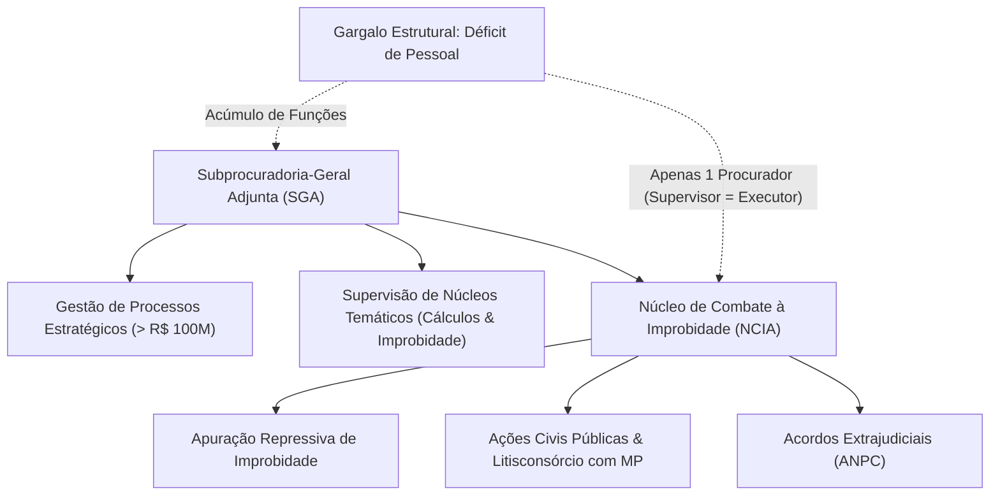
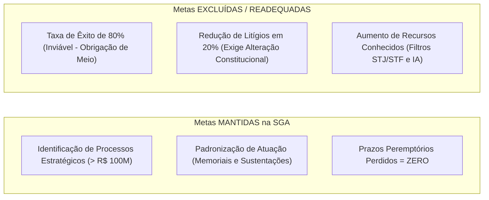
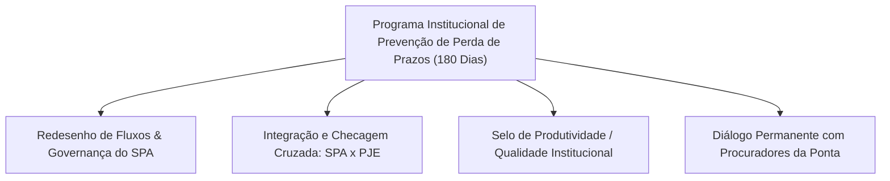
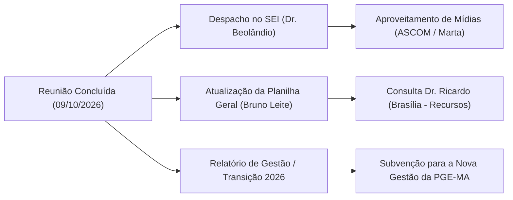

# Resumo de Reunião de Alinhamento Estratégico: 09/10/2026 - Planejamento Estratégico e Ajuste de Metas da Subprocuradoria-Geral Adjunta e do Núcleo de Combate à Improbidade Administrativa

## Ideia Central (Tese)
A reunião técnica realizada em 09 de outubro de 2026 entre a Assessoria de Estratégia e a Subprocuradoria-Geral Adjunta da Procuradoria-Geral do Estado do Maranhão (PGE-MA) promoveu uma reestruturação crítica do Plano de Ação Institucional (2026–2030), adequando os indicadores operacionais à realidade material de escassez de recursos humanos e à natureza jurídica das atividades finalísticas da advocacia pública [3, 6]. A deliberação eliminou metas quantitativas exógenas e inexequíveis — tais como taxas fixas de êxito judicial, redução compulsória de litígios e índices rígidos de admissibilidade recursal —, reorientando as diretrizes para a atuação qualificada em processos estratégicos de grande impacto econômico, o cumprimento estrito dos prazos processuais e a instituição de um Programa Institucional de Prevenção de Perda de Prazos [4, 7-9, 12]. Essa reformulação assegura o alinhamento pragmático entre a Subprocuradoria-Geral Adjunta (SGA) e o Núcleo de Combate à Improbidade Administrativa (NCIA), fundamentando o Relatório de Encerramento do Exercício de 2026 e garantindo transparência e continuidade na transição de gestão da PGE-MA [4, 13, 18].

---

## Desenvolvimento Detalhado e Estruturado

### 1. Contextualização Institucional e Diagnóstico Estrutural

#### 1.1. Participantes, Data e Metodologia de Planejamento
Em 09 de outubro de 2026, realizou-se a reunião técnica de alinhamento e revisão do Planejamento Estratégico das unidades vinculadas à Subprocuradoria-Geral Adjunta [3, 6]. O encontro foi conduzido por **Bruno Leite** (Assessoria de Estratégia), com a participação do **Dr. Francisco Beolândio dos Santos** (Subprocurador-Geral Adjunto para Assuntos Estratégicos e Coordenador do Núcleo de Combate à Improbidade Administrativa) e acompanhamento de **Hellisandra Coelho** (Assessoria de Estratégia) [3, 6, 19, 21].

A metodologia de planejamento adota o modelo de **Resultados-Chave (Key Results - KRs)**, estruturado em três níveis de temporalidade e abstração [27-29]:
1. **Eixos Estratégicos**: Objetivos de longo prazo (visão até 2030), que estabelecem as diretrizes macro da instituição [28].
2. **Objetivos Estratégicos**: Alvos de médio e longo prazo, que concretizam os eixos em orientações finalísticas [28, 29].
3. **Resultados-Chave (KRs / Metas)**: Indicadores quantificáveis e mensuráveis, sujeitos a prazos e percentuais ajustáveis [29, 39].

#### 1.2. A Configuração Dual das Unidades (SGA e NCIA) e o Severo Déficit de Pessoal
Um dos pontos centrais do diagnóstico inicial apresentado pelo Dr. Francisco Beolândio refere-se à estrutura operacional sob sua responsabilidade, composta por duas unidades com atribuições distintas, mas institucionalmente interligadas [6, 22]:
* **Subprocuradoria-Geral Adjunta (SGA)**: Responsável pelo acompanhamento de processos estratégicos de alta repercussão, coordenação do fluxo de pauta de julgamentos nos Tribunais, supervisão das procuradorias especializadas e articulação institucional [7, 11, 32, 101].
* **Núcleo de Combate à Improbidade Administrativa (NCIA)**: Unidade finalística de execução voltada à apuração de atos de improbidade, proposição de Ações Civis Públicas (ACPs), celebração de Acordos de Não Persecução Cível (ANPC) e atuação em litisconsórcio com o Ministério Público [14, 137-139].

**O Gargalo Operacional e a Confusão de Papéis**:
Originalmente, o NCIA contava com uma estrutura formada pelo Coordenador (o próprio Subprocurador-Geral Adjunto) e mais dois procuradores do Estado designados de especializadas para atuação cumulativa [6, 25]. Todavia, na conjuntura atual, **não há nenhum procurador designado para integrar o Núcleo** [6, 22]. Como consequência material, o Dr. Francisco Beolândio acumula simultaneamente as funções de coordenação/supervisão e de execução direta em ambas as unidades, atuando como "coordenador de si mesmo" [6, 22-24, 150]. Essa escassez crítica de recursos humanos impede o ajuizamento massivo de novas ações e exige a readequação das metas para modelos faticamente exequíveis [13, 124, 126].

---

### 2. Análise Crítica e Reajuste dos Eixos e Metas da SGA

#### 2.1. Eixo Estratégico 5 – Eficiência e Resolutividade nos Processos Internos e Externos
O Eixo Estratégico 5 orienta a atuação da PGE-MA na busca por maior eficiência jurisdicional e administrativa até 2030 [2, 28, 178]. Cada objetivo do eixo foi submetido a escrutínio rigoroso durante a reunião [4, 7-9]:

##### Objetivo 1: Aprimorar a Gestão de Processos Estratégicos
* **KR1 – Identificar 100% dos processos estratégicos/prioritários até 2027 e incluir no Monitor PGE**:
  * **Situação**: **MANTIDO** [4, 7, 31-34].
  * **Fundamentação**: A meta possui total pertinência com as atribuições da SGA [7, 31]. O trabalho é realizado em cooperação com a Subprocuradoria-Geral Adjunta Judicial (Dr. João Vítor), focando em causas de grande repercussão econômica (parâmetro formal: processos acima de R$ 100 milhões, regidos por portaria específica, ou causas de relevante impacto social/jurídico) [7, 32, 91].
* **KR2 – Garantir atuação processual estratégica padronizada (audiências, memoriais e sustentações orais) em 100% dos processos prioritários até 2030**:
  * **Situação**: **MANTIDO** [4, 7, 39-40].
  * **Fundamentação**: Funciona como desdobramento natural do KR1 [40]. A unidade já adota por padrão a entrega de memoriais, o despacho presencial/virtual com magistrados e a realização de sustentações orais nas sessões de julgamento [7, 40].
* **KR3 – Aumentar a taxa de êxito em processos estratégicos para 80% até 2027**:
  * **Situação**: **EXCLUÍDO / REAJUSTADO** [4, 8, 41-46].
  * **Fundamentação**: O resultado de uma demanda judicial depende do julgamento soberano do Poder Judiciário e de fatores exógenos fora do controle da advocacia pública [8, 42-43]. A atuação do procurador constitui **obrigação de meio, e não de resultado** [61]. Muitas vezes, a sustentação oral é realizada para marcar presença institucional ou defender tese tática, mesmo em cenários com jurisprudência desfavorável [45-46]. Fixar um percentual quantitativo rígido de vitórias gera um indicador distorcido e inalcançável [8, 44-45].

##### Objetivo 2: Assegurar a Defesa Jurídica com Eficiência e Redução de Litígios
* **KR1 – Reduzir em 20% o ajuizamento de novos processos contra o Estado até 2030**:
  * **Situação**: **EXCLUÍDO DA SGA** [4, 8, 48-54].
  * **Fundamentação**: O Estado do Maranhão não possui câmaras de conciliação nem mecanismos pré-processuais estruturados de solução de controvérsias na PGE [48]. Qualquer celebração de acordo exige um rito burocrático complexo que necessita de autorização formal do Chefe do Executivo [48]. Alterar esse cenário exigiria modificações legislativas profundas na Lei Orgânica da PGE e na Constituição Estadual [8, 53-54]. A pauta de fomento à conciliação foi direcionada como projeto institucional do "Inova PGE" [55].
* **KR2 – Aumentar em 20% os recursos conhecidos em Tribunais Superiores até 2028**:
  * **Situação**: **EXCLUÍDO DA SGA** [4, 9, 56-63].
  * **Fundamentação**: A admissibilidade de Recursos Especiais (STJ) e Extraordinários (STF) enfrenta barreiras procedimentais severas impostas pelas Vice-Presidências dos Tribunais de Justiça locais e pelas Cortes Superiores [9, 58, 66]. A instituição do **filtro de relevância no STJ** e a exigência de **resumos estruturados lidos por ferramentas de Inteligência Artificial** restringem drasticamente o conhecimento de recursos públicos [9, 60]. A estratégia atual da SGA consiste em desistir precocemente de recursos manifestamente inviáveis para evitar desgaste institucional e custos indevidos [58, 59]. Bruno Leite alinhará com o Dr. Ricardo (Brasília) eventuais métricas específicas para a representação na Capital Federal [5, 64].

##### Objetivo 6: Garantir o Tratamento Adequado dos Prazos Processuais
* **KR1 – Manter em zero o número de prazos processuais judiciais peremptórios perdidos mensalmente até 2030**:
  * **Situação**: **MANTIDO PARA TODAS AS UNIDADES** [4, 9, 67-69, 179].
  * **Fundamentação**: Diretriz prioritária fixada pelo Procurador-Geral do Estado (Dr. Denilson) [9, 68]. A SGA cumpre a meta mediante a checagem cruzada e diária entre o Sistema de Protocolo Administrativo (SPA) e o Processo Judicial Eletrônico (PJE) [9, 70].

#### 2.2. Remanejamento do Eixo Estratégico 6 (Reconhecimento Externo)
O Eixo Estratégico 6, que previa metas de percepção positiva nas mídias sociais, publicação de matérias institucionais e eventos [180], foi **retirado como eixo autônomo da SGA** [4, 10, 74].

**Fundamentação Técnica**: O reconhecimento externo da PGE-MA não constitui uma atividade finalística isolada, mas sim uma **consequência natural do trabalho processual eficiente** executado pelas unidades [10, 74-75]. Decidiu-se integrar as ações de divulgação ao KR de processos estratégicos [10, 73, 76].
**Iniciativa com a ASCOM**: Dr. Francisco Beolândio propôs à Assessoria de Comunicação (Marta) o aproveitamento do acervo de sustentações orais gravadas em vídeo nas sessões dos Tribunais (disponíveis no YouTube), permitindo à ASCOM realizar cortes, matérias institucionais e divulgação da atuação dos procuradores [5, 10, 78-79].

---

### 3. Matriz Comparativa da Reestruturação de Metas da SGA

| Eixo Estratégico | Objetivo Original | KR / Meta Original | Deliberação na Reunião | Justificativa Técnica e Encaminhamento |
| :--- | :--- | :--- | :--- | :--- |
| **Eixo 5 – Eficiência** | Obj. 1 – Mapeamento | KR1: Identificar 100% dos processos estratégicos até 2027 [178] | **MANTIDO** [4, 7] | Foco em causas > R$ 100M e alta repercussão em conjunto com a Adjunta Judicial [7, 32]. |
| **Eixo 5 – Eficiência** | Obj. 1 – Mapeamento | KR2: Padronizar atuação em 100% dos processos prioritários [178] | **MANTIDO** [4, 7] | Prática consolidada de despachos, memoriais e sustentações orais [7, 40]. |
| **Eixo 5 – Eficiência** | Obj. 1 – Mapeamento | KR3: Aumentar taxa de êxito para 80% até 2027 [178] | **EXCLUÍDO** [4, 8] | Resultado judicial é dependente do Judiciário; advocacia pública é obrigação de meio [8, 42-43]. |
| **Eixo 5 – Eficiência** | Obj. 2 – Defesa/Litígios | KR1: Reduzir em 20% ajuizamento de novos processos até 2030 [179] | **EXCLUÍDO** [4, 8] | Ausência de câmaras de conciliação; exige alteração da LCE e Constituição Estadual. Tema para o Inova PGE [8, 48, 53-55]. |
| **Eixo 5 – Eficiência** | Obj. 2 – Defesa/Litígios | KR2: Aumentar em 20% recursos conhecidos até 2028 [179] | **EXCLUÍDO** [4, 9] | Rigor nos filtros de admissibilidade do TJ, filtro de relevância do STJ e resumos por IA [9, 58, 60]. |
| **Eixo 5 – Eficiência** | Obj. 6 – Prazos | KR1: Manter em ZERO perda de prazos peremptórios [179] | **MANTIDO** [4, 9] | Meta prioritária fixada pela direção geral (Dr. Denilson); controle via SPA x PJE [9, 68, 70]. |
| **Eixo 6 – Imagem** | Obj. 1 – Reconhecimento | KRs 1 a 4: Metas de mídias, matérias e eventos [180] | **REMANEJADO** [4, 10] | Reconhecimento é consequência da atuação finalística. Parceria com ASCOM usando acervo do YouTube [10, 74-78]. |

---

### 4. Plano de Ação Executivo e Novas Diretrizes da SGA

Para dar cumprimento às metas remanescentes do Eixo 5, a SGA definiu um plano de ação racionalizado [4, 11, 80]:

#### 4.1. Mapeamento Contínuo e Eliminação de Burocracia Inútil
* **Exclusão de Atos Normativos Desnecessários**: A proposta inicial de editar portarias formais para regulamentar a identificação de processos foi descartada, pois a PGE já dispõe de regramento consolidado (Portaria de processos > R$ 100M e Memorando Circular de fluxo de pauta > R$ 1M) [11, 88, 91].
* **Adoção do Mapeamento Contínuo**: A ação foi convertida em rotina permanente e diária do setor, realizando a triagem de processos remetidos pelas especializadas e direcionando-os ao Monitor PGE e às pautas do TJMA/TRF [4, 11, 89, 94, 97].

#### 4.2. Reuniões Periódicas com Chefias e Supervisão dos Núcleos Temáticos
A SGA ajustou a redação da ação de supervisão para incluir expressamente as instâncias operacionais sob sua tutela [4, 11, 104-106]:
* **Reuniões com Chefias de Especializadas**: Acompanhamento dos relatórios de correição ordinária emitidos pela Corregedoria, exigindo planos de ajuste e correção de fluxos [101].
* **Inclusão dos Núcleos Temáticos Específicos**: Ação de supervisão direta sobre o **Núcleo de Cálculos** (gestão de precatórios/RPVs e bloqueios judiciais) e o **Núcleo de Combate à Improbidade Administrativa (NCIA)** [11, 103, 105-106]. O Núcleo de Recuperação Fiscal permanece sob a supervisão da coordenação fiscal (Dr. Marcelo) [106].

#### 4.3. Descontinuidade de Demandas Operacionais Desalinhadas
Dr. Francisco Beolândio destacou que os processos administrativos relativos ao **Termo de Ajustamento de Contas (TAC)** — que tratam da análise de pagamentos indenizatórios por serviços sem cobertura contratual — representam tarefas meramente consultivas/operacionais delegadas temporariamente à SGA [12, 110, 125-126]. Ficou decidido que essa atribuição não deve constar no Planejamento Estratégico por carecer de afinidade com as competências centrais da unidade [12, 111].

#### 4.4. Instituição do Programa Institucional de Prevenção de Perda de Prazos
Por proposta de Bruno Leite, acolhida pelo Dr. Francisco Beolândio, será criado um programa corporativo transversal com as seguintes premissas [4, 12, 112, 117-120]:
* **Governança Específica do SPA**: Redesenho de fluxos no Sistema de Protocolo Administrativo para sanar delays na captura de expedientes judiciais e evitar contagens fatais incorretas [12, 70, 119].
* **Engajamento e Selos de Produtividade**: Realização de reuniões com procuradores da ponta e criação de incentivos institucionais (selos de qualidade/produtividade alinhados aos critérios do TJ) [120].
* **Prazo de Execução**: Fixado em **180 dias** para viabilizar o debate prévio e a oitiva de todas as especializadas [12, 122].

---

### 5. Reestruturação Rígida do NCIA

#### 5.1. Descaracterização de Atribuições Consultivas e Exclusão do Eixo 4
A análise da planilha original do Núcleo de Combate à Improbidade Administrativa revelou uma inadequação metodológica severa [14, 134-136, 140]:
* **Eixo 4 (Atendimento e Ouvidoria)**: A planilha previa KRs como responder 90% das consultas das secretarias e atingir 90% de satisfação do usuário externo [1, 135].
* **Ajuste Aprovado**: **EXCLUSÃO TOTAL DO EIXO 4 NO NCIA** [14, 136, 141]. O NCIA é uma unidade estritamente repressiva e de persecução patrimonial, não exercendo consultoria jurídica nem atendimento ao público de ouvidoria [14, 137, 140]. O alvo de uma investigação de improbidade jamais apresentará índice de satisfação positivo em relação ao órgão repressivo [140].

#### 5.2. Foco Finalístico: Repressão, ACPs e Acordos Extrajudiciais (ANPC)
Ficou pactuado que a atuação do NCIA deve concentrar-se exclusivamente em suas competências legais finalísticas [14, 137-139]:
1. **Apuração Repressiva de Atos de Improbidade**: Investigação de ilícitos administrativos com dano ao erário [14, 137].
2. **Ações Civis Públicas (ACPs)**: Proposição direta de ações e, precipuamente, **atuação em litisconsórcio ativo e assistência ao Ministério Público** [14, 138-139].
3. **Acordos de Não Persecução Cível (ANPC)**: Celebrados em situações de menor gravidade, visando à recomposição célere e eficiente do patrimônio público sem os custos de uma demanda judicial prolongada [14, 137].

#### 5.3. Diagnóstico Técnico dos Sistemas, Ausência de Linha de Base e Falhas no Dashboard
* **Ausência de Linha de Base Histórica**: A proposta de levantar dados históricos de prazos perdidos no NCIA foi descartada devido à inexistência de correições anteriores estruturadas no setor e ao fato de o controle ser mantido pessoalmente pelo coordenador, com registro de apenas um caso isolado e justificado [17, 160-161].
* **Inviabilidade de Automação de Distribuição**: Descartada a automação de distribuições eletrônicas, visto que o Núcleo possui uma equipe de apenas uma pessoa [17, 163].
* **Identificação de Falha Crítica no Dashboard da Corregedoria**: O Dr. Francisco Beolândio reportou um vício de programação no dashboard da Corregedoria: quando um procurador armazena um processo no sistema sem necessidade de intervenção (processo sem prazo pendente), mas não realiza a leitura formal do expediente antes de armazenar, o dashboard contabiliza incorretamente o decurso do tempo como "prazo perdido" [17, 167-168]. Essa falha gera falsos positivos de perda de prazo e já foi comunicada à direção (Dr. Marcos) para correção pelos desenvolvedores [17, 168-169].

#### 5.4. Consolidação dos Planos de Ação do NCIA
Das 14 propostas originais, o NCIA manteve apenas **4 ações principais essenciais** [18, 173]:
1. Garantir o cumprimento de 100% dos prazos processuais judiciais em ACPs e assistências ao MP [15, 143].
2. Fornecer insumos técnicos para a correção do SPA e sanar falhas na captura de expedientes [164-165].
3. Utilizar o dashboard da Corregedoria como ferramenta preventiva de alerta de prazos (após a correção dos erros de sistema) [166, 169-170].
4. Manter a conferência rotineira e diária de processos pendentes no PJE e SPA [172-173].

---

### 6. Tabela Comparativa do Núcleo de Combate à Improbidade Administrativa (NCIA)

| Dimensão Analisada | Configuração Anterior (Planilha Original) | Nova Configuração Aprovada (Reunião 09/10/2026) | Fundamentação da Alteração |
| :--- | :--- | :--- | :--- |
| **Atendimento / Ouvidoria** | Responder consultas de secretarias e aferir satisfação (Eixo 4) [1] | **ELIMINADO** [14, 136] | O NCIA não é órgão consultivo; atua na repressão e improbidade [14, 137, 140]. |
| **Metas de Êxito Judicial** | Atingir 80% de êxito em processos de improbidade [2] | **ELIMINADO** [4, 8, 142] | Vitória judicial depende do Poder Judiciário; dever de meio [8, 42, 61]. |
| **Controle de Prazos** | Manter em ZERO perda de prazos peremptórios [2] | **MANTIDO** [4, 15, 143] | Compromisso absoluto em ações próprias e em apoio ao MP [15, 143]. |
| **Ações Operacionais** | 14 ações administrativas fragmentadas [153] | **REDUZIDO PARA 4 AÇÕES** [18, 173] | Adequação ao déficit de pessoal (equipe de 1 pessoa) [6, 18, 150]. |
| **Automação & Distribuição**| Prevista distribuição eletrônica automática [162] | **DESAGRAVADO / ELIMINADO** [17, 163] | Inviável distribuir processos quando só há 1 procurador atuando [17, 163]. |
| **Aferição de Prazos** | Leitura direta pelo Dashboard da Corregedoria [166] | **REVISÃO TÉCNICA EXIGIDA** [17, 167-169] | Correção de erro do sistema que marca processos armazenados como perdidos [17, 167]. |

---

### 7. Próximos Passos Administrativos e Governança de Transição

Ao encerramento da reunião, definiram-se os seguintes encaminhamentos formais [4, 5, 18]:

1. **Emissão de Despacho no SEI**: O Dr. Francisco Beolândio inserirá um despacho formal no Sistema Eletrônico de Informações (SEI), noticiando a realização da reunião de alinhamento com a Assessoria de Estratégia (Bruno Leite) e homologando os ajustes de metas efetuados [4, 18, 175].
2. **Relatório de Encerramento do Exercício de 2026 e Transição**: O Dr. Francisco Beolândio registrará no Relatório de Encerramento do Exercício de 2026 todos os objetivos e metas não alcançados devido ao déficit estrutural de pessoal, bem como a necessidade premente de nomeação de procuradores para o NCIA [4, 13, 124, 130]. Esse documento subsidiará a Direção e a nova equipe na transição de gestão [4, 13, 130-131].
3. **Interlocução em Brasília**: Bruno Leite consultará o Dr. Ricardo (Brasília) para estudar metodologias de mensuração de admissibilidade recursal adequadas à representação nos Tribunais Superiores [5, 64].
4. **Alinhamento com a ASCOM**: Encaminhamento formal à ASCOM (Marta) da sugestão de aproveitamento do acervo de sustentações orais do YouTube para matérias institucionais [5, 10, 78].

---

## Notas Explicativas e Complementos das Citações Numeradas

Para assegurar a rastreabilidade absoluta e complementar a compreensão pedagógica deste relatório, apresentam-se abaixo as explicações detalhadas relativas a cada índice numérico citado no texto:

* **[1]**: Refere-se ao documento oficial *Núcleo de Combate à Improbidade Administrativa - Eixos Objetivos e Metas (KRs).pdf*, especificamente ao Eixo Estratégico 4 (Proporcionar maior satisfação e qualidade no atendimento), que previa erroneamente metas de resposta a consultas em prazos regulamentares (KR1), satisfação de usuários externos em 90% (KR2) e 100% de retorno conclusivo à Ouvidoria (KR3) — metas descartadas na reunião por incompatibilidade com a função repressiva do Núcleo [1, 14, 135-136].
* **[2]**: Refere-se ao documento oficial *Núcleo de Combate à Improbidade Administrativa - Eixos Objetivos e Metas (KRs).pdf*, Eixo Estratégico 5, que fixava a taxa de êxito em processos estratégicos em 80% até 2027 (KR3 do Obj. 1 - excluída) e a manutenção de zero prazos peremptórios perdidos até 2030 (KR1 do Obj. 6 - mantida) [2, 4, 142-143].
* **[3]**: Refere-se ao documento de registro *Reunião dr. Beolandio - 2026/10/09 09:55 GMT-03:00 - Anotações do Gemini*, contendo o cabeçalho, data (09/10/2026), lista de participantes e o resumo corporativo dos eixos debatidos (planejamento, reestruturação, prazos e finalização no SEI) [3].
* **[4]**: Refere-se à seção de *Decisões Alinhadas* das Anotações do Gemini, que discrimina expressamente a manutenção de processos estratégicos, a retirada da taxa de êxito, a remoção da redução de litígios e de recursos conhecidos, a manutenção da meta de prazos peremptórios, o ajuste do eixo de reconhecimento externo, a adoção do mapeamento contínuo, a inclusão de núcleos temáticos em reuniões, o relatório de transição e a emissão de despacho no SEI [4].
* **[5]**: Refere-se à seção de *Próximas Etapas* das Anotações do Gemini, que atribui responsabilidades a Bruno Leite (atualizar planejamento, consultar Dr. Ricardo em Brasília), Dr. Francisco Beolândio (contatar ASCOM/Marta e finalizar despacho SEI) e ao grupo (prevenir perda de prazos em 180 dias) [5].
* **[6]**: Refere-se aos trechos da transcrição da reunião (00:00:01 e 00:07:49), onde Bruno Leite abre a reunião apresentando Hellisandra Coelho, e Dr. Francisco Beolândio relata o problema estrutural de ausência de procuradores designados para a SGA e NCIA, gerando acúmulo pessoal de coordenação e execução [6, 19, 22-25].
* **[7]**: Refere-se ao trecho da transcrição (00:10:46 e 00:16:33), no qual se confirma a pertinência de identificar 100% dos processos estratégicos em atuação conjunta com a Adjunta Judicial (processos > R$ 100 milhões) e se consolida a padronização de despachos, memoriais e sustentações orais [7, 31-33, 40].
* **[8]**: Refere-se ao trecho da transcrição (00:18:38 e 00:21:19), em que Dr. Beolândio demonstra a inviabilidade da taxa de êxito quantitativa (obrigação de meio) e explica a impossibilidade de redução numérica de litígios por ausência de câmaras de conciliação e necessidade de alterações na Lei Orgânica e Constituição Estadual [8, 42-43, 48, 53-54].
* **[9]**: Refere-se ao trecho da transcrição (00:25:29 e 00:30:54), no qual se aborda a inadequação de metas de admissibilidade recursal diante dos filtros rígidos do TJ/Vice-Presidência e das novas exigências do STJ (filtro de relevância e resumos por IA), além da aprovação do compromisso de zero prazos peremptórios perdidos por solicitação do Procurador-Geral (Dr. Denilson) [9, 58, 60, 68].
* **[10]**: Refere-se ao trecho da transcrição (00:33:36), onde Bruno Leite e Dr. Beolândio acordam que o reconhecimento externo decorre da atuação eficiente (Eixo 5) e sugerem à ASCOM (Marta) o uso do acervo de sustentações orais no YouTube do TJMA [10, 74-78].
* **[11]**: Refere-se ao trecho da transcrição (00:39:36 e 00:44:00), no qual se aprova o mapeamento contínuo de processos estratégicos e se inclui formalmente a supervisão sobre os núcleos temáticos de Cálculo e de Combate à Improbidade Administrativa nas reuniões com chefias [11, 89, 94, 103, 105-106].
* **[12]**: Refere-se ao trecho da transcrição (00:49:42 e 00:51:34), em que Dr. Beolândio descarta processos de Termo de Ajustamento de Contas (TAC) do planejamento e pactua com Bruno Leite a criação do Programa Institucional de Prevenção de Perda de Prazos no prazo de 180 dias [12, 110-112, 117-122].
* **[13]**: Refere-se ao trecho da transcrição (00:55:21 a 00:59:29), no qual Dr. Beolândio fixa como prioridade a reestruturação do NCIA com nomeação de membros, aborda o fluxo de pauta, o eixo fiscal (Dr. Marcelo) e a inclusão de metas pendentes no relatório de encerramento de 2026 para a transição de gestão [13, 124, 126, 130-131].
* **[14]**: Refere-se ao trecho da transcrição (01:00:18 a 01:03:24), que detalha as atribuições reais do NCIA: investigações repressivas, Ações Civis Públicas, acordos extrajudiciais (ANPC) para ressarcimento rápido e atuação conjunta em litisconsórcio com o Ministério Público [14, 137-139].
* **[15]**: Refere-se ao trecho da transcrição (01:04:20 e 01:05:20), expondo a confusão de papéis no NCIA (supervisor = executor) e reafirmando o dever de cumprimento estrito de prazos processuais em apoio a Dr. Denilson [15, 143, 150].
* **[16]**: Refere-se ao trecho da transcrição (01:06:50), onde se esclarece que a geração de eficiência em gastos públicos refere-se ao controle externo/repressivo sobre outros órgãos estaduais, e não à gestão administrativa interna [16, 148].
* **[17]**: Refere-se ao trecho da transcrição (01:09:39 a 01:16:12), demonstrando a inexistência de linha de base histórica por falta de correição prévia, desestimulando a distribuição automática (equipe de 1 pessoa) e detalhando a falha no dashboard da Corregedoria que marca processos armazenados sem leitura como "prazos perdidos" [17, 160, 163, 167-168].
* **[18]**: Refere-se ao trecho final da transcrição (01:18:38 e 01:19:19), em que se reduz o plano do NCIA a 4 ações essenciais e se estabelece o encerramento dos trabalhos mediante despacho de devolução no SEI [18, 173, 175].
* **[19]–[177]**: Refere-se ao corpo integral da transcrição textual contínua dos diálogos entre Bruno Leite, Dr. Francisco Beolândio dos Santos e Hellisandra Coelho, que fundamenta detalhadamente cada debate, citação verbal, argumento técnico e decisão operacional registrada neste documento [19-177].
* **[178]**: Refere-se ao documento oficial *Subprocuradoria-Geral Adjunta - Eixos Objetivos e Metas (KRs).pdf*, Eixo Estratégico 5, Objetivo 1, contendo os KRs de identificação de 100% dos processos estratégicos até 2027 (KR1), atuação padronizada até 2030 (KR2) e taxa de êxito de 80% até 2027 (KR3) [178].
* **[179]**: Refere-se ao documento oficial *Subprocuradoria-Geral Adjunta - Eixos Objetivos e Metas (KRs).pdf*, Eixo Estratégico 5, Objetivo 2 (redução de litígios em 20% e recursos conhecidos em 20%) e Objetivo 6 (manter zero prazos peremptórios perdidos) [179].
* **[180]**: Refere-se ao documento oficial *Subprocuradoria-Geral Adjunta - Eixos Objetivos e Metas (KRs).pdf*, Eixo Estratégico 6 (Obter maior reconhecimento externo), detalhando os KRs de percepção em mídias, matérias mensais, eventos anuais e alcance em redes sociais [180].
