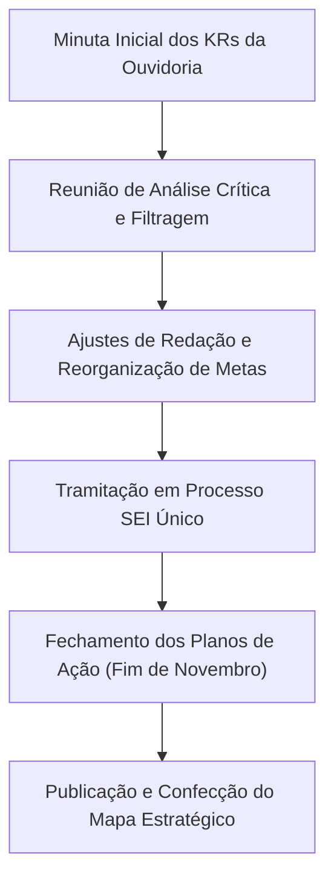
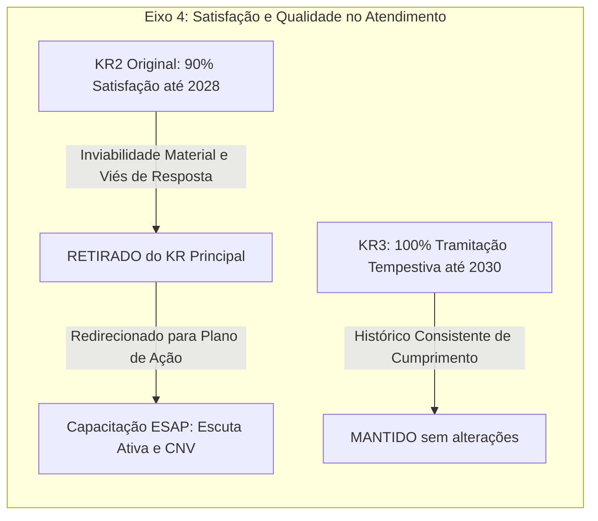
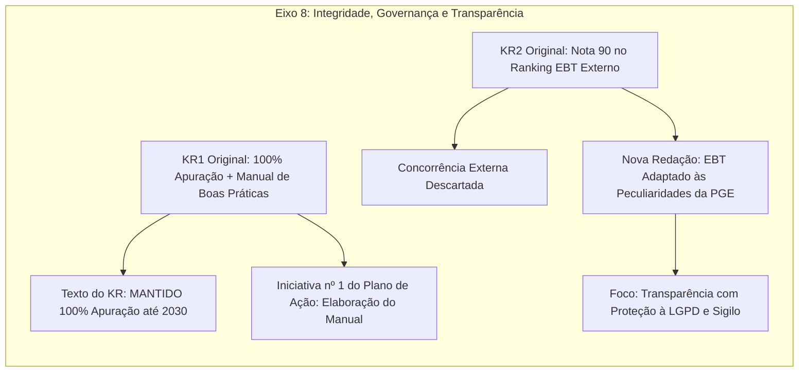
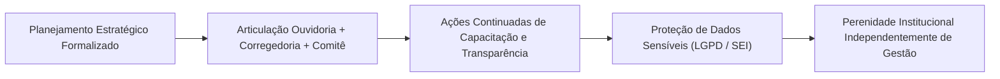

# Resumo de Reunião: Planejamento Estratégico e Metas (KRs) da Ouvidoria — Eixos Objetivos e Metas

## Título do Resumo
Resumo de Reunião de Alinhamento: Planejamento Estratégico e Metas (KRs) da Ouvidoria da PGE

## Ideia Central (Tese)
A reunião de alinhamento do Planejamento Estratégico da Ouvidoria da Procuradoria-Geral do Estado (PGE) teve como objetivo reavaliar, enxugar e adequar os Resultados-Chave (KRs) dos Eixos Estratégicos 4 (Satisfação/Atendimento) e 8 (Integridade/Governança), ajustando-os à realidade operacional e às limitações materiais dos sistemas informatizados [9, 22]. A discussão resultou no redirecionamento de metas inviáveis de mensuração direta (como pesquisas de satisfação genéricas e o ranking EBT externo) para iniciativas concretas de capacitação institucional e regulação interna via Plano de Ação [8, 12, 18], assegurando a perenidade das diretrizes de transparência, equidade e resposta tempestiva perante trocas de gestão [19, 21].

---

## Desenvolvimento Detalhado e Estruturado

### 1. Contexto Geral e Diretrizes Metodológicas da Revisão Estratégica

O encontro de alinhamento reuniu os interlocutores responsáveis pela estruturação do Planejamento Estratégico e Metas da Ouvidoria da PGE (referenciados nas gravações da "Rua Fortaleza, 25" [4, 17]). A pauta principal consistiu no exame minucioso da minuta de Eixos Estratégicos, Objetivos e Resultados-Chave (KRs) constante do documento oficial do setor [1, 2, 3].

Os interlocutores identificaram a necessidade premente de realizar uma filtragem rigorosa sobre as metas propostas, eliminando dubiedades, adequando os prazos regulamentares (com horizontes para 2027, 2028 e 2030) e alinhando as expectativas às reais atribuições e capacidades operacionais da Ouvidoria [9, 22]. 

No âmbito procedimental, ficou acordado que todas as correções e novas redações seriam formalizadas e encaminhadas no âmbito do mesmo processo administrativo já aberto no Sistema Eletrônico de Informações (SEI), evitando a proliferação desnecessária de novos processos e otimizando a comunicação interna com os demais setores da instituição [10]. Ficou estabelecido o final de novembro como prazo-limite para a consolidação dos Planos de Ação, momento após o qual prevê-se a confecção e impressão do Mapa Estratégico da Ouvidoria para fixação e ampla visibilidade no setor [18, 23].

---

### 2. Eixo Estratégico 4 — Proporcionar Maior Satisfação e Qualidade no Atendimento

O Eixo Estratégico 4 é voltado ao aprimoramento da experiência dos interlocutores e cidadãos que acionam a Ouvidoria [1]. O debate centrou-se no Objetivo 1 ("Melhorar a experiência de stakeholders externos e internos") e em seus dois KRs principais:

#### 2.1. Reavaliação e Reformulação do KR2 (Satisfação do Usuário vs. Atendimento Cordial e Humanizado)
* **Proposição Original do PDF [1]:** "KR2: Manter em 90% o índice de satisfação do usuário externo até 2028 (se instituir canal interno de feedback)."
* **Análise Crítica dos Interlocutores [4, 5, 6, 7, 9]:**
  * A expressão "satisfação dos usuários" foi julgada excessivamente vaga e imprecisa, pois não especificava a qual perfil de manifestação se referia (denúncia, reclamação, sugestão, elogio) nem se abrangia usuários internos ou externos [9].
  * Constatou-se a inexistência de um sistema automatizado de coleta fornecido pela Ouvidoria-Geral do Estado (OGSTC/STC), bem como a ausência de um canal de feedback ativo estruturado [4, 9].
  * **Impossibilidade Material e Viés Amostral Severo [6, 7]:** A equipe debateu a inviabilidade de medir objetivamente o "atendimento cordial e humanizado" por meio de pesquisas voluntárias. Em ouvidorias públicas, pesquisas abertas sem incentivo (ex.: links de Google Forms) possuem baixíssima adesão e sofrem de um viés de seleção negativo radical — o cidadão satisfeito raramente dispõe do seu tempo para preencher avaliações, enquanto manifestantes insatisfeitos utilizam o espaço preponderantemente para manifestar indignação ("só responde quem está p***") [6, 7].
* **Decisão Consensual [8, 10]:** Retirada formal do KR2 como meta quantitativa direta de satisfação.
* **Redirecionamento para o Plano de Ação [8]:** A busca por um atendimento cordial e humanizado foi convertida em iniciativa educacional contínua. Estabeleceu-se como ação complementar a articulação com a Escola Superior da Advocacia Pública (ESAP) e o Comitê de Equidade para a realização de capacitações institucionais em **Escuta Ativa** e **Comunicação Não Violenta (CNV)**, atuando a Ouvidoria e a Corregedoria como órgãos coexecutores e provocadores [8].

#### 2.2. Confirmação do KR3 (Tempestividade e Respostas Conclusivas)
* **Proposição Original do PDF [1]:** "KR3: Manter em 100% o índice de tramitação tempestiva e de respostas conclusivas em prazo regulamentar até 2030."
* **Análise dos Interlocutores [21, 22]:** O indicador não gerou controvérsias, pois reflete uma rotina já consolidada na Ouvidoria da PGE, que ostenta histórico rigoroso de cumprimento de prazos regulamentares em todas as manifestações recebidas.
* **Decisão Consensual [21]:** Manutenção integral do KR3 com meta de 100% até 2030.

---

### 3. Eixo Estratégico 8 — Garantir a Integridade e a Responsabilidade Social

O Eixo Estratégico 8 aborda o Objetivo 2 ("Fortalecer a governança, a integridade e a transparência") [2]. O colegiado debruçou-se sobre a redação do KR1 e do KR2, promovendo reestruturações de fundo:

#### 3.1. Reestruturação do KR1 (Apuracao de Desvios e o Manual de Boas Praticas)
* **Proposição Original do PDF [2]:** "KR1: Garantir que 100% dos desvios de conduta e manifestações reportadas à Corregedoria e Ouvidoria sejam formalmente apurados dentro do prazo legal até 2030, com aplicação tempestiva das medidas corretivas do Manual de Boas Práticas."
* **Análise Crítica e Deliberação [17, 18, 19, 20, 21]:**
  * Discutiu-se a adequação de citar expressamente o "Manual de Boas Práticas" no texto da meta principal. Como a elaboração e atualização do Manual dependem de articulação conjunta entre o Comitê de Equidade e a Corregedoria, mantê-lo no enunciado do KR engessaria o indicador finalista [17, 18].
  * O Comitê de Equidade atua como órgão consultivo e propositivo, cabendo ao Corregedor-Geral a decisão final de normatização [18, 20].
* **Decisão Consensual [20, 21]:**
  1. **Ajuste na Redação do KR1:** Remoção da expressão "Manual de Boas Práticas" do texto do KR, fixando a meta estritamente em: apurar formalmente 100% dos desvios de conduta e manifestações dentro do prazo legal até 2030 [21].
  2. **Inclusão no Plano de Ação:** A inclusão das orientações do Comitê de Equidade no Manual de Boas Práticas da PGE passa a figurar como a **Iniciativa nº 1 do Plano de Ação** [18, 20].
  3. **Perenidade Institucional:** Ao vincular formalmente a elaboração do Manual ao Planejamento Estratégico, garante-se que as diretrizes de integridade e equidade sejam preservadas e cobradas de forma contínua, independentemente de mudanças de gestão ou trocas na Corregedoria [18, 19].

#### 3.2. Reformulação do KR2 (Ranking de Transparência EBT vs. LGPD e Métrica Adaptada)
* **Proposição Original do PDF [2]:** "KR2: Atingir uma pontuação de 90 no ranking de transparência EBT para os relatórios anuais da PGE até 2030 (papel consultivo)."
* **Análise Crítica e Impasses Identificados [11, 12, 13, 14, 15, 16]:**
  * **Incompatibilidade da Concorrência Externa [11, 12]:** A Escala Brasil Transparente (EBT) é aplicada pela STC para avaliar entes públicos globais. A PGE não compete diretamente como órgão autônomo nesse ranking [11, 12].
  * **Conflito com a LGPD e Sigilo Funcional [14, 15]:** Manifestações tratadas pela Ouvidoria contêm dados extremamente sensíveis (denúncias éticas, desvios e informações pessoais) encaminhados à Corregedoria. A transparência irrestrita exigida em rankings genéricos colide com as exigências da Lei Geral de Proteção de Dados (LGPD) e com as regras de restrição de acesso do SEI [14, 15]. A consolidação de relatórios anuais exige criterioso processo de anonimização [15].
  * **Plano de Integridade e Consultoria [13]:** Registrou-se a previsão orçamentária de aproximadamente R$ 50.000 para contratação de consultoria especializada na elaboração do Plano de Integridade da PGE [13, 14].
* **Decisão Consensual [12, 16]:**
  * Descarte definitivo da intenção de "concorrer ao ranking EBT".
  * **Nova Redação do KR2:** Substituição por uma **"Escala EBT Adaptada"**, mediante a seleção prévia de indicadores de transparência ativa e passiva compatíveis com a natureza jurídica da PGE e com os relatórios anuais de Ouvidoria, garantindo plena conformidade com a LGPD [12, 16].

---

### 4. Tabela Comparativa — Síntese das Decisões do Alinhamento Estratégico

| Eixo Estratégico | KR Original (Minuta PDF) | Diagnóstico da Reunião | Decisão / Redação Aprovada | Mecanismo de Execução |
| :--- | :--- | :--- | :--- | :--- |
| **Eixo 4 — Atendimento** | **KR2:** Manter 90% de satisfação do usuário externo até 2028 [1]. | Sem ferramenta de coleta; viés amostral negativo em pesquisas abertas ("só responde quem está insatisfeito") [6, 9]. | **Retirado do rol de KRs.** | Convertido em Plano de Ação: Cursos ESAP de Escuta Ativa e CNV [8]. |
| **Eixo 4 — Atendimento** | **KR3:** Manter 100% de tramitação tempestiva e respostas até 2030 [1]. | Meta consolidada; histórico de 100% de cumprimento pelo setor [21]. | **Mantido integralmente.** | Acompanhamento contínuo da rotina da Ouvidoria [21]. |
| **Eixo 8 — Integridade** | **KR1:** 100% de apuração legal + aplicação do Manual de Boas Práticas [2]. | Citação do Manual na meta engessava a apuração; necessidade de separar meta finalista de iniciativa [17, 18]. | **Redação Ajustada:** 100% de apuração legal de desvios até 2030 (sem citação do Manual na meta) [21]. | Manual de Boas Práticas torna-se Iniciativa nº 1 do Plano de Ação [18]. |
| **Eixo 8 — Integridade** | **KR2:** Nota 90 no ranking de transparência EBT até 2030 [2]. | PGE não concorre no EBT externo; conflito com restrições da LGPD em dados sensíveis [12, 14]. | **Redação Reformulada:** Escala EBT Adaptada para relatórios anuais da PGE [12, 16]. | Seleção interna de itens de transparência aplicáveis (ex.: remuneração, relatórios anonimizados) [15, 16]. |

---

### 5. Diretrizes de Implantação, Sistemas e Gestão da Mudança

1. **Adequação aos Sistemas Existentes:** Os interlocutores reconheceram que as soluções de inteligência de dados e métricas devem respeitar a arquitetura dos sistemas de informação atualmente em uso na PGE e na OGSTC [9, 22].
2. **Segurança da Informação e LGPD:** Todos os relatórios e encaminhamentos à Corregedoria com informações sensíveis de denúncias manterão marcação de restrição de acesso no SEI e passarão por rigoroso protocolo de anonimização antes de qualquer publicação externa [14, 15].
3. **Sustentabilidade Institucional do Planejamento:** A pactuação conjunta entre Ouvidoria, Corregedoria e Comitê de Equidade blinda as metas contra descontinuidades administrativas decorrentes de futuras trocas de gestão [18, 19, 23].

---

## Explicações Numeradas das Citações das Fontes

Abaixo consta a lista detalhada e explicativa de todas as referências citadas ao longo do resumo, oferecendo contexto complementar para o registro institucional:

1. **[1] — Ouvidoria - Eixos Objetivos e Metas (KRs) 1.pdf (pág. 1):** Documento inicial de planejamento contendo a proposição original do Eixo Estratégico 4 (Satisfação no Atendimento), Objetivo 1 (Experiência de stakeholders) e seus respectivos KRs: KR2 (índice de 90% de satisfação) e KR3 (100% de tramitação e respostas tempestivas no prazo regulamentar até 2030).
2. **[2] — Ouvidoria - Eixos Objetivos e Metas (KRs) 1.pdf (pág. 1):** Apresenta o Eixo Estratégico 8 (Integridade e Responsabilidade Social), Objetivo 2 (Governança, Integridade e Transparência), com o KR1 (100% de apuração formal de desvios com aplicação do Manual de Boas Práticas até 2030) e o KR2 (pontuação 90 no ranking de transparência EBT até 2030).
3. **[3] — Ouvidoria - Eixos Objetivos e Metas (KRs) 1.pdf (pág. 1):** Registra as anotações sobre o papel consultivo da Ouvidoria e as sugestões preliminares para remoção de termos do texto principal do KR e sua inclusão como iniciativas do Plano de Ação.
4. **[4] — Rua Fortaleza, 25 12.m4a:** Transcrição do áudio em que os interlocutores iniciam o debate sobre o registro de satisfação nos sistemas, relembrando propostas anteriores de incluir no KR1/Objetivo 2 o atendimento cordial e humanizado nas manifestações da Ouvidoria.
5. **[5] — Rua Fortaleza, 25 12.m4a:** Trecho no qual se destaca o compromisso da equipe em prestar atendimento humanizado, cortês e reorientar o cidadão para o canal adequado, alinhado às diretrizes da OGS/STC.
6. **[6] — Rua Fortaleza, 25 12.m4a:** Discussão crítica acerca da impossibilidade de mensurar objetivamente a cordialidade do atendimento sem uma pesquisa ativa, ressaltando o viés intrínseco de pesquisas voluntárias em que apenas usuários insatisfeitos costumam responder ("só responde quem está p***").
7. **[7] — Rua Fortaleza, 25 12.m4a:** Análise da proposta de disponibilizar links abertos no Google Forms para avaliação, concluindo-se que a adesão seria insignificante e não representativa estatisticamente, recomendando-se a retirada da meta quantitativa direta.
8. **[8] — Rua Fortaleza, 25 12.m4a:** Deliberação que substitui a meta de satisfação por um plano de ação executável com o apoio da ESAP e do Comitê de Equidade, prevendo capacitação institucional em escuta ativa e comunicação não violenta (CNV).
9. **[9] — Rua Fortaleza, 25 12.m4a:** Observação sobre a imprecisão do termo "satisfação dos usuários" e o registro de que a ouvidoria setorial da OGSTC não fornece atualmente métricas específicas consolidadas.
10. **[10] — Rua Fortaleza, 25 12.m4a:** Acordo sobre o fluxo de tramitação administrativa, definindo que as alterações nas metas seriam enviadas dentro do mesmo processo SEI já existente para evitar redundância de processos.
11. **[11] — Rua Fortaleza, 25 12.m4a:** Debate sobre o KR2 do Eixo 8 (pontuação 90 no ranking EBT da STC), com esclarecimentos de que o ranking avalia entes e órgãos globais no evento da STC.
12. **[12] — Rua Fortaleza, 25 12.m4a:** Definição de que a PGE não deve disputar posições no ranking EBT externo, mas adaptar a metodologia da Escala Brasil Transparente para criar uma escala interna de indicadores de transparência ativa e passiva.
13. **[13] — Rua Fortaleza, 25 12.m4a:** Menção à elaboração do Plano de Integridade da PGE, orçamento reservado de R$ 50.000 para contratação de consultoria especializada e publicação do relatório anual.
14. **[14] — Rua Fortaleza, 25 12.m4a:** Alerta quanto à necessidade de conciliar a transparência de dados de ouvidoria com as restrições da LGPD e o sigilo de manifestações e denúncias enviadas à Corregedoria com tarja de restrição no SEI.
15. **[15] — Rua Fortaleza, 25 12.m4a:** Detalhamento das rotinas de anonimização de dados pessoais e relatórios anuais de ouvidoria/corregedoria divulgados na Exanet e no SEI.
16. **[16] — Rua Fortaleza, 25 12.m4a:** Recomendação de reescrita total da redação do KR2 do Eixo 8 para estabelecer metas específicas de transparência aplicáveis (ex.: transparência salarial/remuneração no portal).
17. **[17] — Rua Fortaleza, 25 13.m4a:** Transcrição da gravação subsequente sobre a articulação do Manual de Boas Práticas em conjunto com a Corregedoria, a ESAP e o novo Congresso.
18. **[18] — Rua Fortaleza, 25 13.m4a:** Definição final de deslocar a elaboração do Manual de Boas Práticas do texto da meta principal para figurar como a primeira iniciativa do Plano de Ação a ser concluído até novembro.
19. **[19] — Rua Fortaleza, 25 13.m4a:** Destaque para a importância da inserção formal das ações do Comitê de Equidade no Planejamento Estratégico para garantir a perenidade do plano independentemente de trocas de gestão.
20. **[20] — Rua Fortaleza, 25 13.m4a:** Esclarecimento do papel do Comitê de Equidade como coexecutor propositivo perante a deliberação e aprovação final a cargo do Corregedor-Geral.
21. **[21] — Rua Fortaleza, 25 13.m4a:** Confirmação da manutenção do KR3 do Eixo 4 (100% de tramitação e respostas tempestivas) e aprovação da retirada da expressão "Manual de Boas Práticas" do enunciado do KR1 do Eixo 8.
22. **[22] — Rua Fortaleza, 25 13.m4a:** Síntese das discussões sobre as limitações dos sistemas informatizados e o consenso em enxugar o plano estratégico para mantê-lo focado nas competências diretas da Ouvidoria.
23. **[23] — Rua Fortaleza, 25 13.m4a:** Definição do cronograma de fechamento dos planos de ação para o final de novembro e alinhamento para impressão e afixação do Mapa Estratégico no setor.
24. **[24] — Rua Fortaleza, 25 13.m4a:** Trecho de encerramento descontraído da reunião com comentários sobre perspectivas de futuro e transição na gestão do setor.
