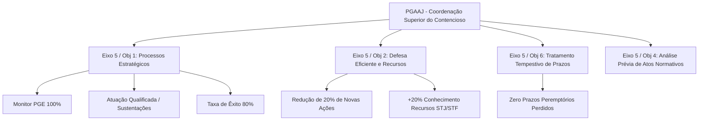

# Relatório Sintético de Ajustes Pós-Manifestação Processual SEI
## Procuradoria-Geral Adjunta para Assuntos Judiciais (PGAAJ / PGE-MA)

**Processo de Referência SEI:** 2026.11103.07177  
**Documento de Encaminhamento:** Memorando nº 31/2026 - PGAAJ (Doc. SEI 017814889)  
**Interlocutor:** Dr. João Victor Holanda do Amaral (Procurador-Geral Adjunto para Assuntos Judiciais)  
**Data de Consolidação:** Outubro de 2026 – Ciclo PGE-MA 2026–2030  

---

### 1. Contexto e Manifestação Formal no SEI
No âmbito do planejamento estratégico 2026–2030, a Procuradoria-Geral Adjunta para Assuntos Judiciais (PGAAJ) manifestou-se formalmente no Processo SEI nº 2026.11103.07177, submetendo o Memorando nº 31/2026 e a Planilha do Plano de Ação setorial com 21 iniciativas operacionais desenhadas pela chefia e assessores. O expediente reflete a maturidade institucional do setor em estruturar rotinas de alta densidade técnica para a gestão superior do contencioso judicial.

---

### 2. Saneamento de Metas e Expurgos Metodológicos

| Meta Original (Minuta Inicial) | Tratamento pela PGAAJ no SEI | Fundamento Técnico do Setor | Harmonização na Lista Mestre |
| :--- | :--- | :--- | :--- |
| **KR1/KR2/KR3 Eixo 6**: Redes sociais, matérias na mídia e eventos | **Totalmente Expurgadas** | Competência exclusiva da ASCOM; incompatível com a atividade-fim da PGAAJ | **Suprimidas** do plano da PGAAJ |
| **KR1 Eixo 5 / O1**: Identificar processos no Monitor PGE | **Aprovada com 4 ações** | Definição de política, mapeamento global e integração de RPAs | Redação atualizada: *"Cadastrar e monitorar 100%"* |
| **KR2 Eixo 5 / O1**: Atuação estratégica qualificada | **Aprovada com 4 ações** | Rito mensal executivo, painel de julgamentos e presença institucional | Redação atualizada: *"Garantir atuação qualificada em 100%"* |
| **KR3 Eixo 5 / O1**: Aumentar taxa de êxito para 80% | **Aprovada com 3 ações** | Critérios diferenciados por especialidade e repositório de teses | Redação atualizada: *"Atingir taxa de êxito de 80%"* |
| **KR1 Eixo 5 / O2**: Reduzir em 20% novas ações judiciais | **Aprovada com 3 ações** | Mapeamento de causas-raiz em secretarias e atuação consensual | Confirmada no plano ajustado |
| **KR2 Eixo 5 / O2**: Aumentar recursos conhecidos em 20% | **Aprovada com 3 ações** | Qualificação recursal perante STJ/STF e oficinas com a ESAP | Confirmada no plano ajustado |
| **KR1 Eixo 5 / O6**: Zero prazos judiciais perdidos | **Aprovada com 4 ações** | Protocolo formal, conferência diária e alerta escalonado | Confirmada no plano ajustado |

---

### 3. Síntese das 21 Ações do Plano de Ação 5W2H
- **Gestão no Monitor PGE (KR1 - 4 ações)**: Política formal de processos estratégicos (120d); Mapeamento exaustivo da carteira global (180d); Rotina periódica e campos mínimos no sistema (120d); Ferramentas de automação e RPAs para alertas e consistência (360d).
- **Atuação Estratégica Qualificada (KR2 - 4 ações)**: Reuniões mensais executivas com chefias das especializadas; Painel gerencial de acompanhamento de julgamentos (360d); Uso de IA/Jurimetria do PROFISCO III; Protocolo institucional de sustentações orais e memoriais nos tribunais (240d).
- **Taxa de Êxito de 80% (KR3 - 3 ações)**: Padronização objetiva de critérios de êxito por especialidade jurídica (240d); Repositório institucional de teses vitoriosas e precedentes (360d); Avaliação semestral de resultados e revisão de teses (300d).
- **Redução da Litigiosidade na Origem (KR1 Eixo 5/O2 - 3 ações)**: Mapeamento de causas-raiz nas secretarias para emissão de orientações preventivas (180d); Aproveitamento de dados de grupos de trabalho interinstitucionais (240d); Painel de monitoramento do ingresso de novas ações (300d).
- **Qualificação Recursal perante STJ e STF (KR2 Eixo 5/O2 - 3 ações)**: Política de qualificação e filtragem recursal (240d); Rotina permanente de apoio e revisão técnica de RE/REsp com a Procuradoria de Brasília (360d); Oficinas de capacitação em precedentes qualificados com a ESAP (240d).
- **Tolerância Zero a Perda de Prazos (KR1 Eixo 5/O6 - 4 ações)**: Instrução normativa de contingência contra perda de prazos (90d); Rotina diária de conferência cruzada nas caixas do PJe e Tribunais Superiores (Imediato / Diário); Fluxo de alerta escalonado de 48h/24h (240d); Auditoria mensal por causa-raiz (Mensal).

---

---
*São Luís/MA, Outubro de 2026. Assessoria de Planejamento e Gestão Estratégica – PGE-MA.*
