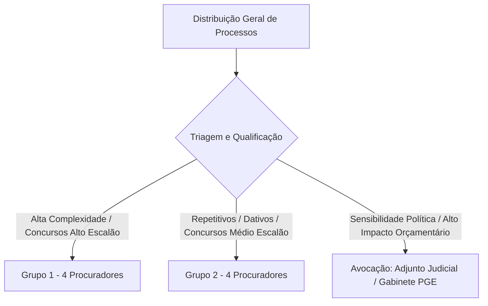
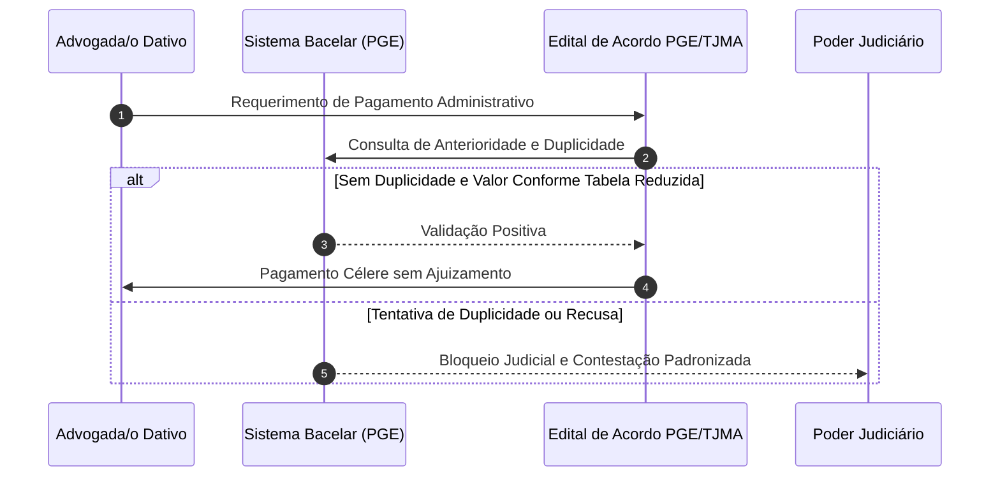
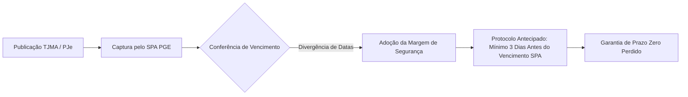

1. A Procuradoria Judicial da PGE-MA organiza-se sob uma estrutura funcional desenhada para otimizar a distribuição de processos de acordo com a complexidade e o volume das matérias jurídicas [3]. 

### 1.1. Divisão Interna por Grupos de Trabalho (GTs)

A unidade é liderada pelo Procurador-Chefe e dividida em dois Grupos de Trabalho especializados, compostos por 4 procuradores cada, garantindo a continuidade dos serviços durante períodos de férias ou afastamentos legais [4]:

* **Grupo 1 (Demandas Complexas):** Responsável pelo contencioso de alta complexidade jurídica e impacto financeiro intermediário. Abrange ações de responsabilidade civil do Estado, ações anulatórias de atos administrativos, processos de conhecimento de grande porte, e concursos públicos de alto escalão (ex.: carreiras de Magistrado, Promotor de Justiça e Procurador do Estado) [5].
* **Grupo 2 (Demandas Repetitivas e de Massa):** Focado no contencioso volumoso e padronizado. Trata precipuamente de cobranças de honorários de advogados dativos e demandas relativas a concursos públicos de médio e baixo escalão [6].

### 1.2. Tratamento dos Processos Estratégicos e Sensíveis

Ficou registrado no alinhamento que os processos classificados como **estratégicos** (envolvendo valores altamente expressivos, grande repercussão política ou risco de grave impacto orçamentário) **não tramitam na rotina ordinária da Procuradoria Judicial** [7]. Tais feitos são automaticamente avocados e conduzidos pelo Procurador-Geral Adjunto Judicial (PGAAJ), pela Assessoria Jurídica e pelo Procurador-Geral do Estado, desonerando a Procuradoria Judicial desse monitoramento direto [8].

---

## 2. Análise do Eixo Estratégico 4: Experiência de Stakeholders e Qualidade no Atendimento

O Eixo 4 do Plano Estratégico busca proporcionar maior satisfação e eficiência no atendimento aos públicos interno e externo [9].

### 2.1. Adequação das Metas à Realidade da Procuradoria Judicial

Durante a reunião de validação, identificou-se que determinadas metas do Eixo 4 não possuem pertinência direta com a rotina da Procuradoria Judicial:

* **Atendimento Direto ao Público Externo (KR2):** A Procuradoria Judicial não possui balcão de atendimento contínuo ou receptivo de cidadãos (atribuição típica da Ouvidoria e do SAPE). Os contatos são meramente episódicos com advogados e defensores [10]. Portanto, pesquisas de satisfação de público externo foram suprimidas do plano de ação específico do setor [11].
* **Consultas Administrativas de Secretarias (KR1):** A unidade atua essencialmente no contencioso judicial. Demandas consultivas diretas são canalizadas via ofícios para solicitação de subsídios de defesa [12].

### 2.2. Gargalos Institucionais: Secretarias de Estado Inadimplentes

Identificou-se um gargalo crítico na obtenção tempestiva de subsídios técnicos e documentos para a instrução de defesas judiciais do Estado [13].

* **Secretarias Críticas:** A **Secretaria de Estado da Cultura (SECULT)** e a **Secretaria de Estado do Meio Ambiente (SEMA)** foram apontadas como as unidades mais morosas no cumprimento dos prazos de resposta aos ofícios da PGE [14].
* **Encaminhamento Proposto:** Realização de reuniões institucionais e visitas de alinhamento com os gestores da SECULT e SEMA, além da expedição de portaria/orientação conjunta para sensibilizar as equipes administrativas sobre a urgência dos prazos processuais judiciais [15].
* **Casos de Sucesso (Procuradorias Setoriais):** Destacou-se que setores como Saúde, Segurança Pública e Educação possuem procuradores alocados *in loco* nas secretarias, o que zera o tempo de resposta e facilita a colheita de provas [16].

---

## 3. Análise do Eixo Estratégico 5: Eficiência, Resolutividade e Redução de Litígios

O Eixo 5 concentra o maior volume de iniciativas operacionais para otimizar os fluxos do contencioso e reduzir demandas desnecessárias [17].

### 3.1. Enfrentamento da Litigiosidade de Advogados Dativos

O volume de execuções e ações de cobrança de honorários de advogados dativos representa um dos maiores desafios operacionais do Grupo 2 [18].

#### A. Prevenção de Cobranças Duplicadas (Sistema Bacelar)

Anteriormente, o controle de processos de dativos era realizado manualmente por meio de uma planilha no Google Drive contendo mais de 3.000 registros, o que gerava vulnerabilidade a falhas e cobranças duplicadas [19]. 

* **Inovação Desenvolvida:** O Dr. Bacelar desenvolveu uma plataforma/sistema automatizado que consolida todo o acervo histórico de requerimentos de dativos, realizando o cruzamento automático de dados para identificar tentativas de recebimento em duplicidade do mesmo título honorário [20].

#### B. Acordo Extrajudicial e Tabela Reduzida de Honorários

O Estado do Maranhão, em parceria entre PGE, TJMA e OAB-MA, está implementando um edital de convocação para pagamento administrativo/extrajudicial de honorários dativos [21].

* **Estudo Econométrico e Comparativo Estadual:** Apresentou-se estudo demonstrando que outros Estados (como Ceará e Minas Gerais) adotam tabelas próprias de honorários dativos com valores significativamente inferiores à Tabela de Honorários da OAB (pagando entre 10% e 40% dos valores estipulados pela OAB) [22]. 
* **Impacto Orçamentário e Efeito Pedagógico:** A fixação de uma tabela reduzida mediante acordo tripartite desestimula o ajuizamento predatório de ações e preserva os recursos do erário estadual [23].

### 3.2. Padronização de Teses e Relatório de Matérias

A Procuradoria Judicial mantém um **Relatório de Matérias** consolidado (com mais de 50 páginas) contendo os resumos e orientações sobre as principais teses jurídicas e precedentes aplicáveis às defesas do Estado [24]. 

* **Desafio Identificado:** Necessidade de engajamento contínuo dos procuradores para alimentar o relatório com novas decisões dos Tribunais Superiores [25].
* **Ação:** Sistematizar a atualização trimestral do relatório e vincular a elaboração de peças ordinárias às teses consolidadas [26].

### 3.3. Automação de Fluxos, Inteligência Artificial e Agenda Única

* **Ferramenta Minuta IA:** Processo licitatório encaminhado para contratação do software "Minuta IA", focado na geração automatizada de minutas de contestações e recursos para demandas repetitivas do Grupo 2 (dativos e concursos) [27].
* **Agenda Compartilhada de Audiências:** Identificou-se a ausência de um calendário centralizado de audiências no setor. Foi pactuada a criação de uma pauta compartilhada (via Google Calendar ou módulo do SPA) alimentada pelos procuradores para controle da chefia [28].
* **Harmonização de Numeração (Extranet x SEI):** Alinhamento técnico para zerar e sincronizar as numerações de pareceres e ofícios entre o sistema Extranet PGE e o sistema SEI no ciclo de 2027 [29].

### 3.4. Governança de Prazos Processuais ("Programa Prazo Zero Perdido")

A gestão de prazos na Procuradoria Judicial possui índice de excelência, mas exige cautela diante de inconsistências tecnológicas entre sistemas [30].

* **Risco Técnico:** Identificou-se eventual *delay* ou divergência de datas entre o vencimento registrado no PJe (TJMA) e a data capturada pelo SPA (Sistema de Processos Administrativos da PGE) [31].
* **Diretriz Preventiva (Memorando PGAAJ):** Emissão de orientação urgente determinando que todos os procuradores realizem o protocolo das peças com margem de segurança de **pelo menos 3 dias de antecedência** em relação ao prazo final indicado pelo SPA, eliminando qualquer risco de intempestividade [32].

### 3.5. Defesa Oral, Memoriais

A atuação presencial e oral perante os órgãos julgadores do TJMA e TRF-1 foi objeto de debate aprofundado [33].

* **Diagnóstico:** Constatou-se inibição e resistência de parcela dos procuradores (especialmente os mais novos) para realizar sustentações orais e despachos presenciais de memoriais com Magistrados [34].
* **A Analogia Pedagógica:** O Procurador-Chefe destacou a premissa de que *"tudo é repetição"* para exemplificar que a fluência na tribuna e a perda da timidez não dependem de talento nato, mas sim do treino contínuo, da preparação técnica e da repetição exaustiva da prática oratória [35].
* **Solução Proposta:** Promover oficinas internas de oratória jurídica em parceria com a ESAP/EGMA para "destravar" os procuradores e estruturar uma escala formal de sustentação oral nas Câmaras do TJMA [36].

---

## 4. Análise do Eixo Estratégico 7: Inovação Tecnológica e Capacitação Digital

O Eixo 7 assegura a transformação digital contínua da Procuradoria Judicial [37].

### 4.1. Trilhas de Aprendizagem e Parceria ESAP/EGMA

* **Capacitação em IA e Processo Eletrônico:** Mapeamento de demandas funcionais para inclusão de procuradores e assessores em cursos de Direito Digital, Inteligência Artificial aplicada ao Direito e Gestão de Fluxos Eletrônicos promovidos pela Escola Superior da Advocacia Pública (ESAP) e Escola de Governo do Maranhão (EGMA) [38].
* **Recursos do PROFISCO:** Perspectiva de aporte de recursos via financiamento PROFISCO no próximo ano para modernização de infraestrutura tecnológica e licenças de software especializado [39].

---

## 5. Matriz Comparativa de Desempenho e Metas Estratégicas

A tabela abaixo sintetiza a adaptação das metas globais do Plano Estratégico da PGE-MA para a realidade operacional da Procuradoria Judicial:

| Eixo Estratégico        | Objetivo Estratégico        | Meta Original (OKR)                                  | Adaptação Pragmática da Procuradoria Judicial                                                 | Status / Ação Deliberada        |
|:----------------------- |:--------------------------- |:---------------------------------------------------- |:--------------------------------------------------------------------------------------------- |:------------------------------- |
| **Eixo 4: Atendimento** | Experiência de Stakeholders | 90% de satisfação do usuário externo até 2030 [40]   | Meta suprimida por ausência de atendimento público direto no setor [41]                       | **Inaplicável / Ajustado**      |
| **Eixo 4: Atendimento** | Resposta às Secretarias     | 90% das consultas respondidas no prazo até 2030 [42] | Reuniões institucionais e portaria de cobrança com SECULT e SEMA [43]                         | **Ação Corretiva em Andamento** |
| **Eixo 5: Eficiência**  | Processos Estratégicos      | 100% dos processos no Monitor PGE até 2027 [44]      | Processos sensíveis são avocados pela PGAAJ/Gabinete [45]                                     | **Adequado à Alocação**         |
| **Eixo 5: Eficiência**  | Redução de Litígios         | Reduzir em 20% novos litígios contra o Estado [46]   | Triagem automatizada e Acordo de Dativos com tabela reduzida [47] | **Iniciativa Prioritária**      |
| **Eixo 5: Eficiência**  | Automação de Fluxos         | Reduzir em 50% tempo de minutas via IA até 2029 [48] | Contratação da ferramenta "Minuta IA" para demandas do Grupo 2 [49]                           | **Em Fase de Licitação**        |
| **Eixo 5: Eficiência**  | Gestão de Prazos            | Zero prazos peremptórios perdidos [50]               | Protocolo antecipado obrigatório em 3 dias (Prevenção SPA x PJe) [51]                         | **Regra Operacional Ativa**     |
| **Eixo 7: Inovação**    | Capacitação Digital         | Capacitar 25% da equipe em IA/Digital até 2027 [52]  | Cursos de Oratória e Tecnologias Jurídicas via ESAP/EGMA [53]                                 | **Planejado com ESAP**          |

---

## 6. Explicações e Notas Complementares Numeradas

Abaixo apresentam-se as explicações exaustivas e contextualizadas para cada citação e diretriz constante deste resumo:

1. **[1] Alinhamento Estratégico PGE-MA:** Trata-se da reunião de trabalho para harmonizar as diretrizes macro do planejamento estratégico da instituição com a rotina operacional específica da Procuradoria Judicial.
2. **[2] Diretrizes Pragmáticas:** A priorização de ações viáveis evita a sobrecarga burocrática e foca no aumento da eficiência contenciosa do Estado.
3. **[3] Estrutura da Procuradoria Judicial:** Organização administrativa responsável pela representação do Estado em demandas cíveis, trabalhistas, administrativas e de concursos públicos.
4. **[4] Dimensionamento das Equipes (GTs):** A divisão em 4 procuradores por grupo assegura o binômio especialização/substituição contínua sem paralisação do serviço em períodos de férias.
5. **[5] Escopo do Grupo 1:** Trata de causas com maior densidade teseológica e risco patrimonial relevante, exigindo peticionamento artesanal e personalizado.
6. **[6] Escopo do Grupo 2:** Concentra a advocacia de massa do setor, onde a padronização e a automação geram grande ganho de escala e produtividade.
7. **[7] Avocação de Processos Estratégicos:** Regra de governança pela qual feitos de enorme impacto político/financeiro são conduzidos diretamente pela alta direção e procuradores adjuntos.
8. **[8] Desoneração do Setor:** Permite que a equipe da Procuradoria Judicial mantenha foco e vazão ao expressivo volume de processos ordinários sem dispersão em causas excepcionais.
9. **[9] Eixo Estratégico 4:** Eixo do Plano Estratégico voltado à satisfação dos cidadãos, órgãos públicos e parceiros institucionais.
10. **[10] Inexistência de Balcão Receptivo:** Ao contrário da Ouvidoria ou da Procuradoria da Dívida Ativa, a Procuradoria Judicial lida com autos do PJe e não atende o público em geral em guichês.
11. **[11] Supressão de Indicador Inadequado:** A eliminação da medição de satisfação externa evita a geração de dados distorcidos ou sem utilidade prática para a unidade.
12. **[12] Fluxo de Expedientes com Secretarias:** Comunicação formal realizada prioritariamente via sistema de processo administrativo (SPA/SEI) para instrução probatória.
13. **[13] Gargalo de Subsídios:** A demora do órgão gestor da política pública em fornecer documentos técnico-jurídicos compromete a qualidade da contestação do Estado.
14. **[14] Inadimplência da SECULT e SEMA:** Identificação empírica das duas secretarias com maiores taxas de atraso na resposta aos requerimentos da PGE.
15. **[15] Ação de Visita Institucional:** Abordagem pedagógica e dialogada junto aos secretários de Estado para estabelecer fluxos prioritários de atendimento à PGE.
16. **[16] Modelo de Procuradorias Setoriais:** Alocação de procuradores dentro do prédio das secretarias, garantindo acesso imediato aos processos e servidores responsáveis.
17. **[17] Eixo Estratégico 5:** Núcleo central da gestão contenciosa, visando racionalizar o volume de processos, pacificar controvérsias e automatizar procedimentos.
18. **[18] Litigiosidade de Dativos:** A ausência histórica de Defensores Públicos em todas as comarcas gerou expressivo passivo de honorários arbitrados para advogados dativos cobrados judicialmente contra o Estado.
19. **[19] Vulnerabilidade do Controle em Planilhas:** Planilhas eletrônicas descentralizadas não impediam que um mesmo título de honorários fosse cobrado repetidamente em ações autônomas.
20. **[20] Sistema Bacelar:** Ferramenta desenvolvida no âmbito interno da PGE que unifica a base de dados de dativos, bloqueando pagamentos em duplicidade e subsidiando contestações.
21. **[21] Edital Tripartite de Conciliação:** Esforço conjunto PGE/TJMA/OAB para liquidação administrativa de honorários com deságio regulamentado, evitando o ajuizamento de novas ações.
22. **[22] Estudo Econométrico de Tabelas:** Pesquisa comparativa demonstrando que Estados populosos praticam tabelas de dativos substancialmente reduzidas em relação à tabela geral da OAB.
23. **[23] Efeito Pedagógico da Tabela Reduzida:** A redução do valor unitário pago ao dativo desestimula a captação predatória e incentiva o ingresso na carreira da Defensoria Pública.
24. **[24] Relatório de Matérias:** Manual de teses defensivas da Procuradoria Judicial que reúne entendimentos pacificados no STF, STJ e TJMA para rápida aplicação nos autos.
25. **[25] Atualização Contínua de Teses:** Necessidade de alimentador contínuo para evitar que teses superadas continuem sendo veiculadas em petições do Estado.
26. **[26] Vinculação de Peças a Precedentes:** Diretriz para que contestações e recursos façam citação direta aos precedentes qualificados e pareceres referenciais do Estado.
27. **[27] Ferramenta Minuta IA:** Solução tecnológica baseada em inteligência artificial para leitura de petições iniciais e sugestão de minutas de defesa estruturadas.
28. **[28] Pauta Compartilhada de Audiências:** Mecanismo de controle gerencial para evitar designações concomitantes de audiências e permitir o acompanhamento em tempo real pela chefia.
29. **[29] Harmonização Extranet x SEI:** Padronização da numeração oficial de documentos emitidos pela PGE para sanar inconsistências nos relatórios estatísticos.
30. **[30] Gestão de Prazos Peremptórios:** O cumprimento rigoroso dos prazos judiciais é dever funcional primário para evitar preclusões ou reveias do Estado.
31. **[31] Inconsistência PJe x SPA:** Eventuais atrasos na sincronização da API entre o Tribunal de Justiça e o sistema interno da PGE podem alterar a data limite exibida ao procurador.
32. **[32] Margem de Segurança de 3 Dias:** Regra prudencial que impõe o protocolo da peça até 72 horas antes do prazo estipulado no sistema interno, anulando o risco de falha técnica.
33. **[33] Importância da Atuação Presencial/Oral:** A sustentação oral e o despacho de memoriais elevam a taxa de êxito do Estado em julgamentos colegiados de Câmaras Cíveis.
34. **[34] Inibição Funcional:** Hesitação de procuradores em falar em tribuna, decorrente da falta de hábito ou de treinamento específico em oratória.
35. **[35] Diretriz de Prática Contínua de Oratória:** Destaque ao princípio de que a excelência técnica e a oratória forense resultam de treino, repetição e persistência.
36. **[36] Capacitação em Oratória (ESAP):** Implementação de cursos de expressão verbal e sustentação oral para encorajar e preparar os membros da Procuradoria Judicial.
37. **[37] Eixo Estratégico 7:** Foco na inovação, capacitação tecnológica e modernização das ferramentas de trabalho da advocacia pública.
38. **[38] Cursos ESAP/EGMA:** Trilha de formação profissional contínua para adaptação das equipes às novas tecnologias e ao processo eletrônico.
39. **[39] Aporte do PROFISCO:** Programa de modernização fiscal e administrativa financiado por organismo internacional para investimento em TI.
40. **[40] OKR Original do Eixo 4 (KR2):** Meta genérica projetada para órgãos com atendimento presencial extensivo ao público.
41. **[41] Justificativa do Ajuste no Eixo 4:** Adequação ao princípio da eficiência, eliminando medições incompatíveis com a natureza contenciosa do setor.
42. **[42] OKR Original de Consultas (KR1):** Meta de cumprimento de prazos em consultas jurídicas das secretarias.
43. **[43] Ação Focada para Secretarias:** Direcionamento do esforço de cobrança para os órgãos efetivamente reincidentes em atrasos (SECULT e SEMA).
44. **[44] OKR de Processos Estratégicos (KR1):** Meta de cadastramento total no Monitor PGE até 2027.
45. **[45] Justificativa de Avocação:** Atribuição mantida na esfera do Procurador Adjunto Judicial para preservar a especialização do contencioso de massa.
46. **[46] OKR de Redução de Litígios (KR1):** Meta de redução de 20% em novos processos ajuizados contra o Estado até 2030.
47. **[47] Impacto da Solução de Dativos:** Ação com maior potencial de redução quantitativa de novos litígios no âmbito da Procuradoria Judicial.
48. **[48] OKR de Automação por IA (KR2):** Meta de redução de 50% no tempo de confecção de documentos repetitivos até 2029.
49. **[49] Adotação da Minuta IA:** Medida concreta alinhada diretamente ao cumprimento do KR2 do Eixo 5.
50. **[50] OKR de Prazo Zero Perdido (KR1):** Meta permanente de manter em zero a perda de prazos peremptórios.
51. **[51] Protocolo Preventivo de 3 Dias:** Mecanismo operacional criado para blindar o cumprimento do OKR de Prazo Zero.
52. **[52] OKR de Capacitação Digital (KR2):** Meta de treinar 25% do corpo funcional em competências digitais até 2027.
53. **[53] Cursos de Oratória e IA:** Ações de formação vinculadas diretamente ao atingimento do indicador do Eixo 7.
