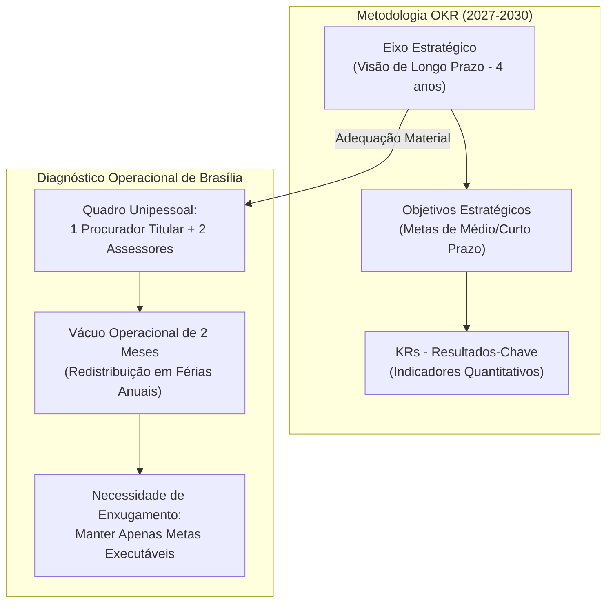
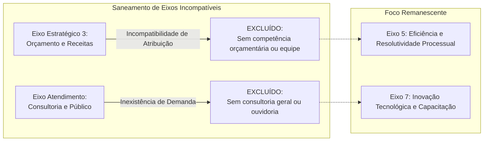
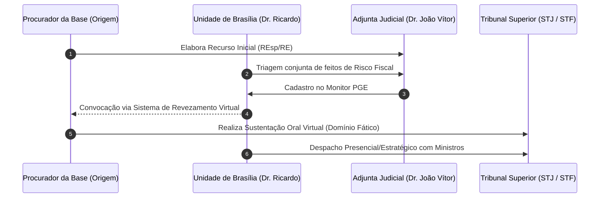
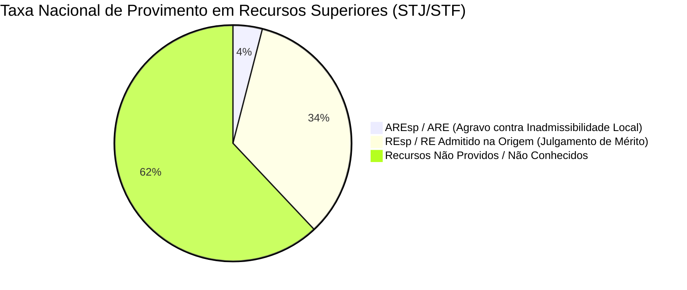
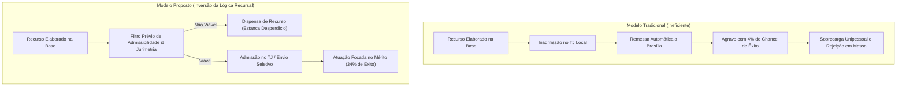
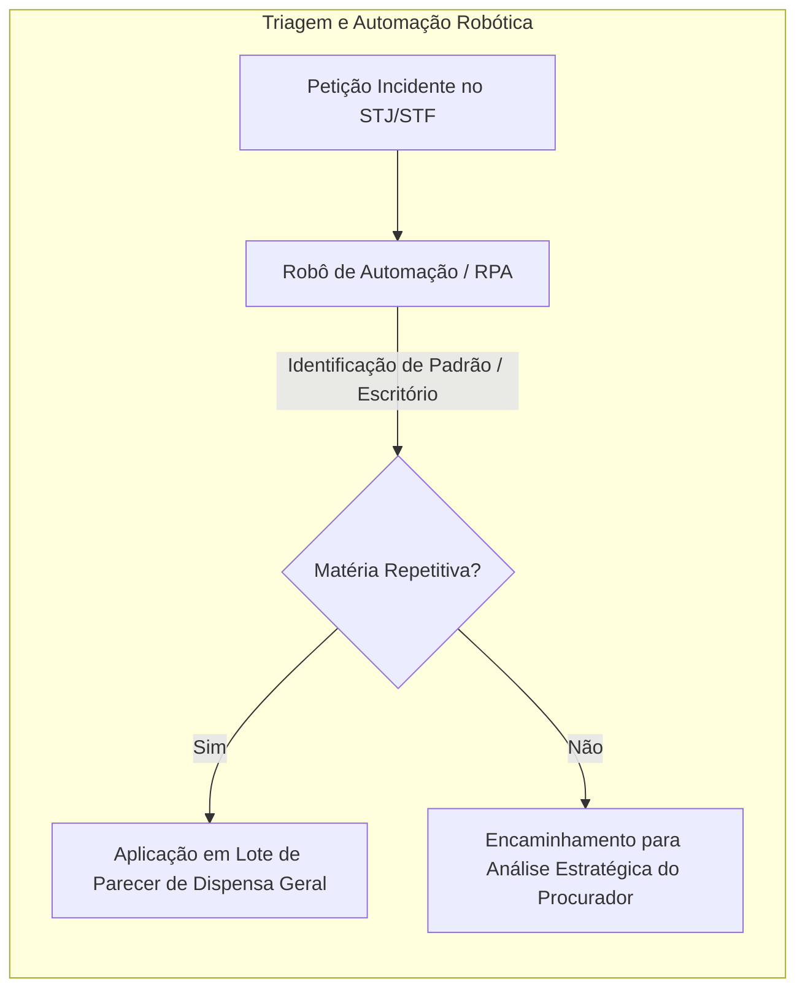
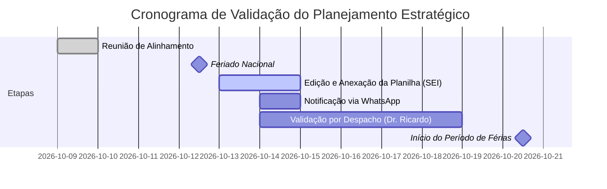

# Resumo de Reunião de Planejamento Estratégico: 09/10/2026 - Ajuste de Eixos, Objetivos e Metas (KRs) da Unidade de Brasília (2027–2030)

## Ideia Central (Tese)
A reunião de planejamento estratégico realizada entre o Procurador Dr. Ricardo Séllos e Bruno Leite (Adjunta para Assuntos Estratégicos) definiu a readequação do Plano de Ação 2027–2030 da Unidade da PGE em Brasília à sua estrita realidade operacional e institucional [5, 8]. Diante do quadro unipessoal da unidade e de sua atuação focada exclusivamente nos Tribunais Superiores (STJ e STF), o alinhamento eliminou eixos inviáveis — como captação de receitas, gestão orçamentária e atendimento ao público — para concentrar esforços em duas frentes fundamentais: a gestão seletiva de processos prioritários e a inovação tecnológica [6, 9, 10]. O encontro estabeleceu novos paradigmas operacionais, incluindo a proposta de inversão da lógica recursal para estancar a remessa de recursos ineficientes, a implementação de robôs para automação de tarefas repetitivas, o revezamento virtual de procuradores da base em sustentações orais e o fluxo didático de agravos, reduzindo o planejamento a dois eixos centrais e cerca de sete metas validadas antes do período de férias da chefia [6, 14, 16, 17, 22].

---

## Desenvolvimento Detalhado e Estruturado

### 1. Contexto Institucional, Metodologia OKR e Diagnóstico da Unidade de Brasília

O alinhamento do Planejamento Estratégico da Procuradoria-Geral do Estado (PGE) para o quadriênio 2027–2030 baseia-se na metodologia de **OKRs** (*Objectives and Key Results* / Objetivos e Resultados-Chave) [8, 30]. Essa estrutura metodológica divide o direcionamento institucional em três níveis encadeados [29, 30]:

*   **Eixos Estratégicos**: Representam a visão de longo prazo da instituição, definindo onde a PGE deseja se encontrar ao término do ciclo de quatro anos [29, 30].
*   **Objetivos Estratégicos**: Desdobramentos de médio e curto prazo dos eixos, voltados a operacionalizar a visão estratégica [30].
*   **Resultados-Chave (KRs - *Key Results*)**: Metas quantificáveis e mensuráveis que aferem o atingimento progressivo dos objetivos [30].

Durante a sessão de alinhamento, o Procurador Dr. Ricardo Séllos apresentou o diagnóstico real da Unidade de Brasília, destacando que a unidade conta com **apenas um procurador titular** e dois assessores jurídicos [8, 20, 26]. Essa configuração unipessoal gera limitações materiais severas: durante o período de férias anuais do titular (composto por até dois meses de ausência), os processos são redistribuídos para procuradores da base, gerando um vácuo no acompanhamento direto e personalizado perante as instâncias superiores [8, 26]. 

A conjuntura da Unidade de Brasília assemelha-se à do Núcleo de Combate à Improbidade Administrativa, liderado pelo Subprocurador Dr. Beolâ, que também opera de forma unipessoal [8, 27]. Diante da impossibilidade material de execução, Bruno Leite reforçou a premissa de que manter metas irrealistas compromete a gestão estratégica, sendo imperativo enxugar o plano e manter apenas metas dotadas de efetiva executibilidade e capacidade de mensuração [8, 27].

---

### 2. Saneamento do Plano de Ação: Exclusão de Eixos Incompatíveis

A análise pormenorizada da proposta inicial revelou a presença de eixos e indicadores concebidos para unidades administrativas ou especializadas de grande porte na sede da PGE, mas completamente alheios à competência e à estrutura da Unidade de Brasília [6, 9, 10].

#### Eixo Estratégico 3 – Incrementar e Executar Integralmente o Orçamento Institucional
*   **Captação de Recursos Externos (Objetivo 1 / KR1)**: A busca por receitas alternativas via convênios ou parcerias revelou-se materialmente inviável [1, 9, 29]. O orçamento da PGE é pré-estruturado pela administração central, e a unidade regional não possui competência regimental nem quadro de pessoal para captação orçamentária [9, 29, 31]. **Decisão**: Exclusão imediata e integral do indicador [6, 9].
*   **Controle de Execução Orçamentária e Contratual (Objetivo 1 / KR2)**: O acompanhamento da execução orçamentária inicial e gestão de contratos administrativos é atribuição da sede [1, 31, 32]. A competência da Unidade de Brasília, definida pela Lei Orgânica, restringe-se estritamente ao acompanhamento processual judicial perante os Tribunais Superiores [31, 32]. **Decisão**: Exclusão do objetivo e dos KRs associados [6, 32].

#### Eixo Estratégico – Proporcionar Satisfação e Qualidade no Atendimento
*   **Atendimento ao Público, Ouvidoria e Consultoria Geral**: Questionado sobre a existência de demandas consultivas de secretarias de Estado, ouvidoria ou órgãos de controle externo, Dr. Ricardo Séllos esclareceu que a unidade não realiza atendimentos ao público nem emite pareceres consultivos cotidianos [6, 10, 33]. Atuações fora do contencioso limitam-se ao acompanhamento jurídico formal de autoridades (como o Governador do Estado) em missões oficiais em Brasília [10, 33, 34]. **Decisão**: Eliminação completa do eixo e de suas metas por ausência de aderência funcional [6, 10, 34].

---

### 3. Eixo Estratégico 5 – Gestão Estratégica nos Tribunais Superiores (STJ e STF)

Com a eliminação dos eixos incompatíveis, o plano concentrou-se na atividade-fim da Unidade de Brasília: a atuação perante o Superior Tribunal de Justiça (STJ) e o Supremo Tribunal Federal (STF) [6, 11, 34].

#### Aprimoramento da Gestão de Processos Estratégicos (Objetivo 1)
Brasília atua como o **último bastião judicial** do Estado para reverter decisões desfavoráveis ou consolidar teses de grande impacto fiscal e social [11, 35]. 
*   **Parceria com a Adjunta Judicial**: A identificação e triagem dos processos prioritários são feitas em colaboração direta entre Dr. Ricardo Séllos e o Adjunto Judicial, Dr. João Vítor [11, 35, 36].
*   **Ferramenta Monitor PGE**: Como a Unidade de Brasília não está integrada operacionalmente ao aplicativo *Monitor PGE*, a gestão no sistema permanece sob responsabilidade do Dr. João Vítor [11, 37, 38]. Dr. Ricardo atua identificando processos relevantes na distribuição dos Tribunais Superiores e alimentando a Adjunta Judicial para inserção no sistema [11, 38, 39].

#### Audiências, Memoriais e Sustentações Orais (Objetivo 1 / KR2)
Atualmente, o titular em Brasília realiza pessoalmente os despachos com Ministros, a entrega de memoriais e as sustentações orais nos feitos estratégicos [2, 12, 41]. Contudo, a reunião formalizou duas propostas inovadoras para otimizar essa atuação [12, 42, 44]:

1.  **Sistema de Revezamento Virtual**: Proposição de uma escala que permita a procuradores da base (que atuaram no processo desde a primeira instância e no Tribunal de Justiça) realizarem sustentações orais e despachos virtuais perante o STJ e STF [12, 42, 43]. 
    *   *Fundamentação Técnica / Analogia*: O procurador de origem domina detalhes fáticos e nuances da instrução probatória que muitas vezes não constam expressamente das peças recursais sintéticas, fazendo diferença decisiva na sensibilização dos Ministros [12, 43, 44].
2.  **Capacitação em Sustentação Oral**: Em alinhamento com a Procuradoria Judicial (Dra. Marcela Polo), propôs-se a inclusão de treinamentos práticos para procuradores que não se sentem confortáveis ou seguros em sustentar oralmente, expandindo o quadro de atuantes [12, 44, 45].

---

### 4. Análise Crítica da Taxa de Êxito, Inversão da Lógica Recursal e Jurimetria

#### Desconstrução do Indicador de Taxa de Êxito (Objetivo 1 / KR3)
A fixação de metas baseadas estritamente em "taxa de êxito" nos Tribunais Superiores foi criticada por sua extrema subjetividade e dependência de fatores alheios ao trabalho realizado em Brasília [2, 13, 47, 48]. Nos Tribunais Superiores, vige a vedação ao reexame de fatos e provas (Súmulas 5 e 7 do STJ; Súmula 279 do STF) [13, 48, 49]. Assim, a probabilidade de vitória em Brasília é quase totalmente determinada pela qualidade técnica da peça originária produzida na base [13, 49, 53].

#### Radiografia Estatística Nacional do STJ e STF
Dr. Ricardo Séllos apresentou dados estatísticos oficiais publicizados pelo STJ e STF sobre o fluxo recursal nacional [13, 51, 52]:

*   **Agravo em Recurso Especial (AREsp) / Agravo em Recurso Extraordinário (ARE)**: Quando o Presidente do Tribunal de Justiça local nega seguimento ao recurso com base em óbices sumulares e o Estado interpõe Agravo, a chance nacional de provimento e reversão do óbice é de apenas **3% a 4%** [13, 52, 53].
*   **Recurso Especial (REsp) / Extraordinário (RE) Admitido na Origem**: Quando o recurso supera o juízo de admissibilidade local e é remetido diretamente para julgamento de mérito no STJ/STF, a taxa de sucesso salta para **34%** [13, 52, 53].

*Diagnóstico*: De 90% a 95% dos não conhecimentos decorrem de falhas técnicas e atécnicas na elaboração inicial do recurso na base (inobservância de pressupostos formais, ausência de impugnação específica, falta de comprovação de feriado local, intempestividade) e não de erros na decisão do Tribunal local [15, 61, 73, 75].

#### Proposta de Inversão da Lógica Recursal
Inspirado na atuação das Procuradorias-Gerais dos Estados de São Paulo (PGE-SP), Bahia (PGE-BA) e Sergipe (PGE-SE), Dr. Ricardo defendeu a **Inversão da Lógica Recursal** [14, 55, 100]:

*   **Novo Paradigma**: A regra institucional passa a ser **não recorrer extraordinariamente de forma automática** [14, 55].
*   **Filtro de Admissibilidade Prévia**: O procurador de origem deve apresentar justificativa técnica demonstrando a viabilidade concreta do recurso e a probabilidade de provimento perante os Tribunais Superiores antes de enviá-lo a Brasília [14, 55, 56].
*   **Otimização do Funil**: Em vez de afunilar 100 recursos fracos sobre um único procurador em Brasília (com 4% de êxito), a PGE remeteria apenas 20 recursos altamente qualificados, elevando a taxa de êxito institucional para patamares próximos a 34% e reduzindo o desgaste da imagem do Estado perante as Cortes [14, 56].

#### Jurimetria e Fluxo Didático de Agravos
1.  **Jurimetria**: Uso de ferramentas para mapear o perfil de julgamento de turmas e gabinetes de Ministros específicos (prática realizada artesanalmente por Dr. Ricardo e que passará a ser sistematizada) [14, 57, 58].
2.  **Fluxo Didático dos Agravos**: Proposta para que os agravos decorrentes de decisões de inadmissibilidade retornem para elaboração pelo próprio procurador de base que redigiu a peça original [16, 66, 67]. Ao enfrentar a decisão de inadmissibilidade (por exemplo, por falta de juntada da lei local sobre feriado municipal para comprovar tempestividade), o procurador assimila o erro processual e corrige a técnica em lançamentos futuros [16, 66, 75, 76].
3.  **Reclassificação da Meta**: Diante da estrutura reduzida, a meta de "aumento de recursos conhecidos" foi reclassificada de execução direta para **indicador de caráter consultivo e focado em capacitação** [6, 16, 83].

---

### 5. Automação Robótica, Tratamento de Prazos e Eliminação do Desperdício Institucional

#### Automação e Redução de Demandas Repetitivas (Eixo 5 / Objetivo 5)
A Unidade de Brasília lida com volumosas demandas repetitivas oriundas de sindicatos e associações de servidores [17, 87, 94]. 

*   **Pareceres de Dispensa Geral**: Atualmente, Dr. Ricardo utiliza pareceres de dispensa geral de contrarrazões autorizados pelo Procurador-Geral Adjunto Judicial [17, 89, 91]. Sendo as contrarrazões uma peça facultativa, e sendo a taxa de êxito do recurso da parte contrária de apenas 4%, abster-se de contrarrazoar libera tempo precioso para focar nos processos de risco fiscal [17, 88, 89].
*   **Introdução de Robôs de Automação (RPA / IA)**: Bruno Leite propôs o apoio da equipe de desenvolvimento da Adjunta para Assuntos Estratégicos para criar robôs capazes de identificar automaticamente petições repetitivas [6, 17, 93, 95]. Como exemplo, a identificação visual ou textual de logotipos de grandes escritórios patronais/sindicais permitirá a aplicação automática de despachos em lote e minutas padronizadas [17, 94, 95, 96].

#### Tratamento de Prazos e Teses Pacificadas (Eixo 6)
No tocante ao controle de prazos processuais, registrou-se que a Unidade de Brasília possui índice **zero de perda de prazos peremptórios**, mantendo rigoroso controle interno [3, 18, 85, 98].

O gargalo identificado não reside na perda de prazos, mas no **desperdício de esforço institucional em teses pacificadas** [18, 98, 99]:
*   *Analogia / Caso Prático*: Em ações de indenização por morte de detento no sistema prisional, o STJ pacificou o entendimento de que o valor justo de indenização situa-se entre R$ 50.000,00 e R$ 100.000,00 [18, 99]. Contudo, procuradores da base continuam interpondo Recursos Especiais contra condenações de R$ 60.000,00 [18, 99, 100]. Ao chegarem a Brasília, tais recursos exigem que Dr. Ricardo elabore pareceres individuais de dispensa para estancar o andamento inútil [18, 99, 100].
*   *Solução*: A consolidação da inversão da lógica recursal impedirá que recursos contrários a jurisprudências pacificadas dos Tribunais Superiores sejam sequer minutados na base, otimizando integralmente o fluxo de trabalho [18, 19, 100].

---

### 6. Inovação Tecnológica, Capacitação Digital e Cronograma de Validação

#### Ajustes nas Metas do Eixo Estratégico 7
*   **Projetos de Inovação (KR1)**: As metas voltadas ao desenvolvimento de projetos formais de inovação foram **eliminadas**, pois exigem equipes dedicadas de procuradores [4, 20, 101].
*   **Capacitação Digital e Inteligência Artificial (KR2)**: As metas de capacitação em Direito Digital, Inteligência Artificial e novas tecnologias foram **mantidas e enfatizadas** para procuradores e assessores [4, 21, 102]. Dr. Ricardo ressaltou que o STJ e o STF já adotam triagens rigorosas por IA e exigirão resumos estruturados; sem capacitação técnica contínua na confecção das peças, a IA das Cortes Superiores rejeitará os recursos estaduais com celeridade ainda maior [21, 81].
*   **Perspectiva de Expansão de Quadro**: Informou-se que o Procurador-Geral autorizou a abertura de edital para remoção/lotação de um **segundo procurador** em Brasília, com previsão de chegada para o início de 2027, o que minorará o cenário unipessoal [79, 80].

#### Consolidação do Plano e Cronograma de Entrega
O planejamento estratégico da Unidade de Brasília foi reduzido de uma extensa lista para **apenas dois eixos estratégicos e cerca de sete metas** com total aderência operacional [21, 103].

---

## Explicações Complementares das Citações

1.  **Citação [1] (Eixo Estratégico 3 do Plano de Ação da PGE)**: Refere-se à previsão original do plano de ação para incremento e execução do orçamento e ampliação de receitas contratuais/externas [1]. *Explicação*: Esse item foi revisado por demonstrar incompatibilidade total com as atribuições da Unidade de Brasília, que não administra contratos ou orçamentos [9, 31].
2.  **Citação [2] (Eixo Estratégico 5 do Plano de Ação da PGE)**: Trata das metas iniciais de atuação estratégica, incluindo o aumento da taxa de êxito para 80% e aumento proporcional de 20% nos recursos conhecidos [2]. *Explicação*: O detalhamento das discussões demonstrou que tais metas de execução direta não se aplicam a Brasília sem reclassificação consultiva e suporte da base [16, 49, 83].
3.  **Citação [3] (Objetivos de Automação e Prazos)**: Refere-se às metas de redução de atividades repetitivas em 20%, tempo de elaboração em 50% e manutenção de zero prazos perdidos [3]. *Explicação*: Validou-se que Brasília mantém zero perda de prazos peremptórios, concentrando a automação no uso de robôs para triagem de petições repetitivas [17, 18, 98].
4.  **Citação [4] (Eixo Estratégico 7 - Inovação e Capacitação)**: Contempla as metas de implementação de projetos de inovação e capacitação de 25% do pessoal em IA e Direito Digital [4]. *Explicação*: As metas de projetos de inovação foram excluídas por falta de equipe de procuradores, enquanto as metas de capacitação digital foram integralmente preservadas [20, 21, 102].
5.  **Citação [5] (Anotações do Gemini - Cabeçalho da Reunião)**: Registro formal da reunião realizada em 09/10/2026 entre Dr. Ricardo Séllos e Bruno Leite [5]. *Explicação*: Serve como marco documental da revisão prévia do planejamento estratégico 2027–2030 antes das férias da chefia [5, 22].
6.  **Citação [6] (Resumo das Decisões Alinhadas)**: Síntese das decisões tomada no encontro: exclusão de receitas, eliminação de atendimento, robótica para processos repetitivos e validação de planilha [6]. *Explicação*: Consolida o consenso normativo e operacional atingido entre as partes [6].
7.  **Citação [7] (Próximas Etapas e Atribuições)**: Lista de tarefas atribuídas a Bruno Leite (editar planilha, encaminhar modelo) e a Dr. Ricardo Séllos (validar por despacho) [7]. *Explicação*: Detalha o fluxo procedimental no SEI e WhatsApp para encerramento do processo administrativo [7, 22].
8.  **Citação [8] (Contexto e Quadro Unipessoal)**: Registro do problema central apontado pelo Dr. Ricardo sobre atuar como único procurador em Brasília e o vácuo de dois meses nas férias [8]. *Explicação*: Justificou a aplicação da mesma metodologia de enxugamento aplicada ao Núcleo de Improbidade (Dr. Beolâ) [8, 27].
9.  **Citação [9] (Análise do Eixo 3 e Inviabilidade de Receitas)**: Discussão técnica demonstrando que o orçamento da PGE vem engessado da sede e Brasília não possui pessoal para captação externa [9]. *Explicação*: Motivou a exclusão imediata do indicador de captação de recursos [6, 9].
10. **Citação [10] (Exclusão de Atendimento ao Público e Consultoria)**: Esclarecimento de que Brasília não realiza atendimento ao público ou consultoria jurídica a secretarias [10]. *Explicação*: Resultou no descarte do Eixo de Atendimento por ausência de aderência funcional [6, 10, 33].
11. **Citação [11] (Gestão de Processos Estratégicos e Monitor PGE)**: Detalhamento da atuação conjunta com a Adjunta Judicial (Dr. João Vítor) e o uso do sistema Monitor PGE [11]. *Explicação*: Ficou assentado que a liderança no sistema Monitor PGE cabe ao Adjunto Judicial, atuando Brasília no envio de processos relevantes [11, 38, 39].
12. **Citação [12] (Sustentações Orais e Revezamento Virtual)**: Proposta de criação de uma escala virtual para que procuradores de origem sustentem oralmente no STJ e STF [12]. *Explicação*: Fundamenta-se no maior domínio fático do procurador que instruiu a ação na primeira e segunda instâncias [12, 43, 44].
13. **Citação [13] (Estatísticas Nacionais do STJ/STF e Taxa de Êxito)**: Apresentação dos dados de 4% de êxito em AREsp/ARE contra 34% em recursos admitidos na origem [13]. *Explicação*: Demonstra matematicamente que o problema de insucesso reside nos vícios formais da peça elaborada na base e não na atuação em Brasília [13, 52, 53].
14. **Citação [14] (Inversão da Lógica Recursal e Jurimetria)**: Apresentação do modelo de não recorrer automaticamente, exigindo justificativa de admissibilidade (ex.: PGE-SP, PGE-BA, PGE-SE) [14]. *Explicação*: Constitui a principal medida estruturante para estancar a remessa de recursos inviáveis e aumentar a taxa de sucesso institucional [14, 55, 56].
15. **Citação [15] (Origem dos Erros nos Recursos)**: Apontamento de que 90% a 95% dos óbices decorrem de falhas atécnicas de elaboração na base [15]. *Explicação*: Reforça a necessidade de focar o planejamento na capacitação da base e no filtro prévio de admissibilidade [15, 61, 62].
16. **Citação [16] (Fluxo Didático dos Agravos e Reclassificação)**: Sugestão de que os agravos retornem ao procurador de origem para aprendizado prático e reclassificação do KR para consultivo [16]. *Explicação*: Permite transformar a rotina recursal em instrumento pedagógico sem sobrecarregar a Unidade de Brasília com metas diretas inexecutáveis [16, 66, 83].
17. **Citação [17] (Automação por Robôs e Pareceres de Dispensa)**: Uso de pareceres de dispensa geral de contrarrazões e proposta de robôs para identificação de teses repetitivas [17]. *Explicação*: Estratégia tecnológica para liberar tempo do procurador focado em contencioso de alto risco fiscal [17, 89, 93, 95].
18. **Citação [18] (Tratamento de Prazos e Teses Pacificadas)**: Discussão sobre o cumprimento rigoroso de prazos e o desperdício de energia em recursos contra jurisprudências consolidadas (ex.: mortes de detentos) [18]. *Explicação*: Ilumina a diferença entre eficiência formal (prazos) e eficiência substancial (não recorrer do que já está perdido) [18, 98, 99].
19. **Citação [19] (Exemplo Prático de Indenização por Morte de Detento)**: Detalhamento do parâmetro do STJ entre R$ 50 mil e R$ 100 mil e o recurso desnecessário em condenações de R$ 60 mil [19]. *Explicação*: Exemplo fático utilizado para convencer sobre a urgência da inversão da lógica recursal [18, 19, 100].
20. **Citação [20] (Exclusão de Metas de Projetos por Ausência de Equipe)**: Esclarecimento de que a Unidade possui apenas 1 procurador e 2 assessores, não se enquadrando na exigência de equipe de procuradores para projetos [20]. *Explicação*: Motivou o cancelamento das metas de projetos formais de inovação [6, 20, 101].
21. **Citação [21] (Manutenção de Capacitação e Enxugamento Final)**: Confirmação da importância da capacitação em IA e redução do plano para 2 eixos e ~7 metas [21]. *Explicação*: Síntese do resultado do alinhamento estratégico, garantindo um plano compacto e plenamente executável [21, 103].
22. **Citação [22] (Cronograma de Validação Antes das Férias)**: Definição do envio do material ajustado até 14/10 para validação antes de 20/10/2026 [22]. *Explicação*: Garante o encerramento do processo administrativo SEI com segurança jurídica e eficácia institucional [7, 22, 105, 107].
