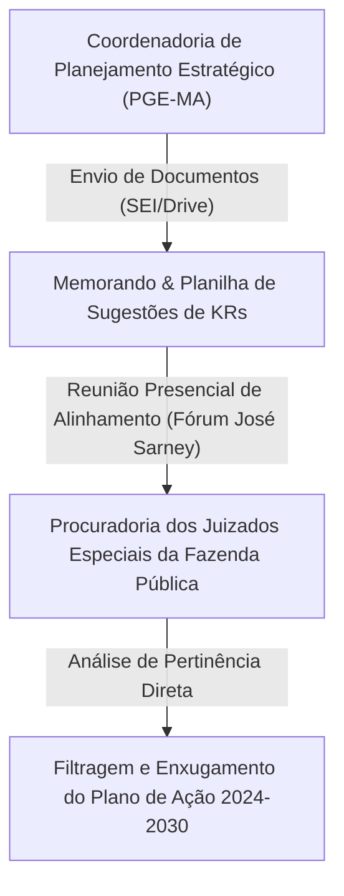
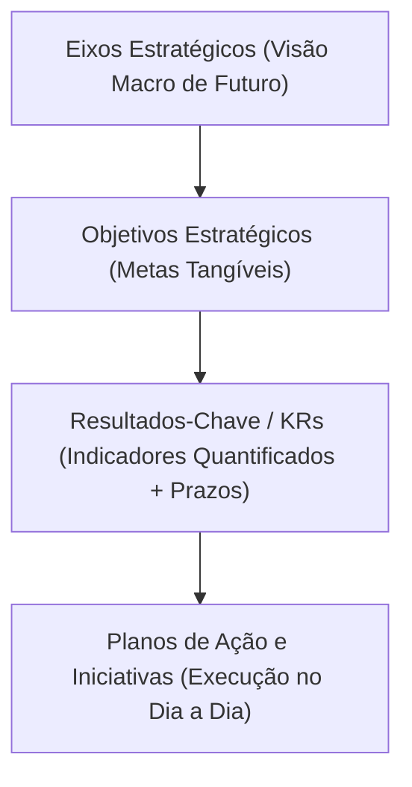
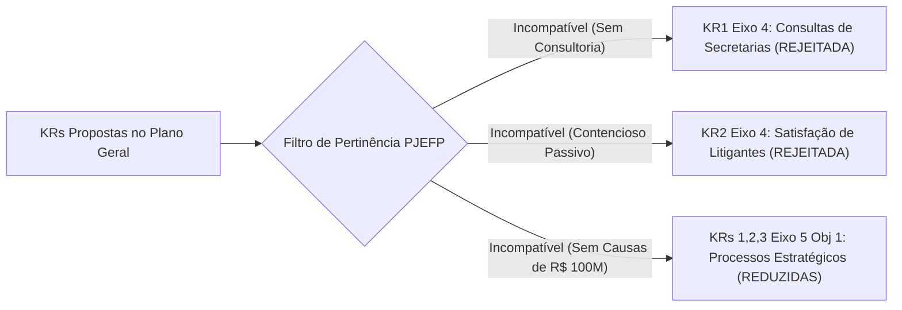
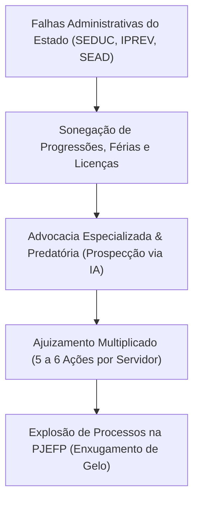
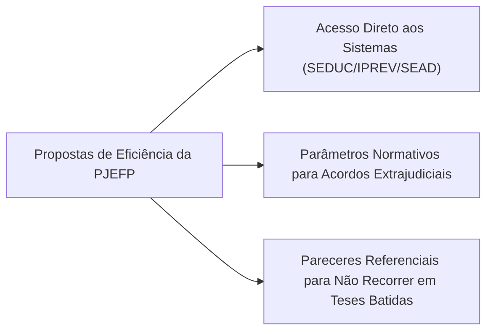
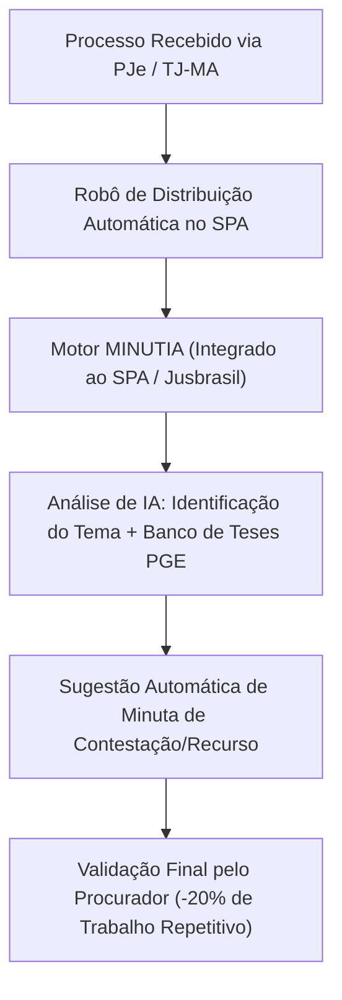
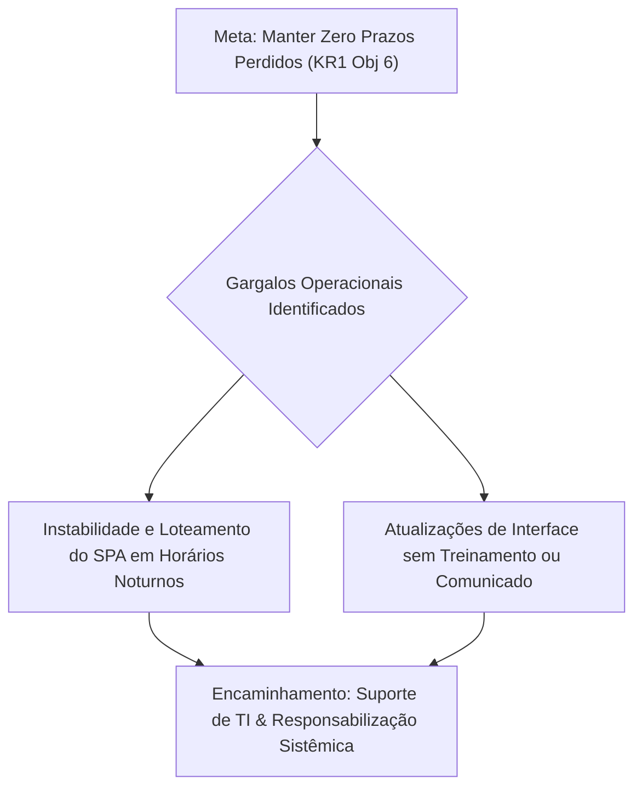
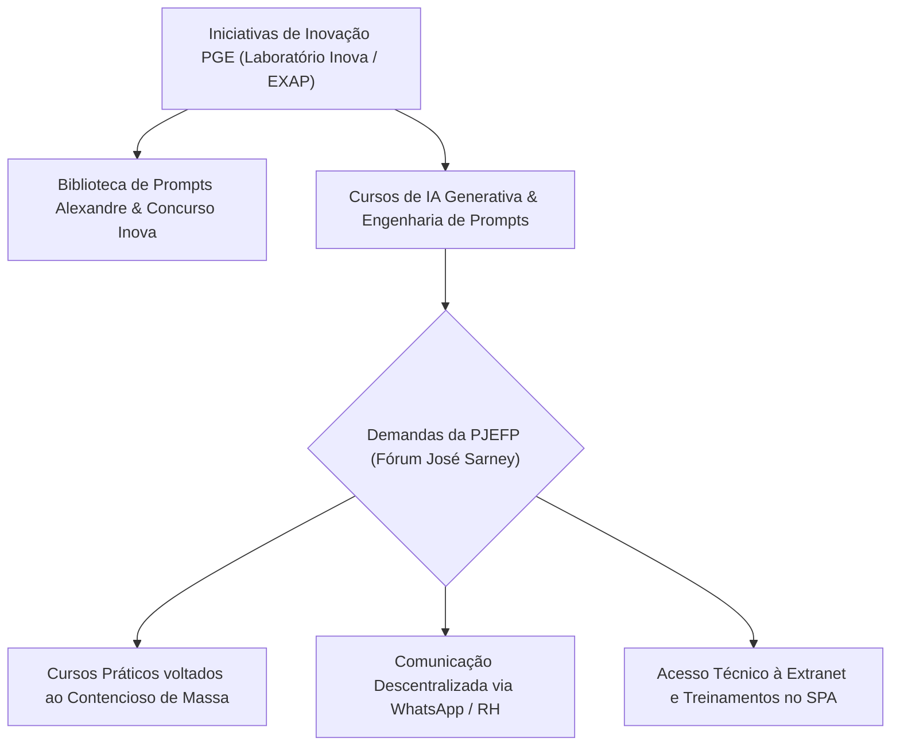
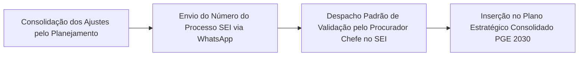

# Resumo de Reunião de Alinhamento do Planejamento Estratégico da PGE-MA: Planejamento Estratégico 2024–2030 - Procuradoria dos Juizados Especiais da Fazenda Pública - Filtragem de Eixos, Objetivos e Metas (KRs)

## Ideia Central (Tese)
Esta reunião de alinhamento estratégico reuniu a equipe da Coordenadoria de Planejamento Estratégico da Procuradoria-Geral do Estado do Maranhão (PGE-MA) e os Procuradores do Estado lotados na Procuradoria dos Juizados Especiais da Fazenda Pública (PJEFP - Fórum José Sarney) para realizar a filtragem, adequação e validação do Plano de Ação 2024–2030 [1, 2, 3]. O objetivo central do encontro consistiu em ajustar as metas globais da PGE-MA à realidade operacional do contencioso cível de massa [7, 10], afastando indicadores incompatíveis com a atuação no Juizado Especial, mapeando as causas estruturais da explosão de litígios estaduais [16, 17] e estabelecendo soluções baseadas na integração de sistemas (SEDUC, IPREV, SEAD) [18, 19], na normatização de acordos extrajudiciais [21, 22] e na automação tecnológica via ferramenta MINUTIA e robôs integrados ao Sistema de Processos Administrativos (SPA) [27, 29, 31].

---

## Desenvolvimento Detalhado e Estruturado

### Tópico 1: Contextualização Institucional e Abertura dos Trabalhos
A reunião foi conduzida por Bruno, representante do setor de Planejamento Estratégico da PGE-MA, juntamente com o Procurador de Estado Chefe e a equipe de procuradores atuantes na Procuradoria dos Juizados Especiais da Fazenda Pública, instalada no Fórum Desembargador José Sarney [1, 2, 46]. A PJEFP possui uma particularidade geográfica e operacional relevante no âmbito do órgão central: está fisicamente descentralizada da sede da Procuradoria-Geral [46, 47], o que gera desafios específicos de comunicação institucional, acesso à Extranet e integração com os fluxos administrativos e tecnológicos da instituição [48, 49].

A finalidade primordial da exposição presencial foi apresentar o acervo documentacional do Planejamento Estratégico (composto por memorando explicativo, tabela de eixos e metas, e planilha de sugestões de planos de ação) [1, 2] e submetê-lo a um rigoroso "filtro de pertinência" [3]. A orientação do Planejamento Estratégico é garantir que cada unidade especializada da PGE assuma estritamente metas (Key Results - KRs) que possuam execução direta no seu dia a dia laboral, eliminando atribuições indiretas ou meramente consultivas que poluam a gestão por resultados [3, 7].

---

### Tópico 2: Metodologia de Planejamento Estratégico da PGE-MA
Durante a abertura metodológica, Bruno expôs a arquitetura conceitual adotada pela PGE-MA para a formulação do seu plano estratégico de longo prazo (ciclo 2024–2030) [3, 5, 49, 50]. A metodologia desdobra-se em quatro níveis hierárquicos interligados:

1. **Eixos Estratégicos:** Representam os temas organizacionais macro, traduzindo a visão subjetiva de futuro do órgão até 2030 (como a PGE deseja ser reconhecida pela sociedade e pelas instituições parceiras) [3, 5, 50].
2. **Objetivos Estratégicos:** Consistem em metas operacionais tangíveis e alcançáveis de médio e longo prazo, desenhadas para operacionalizar o alcance de cada eixo [4, 5].
3. **Resultados-Chave (KRs - Key Results / Metas):** Indicadores mensuráveis e quantificados, associados a marcos temporais bem definidos, que balizam e comprovam o cumprimento progressivo dos objetivos [5, 6]. Bruno ressaltou que tanto as métricas quantitativas quanto os prazos finais das KRs estão sendo ajustados coletivamente após a escuta de cada especializada [6].
4. **Planos de Ação / Iniciativas:** Projetos e rotinas concretas de execução no cotidiano administrativo e judicial que viabilizam o atingimento dos KRs [2, 44, 45].

Ademais, definiu-se o conceito de ***Stakeholders*** no contexto da advocacia pública: todos os parceiros estratégicos internos (servidores, procuradores, gestão) e externos (poder judiciário, secretarias de estado, cidadãos e órgãos de controle) que mantêm relacionamento direto com a atuação da PGE [4, 5, 51].

---

### Tópico 3: Análise Crítica e Filtragem dos Eixos e KRs pela Procuradoria dos Juizados Especiais da Fazenda Pública

#### 3.1. Eixo Estratégico 4 – Proporcionar Maior Satisfação e Qualidade no Atendimento
- **Objetivo 1:** Melhorar a experiência de stakeholders externos e internos [4, 51].
  - **KR1 (Assegurar resposta a 90% das consultas das secretarias no prazo):** **AFASTADA / REJEITADA** [7]. A equipe da PJEFP esclareceu que atua exclusivamente no contencioso judicial de massa, não respondendo a consultas jurídicas ou emitindo pareceres preventivos para secretarias de estado, atribuição afeta às procuradorias de assessoria consultiva [7].
  - **KR2 (Atingir e manter em 90% o índice de satisfação do usuário externo):** **AFASTADA / REJEITADA** [8, 51]. O Procurador Chefe apresentou uma reflexão pedagógica e bem-humorada sobre a natureza do contencioso de massa público: a PJEFP não realiza atendimento presencial direto ao público e sua função precípua é obter a improcedência das pretensões ajuizadas contra o Estado [8]. Desse modo, o usuário externo litigante (parte contrária) invariavelmente sai insatisfeito quando a PGE obtém êxito judicial [8, 9].

#### 3.2. Eixo Estratégico 5 – Alcançar Maior Eficiência e Resolutividade nos Processos Internos e Externos
- **Objetivo 1:** Aprimorar a gestão de processos estratégicos [10, 52].
  - **Analogia do "Jurídico de Massa" vs. "Empresas de Telefonia (Vivo)":** O Procurador formulou uma analogia marcante para desenhar a rotina da especializada [9, 10]. A PJEFP funciona como o departamento jurídico de uma grande concessionária de serviço público (ex.: operadora telefônica): recebe um volume colossal de ações repetitivas, fundadas em "teses batidas" [9, 10]. Não há processos estratégicos, causas de valores astronômicos (acima de R$ 100 milhões) ou discussões de alto impacto estrutural no Estado; trata-se de um volumoso contencioso onde os advogados "jogam barro na parede" (fenômeno do *"vai que cola"*) [10, 11, 12].
  - **KR1, KR2 e KR3 (Identificação, Atuação Padronizada e Taxa de Êxito em Processos Estratégicos):** **REDUZIDAS / DESCARTE PARCIAL** [12, 15, 52]. Diante da ausência do critério objetivo de valor/impacto normativo na unidade, essas metas foram retiradas do escopo direto do Juizado [12, 15].
  - **Limitações Estruturais e Carga de Trabalho Real:** Quanto à cobrança por maior presença de procuradores em audiências e atos presenciais (foco em despachos e sustentação oral desejado pela direção - Dr. Denis) [12], os procuradores apontaram a impossibilidade física e material [12, 13]: a unidade conta com **apenas 4 procuradores** [12], responsáveis por cobrir pautas diárias de audiências de segunda a sexta-feira (cerca de 24 audiências diárias por procurador) e redistribuição massiva de prazos (ex.: 150 prazos recebidos em um único dia) [12, 13]. Mencionou-se o paralelo com a Subprocuradoria de Combate à Improbidade (Dr. Beândia), onde o procurador atua sozinho sem estrutura de apoio [14].

---

### Tópico 4: Diagnóstico das Causas do Litígio Massivo e Estratégias de Redução de Demandas

#### 4.1. Diagnóstico da Explosão Processual no Juizado
Ao analisarem o **Objetivo 2 do Eixo 5 (KR1: Reduzir em 20% o ajuizamento de novos processos até 2030)** [16, 53], os interlocutores constataram uma realidade oposta: o número de ações judiciais contra o Estado no Juizado Especial da Fazenda Pública está explodindo [16, 24].

A causa primária do litígio de massa não decorre da atuação da Procuradoria, mas sim de **falhas administrativas crônicas do próprio Estado do Maranhão na ponta executiva** [17, 20, 24]. As secretarias estaduais descumprem deveres básicos com seus servidores públicos, gerando passivos acumulados que estimulam o acionamento do Judiciário [17, 24, 25]:
- Não concessão ou atraso no pagamento de progressões funcionais e gratificações de titulação [17, 24].
- Não pagamento de férias acumuladas (inclusive da década de 1990) e licenças-prêmio não gozadas por servidores aposentados [16, 25].
- Retenção indevida de abono de permanência [25].

Com a constatação de que o Juizado Especial é célere no julgamento e veloz no pagamento de Requisições de Pequeno Valor (RPVs) [24], os advogados especializados "descobriram" o nicho e passaram a atuar de forma massiva [16, 24]. Um único professor estadual, por exemplo, ingressa com 5 a 6 ações judiciais distintas para cobrar cada uma das verbas sonegadas [24, 25]. Mencionou-se a preocupação da PGE e da Magistratura com o avanço da **advocacia predatória** e o uso intensivo de ferramentas automatizadas por escritórios privados [16, 27].

#### 4.2. Soluções Propostas e Condicionantes para Eficiência Judicial
Para que a PJEFP possa contribuir com a meta de redução de litígios e aumento da resolutividade, foram pactuadas as seguintes **iniciativas condicionantes** [18, 19, 21, 23]:

1. **Acesso Direto aos Sistemas de Informação das Secretarias:** Integração imediata e acesso direto dos procuradores aos sistemas bancários e funcionais da **SEDUC (Educação), IPREV (Previdência State), SEAD (Administração) e Secretaria de Segurança Pública** [18, 19]. Com o acesso direto, a PGE pode extrair fichas financeiras e históricos funcionais atualizados para comprovar pagamento ou ausência de direito, instruindo contestações com eficácia e eliminando condenações por falta de provas [18, 19].
2. **Normatização de Acordos Extrajudiciais e Transação:** Atualmente, entre 50% e 60% das ações que chegam ao Juizado resultam em procedência contra o Estado devido à incontestabilidade do direito do servidor [20]. Contudo, a legislação estadual e a postura da direção da PGE são excessivamente rígidas, exigindo autorização expressa do Governador para qualquer transação [21, 22]. A especializada defende a criação de normas de transação (semelhantes às regras do INSS e AGU) e emissão de pareceres referenciais para autorizar a não interposição de recursos e a realização de acordos de redução de prejuízo [20, 21].
3. **Precedente dos Advogados Dativos:** Citou-se a minuta de ato normativo conjunto entre PGE, Tribunal de Justiça (TJ-MA) e OAB-MA como modelo de sucesso para regulamentar pagamentos e tabelas administrativas de conciliação [22, 23].

---

### Tópico 5: Tecnologia, Automação e Modernização dos Fluxos de Trabalho

#### 5.1. Implementação da Ferramenta MINUTIA (Jusbrasil / Coreaplan)
Diante da impossibilidade de expansão do quadro analítico na velocidade da demanda judicial [30, 43], o ponto focal para otimização de fluxos de trabalho (**Eixo 5 - Objetivo 5 / KRs 1 e 2**) reside na automação tecnológica [26, 27, 54].

Bruno apresentou o estágio avançado do processo administrativo de contratação da ferramenta **MINUTIA** [27, 31, 34]. O projeto incluiu a elaboração de Termo de Referência (TR), Estudo Técnico Preliminar (ETP), pesquisa de mercado e encaminhamento à Escola Superior da Advocacia Pública (EXAP) e órgãos orçamentários [34]. A contratação dar-se-á por dispensa de licitação (fundada nos atestados de exclusividade e na aquisição recente do sistema pelo Jusbrasil) [31, 35, 36], com previsão de disponibilização no primeiro semestre do ano subsequente [35]. Estima-se a aquisição de **200 a 300 licenças de acesso** para atender todos os procuradores e assessores da PGE-MA [36].

#### 5.2. Integração Nascida com o SPA e Ganhos de Produtividade
- **Integração Nativa:** O MINUTIA funcionará integrado diretamente ao Sistema de Processos Administrativos (SPA) da PGE [29, 31, 32]. O procurador ou assessor não precisará baixar arquivos ou alternar entre telas [32].
- **Inteligência Artificial Aplicada ao Peticionamento:** A ferramenta analisará a petição inicial, identificará o tema jurídico, pesquisará o banco de teses da PGE e a jurisprudência atualizada dos tribunais, sugerindo automaticamente a minuta de contestação ou recurso adequada [29, 32, 33].
- **Superação do "Assistente de Peças":** Essa tecnologia substitui com folga os modelos antigos (como o assistente tagueado desenvolvido internamente pelo Dr. Denis), que exigiam inserção manual e "copia e cola" exaustivo [32, 33].
- **Meta de Impacto:** O uso da IA objetiva reduzir em pelo menos **20% as atividades manuais e repetitivas** dos procuradores, liberando tempo para a análise de processos mais complexos [33, 54].

#### 5.3. Robôs Institucionais e Automação de Tarefas de Apoio
Além do MINUTIA, acordou-se o fortalecimento e expansão do uso de robôs computacionais no SPA [26, 33, 36]:
1. **Robôs de Distribuição Automática:** Para recepção e triagem imediata do acervo vindo do PJe/TJ-MA [26, 36].
2. **Robôs de Captura e Ciência de Intimações:** Automação do registro de ciências e prazos em sessões de julgamento de 2º Grau (PJ2) e turmas recursais [28, 36].

---

### Tópico 6: Gestão de Prazos Processuais e Diagnóstico de Falhas Operacionais

No âmbito do **Eixo 5 - Objetivo 6 (KR1: Manter em ZERO o número de prazos processuais peremptórios perdidos mensalmente)** [37, 54], os procuradores relataram a rotina concreta e os fatores de risco envolvidos na gestão de prazos [37, 38].

A equipe atestou que a ocorrência pontual de atrasos ou riscos de perda de prazo não decorre de desídia funcional, mas de **grave instabilidade técnica do SPA** [37, 38]:
- O sistema apresenta travamentos, lentidão crítica e indisponibilidade em horários de pico ou durante despachos efetuados no período noturno [37, 38].
- Ocorrem atualizações frequentes da interface do SPA sem qualquer comunicado prévio, nota explicativa ou treinamento para as equipes descentralizadas, gerando desorientação na visualização das abas de prazos e captura de expedientes [38].

Bruno registrou formalmente as reclamações operacionais para encaminhamento ao setor de Tecnologia da Informação (TI) e à Coordenadoria do SPA, ressaltando que a responsabilidade por eventuais falhas sistêmicas de captura deve ser institucionalmente assumida pelo sistema e não imputada individualmente aos procuradores [37, 38].

---

### Tópico 7: Inovação Tecnológica, Capacitação Digital e Gargalos de Comunicação Institucional

#### 7.1. Cultura de Inovação e Capacitação (Eixo Estratégico 7)
A discussão final abordou o **Eixo 7 (Incentivar a Inovação Tecnológica - Objetivo 3: Fomentar Cultura de Inovação e Capacitação Digital)** [39, 55]. Bruno detalhou as iniciativas em andamento coordenadas pela Assessoria de Inovação e pelo Laboratório Inova PGE [42, 43]:
- **Biblioteca de Prompts "Alexandre":** Repositório institucional de prompts instrucionais desenvolvidos para auxiliar procuradores e servidores na utilização diária de ferramentas de Inteligência Artificial generativa [42, 43].
- **Concurso Inova PGE:** Estímulo à criação de ideias e soluções tecnológicas internas [42, 43].
- **Cursos e Capacitações em IA e Direito Digital:** Promoção de eventos em parceria com a EXAP [39, 40, 55]. Mencionou-se o curso ministrado pela Dra. Adriana sobre elaboração de prompts aplicados à advocacia pública (com foco em recursos e técnicas de engenharia de prompt) [40, 41].

#### 7.2. Demandas do Juizado para Superar o Isolamento Institucional
A equipe da PJEFP manifestou entusiasmo com as iniciativas de inovação [39, 50], mas apresentou três pleitos fundamentais para garantir a inclusão prática da unidade [47, 48, 49]:

1. **Adequação Pedagógica dos Cursos:** Solicitação para que os cursos de IA e prompts oferecidos pela EXAP abordem exemplos práticos voltados ao contencioso cível de massa e às matérias dos Juizados da Fazenda Pública, e não apenas ao direito do trabalho ou pareceres consultivos [40, 41].
2. **Canais Diretos de Comunicação (WhatsApp e RH):** Criação de um grupo de avisos institucionais via WhatsApp pelo RH/Comunicação para informar sobre cursos, prazos de inscrição, eventos e feriados, visto que os servidores do Fórum José Sarney não acessam o mural físico da sede [48, 49].
3. **Acesso Pleno à Extranet e Treinamentos no SPA:** Regularização do acesso técnico à Extranet da PGE no Fórum José Sarney e oferta de treinamentos específicos nas novas funcionalidades do SPA [48, 49].

---

### Tópico 8: Encaminhamentos Finais, Validação em Processo SEI e Compromissos Futuros

Ao encerrar a reunião, Bruno e o Procurador Chefe definiram os encaminhamentos formais para a consolidação das metas da PJEFP no Planejamento Estratégico 2024–2030 [45, 46, 49]:

1. **Revisão e Enxugamento da Planilha de KRs:** O setor de Planejamento Estratégico atualizará a planilha excel e o documento de metas, removendo todas as KRs declaradas inaplicáveis (consultas de secretarias, satisfação de usuários externos, processos estratégicos de R$ 100M) e mantendo as KRs de automação, prazos e inovação devidamente condicionadas [45, 46].
2. **Tramitação e Validação via Processo SEI:** Bruno informará o número do processo SEI correspondente via WhatsApp [45, 46]. O Procurador Chefe inserirá um despacho padrão no SEI com os seguintes dizeres: *"Com reunião presencial e documento anexado, valido os dados e o processo"*, conferindo segurança jurídica e formalização ao ajuste [46].
3. **Publicização do Plano Geral PGE 2030:** As sugestões colhidas comporão o documento institucional consolidado do Planejamento Estratégico da PGE-MA, que vigorará até o ano de 2030, direcionando os investimentos institucionais em tecnologia, pessoal e estrutura [49, 50].

---

## Explicações das Citações Numeradas

Below is the detailed list explaining each numbered citation referenced in the report, corresponding to passages from the spoken recording transcript ("CEJUSC - Forum José Sarney.m4a") and the official document ("Procuradoria dos Juizados Especiais da Fazenda Pública - Eixos Objetivos e Metas (KRs).pdf"):

1. **[1]** Refere-se à fala inicial de Bruno informando sobre a aprovação do edital orçamentário e a disponibilização dos três arquivos de planejamento no Drive/SEI (memorando padrão, PDF de metas e planilha de sugestões).
2. **[2]** Refere-se às orientações enviadas no memorando e à sistemática de preenchimento das planilhas de iniciativas sugeridas para validação pelas especializadas.
3. **[3]** Explicação de Bruno sobre a necessidade de filtragem das metas para manter apenas as KRs que possuem pertinência direta e execução no cotidiano de cada setor.
4. **[4]** Apresentação da estrutura hierárquica do planejamento: eixos estratégicos como visão subjetiva de futuro e objetivos de médio/longo prazo como metas tangíveis (ex.: Eixo 4 e melhoria na experiência de parceiros).
5. **[5]** Explicação sobre a quantificação dos objetivos em metas (KRs) e a conceituação de *stakeholders* internos e externos nas relações da PGE.
6. **[6]** Esclarecimento de que os valores numéricos e marcos temporais das KRs foram pré-formatados como proposta e estão sendo ajustados por consenso após a escuta das unidades.
7. **[7]** Discussão da KR de responder a 90% das consultas das secretarias em prazo, oportunidade em que o Procurador esclarece que a PJEFP atua em jurídico de massa (contencioso) e não responde a consultas.
8. **[8]** Análise da KR de satisfação do usuário externo (90%), onde o Procurador pontua com ironia pedagógica que a atuação judicial do Estado visa à improcedência dos pedidos, gerando insatisfação natural na parte contrária.
9. **[9]** Explicação sobre o perfil repetitivo das ações no Juizado Especial e a corrida no sol até a reunião no Fórum José Sarney.
10. **[10]** Formulação da analogia entre a PJEFP e o departamento jurídico de uma empresa de telefonia (ex.: Vivo): atuação em grande volume de causas repetitivas de baixo valor, sem teses inéditas ou processos de impacto estratégico direto.
11. **[11]** Discussão sobre o fenômeno do *"vai que cola"* na advocacia privada e a ausência de causas que preencham os requisitos normativos de processos estratégicos no Juizado.
12. **[12]** Análise da KR de atuação estratégica padronizada (audiências, memoriais e sustentações) desejada pela direção (Dr. Denis), confrontada com a limitação de apenas 4 procuradores e o volume avassalador de audiências diárias e prazos.
13. **[13]** Relato sobre a carga de trabalho extrema (150 prazos distribuídos em um único dia; 24 audiências/dia) e a necessidade de ampliação do quadro de procuradores para permitir gestão administrativa pelo chefe.
14. **[14]** Exemplo comparativo trazido por Bruno referente à Subprocuradoria de Combate à Improbidade (Dr. Beândia), onde o procurador atua isoladamente e despacha para si mesmo por falta de equipe.
15. **[15]** Decisão de reduzir ou afastar a KR de aumento da taxa de êxito em processos estratégicos no âmbito da PJEFP por falta de enquadramento nos critérios objetivos.
16. **[16]** Debate sobre a KR de redução de 20% no ajuizamento de novas ações, constatando-se a explosão no volume de processos no Juizado e a citação de reunião da direção sobre advocacia predatória.
17. **[17]** Mapeamento das causas primárias da explosão de litígios: descumprimento pelo Estado (administração direta) de direitos funcionais básicos de servidores (progressões, férias não pagas, licenças).
18. **[18]** Proposta de concessão de acesso direto aos sistemas informatizados da SEDUC e IPREV para que a PGE obtenha documentos probatórios de forma célere e evite condenações indevidas.
19. **[19]** Ratificação da necessidade de acesso direto aos sistemas da SEDUC, IPREV, SEAD e Segurança Pública como condição indispensável para instrução defensiva eficaz.
20. **[20]** Constatação de que 50% a 60% das ações no Juizado são procedentes por falha administrativa do Estado e sugestão de elaboração de pareceres para não recorrer e realização de acordos para mitigação de prejuízos.
21. **[21]** Crítica à rigidez normativa e à falta de incentivo da direção para a celebração de acordos extrajudiciais pelo Estado, cuja legislação atual exige autorização do Governador.
22. **[22]** Pergunta e esclarecimento sobre a negociação de acordos no âmbito dos honorários de advogados dativos, citando-se a construção de regramento conjunto entre PGE, TJ-MA e OAB-MA.
23. **[23]** Registro das propostas de acesso a sistemas e acordos como condições essenciais para a manutenção da meta de redução de litígios na planilha de planejamento.
24. **[24]** Explicação de que a celeridade do Juizado e a rapidez no pagamento de RPVs atraíram advogados que fracionam pretensões de servidores em múltiplas ações judiciais (progressão, titulação, férias, licença).
25. **[25]** Listagem detalhada de direitos de servidores represados pela administração estadual (gratificação de titulação, abono de permanência, licenças de aposentados).
26. **[26]** Pergunta de Bruno sobre o interesse da unidade na implementação de ferramentas de inovação e automação por robôs para triagem e captura de expedientes.
27. **[27]** Apresentação da contratação da ferramenta de inteligência artificial MINUTIA e a observação de que advogados privados já utilizam IA para multiplicar o peticionamento contra o Estado.
28. **[28]** Discussão sobre o uso do SPA e a necessidade de automação segura para registro de prazos e ciências de sessões de julgamento de 2º Grau (PJ2).
29. **[29]** Detalhamento da funcionalidade do MINUTIA: detecção da matéria do processo e sugestão automática de minutas padronizadas diretamente no ambiente do SPA.
30. **[30]** Defesa da necessidade de estruturação tecnológica e acesso automático aos bancos de dados estaduais para evitar o colapso do trabalho manual da Procuradoria.
31. **[31]** Explicação sobre a integração nativa entre o MINUTIA, o SPA e a plataforma Jusbrasil, eliminando o download manual de peças.
32. **[32]** Crítica aos modelos antigos de assistente de peças que exigiam colagem manual e explicação de que o MINUTIA automatizará a atualização jurisprudencial e das teses da PGE.
33. **[33]** Definição da meta de redução de pelo menos 20% do trabalho repetitivo com o uso do MINUTIA, liberando procuradores para peças de maior complexidade.
34. **[34]** Detalhamento do processo administrativo de contratação do MINUTIA conduzido por Bruno (TR, ETP, envio à EXAP e pesquisa de mercado que demonstrou viabilidade orçamentária).
35. **[35]** Estimativa de implantação do MINUTIA para o primeiro semestre do ano seguinte via dispensa de licitação e citação do uso consolidado em procuradorias municipais e estaduais.
36. **[36]** Discussão sobre o quantitativo de acessos ao MINUTIA (200 a 300 licenças para abranger todos os procuradores e assessores) e uso imediato de robôs para distribuição e ciências.
37. **[37]** Debate sobre a KR de manter prazo zero perdido, com relato de relatos de instabilidade no SPA durante despachos noturnos e quedas do sistema.
38. **[38]** Queixa contra atualizações de interface no SPA sem treinamento ou aviso prévio aos procuradores, gerando dificuldades na visualização de prazos e expedientes.
39. **[39]** Apresentação do Eixo 7 (Incentivar a Inovação Tecnológica), abordando a participação em projetos de inovação e metas de capacitação de procuradores e servidores.
40. **[40]** Diálogo sobre cursos oferecidos pela EXAP, mencionando-se o curso presencial e online da Dra. Adriana sobre engenharia de prompts e uso do MINUTIA.
41. **[41]** Esclarecimento de que, embora o curso da Dra. Adriana tenha foco exemplificativo em recursos trabalhistas, a metodologia de prompts é aproveitável para as demais áreas da PGE.
42. **[42]** Apresentação da Biblioteca de Prompts "Alexandre" e do Concurso Inova PGE como ferramentas práticas disponíveis no ecossistema da instituição.
43. **[43]** Defesa da inovação e da IA como único caminho viável para enfrentar o crescimento do acervo do TJ-MA diante da redução progressiva do quadro de pessoal.
44. **[44]** Explicação sobre a estrutura das planilhas de iniciativas do planejamento estratégico, que vinculam cada KR a ações práticas de execução rápida.
45. **[45]** Compromisso de Bruno em enxugar a planilha da PJEFP, mantendo apenas as metas validadas e enviando o resultado atualizado via WhatsApp/SEI.
46. **[46]** Acordo quanto à formalização do ajuste por meio de despacho padrão do Procurador Chefe no processo SEI.
47. **[47]** Relato sobre o isolamento geográfico da PJEFP no Fórum José Sarney e a falta de recebimento de comunicações e treinamentos que chegam à sede da PGE.
48. **[48]** Sugestão prática para envio de informativos de cursos, prazos e avisos de RH via grupo de WhatsApp e liberação de acesso à Extranet para unidades fora da sede.
49. **[49]** Inclusão das sugestões de comunicação no plano final de ação e menção à publicação do documento consolidador do Planejamento Estratégico PGE 2030.
50. **[50]** Manifestação de compromisso da PJEFP com a melhoria do relacionamento com a sede e com a adoção de tecnologia para aumentar a eficiência institucional.
51. **[51]** Transcrição oficial das KRs do Eixo Estratégico 4 (Satisfação e Atendimento) no documento da PJEFP (KR1: 90% de consultas respondidas; KR2: 90% de satisfação do usuário externo).
52. **[52]** Transcrição oficial das KRs do Eixo Estratégico 5 - Objetivo 1 (Processos Estratégicos) no documento oficial (KR1: 100% identificados até 2027; KR2: atuação padronizada em 100%; KR3: 80% de taxa de êxito).
53. **[53]** Transcrição oficial das KRs do Eixo Estratégico 5 - Objetivos 2 e 3 (Defesa Eficiente e Atuação Preventiva) no documento oficial (redução de 20% em novos processos; redução de 15% a 30% em litígios de grande impacto/evitáveis).
54. **[54]** Transcrição oficial das KRs do Eixo Estratégico 5 - Objetivos 5 e 6 (Automação e Prazos) no documento oficial (redução de 20% em atividades repetitivas até 2028; redução de 50% no tempo de elaboração até 2029; produtividade +25%; prazo peremptório perdido ZERO até 2030).
55. **[55]** Transcrição oficial das KRs do Eixo Estratégico 7 (Inovação Tecnológica) no documento oficial (4 projetos até 2027; capacitação de 25% do pessoal até 2027; certificação de 25% até 2029).
