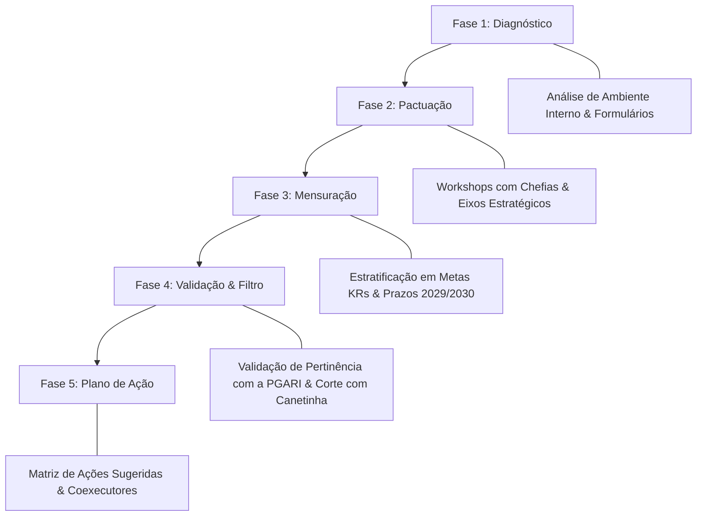
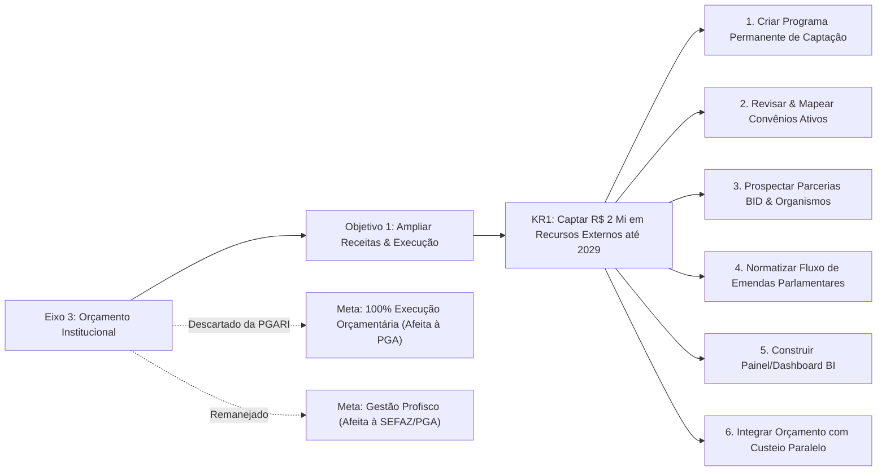
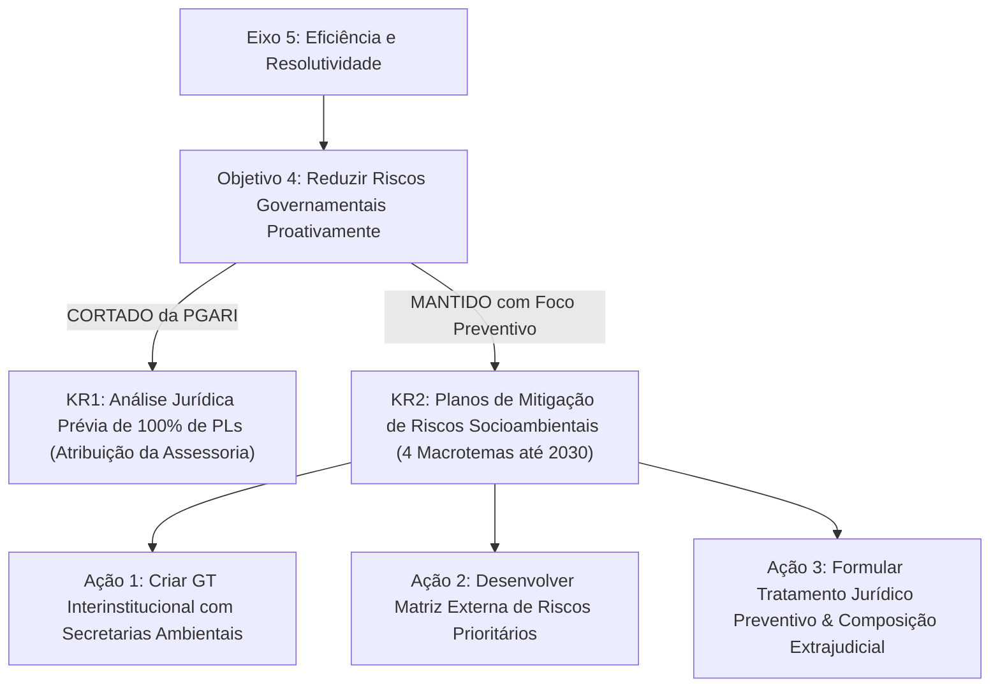

# Resumo de Reunião de Alinhamento: Planejamento Estratégico PGE (2026-2030) - Validação de Eixos, Objetivos e Metas (KRs) da PGARI

## Ideia Central (Tese)
A reunião de alinhamento estratégico tem como objetivo consolidar, revisar e filtrar as metas quantitativas (KRs) e as ações operacionais do Plano Estratégico de Longo Prazo (2026–2030) da Procuradoria-Geral do Estado (PGE), definindo com precisão o escopo de atuação da Procuradoria-Geral Adjunta de Relacionamento Institucional (PGARI) [3, 4]. A tese central assenta na necessidade de focar a PGARI em funções proativas de captação de recursos externos, governança de parcerias estratégicas e articulação interinstitucional para prevenção de riscos socioambientais, descartando atribuições puramente administrativas ou de consultoria ordinária que pertencem a outras unidades da PGE [4, 6, 9]. Esse filtro garante a eficiência da gestão por resultados, alinhando a capacidade executiva da PGARI aos objetivos estratégicos estaduais [1, 11, 17].

---

## Desenvolvimento Detalhado e Estruturado

### 1. Contexto Metodológico e Ciclo do Planejamento Estratégico da PGE (2026–2030)

O Planejamento Estratégico da Procuradoria-Geral do Estado (PGE) é estruturado como um plano de longo prazo com horizonte temporal de quatro anos, projetado até o ano de 2030 [3]. O ciclo metodológico do planejamento desdobra-se em etapas encadeadas de diagnóstico, formulação e operacionalização [3, 4]:

1. **Análise do Ambiente Interno e Diagnóstico**: Etapa preliminar que envolveu a aplicação de formulários de consulta, escuta ativa e coleta de dados sobre os gargalos e potencialidades da instituição [3].
2. **Workshops com Chefias e Definição de Eixos**: Reuniões participativas com os gestores das unidades para pactuação dos eixos estratégicos globais e dos objetivos institucionais de longo prazo [3].
3. **Estratificação em Metas Quantificadas (KRs) e Marcos Temporais**: Transposição dos objetivos abstratos em *Key Results* (Resultados-Chave) mensuráveis, dotados de alvos numéricos e prazos definidos de cumprimento (2029 e 2030) [1, 2, 3].
4. **Validação de Pertinência Temática por Unidade (Oficina de Filtragem)**: Fase atual em que cada Procuradoria Adjunta analisa a planilha de metas e indicadores para confirmar se possui competência regimental e interesse operacional no tema, ajustando ou descartando itens por meio da edição direta no documento [4, 6, 11].
5. **Desenho do Arcabouço de Ações Sugeridas e Coexecutores**: Formulação de iniciativas concretas, projetos e mapeamento de unidades parceiras (internas e externas) para viabilizar cada meta aprovada [4, 12, 15].

---

### 2. Eixo Estratégico 3: Incrementar e Executar Integralmente o Orçamento Institucional

O Eixo Estratégico 3 foca no fortalecimento financeiro da PGE, visando à ampliação dos aportes orçamentários e à otimização do gasto público [1, 4].

#### 2.1. Objetivo 1 e KR1 (Meta de Captação Externa)
* **Objetivo 1**: Ampliar fontes de receita e otimizar a execução orçamentária [1, 4].
* **Meta (KR1)**: Captar R$ 2,0 milhões em recursos externos (provenientes de emendas parlamentares, parcerias institucionais e editais) para financiamento de projetos estratégicos da PGE até 2029 [1, 4].
* **Deliberação sobre Pertinência**: O Procurador-Geral Adjunto confirmou a plena pertinência desta meta para a PGARI [4, 5]. Destacou-se que a atuação da PGARI ocorrerá de forma compartilhada e consultiva, servindo como ponte de articulação institucional com outros atores e órgãos coexecutores (como EXAP, Brasília e Secretarias) [4, 5, 12].

#### 2.2. Arcabouço de Ações Sugeridas e Validadas para o KR1
Para viabilizar a captação de R$ 2 milhões até 2029, foram aprovadas seis iniciativas estratégicas na planilha de trabalho [4, 12, 13, 14]:

1. **Instituir Programa Permanente de Captação de Recursos**:
   * *Ação*: Edição de ato normativo interno formalizando o programa e fixando competências [12].
   * *Coexecutores*: PGARI e Escritório de Representação em Brasília [12].
2. **Manter e Revisar Convênios e Parcerias Ativas**:
   * *Ação*: Mapeamento sistemático de parcerias vigentes, verificação do cumprimento de entregas e identificação de gargalos operacionais [12, 13].
   * *Coexecutores*: Secretaria de Administração e Planejamento (SAP), Assessoria Estratégica e PGARI [13].
3. **Prospectar Novas Parcerias Estratégicas**:
   * *Ação*: Mapeamento proativo junto a organismos nacionais e internacionais (ex.: Banco Interamericano de Desenvolvimento – BID), definindo critérios institucionais de seleção [13].
4. **Estabelecer Critérios Institucionais para Emendas Parlamentares**:
   * *Ação*: Criar regramento para absorção e direcionamento de emendas do Poder Legislativo [13, 14].
   * *Diretriz do Procurador Adjunto*: Ação mantida no plano estratégico, deixando para a operacionalização prática e gestões subsequentes a superação dos desafios de implementação [14].
5. **Criar Painel/Dashboard de Acompanhamento da Captação**:
   * *Ação*: Desenvolvimento de solução de *Business Intelligence* para visualização transparente dos valores captados, fontes e prazos de aplicação [14].
6. **Integrar Captação Externa ao Planejamento Orçamentário**:
   * *Ação*: Alinhamento do orçamento próprio com as fontes alternativas de custeio estratégico [14].

#### 2.3. Metas Descartadas ou Remanejadas do Eixo 3
* **Garantia de 100% de Execução Orçamentária Anual**: O Procurador e o facilitador concluíram que a execução orçamentária direta é atribuição exclusiva da Procuradoria-Geral Adjunta de Administração (PGA) e da área de Socorro Administrativo, sendo descartada da PGARI [6].
* **Ações Relacionadas ao Programa Profisco**: Identificou-se que a gestão das metas do Profisco cabe à Secretaria de Estado da Fazenda (SEFAZ) em articulação com a PGA, não à PGARI [8].

---

### 3. Eixo Estratégico 5: Alcançar Maior Eficiência e Resolutividade nos Processos Internos e Externos

O Eixo Estratégico 5 aborda a resolutividade institucional, o fortalecimento da atuação preventiva e a diminuição de contenciosos do Estado [1, 2].

#### 3.1. Objetivo 4 e Análise de Metas (KRs)
* **Objetivo 4**: Reduzir riscos governamentais com ações proativas [1, 2].
* **Análise do KR1 (Análise Jurídica Prévia de Atos Normativos e PLs)**:
  * *Descrição do KR*: Assegurar análise jurídica prévia de constitucionalidade e legalidade em 100% dos projetos de lei e atos normativos de iniciativa do Executivo até 2030, subsidiando vetos governamentais [2, 9].
  * *Deliberação de Competência*: O Procurador Adjunto enfatizou que a análise prévia de legalidade de projetos de lei é atividade típica e exclusiva da Consultoria Geral / Assessoria Jurídica da PGE, não guardando relação com a PGARI [9, 10]. O item foi integralmente cortado da planilha da PGARI [10].
* **Análise do KR2 (Mitigação de Riscos Socioambientais e Urbanísticos)**:
  * *Descrição do KR*: Elaborar e implementar planos institucionais de mitigação e prevenção jurídica para ao menos 4 macrotemas de risco socioambiental e urbanístico de alta relevância estadual até 2030 [2, 10].
  * *Deliberação de Competência*: Embora a gestão direta de pastas socioambientais pertença a secretarias específicas do Executivo, reconheceu-se a utilidade de uma atuação preventiva e estratégica da PGARI na articulação interinstitucional para evitar litígios [10, 11, 15].

#### 3.2. Ações Preventivas Aprovadas para o KR2
Para operacionalizar a mitigação de riscos socioambientais e urbanísticos, foram pactuadas três ações direcionadas [15, 16]:

1. **Articular Monitoramento com Órgãos e Parceiros Externos**:
   * *Ação*: Criação de Grupo de Trabalho (GT) interinstitucional com secretarias de Estado e órgãos ambientais para alinhamento preventivo [15, 16].
2. **Construir Matriz de Riscos Socioambientais Externos**:
   * *Ação*: Mapeamento, identificação e classificação dos riscos jurídicos prioritários decorrentes de políticas urbanas e ambientais [16].
3. **Desenvolver Tratamento Jurídico Preventivo**:
   * *Ação*: Elaboração de teses, pareceres e minutas de composição extrajudicial para evitar judicialização de grande impacto financeiro ou social [16].

---

### 4. Dinâmicas Institucionais, Interrupções e Aspectos Operacionais Registrados no Encontro

A gravação da reunião registra momentos práticos da rotina da Procuradoria-Geral, demonstrando o ambiente real de tomada de decisão e a sobreposição de demandas administrativas e finalísticas [6, 7, 8, 15]:

1. **Ajustes de Pauta e Audiências Coletivas**:
   * Diálogo operacional do Procurador Adjunto com colegas procuradores ("Denis" e "Daniel") para reorganização da pauta de audiências e julgamentos do dia seguinte [7].
   * Solicitação de remanejamento do horário da sessão para o turno da tarde ou para a manhã do dia posterior em razão de incompatibilidade de agenda [7].
2. **Acúmulo Temporário de Atribuições**:
   * Registro de que o Procurador Adjunto estava acumulando temporariamente a resposta pela área da Educação ("respondendo pela educação"), justificando o alto volume de compromissos [7].
3. **Trativa de Contatos e Encaminhamentos Diretos**:
   * Interações rápidas para compartilhamento de contatos telefônicos de servidores e alinhamento do canal do grupo de mensagens da instituição [7, 8, 15].
4. **Validação Final da Planilha**:
   * O encontro encerrou-se com a validação completa do documento de trabalho e a eliminação formal das metas não pertinentes, concluindo o objetivo metodológico estabelecido pela assessoria de planejamento [11, 17].

---

## Lista de Explicações e Detalhamento das Citações Numeradas

Conforme diretriz pedagógica e regimental, a seguir apresenta-se o detalhamento aprofundado de cada uma das referências numeradas indicadas ao longo do resumo, correlacionando o texto do relatório às fontes originais do documento PDF e do áudio transcrito:

1. **[1] Eixos Estratégicos 3 e 5 no PDF Institucional (PGARI)**:
   * *Explicação*: Corresponde à estrutura formal do *Plano de Ação da PGARI*, onde o Eixo Estratégico 3 foca no orçamento institucional (ampliação de receitas e KR1 de captação de R$ 2 milhões até 2029) e o Eixo Estratégico 5 visa à eficiência e resolutividade processual.
2. **[2] Objetivos e Resultados-Chave de Prevenção de Riscos (PDF PGARI)**:
   * *Explicação*: Refere-se à especificação técnica dos KRs do Objetivo 4 do Eixo 5 constantes no documento PDF: o KR1 (análise prévia de 100% dos PLs e atos do Executivo até 2030) e o KR2 (elaboração de planos de mitigação jurídica para ao menos 4 macrotemas socioambientais e urbanísticos até 2030).
3. **[3] Ciclo Quadrienal de Planejamento da PGE até 2030 (Áudio - Trecho 3)**:
   * *Explicação*: Transcrição em que o facilitador de planejamento detalha a metodologia do plano estratégico de longo prazo (4 anos, visando a 2030) e relata as etapas prévias já concluídas: diagnóstico de ambiente interno, formulários e workshops de eixos com as chefias.
4. **[4] Metodologia de Filtragem de Metas e Planilha de Ações (Áudio - Trecho 4)**:
   * *Explicação*: Exposição do procedimento da reunião de alinhamento. O facilitador apresenta a planilha de estratificação em metas/KRs, submete a redação dos indicadores ao Procurador Adjunto para validação de competência e introduz a matriz de sugestões de ações para captação externa.
5. **[5] Caráter Compartilhado e Consultivo da PGARI no Eixo Orçamentário (Áudio - Trecho 5)**:
   * *Explicação*: Esclarecimento prestado pelo facilitador e aceito pelo Procurador Adjunto de que as metas de captação de recursos externos não exigem execução isolada pela PGARI, exercendo a unidade papel intermediador e consultivo em articulação com coexecutores.
6. **[6] Exclusão da Meta de Execução Orçamentária Anual de 100% (Áudio - Trecho 6)**:
   * *Explicação*: Momento do áudio em que o Procurador Adjunto identifica que a garantia de 100% de execução do orçamento anual não diz respeito à Relacionamento Institucional, utilizando a "canetinha" para riscar o item e atribuí-lo à PGA (Administração / Socorro Administrativo).
7. **[7] Gestão de Agenda, Audiências e Acúmulo de Pastas (Áudio - Trecho 7)**:
   * *Explicação*: Registro da conversa paralela interativa durante a gravação, na qual são debatidos conflitos de agenda de audiências judiciais, remanejamento de horários com os procuradores Denis e Daniel, e a menção de estar respondendo pela pasta da Educação.
8. **[8] Remanejamento do Programa Profisco para a SEFAZ/PGA (Áudio - Trecho 8)**:
   * *Explicação*: Identificação pontual na reunião de que a meta atrelada ao programa Profisco possui governança vinculada à Secretaria de Estado da Fazenda (SEFAZ) e à área administrativa, devendo ser desvinculada do escopo direto da PGARI.
9. **[9] Análise Jurídica Prévia de PLs como Atribuição da Consultoria (Áudio - Trecho 9)**:
   * *Explicação*: Discussão em que a proposta de colocar sob responsabilidade da PGARI a análise prévia de constitucionalidade em 100% dos projetos de lei e atos do Executivo é rejeitada, por se tratar de competência 100% afeita às Assessorias Jurídicas e Consultorias da PGE.
10. **[10] Deliberação sobre Mitigação de Riscos Socioambientais (Áudio - Trecho 10)**:
    * *Explicação*: Debate acerca do KR de prevenção jurídica socioambiental e urbanística. O Procurador Adjunto ressalta que a matéria temática é de outras secretarias estaduais, mas assinala a marca amarela/atenção para manter o viés de articulação preventiva estratégica.
11. **[11] Atualização da Planilha e Sustentação do Alinhamento (Áudio - Trecho 11)**:
    * *Explicação*: O facilitador de planejamento consigna que a planilha anterior estava defasada e compromete-se a atualizar a matriz mantendo exclusivamente os itens validados durante a sessão de trabalho.
12. **[12] Validação do Programa Permanente e Mapeamento de Convênios (Áudio - Trecho 12)**:
    * *Explicação*: Confirmação do Procurador Adjunto para a manutenção das ações estratégicas de edição de ato normativo para captação de recursos (com envolvimento do escritório de Brasília) e de mapeamento de convênios ativos (com coexecução da SAP).
13. **[13] Prospecção no BID e Regramento de Emendas Parlamentares (Áudio - Trecho 13)**:
    * *Explicação*: Detalhamento das iniciativas de busca por novas parcerias institucionais em organismos internacionais (ex.: Banco Interamericano de Desenvolvimento – BID) e da proposição de regramento institucional para absorção de emendas parlamentares.
14. **[14] Diretriz do Procurador sobre Emendas e Painel de BI (Áudio - Trecho 14)**:
    * *Explicação*: Posicionamento do Procurador Adjunto autorizando manter a meta de ordenamento de emendas ("deixa a próxima gestão bater a cabeça sobre a operacionalização") e aprovação do painel visual (dashboard) de captação orçamentária.
15. **[15] Definição de Ações de Articulação Externa e GT Socioambiental (Áudio - Trecho 15)**:
    * *Explicação*: Apresentação do conjunto enxuto de três ações para a meta de risco socioambiental: buscar cooperação com secretarias e órgãos ambientais por meio da constituição de Grupo de Trabalho (GT) externo.
16. **[16] Matriz de Risco e Tratamento Jurídico Preventivo (Áudio - Trecho 16)**:
    * *Explicação*: Detalhamento final das iniciativas de construção de matriz externa de riscos prioritários e desenvolvimento de soluções jurídicas preventivas para evitar a proliferação de processos judiciais contenciosos.
17. **[17] Encerramento e Homologação da Matriz de Trabalho (Áudio - Trecho 17)**:
    * *Explicação*: Conclusão da reunião de alinhamento estratégico, com manifestação expressa de satisfação dos participantes quanto ao fechamento célere e objetivo da planilha de planejamento da PGARI.
