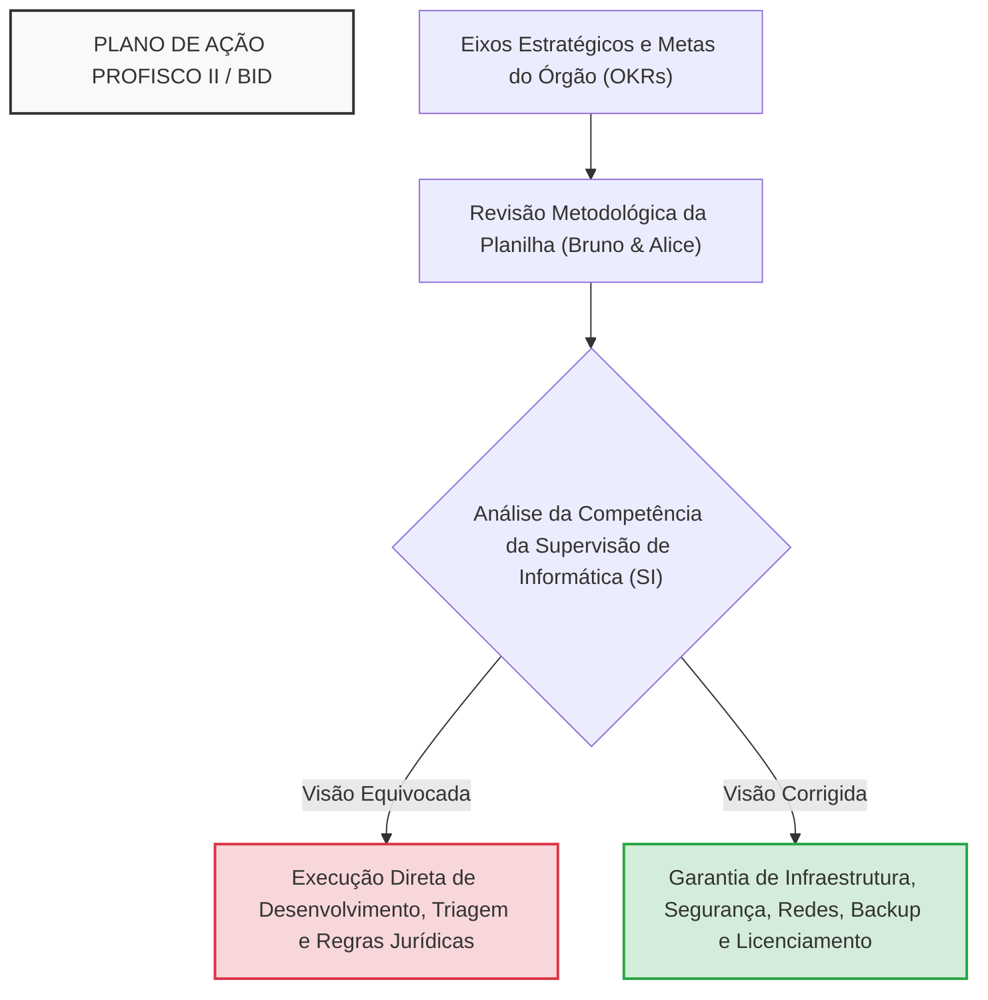
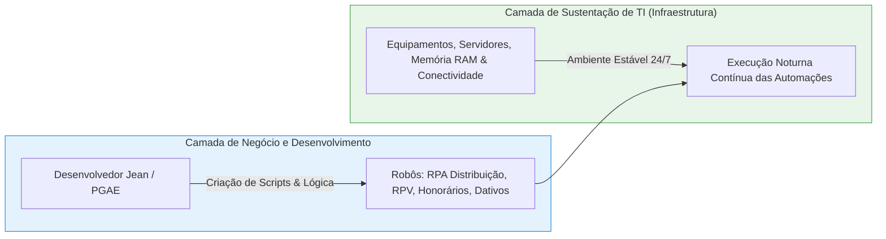
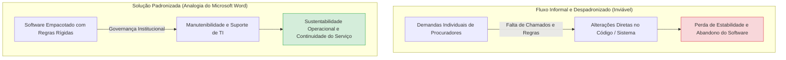
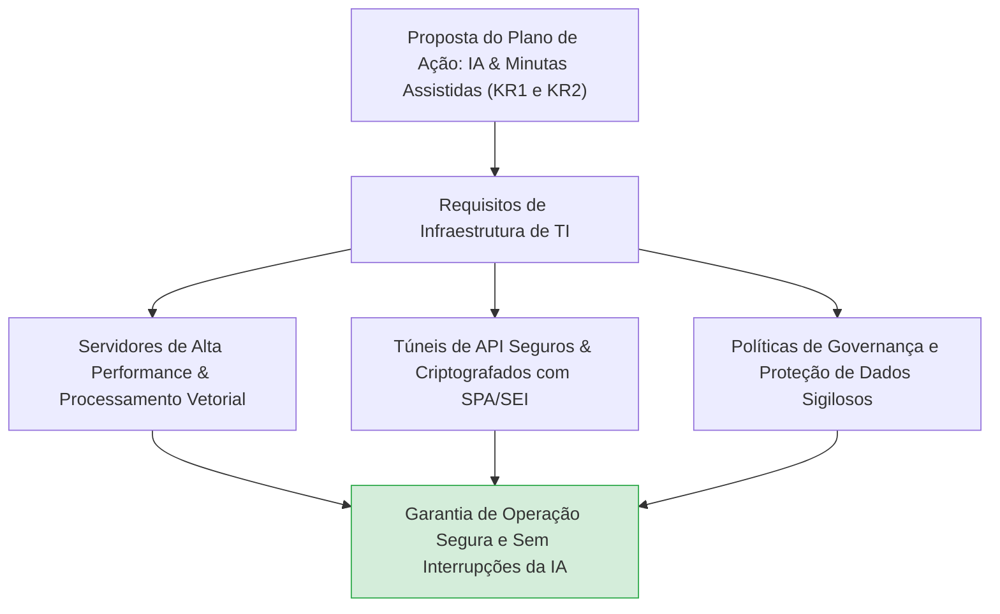
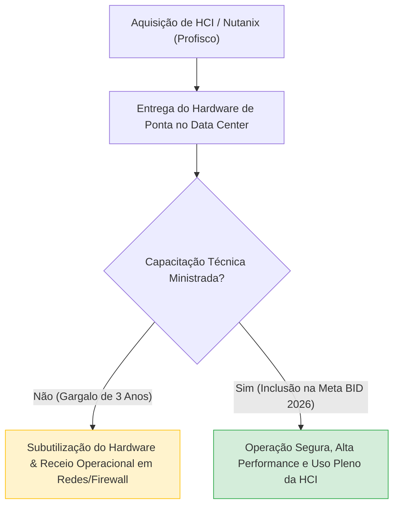
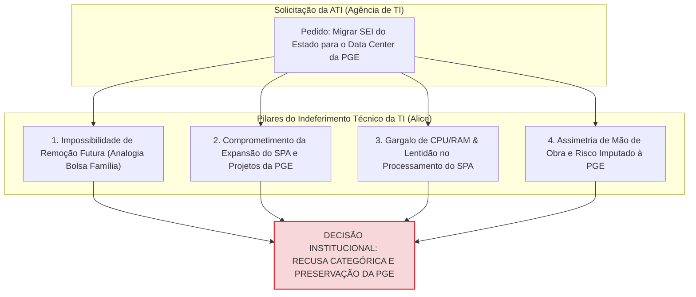
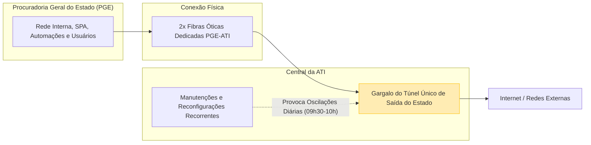
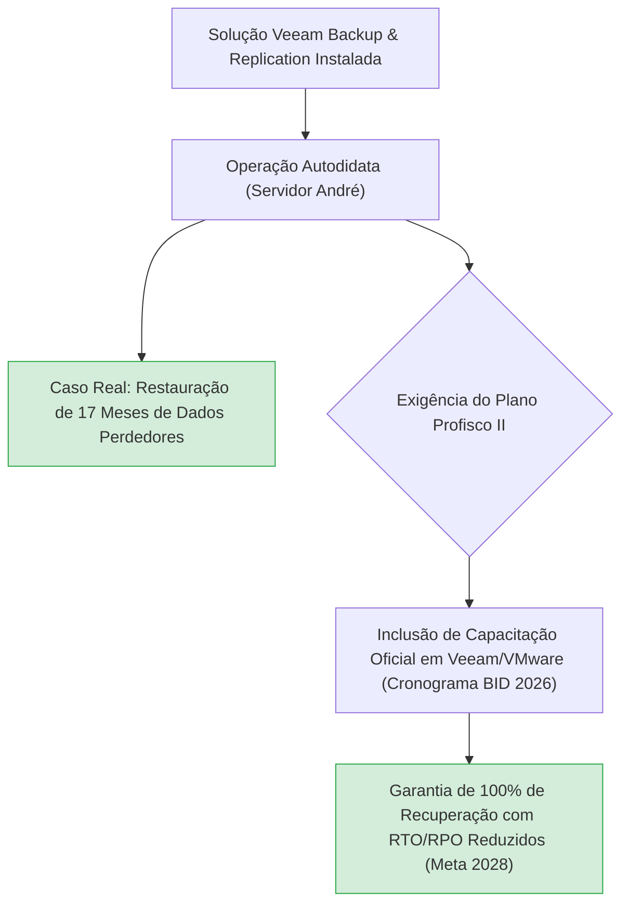
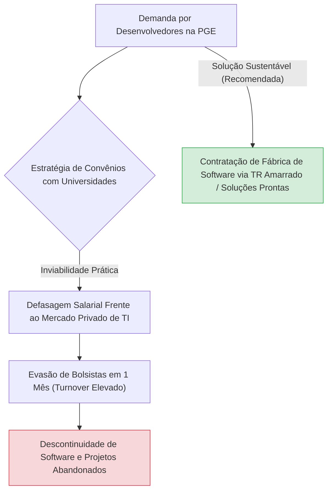
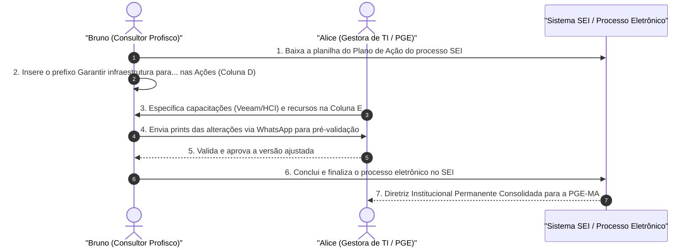

# Resumo de Reunião de Alinhamento Estratégico e Plano de Ação: Gestão de TI na PGE-MA - Alinhamento Profisco II, Governança e Infraestrutura

---

## Ideia Central (Tese)
Esta reunião de alinhamento estratégico entre a Gestão de TI da Procuradoria Geral do Estado do Maranhão (PGE-MA) e a consultoria do Projeto Profisco II (BID) consolida o Plano de Ação da Supervisão de Informática, delimitando as atribuições operacionais da TI setorial na garantia e sustentação da infraestrutura tecnológica. A discussão integra as metas de automação processual, inteligência artificial, modernização do parque tecnológico e backup automatizado (Veeam/HCI) estabelecidas no plano formal, fundamentando a recusa técnica ao compartilhamento indevido de data center com a Agência de Tecnologia da Informação (ATI), a necessidade urgente de capacitação profissional e a padronização das diretrizes institucionais do órgão [1, 3, 6, 20, 30].

---

## 1. Contextualização do Projeto PROFISCO II / BID e Revisão do Plano de Ação

### 1.1. Alinhamento de Instrumentos e Metodologia de Planejamento (OKRs)
A reunião inicia-se com o alinhamento metodológico promovido pelo consultor Bruno e pela gestora Alice para o preenchimento dos memorandos e da planilha do Plano de Ação vinculado ao programa de modernização financiado pelo Banco Interamericano de Desenvolvimento (BID) / Profisco II [1, 31]. Corrige-se a orientação formal dos instrumentos e valida-se a estrutura metodológica baseada em *Objectives and Key Results* (OKRs) [1, 31].

O Plano de Ação da Supervisão de Informática organiza-se a partir da matriz estratégica do órgão [1, 2, 3]:
* **Eixo Estratégico:** Macrodiretriz institucional (ex.: Incrementar orçamento, otimizar fluxos internos, incentivar a inovação tecnológica) [2, 6, 14, 19].
* **Objetivo Estratégico:** Meta qualitativa final de gestão [2, 6, 14, 19].
* **OKR / Meta (Key Result):** Indicador quantitativo mensurável com prazo definido [3, 6, 7, 14, 19, 25, 29].
* **Ação (O QUÊ):** A iniciativa específica a ser executada pela equipe [1, 3, 6, 8, 15, 20].
* **Subação (COMO):** O detalhamento operacional e a infraestrutura necessária [1, 3, 6, 8, 15, 20].
* **Responsáveis (QUEM):** Líderes (Supervisão de Informática) e coexecutores institucionais (PGAE, PGAAJ, USF, CSL, UGAM, ESAP) [3, 4, 7, 14, 19].
* **Prazo (QUANDO):** Cronograma de execução física e financeira [3, 4, 7, 14, 19].

### 1.2. Definição do Escopo da TI e Separação entre Regra de Negócio e Infraestrutura
Alice e Bruno realizam uma varredura crítica na planilha exemplificativa pré-filtrada para garantir que as ações atribuídas ao Setor de Informática (SI) correspondam estritamente à sua competência precípua: sustentação de infraestrutura, segurança cibernética, virtualização, redes e gerenciamento de licenças [2, 32, 40, 54, 70].

Fica pactuado que a TI não possui competência jurídica, documental ou de negócio para definir descarte de peças processuais, criar fluxos jurídicos ou estipular regras de triagem [28, 58]. Para a TI, os dados e peças tramitam em formato bruto; cabe às procuradorias especializadas e à Procuradoria Geral Adjunta para Assuntos Estratégicos (PGAE) definir as regras de negócio, cabendo ao Setor de Informática prover o ambiente estável e seguro para execução [28, 40, 43, 58, 70].

---

## 2. Automação, Otimização de Fluxos de Trabalho e Redução de Tarefas Manuais

### 2.1. Metas de Automação e Divisão do Trabalho (Desenvolvimento vs. Infraestrutura)
No **Eixo Estratégico 5** (Alcançar maior eficiência e resolutividade nos processos internos e externos), o **Objetivo 5** busca otimizar e automatizar fluxos de trabalho [6, 7, 8]. O plano contempla duas metas centrais (KRs):
1. **KR1 (Redução de 20% em atividades repetitivas até 2028):** Implantação de robôs de triagem e minutas inteligentes integrados aos sistemas PJe e E-PGE [6, 7].
2. **KR2 (Redução de 50% no tempo de elaboração de documentos até 2029):** Criação de trilha prioritária de automação, integração e escala de robôs já concluídos em 2025 (RPA Distribuição, RPA Monitor PGE, Calculadora RPV, RPA Honorários, RPA Dativos) [8, 9].

A divisão operacional estabelecida na reunião aloca [2, 23, 32, 42, 53, 72]:
* **Desenvolvimento e Lógica do Robô:** Atribuição do desenvolvedor Jean (lotado na PGE), responsável por codificar os scripts de automação e integração de captura de dados [2, 23, 32, 53].
* **Suporte de Infraestrutura de TI:** Atribuição da equipe de TI (Alice, André e Rames), encarregada de fornecer servidores com memória, CPU, conectividade ininterrupta e ambiente virtualizado para que os robôs rodem de forma contínua durante as madrugadas sem quedas de sistema [2, 42, 54, 72].

Alice ressalta a rigidez das limitações humanas da equipe: a TI não tem capacidade para assumir tarefas operacionais contínuas de monitoramento ilimitado [24, 54]. Atualmente, o monitoramento preventivo manual de apenas três servidores consome o dia inteiro de um profissional experiente [24, 54]. Se for um técnico menos qualificado, ele mal conseguirá monitorar um [55]. Por essa razão, a TI atua no filtro de requisitos e na sustentação do ambiente, evitando o colapso por sobrecarga de atividades extras [26, 56].

### 2.2. A Analogia do "Perfurador e do Celular"
Para ilustrar a impossibilidade pedagógica e institucional de exigir que o Setor de Informática fabrique soluções de software complexas internamente sem estrutura, Alice formula a **Analogia do Perfurador e do Celular** [32, 62]:
> *"A finalidade da PGE não é tecnologia; a finalidade da PGE é prestar apoio à parte jurídica. Se você chega para mim e diz 'quero que tu faça um celular', e eu só sei fazer perfurador, como vai sair um celular se eu só sei fazer perfurador?"* [32, 62]

A metáfora explicita que a Procuradoria não é uma empresa de TI nem possui fábrica de software [32, 62]. Se o órgão necessita de soluções tecnológicas customizadas ou sistemas de grande porte, deve contratar empresas especializadas por meio de Termos de Referência (TR) rigorosamente amarrados, em vez de sobrecarregar a equipe local [32, 63, 64].

### 2.3. A Analogia do "Microsoft Word" e a Padronização de Software
Alice relata os conflitos históricos gerados por procuradores que solicitam alterações individuais em sistemas jurídicos, exigindo adaptações conforme preferências pessoais [34, 64]. Para demonstrar a necessidade imperativa de governança e padronização rígida de software, apresenta a **Analogia do Microsoft Word** [34, 64, 65]:
> *"Por que a gente recebe o Word empacotado sem poder alterar a estrutura do Word? Porque se pudesse alterar, o Word não existiria, pois cada um ia querer do seu jeito — um quer Premium Platinum Plus, o outro quer de outro jeito. Não tem como."* [34, 64, 65]

A ausência de fluxo formal de chamados e a falta de padronização levam ao fracasso de projetos informais [34, 64]. Quando desenvolvedores terceirizados ou estagiários tentam atender solicitações diretas sem mediação institucional, o software perde coesão, culminando no abandono do sistema e no falso diagnóstico de que "o sistema não presta" [34, 64].

---

## 3. Inovação Tecnológica, Modelos de Inteligência Artificial e Assistência Documental

### 3.1. Planejamento de Soluções de IA na Advocacia Pública
No **Eixo Estratégico 7** (Incentivar a inovação tecnológica), o **Objetivo 1** busca adotar ferramentas de tecnologia para otimizar a atuação jurídica [14, 15, 18]. O plano de ação fixa metas ambiciosas:
* **KR1 (Implementar 2 soluções de IA até 2028):** Definir rotinas internas, fluxo de acompanhamento periódico e recursos necessários na TI até dezembro de 2026 [14, 15].
* **KR2 (Automatizar 30% dos pareceres padronizados até 2028):** Configurar servidores, conexões de API seguras, governança de dados e integração com o Sistema de Processos Administrativos (SPA/SEI) para suporte a minutas assistidas [15, 16].
* **Busca Semântica e Repositório Vetorial:** Desenvolver esteira de indexação vetorial dos pareceres referenciais aprovados pelo Procurador-Geral, permitindo recuperação contextual e sugestão inteligente de textos em 240 dias [16, 17].
* **KR3 (Pesquisa Jurídica Inteligente até 2º sem/2026):** Avaliar e selecionar ferramentas de mercado com bancos de dados inteligentes, busca semântica e filtros jurisprudenciais em 90 dias [18, 19].

### 3.2. A Camada de Infraestrutura Obrigatória para Sustentação de IA
Embora a formulação dos modelos de IA e o treinamento dos algoritmos fiquem a cargo da equipe de transformação digital e assessoria jurídica, a TI da PGE é responsável por prover [15, 16, 57, 70]:
1. **Servidores com Capacidade de Processamento:** Hardware robusto capaz de suportar requisições simultâneas de modelos de linguagem e motores de busca vetorial [15, 16].
2. **Conexões de API Seguras:** Canais criptografados para comunicação entre o SPA, o PJe e os serviços de inteligência artificial [15, 16].
3. **Governança de Dados e Segurança:** Proteção contra vazamento de informações sigilosas e controle estrito de acessos [15, 24, 45].

---

## 4. Modernização da Infraestrutura Tecnológica, Data Center e Armazenamento (HCI/Nutanix)

### 4.1. Renovação do Parque Tecnológico e Eficiência em Compras Públicas
No **Eixo Estratégico 7**, o **Objetivo 2** estabelece a modernização da infraestrutura de hardware [19, 20]. A **KR1** prevê a substituição de 100% dos equipamentos defasados até 2027, estruturada nas seguintes ações do plano [19, 20, 21, 22]:
* **Inventário Tecnológico (60 dias):** Levantamento do parque atual, classificação de obsolescência e criticidade por unidade [19, 20].
* **Plano Plurianual de Renovação (120 dias):** Definição de fases de substituição, compatibilidade com IA e cronograma de desembolso [20, 21].
* **Contratação via PROFISCO III:** Elaboração de artefatos, licitação e implantação de equipamentos [21, 22].
* **Baixa e Descarte Patrimonial:** Governança de tombamento, realocação e descarte [22, 23].

Alice relata o histórico de eficiência da PGE na aquisição de equipamentos de grande porte em comparação com a burocracia do Estado [12, 40, 42]. Enquanto uma cotação inicial de mercado para equipar o órgão atingiu R$ 6 milhões (para um orçamento disponível de R$ 1,5 milhão), Alice promoveu negociações diretas com fornecedores e órgãos de Belém, viabilizando a compra de um cluster de Infraestrutura Hiperconvergente (HCI/Nutanix) por aproximadamente R$ 900 mil, com garantia inclusa [12, 42, 43].

### 4.2. O Aparelhamento HCI e o Gargalo da Ausência de Capacitação
Apesar da aquisição bem-sucedida do ambiente HCI (Nutanix) há cerca de três anos por meio de recursos do Profisco, revelou-se um grave gargalo de governança [3, 33, 43]:
* **Promessa Institucional:** Envio do hardware de ponta acompanhado do respectivo curso de capacitação técnica para os servidores da PGE [3, 33].
* **Realidade Observada:** O equipamento foi entregue e instalado no data center, porém a capacitação oficial jamais foi ministrada [3, 33].
* **Consequência Prática:** Equipamento de altíssima complexidade permanece subutilizado ou operado com extrema cautela, pois a equipe não recebeu instrução oficial para explorar todas as suas funcionalidades com segurança [3, 33, 43, 77].

### 4.3. Prudência Operacional e a Ética na Gestão Pública
Para exemplificar a diferença entre a execução mecânica de comandos e a responsabilidade com a segurança da informação, Alice relata o diálogo com o procurador Dr. Marcos a respeito da abertura de portas no firewall da rede [13, 14, 43, 44]:
> *"Doutor, eu sei fazer o comando para abrir as portas. O que eu não sei é: se eu abrir essas portas, qual é a consequência de segurança para a Procuradoria?"* [13, 14, 43, 44]

A declaração reforça que intervenções em ambientes de produção sem suporte especializado (como o do servidor Rames) podem comprometer a integridade dos dados e expor o órgão a ataques cibernéticos, justificando a inclusão de capacitações oficiais como requisito obrigatório no plano [14, 24, 44, 47].

---

## 5. Soberania Tecnológica e Relação PGE vs. ATI (Agência de TI do Estado)

### 5.1. Recusa Fundamentada à Transferência do SEI do Estado para a PGE
Um dos pontos de maior relevância da reunião trata do pedido encaminhado pela Agência de Tecnologia da Informação do Estado (ATI) para hospedar o ambiente do Sistema Eletrônico de Informações (SEI) de todo o Poder Executivo Estadual no data center da PGE, sob a justificativa de "desafogar a estrutura central da ATI" [4, 5, 34, 35].

Alice informa ter apresentado recusa formal e categórica à solicitação junto ao Dr. Marcos, embasando sua posição em quatro pilares fundamentais [4, 5, 6, 7, 8, 9, 15, 35, 36, 38]:

1. **A Analogia do "Bolsa Família" (Vício de Uso do Espaço):** Alice utiliza a metáfora de que *"é igual Bolsa Família: o cara acostuma e nunca mais quer largar"* [9, 39]. Uma vez alocado o SEI do Estado nos servidores da PGE, a ATI jamais removeria o sistema, alegando que a retirada paralisaria o governo estadual [5, 9, 35, 39].
2. **Crescimento dos Sistemas Internos da PGE:** A PGE vive expansão contínua de seus sistemas próprios, como o Sistema de Processos Administrativos (SPA) e o projeto com a universidade [7, 8, 37, 38]. Ceder espaço hoje inviabilizará o crescimento da própria Procuradoria amanhã [8, 38].
3. **Degradação de Desempenho (Processamento e Memória):** Embora a HCI possua bom espaço em disco, a memória RAM, os processadores (CPU) e as fontes de alimentação são compartilhados [15, 45, 46]. Adicionar o tráfego do SEI de todo o Estado causaria lentidão severa no SPA da PGE [15, 45, 46].
4. **Assimetria de Responsabilidade e Risco ("A Chave do Cofre"):** A ATI é o órgão central de TI, recheado de técnicos graduados de excelência [6, 36, 39]. A TI da PGE conta com apenas dois servidores ativos no setor (Alice e André) [6, 36]. Se ocorresse uma pane ou vazamento no ambiente compartilhado, a responsabilidade seria jogada sobre a PGE [6, 36, 39]. Alice declarou que, caso a gestão superior determine o aceite, ela entregará formalmente a "chave do cofre" e se eximirá da responsabilidade técnica [7, 8, 37, 38].

### 5.2. Burocracia Burocrática na ATI vs. Agilidade Operacional na PGE
Alice contrasta o engessamento burocrático da ATI com a gestão prática da Procuradoria [10, 11, 40, 41]. Em contratações anteriores, a ATI reteve processos por exigências formais descabidas e Termos de Referência (TR) inexequíveis elaborados por técnicos sem visão de campo, quase inviabilizando a compra de computadores [10, 11, 40, 41]. A servidora Raíssa (PGE) precisou intervir e negociar diretamente para viabilizar uma adesão à ata de registro de preços (carona) [10, 40].

---

## 6. Arquitetura de Conectividade e Limitações Lógicas do Estado

### 6.1. Topologia de Rede e o Gargalo do "Túnel Único" na ATI
A revisão do plano contempla a infraestrutura de comunicação entre a PGE e a malha do governo [16, 17, 46, 47]:
* **Conexão Física:** A ligação física entre o prédio da PGE e a ATI é realizada por duas fibras óticas dedicadas [17, 47].
* **Gargalo Lógico (Ponto Único de Falha):** Apesar da redundância física, todo o tráfego de dados de todos os órgãos do Estado afunila em um único "túnel" central de saída e retorno gerenciado na ATI [17, 47].
* **Submissão Normativa por Decreto:** Por força de Decreto Estadual, a ATI é a gestora exclusiva da infraestrutura de TIC do governo [18, 48]. A PGE não pode contratar link privado de internet independente; utiliza a malha estadual sem custo direto de faturamento para o órgão, mas sujeita às suas oscilações [18, 48].

### 6.2. Instabilidades Horárias Diárias
Alice e Bruno relatan quedas recorrentes de conexão que ocorrem rotineiramente entre 09h30 e 10h00 [20, 50]. Alice esclarece que o fenômeno ocorre porque a equipe da ATI realiza reconfigurações constantes nos equipamentos centrais para reaproveitar hardware antigo ou remanejar tráfego devido à limitação orçamentária global do Estado [20, 21, 50, 51].

---

## 7. Sistema de Backup Automatizado (Veeam) e Capacitação Técnica

### 7.1. A Meta de Garantia de Recuperação de Dados (KR2)
No **Eixo Estratégico 7**, a **KR2** do **Objetivo 2** estabelece a garantia de 100% de recuperação de dados processuais em caso de falha, por meio de novo sistema de backup automatizado até o segundo semestre de 2028 [25, 26, 27, 28]. As ações programadas incluem:
1. **Projeto de Arquitetura de Backup (90 dias):** Política de backup automatizado, redundância, retenção e testes de restauração [25, 26].
2. **Implantação e Testes Simulados (180 dias):** Configuração de rotinas e cópias de segurança [26, 27].
3. **Treinamento da Equipe Técnica:** Capacitação oficial em Veeam e VMware no cronograma BID 2026 [27, 28, 47, 78].
4. **Calendário Semestral de Contingência:** Simulação periódica de falhas e auditoria do tempo de restauração [28, 29].

### 7.2. Operação Autodidata e o Caso do Backup de 17 Meses
Apesar da falta de cursos formais oferecidos pela administração, a PGE utiliza a ferramenta **Veeam Backup & Replication** [46, 76]. 
* **Atuação do Servidor André:** O técnico André opera o Veeam de forma autodidata, sem ter recebido treinamento oficial [37, 46, 67, 76].
* **Caso de Sucesso Institucional:** Em determinado episódio, uma procuradora perdeu arquivos essenciais acumulados ao longo de 17 meses [37, 67]. André resgatou 17 meses de históricos de backup e restaurou a totalidade dos documentos [37, 67].
* **Formalização de Capacitação:** Para afastar o risco de falhas operacionais e formalizar o conhecimento, Alice e Bruno pactuam a inclusão de treinamento oficial em Veeam e virtualização no plano do Profisco II [47, 48, 77, 78].

---

## 8. Gestão de Pessoas, Perfil da Equipe e Inviabilidade de Convênios

### 8.1. Divisão de Papéis e Mapeamento Comportamental
Alice detalha a composição enxuta da TI e a filosofia de gestão aplicada na equipe, destacando que a eficiência depende do respeito ao perfil individual de cada colaborador [6, 24, 36, 37, 65, 66, 67]:

| Colaborador | Função / Perfil | Atribuição Principal & Filosofia de Gestão |
| :--- | :--- | :--- |
| **Alice** | Gestora de TI / Infraestrutura | Responsável técnica, governança de ativos, defesa do patrimônio e gestão de riscos [6, 14, 24, 81]. |
| **André** | Técnico de TI / Backup | Especialista em backup (Veeam) e infraestrutura. Perfil introspectivo e reservado; deve ser preservado de reuniões administrativas para focar em entregas técnicas [36, 37, 66, 67]. |
| **Rames** | Técnico de TI / Redes | Apoio em infraestrutura física, redes lógicas e projetos de conectividade [6, 14, 16, 44, 46]. |
| **Jean** | Desenvolvedor de Software | Responsável pela criação de automações, robôs de processos e integração [2, 23, 32, 53]. |
| **Marcelo** | Estagiário de TI | Em fase de formação (atleta de vôlei no IPG/Brave); perfil voltado a suporte geral, sem foco em programação [35, 36, 65, 66]. |

Alice resume a premissa de liderança:
> *"Você não pode mandar o André para uma reunião se ele não gosta de reunião e o forte dele é recuperar um backup de 17 meses. Cada um tem que estar focado no seu balai."* [36, 37, 66, 67]

### 8.2. Inviabilidade Prática de Convênios Universitários para Desenvolvimento
A PGE testou no passado a contratação de estudantes e desenvolvedores bolsistas via convênios acadêmicos com universidades [31, 32, 61, 62]. Alice relata que a estratégia revelou-se inviável [31, 32, 61, 62]:
* **Turnover Severo:** Os estudantes selecionados permaneceram cerca de um mês na Procuradoria e migraram imediatamente para o mercado privado assim que receberam propostas salariais superiores [31, 32, 62].
* **Conclusão de Gestão:** Convênios acadêmicos não resolvem a demanda por desenvolvimento permanente em órgãos públicos devido à defasagem das bolsas frente ao mercado de tecnologia [31, 32, 62].

---

## 9. Governança de TIC, Plano Diretor (PDTIC) e Encaminhamentos Finais

### 9.1. Institucionalização da Governança e o PDTIC
No **Eixo Estratégico 7**, o **Objetivo 4** trata da institucionalização da governança de TIC [29, 30]. A **KR1** estabelece a execução de 100% do Plano Diretor de Tecnologia da Informação e Comunicação (PDTIC) até 2030, sob liderança da Supervisão de Informática e coexecução da PGAE [29, 30, 73, 74].

O PDTIC servirá como o mapa de bordo formal da Procuradoria, consolidando os planos de contratação de soluções, modernização da infraestrutura, expansão de links e segurança cibernética, com prestação de contas semestral ao Comitê de Governança de TIC [29, 30, 74].

### 9.2. Padronização Redacional e Tramitação no Processo SEI
Para harmonizar as exigências do programa Profisco II com a capacidade operacional do Setor de Informática, Bruno e Alice definem os seguintes encaminhamentos práticos [39, 40, 41, 44, 70, 71, 74, 80]:
1. **Redação da Coluna D (Ações):** Todas as ações vinculadas a automações, IA, painéis e transformação digital passam a ser redigidas com o prefixo:
   > *"Garantir a infraestrutura necessária para..."* ou *"Dar suporte e condições de infraestrutura para que [a solução] seja executada"* [39, 41, 44, 69, 70, 74].
2. **Coluna E (Recursos Necessários):** Alice e André detalharão os insumos técnicos e financeiros exigidos (capacitações em Veeam/HCI, licenças, servidores e consultorias) [45, 47, 75, 77].
3. **Finalização do Processo no SEI:** Bruno baixará o documento do processo eletrônico no SEI, aplicará os ajustes de redação acordados e enviará capturas de tela via WhatsApp para validação rápida de Alice antes da conclusão formal do processo [49, 50, 80].
4. **Legado Institucional:** O documento final servirá como diretriz institucional permanente e vinculante para a TI da Procuradoria, conferindo estabilidade à gestão independentemente de trocas de comando político [49, 50, 79].

---

## 10. Notas Explicativas e Complementares

Apresenta-se a seguir a lista completa de explicações numeradas correspondentes a cada citação utilizada ao longo deste resumo, proporcionando a fundamentação exaustiva e pedagógica das evidências extraídas dos documentos e áudios:

1. **[1] Estrutura do Plano de Ação e Metodologia OKR (PDF / Áudio):** Registra a definição metodológica do plano (O QUÊ, COMO, QUEM, QUANDO) e a orientação inicial do memorando do Profisco II para preenchimento da planilha no SEI.
2. **[2] Escopo do Setor de Informática e Divisão de Papéis (PDF / Áudio):** Esclarece que o desenvolvedor Jean assume a lógica dos robôs, enquanto a equipe de TI (Alice, André, Rames) garante a infraestrutura e sustentação do ambiente.
3. **[3] KR3 do Eixo 3 - Governança do Profisco III e Inclusão da HCI (PDF / Áudio):** Trata do objetivo de executar 100% dos recursos do Profisco e documenta a entrega do hardware HCI sem a devida capacitação há três anos.
4. **[4] Painel Unificado do Profisco e Solicitação da ATI (PDF / Áudio):** Consolida a ação de unificar projetos tecnológicos em um painel e registra a mensagem da ATI solicitando espaço no data center da PGE.
5. **[5] Planos de Adoção e Risco da Transferência do SEI (PDF / Áudio):** Detalha a exigência de planos de implantação/treinamento para cada contratação do Profisco e justifica a recusa ao SEI da ATI devido ao risco de ocupação perpétua.
6. **[6] KR1 do Eixo 5 - Automação e Assimetria de Pessoal (PDF / Áudio):** Define a meta de reduzir 20% das tarefas manuais até 2028 e contrasta a equipe numerosa da ATI com os dois servidores ativos da PGE.
7. **[7] Robôs de Triagem PJe/E-PGE e Expansão do SPA (PDF / Áudio):** Trata da implantação de robôs de triagem e minutas inteligentes e registra o crescimento rápido do Sistema de Processos Administrativos da Procuradoria.
8. **[8] KR2 do Eixo 5 - Redução no Tempo de Documentos e Crescimento de Dados (PDF / Áudio):** Fixa a meta de reduzir em 50% o tempo de elaboração documental até 2029 e alerta para a escassez futura de espaço em disco na PGE.
9. **[9] Escala de Robôs Concluídos e Analogia do Bolsa Família (PDF / Áudio):** Relata a integração dos robôs de 2025 (RPV, Honorários, Dativos) e apresenta a analogia do Bolsa Família sobre o vício de uso do hardware doado.
10. **[10] Automação Assistida e Burocracia na ATI (PDF / Áudio):** Refere-se à adoção de assistentes para minutas e descreve o travamento burocrático na ATI resolvido pela servidora Raíssa via carona em ata.
11. **[11] Consultoria de Transformação e Engessamento de TRs (PDF / Áudio):** Vincula a consultoria do Profisco ao redesenho do SPA e critica a falta de pragmatismo em Termos de Referência elaborados por técnicos inexperientes do Estado.
12. **[12] Painel de Produtividade e Economia de R$ 5 Milhões na PGE (PDF / Áudio):** Trata da medição do volume automatizado e detalha a negociação de Alice que reduziu cotações de R$ 6M para R$ 900k em equipamentos.
13. **[13] Capacitação Contínua e Desejo da ATI pela HCI da PGE (PDF / Áudio):** Define treinamentos semestrais e evidencia que a ATI cobiça a infraestrutura hiperconvergente comprada com eficiência pela Procuradoria.
14. **[14] KR1 do Eixo 7 - Soluções de IA e Prudência na Abertura de Portas (PDF / Áudio):** Fixa a meta de 2 soluções de IA até 2028 e exemplifica a postura ética de Alice ao questionar os riscos de segurança na abertura de portas de firewall.
15. **[15] KR2 do Eixo 7 - Automação de Pareceres e Compartilhamento de Hardware (PDF / Áudio):** Propõe automatizar 30% dos pareceres com IA e explica que o compartilhamento de CPU/RAM com o SEI deixaria o SPA da PGE lento.
16. **[16] Indexação Vetorial de Pareceres e Infraestrutura de Fibra (PDF / Áudio):** Trata da esteira de busca semântica para pareceres e confirma a existência de duas fibras óticas interligando PGE e ATI.
17. **[17] Repositório de Pareceres Referenciais e Gargalo do Túnel Central (PDF / Áudio):** Explica a busca semântica e identifica que todo o tráfego de dados do governo afunila em um único túnel de saída na ATI.
18. **[18] KR3 do Eixo 7 - Pesquisa Jurídica Inteligente e Decreto Estadual (PDF / Áudio):** Meta de ferramenta inteligente de pesquisa até 2º sem/2026 e menção ao Decreto que obriga a PGE a utilizar a infraestrutura lógica do Estado.
19. **[19] KR1 do Objetivo 2 - Substituição de 100% dos Equipamentos (PDF / Áudio):** Estabelece a meta de renovar todo o parque tecnológico defasado até 2027 e discute o contrato guarda-chuva mantido pela ATI.
20. **[20] Inventário Tecnológico e Quedas Diárias de Conexão (PDF / Áudio):** Mapeamento do parque em 60 dias e explicação de que as quedas de internet entre 09h30 e 10h decorrem de intervenções diárias da ATI.
21. **[21] Plano Plurianual de Renovação e Escassez Orçamentária no Estado (PDF / Áudio):** Cronograma de desembolso para substituição de hardware e reconhecimento da limitação financeira global que afeta os serviços da ATI.
22. **[22] Contratação via PROFISCO III e Governança Tecnológica (PDF / Áudio):** Execução das compras de hardware no programa BID e concordância com a inclusão de painéis de governança.
23. **[23] Baixa e Descarte Patrimonial e Lógica dos Robôs de Captura (PDF / Áudio):** Regras para descarte de equipamentos antigos e integração dos scripts de automação do desenvolvedor Jean.
24. **[24] Painel de Disponibilidade e Limite de Monitoramento por Servidor (PDF / Áudio):** Acompanhamento de incidentes e revela que um técnico de TI consegue monitorar manualmente no máximo três servidores por dia.
25. **[25] KR2 do Objetivo 2 - Sistema de Backup Automatizado (PDF / Áudio):** Meta de garantir 100% de recuperação de dados em falhas até 2º sem/2028 e lembrança da queda histórica do sistema ST por falta de monitoramento.
26. **[26] Projeto da Arquitetura de Backup e Filtro de Requisitos pela TI (PDF / Áudio):** Definição de política de backup/retenção em 90 dias e explicação de que a TI atua filtrando falhas técnicas para manter as aplicações rodando.
27. **[27] Implantação e Testes Simulados de Backup (PDF / Áudio):** Configuração de rotinas de cópia e restauração em 180 dias após contratação da solução.
28. **[28] Capacitação Técnica em Veeam/VMware e Incompetência Documental (PDF / Áudio):** Treinamento da equipe em ferramentas de virtualização e declaração de que a TI não possui competência jurídica para triar peças documentais.
29. **[29] KR1 do Objetivo 4 - Execução de 100% do PDTIC (PDF / Áudio):** Meta de cumprir integralmente o Plano Diretor de TIC até 2030 com revisões anuais e prestação de contas.
30. **[30] Gestão do Cronograma do PDTIC e Necessidade de Recursos (PDF / Áudio):** Implementação dos planos de contratação, infraestrutura e segurança cibernética, condicionada ao aporte prévio de recursos.
31. **[31] Orientação do Memorando do Profisco II (Áudio):** Explicação de Bruno sobre a finalidade pedagógica e normativa dos memorandos enviadas ao setor.
32. **[32] A Analogia do Perfurador e do Celular (Áudio):** Declaração marcante de Alice sobre o papel institucional da PGE e a impossibilidade de criar celulares (softwares) sabendo fazer apenas perfuradores.
33. **[33] Recebimento de Equipamentos sem Treinamento Há 3 Anos (Áudio):** Relato de que a PGE recebeu servidores de grande porte via Profisco sem a entrega da capacitação prometida.
34. **[34] Pedido de Migração do SEI pela ATI (Áudio):** Leitura da mensagem da ATI solicitando abrigo para seus sistemas no data center da Procuradoria.
35. **[35] Riscos da Concessão de Espaço e Perfil do Estagiário Marcelo (Áudio):** Análise do risco de ocupação irreversível do data center e apresentação do perfil do estagiário Marcelo.
36. **[36] Mapeamento Comportamental do Servidor André (Áudio):** Justificativa de Alice para preservar o técnico André de reuniões políticas e mantê-lo focado em operações de backup.
37. **[37] Caso Real de Sucesso na Recuperação de 17 Meses de Backup (Áudio):** Documentação do resgate histórico de 17 meses de arquivos perdidos por uma procuradora, efetuado por André via Veeam.
38. **[38] Análise do Crescimento do SPA e Decisão de Preservar a PGE (Áudio):** Diagnóstico de que a expansão acelerada dos dados do SPA impede o compartilhamento de hardware com a ATI.
39. **[39] A Analogia do Bolsa Família e Risco de Responsabilização (Áudio):** Comparação informal sobre a impossibilidade de retirar sistemas doados e o alerta sobre a "chave do cofre".
40. **[40] Intervenção na Burocracia da ATI e Compras na PGE (Áudio):** Relato da atuação da servidora Raíssa para destravar a compra de computadores retida por formalismos da ATI.
41. **[41] Crítica ao Engessamento em Termos de Referência (Áudio):** Análise do atraso provocado por exigências descabidas colocadas em TRs por técnicos sem experiência prática de Estado.
42. **[42] Cotação de R$ 6 Milhões vs. Compra de R$ 900 Mil em Belém (Áudio):** Demonstração de eficiência administrativa na negociação direta realizada por Alice.
43. **[43] Cobiça da ATI pela HCI e Falta de Capacitação (Áudio):** Confirmação de que a ATI deseja o hardware da PGE e cobrança de cursos técnicos oficiais para a equipe local.
44. **[44] Diálogo com Dr. Marcos sobre Abertura de Portas (Áudio):** Discussão ética sobre a distinção entre executar um comando de rede e conhecer suas consequências cibernéticas.
45. **[45] Gargalo de CPU e Memória em Ambientes Compartilhados (Áudio):** Explicação técnica de que o compartilhamento de hardware causaria lentidão extrema no sistema SPA da PGE.
46. **[46] Projeto de Fibra Ótica do Servidor Rames (Áudio):** Mapeamento das visitas técnicas e da infraestrutura de comunicação do órgão.
47. **[47] A Máfia das Fibras e o Túnel Único de Saída na ATI (Áudio):** Detalhamento da topologia de rede do Estado e do ponto único de falha no tráfego central.
48. **[48] Centralização Normativa por Decreto e Custo Zero (Áudio):** Explicação sobre a impossibilidade legal de contratar links de internet privados devido à legislação estadual.
49. **[49] Contratos Guarda-Chuva e Instabilidade Crônica (Áudio):** Diagnóstico histórico das falhas de sinal enfrentadas pela administração pública estadual.
50. **[50] Quedas de Conexão Entre 09h30 e 10h00 (Áudio):** Registro do horário exato em que a rede oscila devido a intervenções diretas promovidas pela ATI em seus bastidores.
51. **[51] Reaproveitamento de Hardware Antigo na ATI (Áudio):** Reconhecimento das dificuldades orçamentárias da ATI que a obrigam a fazer arranjos com equipamentos defasados.
52. **[52] Proposta de Painel de Governança no Profisco (Áudio):** Sugestão de Bruno para unificar o acompanhamento dos projetos tecnológicos da Procuradoria.
53. **[53] Atribuições de Robôs de Automação com Jean (Áudio):** Confirmação de que o desenvolvimento de automações é conduzido pelo servidor Jean.
54. **[54] Capacidade Real de Monitoramento de Servidores (Áudio):** Mapeamento da carga de trabalho: monitorar três servidores consome a jornada inteira de um técnico experiente.
55. **[55] O Caso da Queda Histórica do Sistema ST em 5 Dias (Áudio):** Alerta sobre a importância de analisar logs de retaguarda para evitar o colapso de sistemas jurídicos.
56. **[56] O Papel da TI no Filtro de Requisitos Técnicos (Áudio):** Explicação de que a TI atua filtrando falhas de infraestrutura para evitar a paralisação dos serviços.
57. **[57] Adequação das Metas ao Papel de Infraestrutura (Áudio):** Sugestão de adaptar as redações das metas para focar no fornecimento do ambiente tecnológico.
58. **[58] Impossibilidade da TI Atuar na Triagem Documental (Áudio):** Declaração explícita de que a TI enxerga os documentos em formato bruto, sem competência para triagem jurídica.
59. **[59] Foco da TI em Garantir o Funcionamento de Ferramentas (Áudio):** Reiteração de que o papel da TI é assegurar estabilidade para softwares desenvolvidos ou contratados.
60. **[60] Condicionamento de Cobranças ao Aporte de Recursos (Áudio):** Afirmação de que a TI só pode ser cobrada por novas entregas se houver o fornecimento prévio de pessoal e orçamento.
61. **[61] Fracasso de Convênios Universitários para Desenvolvimento (Áudio):** Relato da tentativa de atrair bolsistas que abandonaram o órgão em um mês devido a propostas do mercado privado.
62. **[62] A PGE como Apoio Jurídico e Não Empresa de TI (Áudio):** Definição clara da missão institucional da PGE, que não deve criar fábricas de software internas.
63. **[63] Necessidade de Termos de Referência Bem Amarrados (Áudio):** Exigência de planejar e especificar com precisão os contratos de tecnologia firmados com empresas privadas.
64. **[64] A Analogia do Microsoft Word e Pedidos de Procuradores (Áudio):** Explicação sobre como a falta de padronização e os pedidos individuais de procuradores destroem os sistemas.
65. **[65] Apresentação do Perfil do Estagiário Marcelo (Áudio):** Identificação do colaborador Marcelo e constatação de que sua vocação profissional não é a programação.
66. **[66] Filosofia de Gestão: "Cada Um no Seu Balai" (Áudio):** Princípio de liderança de Alice para aproveitar as fortalezas individuais de cada membro da equipe.
67. **[67] Relevância do Trabalho do Servidor André no Backup (Áudio):** Elogio à capacidade técnica de André na restauração de dados críticos de procuradores.
68. **[68] Coerência Geral das Metas do Profisco II (Áudio):** Concordância de Alice com a relevância das metas propostas, exigindo apenas o ajuste de responsabilidade da TI.
69. **[69] Proposta da Redação Padronizada nas Ações (Áudio):** Solução metodológica de iniciar as frases com "Garantir a infraestrutura necessária para...".
70. **[70] Competências Precípuas do Setor de Informática (Áudio):** Consolidação de que infraestrutura, backup, licenças e segurança são as atribuições precípuas da TI.
71. **[71] A Planilha do Profisco como Viabilizadora de Recursos (Áudio):** Esclarecimento de que o plano busca articular recursos e apoio institucional para o setor.
72. **[72] Garantia de Execução Noturna Contínua dos Robôs (Áudio):** Importância de manter a infraestrutura ativa para permitir que automações funcionem de madrugada sem quedas.
73. **[73] Divisão entre TIC Operacional e TIC de Governança/PGAE (Áudio):** Diferenciação entre a gestão estratégica de TIC na PGAE e a execução de infraestrutura no Setor de Informática.
74. **[74] O Plano Diretor de TIC (PDTIC) como Guia do Setor (Áudio):** Confirmação de que o PDTIC elaborado com o desenvolvedor Jean guiará as ações futuras da TI.
75. **[75] Exigência de Recursos Financeiros e Humanos na Coluna E (Áudio):** Regra de que qualquer garantia de infraestrutura deve ter seus insumos financeiros especificados na planilha.
76. **[76] Qualidade do Software Veeam e Operação Autodidata (Áudio):** Reconhecimento da excelência da ferramenta Veeam e da necessidade de formalizar o conhecimento técnico.
77. **[77] Urgência de Capacitação Oficial em Veeam e HCI no BID (Áudio):** Pedido de inclusão de cursos oficiais no plano do Profisco II para capacitar os servidores locais.
78. **[78] Validação do Cronograma de Treinamentos do BID 2026 (Áudio):** Concordância com o calendário de capacitações previsto no programa do Banco Interamericano.
79. **[79] Construção de um Documento Institucional Permanente (Áudio):** Respaldo da fala do Dr. Den sobre a importância de criar um plano de TI imune a mudanças de gestão.
80. **[80] Tramitação Final no SEI e Validação via WhatsApp (Áudio):** Definição do fluxo operacional de revisão da planilha e aprovação de prévias por mensagens.
81. **[81] Realismo e Responsabilidade na Gestão Pública (Áudio):** Encerramento do alinhamento com a declaração de Alice de que sua missão como gestora é garantir que o plano reflita a capacidade real de entrega da TI.
