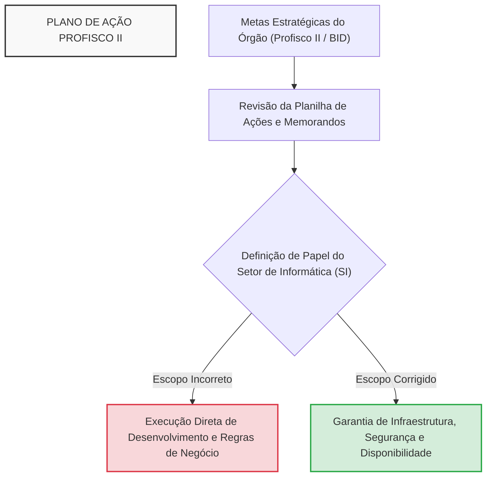
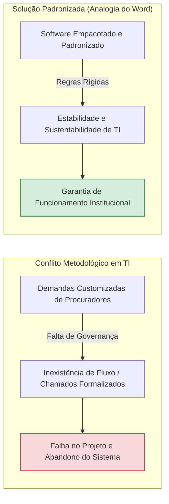
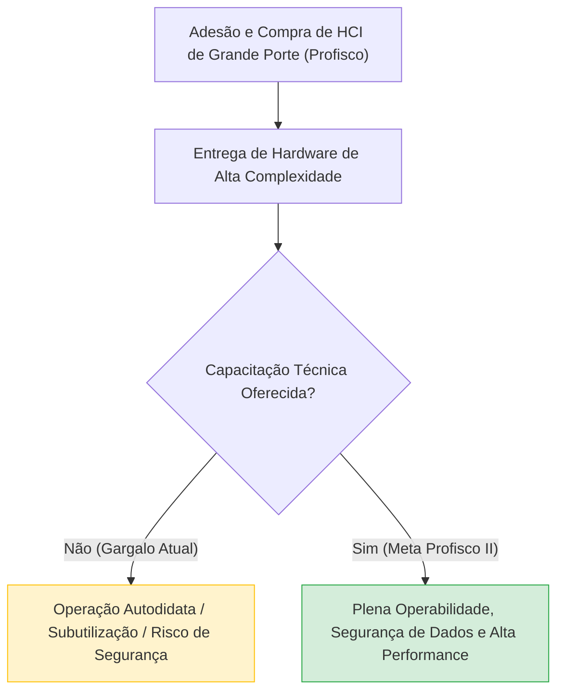
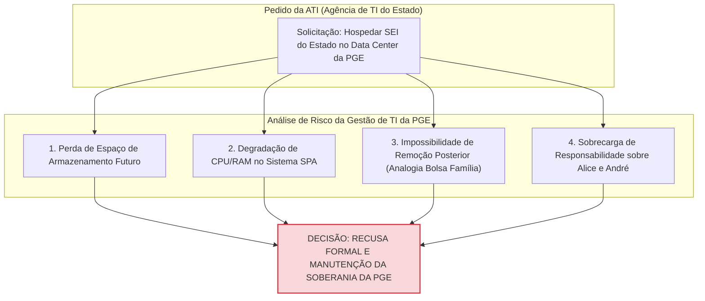
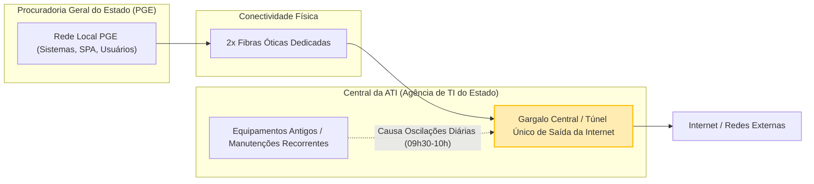
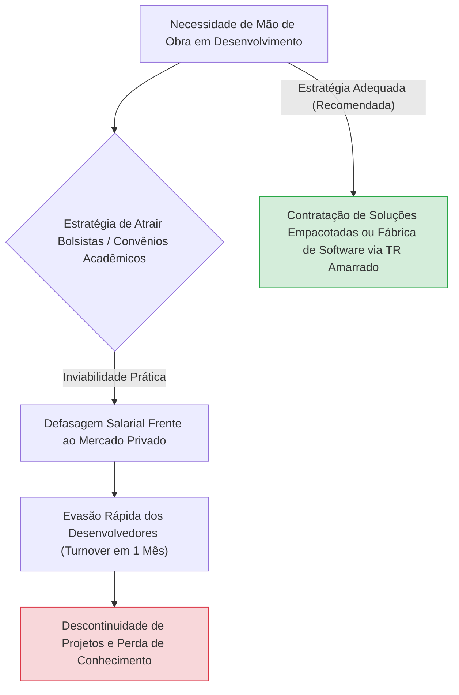
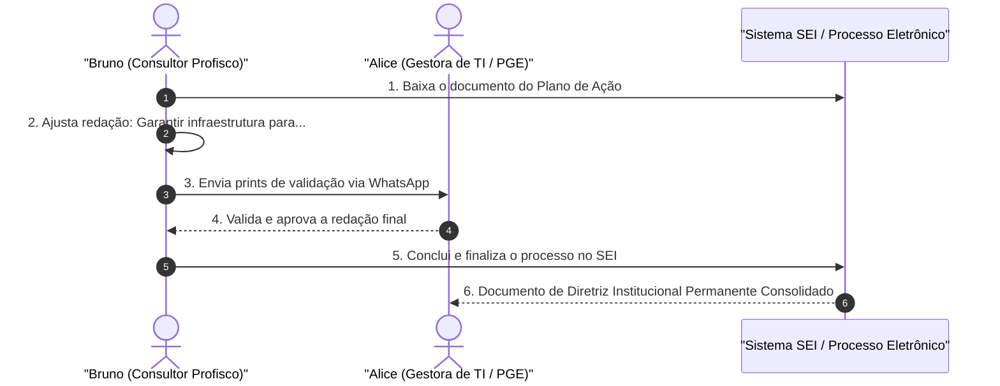

# Resumo de Reunião de Alinhamento Estratégico: Gestão de TI na PGE-MA - Alinhamento de Metas do Profisco II, Governança e Infraestrutura

---

## Ideia Central (Tese)
Esta reunião de alinhamento estratégico entre a Gestão de TI da Procuradoria Geral do Estado do Maranhão (PGE-MA) e a consultoria do Projeto Profisco II (BID) tem como objetivo delimitar com precisão as atribuições operacionais do Setor de Informática, reajustando o Plano de Ação para focar estritamente na garantia e sustentação da infraestrutura tecnológica. A discussão consolida a recusa fundamentada ao compartilhamento inadequado de recursos de hardware com a Agência de Tecnologia da Informação (ATI), evidencia a necessidade premente de capacitação técnica oficial para a equipe interna e estabelece diretrizes claras para a governança de TIC e captação sustentável de recursos no órgão [1, 3, 40].

---

## 1. Alinhamento Inicial e Revisão do Plano de Ação Profisco II

### 1.1. Contextualização do Projeto BID/Profisco II e Correção de Instrumentos
A reunião inicia-se com o alinhamento técnico referente ao preenchimento dos memorandos e planilhas de metas do projeto financiado pelo Banco Interamericano de Desenvolvimento (BID) / Profisco II [1]. Identifica-se a necessidade de retificação de incorreções materiais em documentos preliminares e estabelece-se que a orientação de conformidade visa estruturar os planos de ação (definindo o que fazer, como executar e quais recursos solicitar) [1].

Alice (gestora do Setor de Informática da PGE) e Bruno (consultor de governança) revisam a planilha de trabalho para validar se as ações pré-filtradas refletem a realidade institucional da PGE [1]. O ponto de partida do debate é definir se o Setor de Informática (SI) possui papel consultivo ou deliberação direta sobre aquisições, cursos e projetos de tecnologia do Profisco, convergindo para a necessidade de consenso metodológico [1].

### 1.2. Definição do Escopo Operacional e Papel do Setor de Informática
Discute-se a matriz de competências da TI da Procuradoria. Alice destaca que a TI do órgão atua precipuamente no suporte, segurança, infraestrutura física/lógica e gerenciamento de licenças [2, 24, 40]. Embora existam iniciativas estratégicas na Procuradoria Geral Adjunta para Assuntos Estratégicos (PGAE) e na Assessoria de Gestão, a TI setorial não deve ser onerada com a execução de tarefas que extrapolam sua capacidade operacional [40, 41, 43].

---

## 2. Automação, Otimização de Fluxos e a Fronteira entre Desenvolvimento e Infraestrutura

### 2.1. Redução de Atividades Repetitivas e o Papel do Desenvolvedor vs. Infraestrutura
Na análise da meta de otimização e automação dos fluxos de trabalho (visando reduzir o volume de tarefas manuais e repetitivas dos servidores), delimita-se a atuação dos profissionais [2, 23]:
* **Desenvolvimento de Software / Automações:** Atribuição do servidor Jean, focado na criação de robôs de captura e scripts de automação [2, 23].
* **Apoio de Infraestrutura:** Papel da equipe de TI (Alice, André e Rames), garantindo servidores, conectividade, armazenamento, memória e ambiente de execução estável para que as automações rodem continuamente de dia e de noite sem interrupções [2, 42].

Alice enfatiza que a TI não possui capacidade humana ou técnica para monitorar sistemas de forma ilimitada [24]. Atualmente, o monitoramento manual de apenas três servidores consome o dia inteiro de um servidor técnico experiente [24]. Monitorar logs, verificar comportamento de retaguarda e filtrar falhas são atividades essenciais que não podem ser ampliadas sem o devido aporte de pessoal e novos equipamentos [24, 25, 26].

### 2.2. A Analogia do "Perfurador e do Celular": Limites da Atribuição Institucional
Para ilustrar a impossibilidade de a PGE assumir o desenvolvimento de sistemas internos complexos sem a devida estrutura, Alice formula a **Analogia do Perfurador e do Celular** [32]:
> *"A finalidade da PGE não é tecnologia; a finalidade da PGE é prestar apoio à parte jurídica. Se você chega para mim e diz 'quero que tu faça um celular', e eu só sei fazer perfurador, como vai sair um celular se eu só sei fazer perfurador?"* [32]

A metáfora evidencia que a PGE não é uma empresa de tecnologia nem possui fábrica de software própria [32]. Se o órgão desejar criar soluções tecnológicas avançadas, deve contratar empresas especializadas por meio de Termos de Referência (TR) extremamente bem amarrados, e não exigir que a equipe técnica local fabrique sistemas do zero [32, 33, 34].

### 2.3. Padronização de Software vs. Customização Individual (A Analogia do Microsoft Word)
Alice relata a dificuldade histórica de lidar com demandas de desenvolvimento customizado apresentadas por procuradores, em que cada usuário exige o sistema ajustado ao seu gosto pessoal [34, 35]. Para exemplificar a necessidade de padronização rígida em software, apresenta a **Analogia do Microsoft Word** [34, 35]:
> *"Por que a gente recebe o Word empacotado sem poder alterar a estrutura do Word? Porque se pudesse alterar, o Word não existiria, pois cada um ia querer do seu jeito — um quer Premium Platinum Plus, o outro quer de outro jeito. Não tem como."* [34, 35]

A ausência de governança e de um fluxo formal de chamados resulta no insucesso de projetos informais de TI [34]. Quando procuradores solicitam alterações diretas sem formalização, os desenvolvedores externos ou estagiários ficam desorientados, resultando no abandono do sistema e na falsa premissa de que "o sistema não presta" [34].

---

## 3. Gestão de Equipamentos de Grande Porte (HCI) e o Gargalo da Capacitação

### 3.1. O Aparelhamento do Data Center da PGE e a Ausência de Treinamento
A PGE adquiria há cerca de três anos, por meio de recursos do programa Profisco, equipamentos de alta tecnologia e grande porte (Infraestrutura Hiperconvergente - HCI / Nutanix) [3, 10, 13]. No entanto, revelou-se um grave gargalo de governança [3]:
* **Promessa Institucional:** Envio dos equipamentos de ponta acompanhado da respectiva capacitação técnica para os servidores da PGE [3].
* **Realidade Observada:** Os equipamentos foram entregues e instalados, porém a capacitação oficial nunca foi fornecida [3].
* **Consequência:** Hardware de alta complexidade permanece subutilizado ou operado com receio na TI, pois a equipe não recebeu treinamento específico para explorar todo o seu potencial com segurança [3, 13, 47].

### 3.2. O Risco Operacional da "Abertura de Portas" Sem Visão Sistêmica
Alice relata um episódio com o procurador Dr. Marcos para exemplificar a distinção entre a capacidade de execução mecânica e o conhecimento das consequências técnicas [13, 14]. Quando solicitada a abrir portas de comunicação no firewall/rede, Alice pontuou [13, 14]:
> *"Doutor, eu sei fazer o comando para abrir as portas. O que eu não sei é: se eu abrir essas portas, qual é a consequência de segurança para a Procuradoria?"* [13, 14]

Esse posicionamento ressalta a responsabilidade profissional e a ética pública [14]. Executar uma configuração em ambiente de produção sem suporte técnico especializado (como o do servidor Rames ou consultoria credenciada) pode expor a integridade de dados e redes de toda a PGE a vulnerabilidades [14, 15].

### 3.3. A Solução de Backup Veeam e a Operação Autodidata
Apesar das limitações de treinamento formal, a PGE conta com uma das soluções de backup mais avançadas do mercado global: o software **Veeam Backup & Replication** [46]. 
* **Atuação do Servidor André:** O servidor André opera o sistema de backup de forma totalmente autodidata, sem jamais ter feito um curso oficial de Veeam [37, 46, 47].
* **Caso de Sucesso Institucional:** Em determinado episódio, uma procuradora perdeu arquivos críticos acumulados ao longo de 17 meses [37]. O servidor André resgatou 17 meses de históricos de backup e restaurou com êxito os documentos [37].
* **Demanda de Capacitação:** A inclusão de treinamentos em Veeam e na arquitetura HCI no Plano do Profisco II é classificada como prioritária por Alice e Bruno para formalizar o conhecimento e proteger o órgão contra falhas operacionais [47, 48].

---

## 4. Relação Institucional PGE vs. ATI: Soberania Tecnológica e Gestão de Riscos

### 4.1. Recusa da Migração do Sistema SEI para o Data Center da PGE
Um dos tópicos centrais da reunião diz respeito à solicitação feita pela Agência de Tecnologia da Informação do Estado (ATI) para migrar o ambiente do Sistema Eletrônico de Informações (SEI) do Estado para dentro do data center da PGE, alegando necessidade de "desafogar o data center central da ATI" [4, 5].

Alice informa que manifestou recusa categórica ao pedido junto ao Dr. Marcos, fundamentando sua decisão em quatro pilares técnicos e estratégicos [4, 5, 6, 7, 8, 15]:

1. **Efeito "Bolsa Família" (Analogia do Uso Definitivo de Espaço):** Alice utiliza a analogia de que *"é igual Bolsa Família: o cara acostuma e nunca mais quer largar"* [9]. Uma vez alocado o SEI do Estado nos servidores da PGE, a ATI jamais retiraria o sistema de lá, pois alegaria que a remoção prejudicaria todo o Poder Executivo Estadual [5, 9].
2. **Efeito "Bola de Neve" e Crescimento Interno da PGE:** A PGE tem projetos em expansão, como a parceria com a universidade e o crescimento contínuo do Sistema de Processos Administrativos (SPA) [7, 8]. Ceder espaço hoje comprometerá a capacidade de expansão da própria Procuradoria amanhã [8].
3. **Gargalo de Processamento e Memória:** Embora o armazenamento em disco do ambiente HCI seja amplo, os recursos de CPU, memória RAM e fontes de alimentação são compartilhados [15]. Adicionar o processamento do SEI de todo o Estado causaria degradação severa na velocidade e performance do SPA da PGE [15, 16].
4. **Assimetria de Responsabilidade e Risco ("A Chave do Cofre"):** A ATI é o órgão central de TI, composta por técnicos graduados [6]. A TI da PGE conta com apenas dois servidores no setor (Alice e André) [6]. Se houver qualquer pane ou corrupção de dados no ambiente compartilhado, a responsabilidade recairá injustamente sobre a PGE [6, 9]. Alice afirmou que, se a gestão superior determinar o aceite, ela entregará a "chave do cofre" e se eximirá formalmente da responsabilidade técnica [7, 8, 9].

### 4.2. Gargalos da Burocracia Estadual na Aquisição de Equipamentos
Alice contrasta a eficiência da PGE com o engessamento burocrático da ATI [10, 11, 12, 13].
* **Burocracia na ATI:** A ATI manteve processos travados por exigências descabidas e Termos de Referência (TR) engessados elaborados por servidores sem visão prática, impedindo a renovação do parque tecnológico do Estado [10, 11]. A servidora Raíssa (PGE) precisou intervir para sensibilizar a equipe da ATI e viabilizar uma adesão à ata de registro de preços (carona) [10].
* **Eficiência na PGE:** A PGE possuía orçamento de R$ 1,5 milhão e recebeu cotações iniciais de R$ 6 milhões [12]. Mediante negociação direta promovida por Alice com fornecedores e órgãos de outros estados (Belém), a PGE adquiriu equipamentos de grande porte por R$ 900 mil e pouco, com garantia inclusa [12, 13]. Agora, a ATI almeja utilizar os equipamentos eficientemente adquiridos pela PGE [13].

---

## 5. Arquitetura de Conectividade e Limitações Lógicas do Estado

### 5.1. Links de Fibra Ótica e a Estrutura do "Túnel Único" da ATI
Durante a revisão do plano de ação, analisa-se a infraestrutura de rede que interliga a PGE à ATI [16, 17]:
* **Conexão Física:** A interligação entre o prédio da PGE e a ATI é realizada por duas fibras óticas dedicadas [17].
* **Ponto Único de Falha (Gargalo Central):** Embora a conexão física seja em fibra, todo o tráfego de dados de todos os órgãos do Estado afunila em um único "túnel" de saída e retorno na ATI [17].
* **Inexistência de Autonomia Lógica:** Por força de Decreto Estadual, a ATI é a gestora exclusiva da infraestrutura de TIC do Estado [18]. A PGE não pode contratar link de internet independente, sendo obrigada a utilizar a malha do Estado (que não gera custos diretos de faturamento para a Procuradoria) [18].

### 5.2. Oscilações Diárias de Rede
Alice e Bruno relatan instabilidades recorrentes na conexão (com quedas diárias por volta das 09h30 às 10h00) [20]. Alice esclarece que as instabilidades ocorrem porque a equipe técnica da ATI frequentemente realiza intervenções diretas nos equipamentos centrais, reconfigurando arranjos ou reaproveitando hardware antigo por insuficiência orçamentária global do Estado [20, 21].

---

## 6. Gestão de Recursos Humanos e Perfil da Equipe de TI

### 6.1. Mapeamento de Competências e Perfis Individuais
Alice detalha a composição enxuta e a divisão do trabalho na TI da PGE, ressaltando que o sucesso da gestão depende do aproveitamento correto do perfil de cada servidor [6, 24, 36, 37]:

| Servidor / Colaborador | Função / Perfil Técnico | Atribuição Principal & Comportamento Institucional |
| :--- | :--- | :--- |
| **Alice** | Gestora de TI / Infraestrutura | Responsável técnica, governança de ativos, defesa do patrimônio tecnológico e gestão de riscos [6, 14, 24]. |
| **André** | Técnico de TI / Backup | Focado em operações de infraestrutura e backup (Veeam). Perfil introspectivo; deve ser preservado de reuniões administrativas para focar em entregas técnicas de alta complexidade [36, 37]. |
| **Rames** | Técnico de TI / Redes | Apoio em infraestrutura, redes lógicas e projetos de conectividade [6, 14, 16]. |
| **Jean** | Desenvolvedor de Software | Responsável pela criação de automações, robôs de processos e soluções de código [2, 23]. |
| **Marcelo** | Estagiário de TI | Em fase de definição de carreira (praticante de vôlei no IPG/Brave); não possui perfil focado em programação de sistemas [35, 36]. |

Alice sintetiza sua filosofia de gestão de pessoas:
> *"Você não pode mandar o André para uma reunião se ele não gosta de reunião e o forte dele é recuperar um backup de 17 meses. Cada um tem que estar focado no seu balai."* [36, 37]

### 6.2. Inviabilidade de Convênios Acadêmicos para Desenvolvimento
A PGE avaliou a possibilidade de firmar convênios com universidades para atrair estudantes e desenvolvedores bolsistas [31, 32]. Alice relata que a experiência já foi testada no passado, mas revelou-se inviável devido à concorrência com o mercado privado de tecnologia [31, 32]:
* **Histórico:** Os estudantes selecionados permaneceram cerca de um mês na Procuradoria e migraram para o mercado privado assim que receberam propostas salariais superiores [31, 32].
* **Conclusão:** Convênios acadêmicos não resolvem a demanda por desenvolvimento permanente em órgãos jurídicos devido ao alto *turnover* e à defasagem da remuneração de bolsas frente ao mercado [31, 32].

---

## 7. Encaminhamentos Finais e Formalização do Plano Estratégico

### 7.1. Padronização da Redação das Ações na Planilha Profisco II
Para reconciliar as exigências do programa Profisco II / BID com as competências reais do Setor de Informática, Bruno e Alice definem a seguinte padronização redacional para a Coluna D (Ações) da planilha [39, 40, 41, 44]:
1. **Redação Padronizada:** Todas as ações vinculadas a automações, painéis institucionais, capacitações e transformação digital iniciam-se com a expressão:
   > *"Garantir a infraestrutura necessária para..."* ou *"Dar suporte e condições de infraestrutura para que [a solução] seja executada"* [39, 41, 44].
2. **Coluna de Recursos Necessários (Coluna E):** Alice especificará os insumos indispensáveis para a execução de cada ação, tais como capacitações oficiais (ex: treinamento em Veeam e HCI), aquisição de licenças ou contratação de serviços técnicos especializados [45, 47].

### 7.2. Tramitação no Processo SEI e Validação Institucional
Bruno compromete-se a efetuar os ajustes diretamente na planilha do processo eletrônico no SEI [50]. A tramitação final seguirá o seguinte fluxo [50]:
* Bruno baixa o documento do processo, insere o preâmbulo padronizado de infraestrutura nas ações cabíveis e gera prévias visuais [50].
* Encaminha capturas de tela (prints) via WhatsApp para validação rápida de Alice [50].
* Após o aceite de Alice, o processo é finalizado formalmente no SEI, servindo como documento de diretriz institucional permanente para a TI da Procuradoria, imune a trocas de gestão [49, 50].

---

## 8. Notas Explicativas e Complementares

Para garantir a rastreabilidade total e o aprofundamento pedagógico dos conceitos e evidências extraídos da gravação, apresentam-se a seguir as explicações numeradas correspondentes a cada citação utilizada neste documento:

1. **[1] Início da Reunião e Alinhamento do Plano de Ação do Profisco II (BID):** Registra o momento inicial em que Alice e Bruno revisam os memorandos e planilhas do projeto financiado pelo Banco Interamericano de Desenvolvimento (BID), corrigindo erros de digitação e alinhando como as metas devem ser preenchidas.
2. **[2] Escopo da Meta de Automação de Fluxos de Trabalho:** Explica a divisão de trabalho onde a automação e redução de processos repetitivos fica a cargo do desenvolvedor Jean, cabendo à equipe de TI fornecer o suporte de infraestrutura e servidores.
3. **[3] Recebimento de Equipamentos de Grande Porte (HCI) sem Capacitação:** Alerta para o fato de que a PGE recebeu equipamentos computacionais de alta complexidade há três anos com promessa de treinamento técnico, mas a capacitação nunca foi entregue, mantendo os equipamentos subutilizados.
4. **[4] Solicitação de Migração da ATI e Alerta da TI:** Documenta a mensagem recebida por Alice da equipe da Agência de Tecnologia da Informação (ATI) solicitando transferência de sistemas estaduais para a estrutura de data center da Procuradoria para aliviar a ATI.
5. **[5] Riscos de Ceder Espaço de Armazenamento para a ATI:** Detalha a justificativa de Alice para negar o espaço à ATI: uma vez instalado o sistema SEI do Estado na PGE, a ATI não o removerá mais, sob a justificativa de que atende a todo o governo estadual.
6. **[6] Assimetria de Mão de Obra e Responsabilidade Institucional:** Compara a equipe da ATI (composta por técnicos de excelência) com a equipe enxuta da PGE (apenas Alice e André ativos), destacando que qualquer falha futura no ambiente compartilhado seria atribuída à PGE.
7. **[7] Compromisso com Projetos Internos da PGE e "Chave do Cofre":** Destaca a expansão dos projetos próprios da PGE (como a parceria com a universidade) e a declaração de Alice ao Dr. Marcos de que, se for obrigado a aceitar a ATI, entregará a responsabilidade formal ("chave do cofre").
8. **[8] Crescimento Exponencial dos Dados do SPA:** Mostra que o volume de processamento e dados do Sistema de Processos Administrativos da PGE está crescendo rapidamente, não havendo margem para ceder hardware a outros órgãos.
9. **[9] Analogia do "Bolsa Família" e Vício de Uso:** Apresenta a analogia informal utilizada por Alice de que o acostumamento com recursos doados impede a devolução posterior, tornando o compartilhamento de data center inviável.
10. **[10] Atuação Burocrática da ATI e Intervenção da PGE:** Relata o episódio em que a burocracia e exigências ineficientes da ATI quase inviabilizaram a compra de computadores, sendo necessária a intervenção da servidora Raíssa para viabilizar adesão à ata.
11. **[11] Injeçamento de Termos de Referência na Administração Estadual:** Critica a falta de agilidade e o excesso de critérios formais sem utilidade prática aplicados por novos técnicos do Estado, travando aquisições de TIC.
12. **[12] Negociação Direta e Economia Orçamentária na PGE:** Demonstra a eficiência de gestão de Alice, que reduziu uma cotação inicial de R$ 6 milhões para R$ 900 mil e pouco através de cotações diretas e articulação com Belém.
13. **[13] Desejo da ATI pelos Equipamentos Ágeis da PGE e Falta de Treinamento:** Revela que a ATI busca utilizar os equipamentos recém-adquiridos da PGE devido à alta agilidade do hardware, enquanto a PGE sofre com a ausência de cursos específicos para operá-los plenamente.
14. **[14] Prudência Operacional na Abertura de Portas de Rede:** Exemplifica a postura responsável de Alice ao se recusar a executar comandos de abertura de portas de rede sugeridos por superiores sem ter certeza das implicações de segurança para a Procuradoria.
15. **[15] Compartilhamento de Recursos de Hardware e Perda de Desempenho:** Fundamenta a explicação técnica de que, embora haja espaço em disco, a memória RAM e os processadores da HCI são únicos, e rodar sistemas estaduais deixaria o SPA da PGE lento.
16. **[16] Projeto de Infraestrutura de Fibra Ótica e Limitações:** Aborda a visita técnica realizada pelo servidor Rames para projetos de rede e o diagnóstico de oscilações no tráfego de dados.
17. **[17] A Estrutura de Conectividade em Fibra e o Gargalo do Túnel Central:** Esclarece que a ligação física PGE-ATI é em fibra ótica dedicada, mas o afunilamento de todo o Estado em um único túnel de saída na ATI gera instabilidades.
18. **[18] Centralização Normativa por Decreto Estadual:** Informa que a legislação estadual obriga os órgãos a utilizarem a infraestrutura lógica da ATI, impedindo a contratação de links de internet privados independentes pela PGE.
19. **[19] Contratos Guarda-Chuva e Caráter Crônico da Rede:** Discute a existência de contratos guarda-chuva de conectividade geridos pela ATI e o caráter histórico e crônico dos problemas de sinal no Estado.
20. **[20] Oscilações Horárias e Intervenções Constantes nos Equipamentos:** Detalha que as quedas de internet entre 09h30 e 10h00 ocorrem devido a manutenções e ajustes frequentes realizados pela ATI em seus bastidores técnicos.
21. **[21] Escassez Orçamentária e Defesa do Patrimônio da PGE:** Reconhece o esforço da ATI diante da falta de orçamento geral, mas reforça que a gestora da PGE não pode ceder os recursos da Procuradoria sob pena de colapsar o setor.
22. **[22] Proposta de Governança e Painel de Projetos no Profisco:** Sugere a inclusão de um painel institucional de governança tecnológica para unificar a visão dos sistemas (como o RPV) e infraestrutura.
23. **[23] Atribuições de Robôs de Automação e Integração de Sistemas:** Define que robôs de captura e automação devem ser integrados pelo desenvolvedor Jean, cabendo à TI manter o ambiente estável.
24. **[24] Limites Humanos de Monitoramento de Servidores:** Revela a capacidade operacional real da TI: um servidor técnico dedicado consegue monitorar no máximo três servidores por dia, tornando inviável assumir novas tarefas sem pessoal.
25. **[25] Importância do Monitoramento de Logs de Sistemas:** Relembra a falha histórica no sistema ST, que caiu em cinco dias por falta de monitoramento contínuo de logs de retaguarda.
26. **[26] O Papel da TI no Filtro de Requisitos:** Explica que a TI da PGE atua filtrando problemas técnicos de infraestrutura e que a garantia dessa camada garante o funcionamento das aplicações.
27. **[27] Ajustes e Remoções de Metas Incompatíveis:** Registra a flexibilidade de Bruno em permitir a exclusão ou reformulação de metas que não correspondam à realidade técnica do Setor de Informática.
28. **[28] Ausência de Competência Documental e Jurídica na TI:** Declara expressamente que a TI não possui conhecimento documental ou jurídico para determinar descarte de peças ou triagem de processos, enxergando os arquivos apenas em formato bruto.
29. **[29] Foco da TI em Sustentação de Ferramentas:** Reitera que a atribuição da TI é dar suporte e infraestrutura para que ferramentas adquiridas ou desenvolvidas tenham ambiente estável.
30. **[30] Reconhecimento da Limitação de Recursos Humanos e Financeiros:** Destaca que certas iniciativas só podem ser cobradas da TI se houver o fornecimento prévio dos recursos humanos e financeiros correspondentes.
31. **[31] Tentativa de Programa de Convênio com Universidades:** Menciona a ideia de criar programas de estagiários ou bolsistas desenvolvedores via convênio universitário.
32. **[32] A Analogia do Perfurador e Celular e Evasão de Desenvolvedores:** Traz a célebre analogia sobre o papel institucional da PGE e relata que desenvolvedores universitários contratados no passado deixaram o órgão em um mês devido a salários melhores no mercado.
33. **[33] Risco de Projetos que "Saem do Nada e Voltam pro Nada":** Alerta que iniciativas sem planejamento orçamentário e termos de referência estruturados fracassam rapidamente na administração pública.
34. **[34] Analogia do Microsoft Word e Exigências de Procuradores:** Ilustra a inviabilidade de desenvolver sistemas sob encomenda individual para procuradores, mostrando que a falta de padrão destrói os softwares jurídicos.
35. **[35] Perfil do Estagiário Marcelo:** Registra as características do colaborador Marcelo, destacando que sua área de atuação preferencial não é o desenvolvimento de sistemas.
36. **[36] Mapeamento do Perfil do Servidor André:** Apresenta as características comportamentais de André, justificando por que ele deve ser mantido focado no trabalho técnico reservado.
37. **[37] Caso de Sucesso da Restauração do Backup de 17 Meses:** Documenta a capacidade técnica de André ao restaurar com sucesso 17 meses de dados perdidos por uma procuradora, utilizando o software Veeam.
38. **[38] Coerência Geral das Metas com Necessidade de Adaptação:** Registra a concordância de Alice com a relevância das metas propostas, exigindo apenas que a responsabilidade da TI seja delimitada à infraestrutura.
39. **[39] Sugestão de Redação com "Garantir Infraestrutura":** Apresenta a solução metodológica de iniciar as ações com a expressão "Garantir a infraestrutura necessária para...", preservando a meta sem sobrecarregar a TI.
40. **[40] Competências Precípuas do Setor de Informática:** Consolida que infraestrutura, backup, licenças e segurança são os pilares precípuos de atuação do setor de TI da PGE.
41. **[41] A Planilha de Ações como Instrumento de Viabilização:** Esclarece que a planilha não impõe execução isolada pela TI, mas busca articular o apoio do setor para que o órgão alcance suas metas.
42. **[42] Garantia de Execução Contínua dos Robôs de Automação:** Cita a importância da infraestrutura mantida pela TI para permitir que robôs de captura de dados funcionem durante as madrugadas sem quedas.
43. **[43] Distinção entre TIC de Infraestrutura e TIC de Governança/PGAE:** Esclarece a divisão de papéis no órgão, diferenciando a gestão estratégica de TIC realizada na Procuradoria Adjunta da execução operacional da TI.
44. **[44] Execução do Plano Diretor de TIC (PDTIC):** Menciona que o Plano Diretor de TIC elaborado com o servidor Jean trará as diretrizes formais que a TI executará no futuro.
45. **[45] Exigência de Previsão de Recursos e Investimentos:** Pontua que a execução de qualquer garantia de infraestrutura exige que o órgão forneça os recursos financeiros correspondentes na Coluna E da planilha.
46. **[46] Excelência da Solução de Backup Veeam Instalada:** Destaca que a PGE possui uma das melhores ferramentas do mercado (Veeam), exigindo apenas a capacitação da equipe para o uso ideal.
47. **[47] Necessidade Urgente de Capacitação Oficial em Veeam e HCI:** Formaliza o pedido de inserção de cursos oficiais no plano do Profisco II para qualificar os servidores técnicos André e Alice.
48. **[48] Concordância com o Cronograma do BID:** Confirma que a equipe técnica concorda com o treinamento previsto no programa do BID, validando o conteúdo proposto.
49. **[49] Construção de um Documento Institucional Permanente:** Ressalta a fala do Dr. Den sobre a necessidade de ter um documento de diretriz de TI formalizado, que perdure além das mudanças de gestão.
50. **[50] Encaminhamento Final no SEI e Validação via WhatsApp:** Define o procedimento operacional de finalização do processo no SEI após revisão de textos e envio de confirmações visuais para a gestora.
51. **[51] Realismo e Responsabilidade na Gestão Pública:** Encerra a conversa com a síntese de Alice de que sua função como gestora é ser realista, garantindo que o plano reflita exatamente o que a TI tem condições de entregar com excelência.
