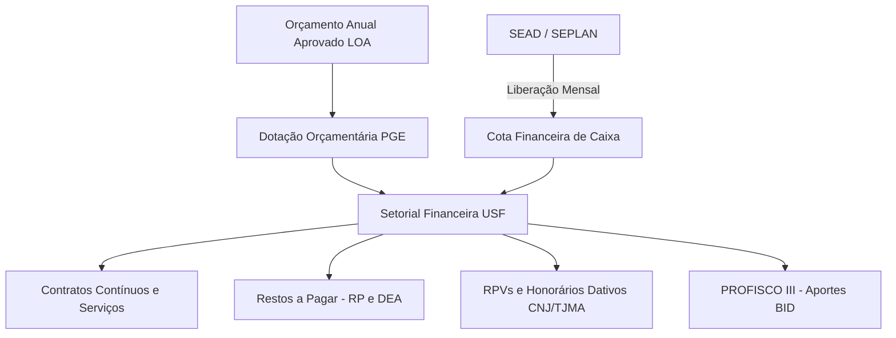

# Relatório Sintético de Ajustes Pós-Reunião
## Unidade Setorial de Finanças (USF / PGE-MA)

**Processo de Referência SEI:** 2026.11103.07203  
**Interlocutores:** Ana Célia (Chefia da Unidade Setorial de Finanças) e Assessoria de Planejamento Estratégico  
**Data de Consolidação:** Outubro de 2026 – Ciclo PGE-MA 2026–2030  

---

### 1. Contexto Institucional e Metodologia SEI
O processo de alinhamento estratégico da Unidade Setorial de Finanças (USF) vincula-se ao Processo SEI nº 2026.11103.07203, integrando as diretrizes dos OKRs 2026–2030 da Alta Direção da PGE-MA ao plano operacional 5W2H. O objetivo central da reunião consistiu em afinar o catálogo de metas com as rotinas práticas de desembolso, liquidação contábil e gestão de cotas financeiras do Poder Executivo estadual.

---

### 2. Deliberações e Saneamento de Metas

| Meta Institucional Original | Pertinência à USF | Condicionantes Identificadas | Encaminhamento Pós-Reunião |
| :--- | :--- | :--- | :--- |
| **1. Captação de R$ 2M em recursos externos até 2029** | Inaplicável (Sem competência) | Atuação restrita a despesas/pagamentos; captação cabe à PGARI/ESAP | **Suprimida / Neutralizada** no 5W2H |
| **2. Execução de 100% do orçamento anual planejado até 2030** | Chave / Prioritária | Dependência de cotas SEAD, Restos a Pagar, DEA, RPV e Dativos | **Aprovada** com 3 ações estruturantes e linha de base 2026 |
| **3. Execução de 100% dos recursos do PROFISCO III até 2030** | Suporte e Liquidação | Gestão de projetos é externa; USF atua na liquidação e conformidade | **Mantida** com foco na conformidade financeira e BID |
| **4. Reduzir em 90% bloqueios e pagamentos duplicados de RPV até 2027** | Coexecutora Financeira | Validação de dados bancários, retenções e honorários dativos | **Aprovada** com checklist financeiro preventivo |

---

### 3. Condicionantes do Fluxo Financeiro Real
1. **Dependência Crítica da Cota Financeira (SEAD / SEPLAN)**: A liquidação e o pagamento dependem da liberação mensal de cotas financeiras de caixa pela SEAD, independentemente de haver dotação orçamentária autorizada na LOA.
2. **Pagamentos Diários Contínuos**: Manutenção ininterrupta de contratos essenciais (vigilância, limpeza, links de TI, locações, energia).
3. **Gestão de Restos a Pagar e DEA**: Faturas de fim de ano inscritas em RP demandam suplementação financeira no primeiro trimestre do ano posterior.
4. **Demandas Judiciais (RPV e Advogados Dativos)**: Fluxo contínuo de RPVs e implementação das requisições de defensores dativos (normativa CNJ/TJMA).

---

### 4. Plano de Ação 5W2H Ajustado (Resumo Executivo)
- **Ação 1 (KR2)**: Consolidação da linha de base de execução orçamentária e financeira de 2026 como referencial histórico (45 dias / 1º Trimestre).
- **Ação 2 (KR2)**: Criação e articulação do Comitê de Programação Orçamentária e Financeira da PGE-MA com reuniões mensais (30 dias / Mensal).
- **Ação 3 (KR2)**: Monitoramento diário dos contratos contínuos e interlocução antecipada junto à SEAD para liberação de cotas (Contínuo / Diário).
- **Ação 4 (KR2)**: Governança preventiva de Restos a Pagar e Despesas de Exercícios Anteriores no encerramento de dezembro (Trimestral / Encerramento do Exercício).
- **Ação 5 (KR2)**: Implantação de painel gerencial mensal de execução física e financeira com dados do SIAFEM/SIGEF (90 dias / Mensal).
- **Ação 6 (KR3)**: Suporte operacional, segregação contábil e liquidação tempestiva das dotações do programa PROFISCO III (Conforme cronograma BID / Contínuo).
- **Ação 7 (KR2 Eixo 1)**: Operacionalização de checklist financeiro de dupla checagem prévia ao pagamento de RPVs (60 dias / Contínuo).
- **Ação 8 (KR2 Eixo 1)**: Estruturação de fluxo contábil-financeiro regular para quitação de honorários de advogados dativos CNJ/TJMA (60 dias / Mensal).

---
*São Luís/MA, Outubro de 2026. Assessoria de Planejamento Estratégico – PGE-MA.*
