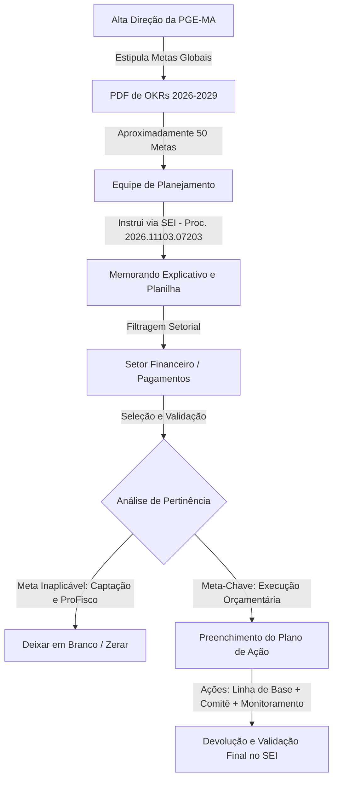
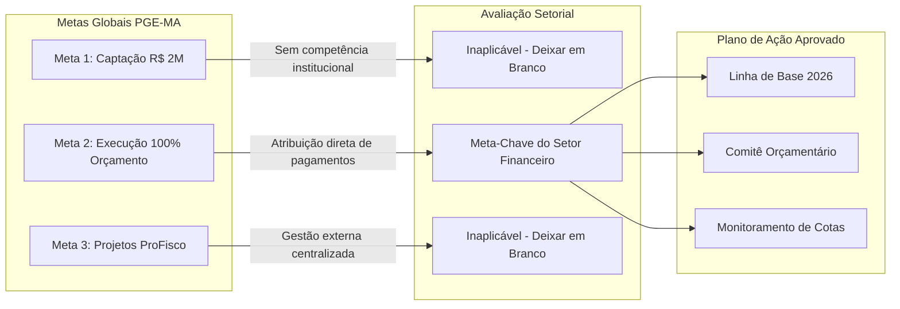
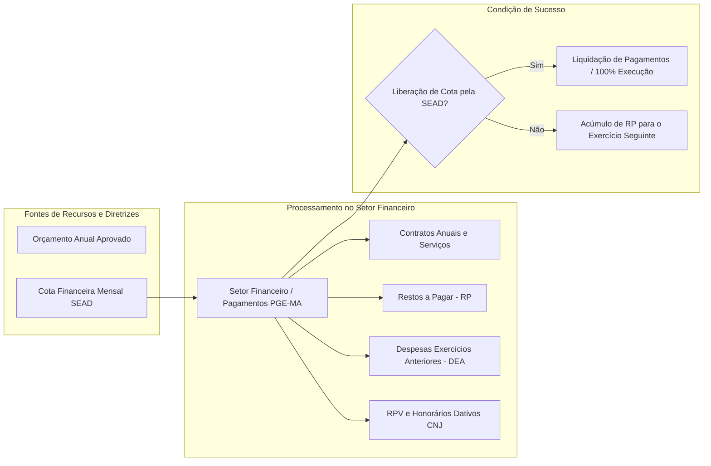

# Resumo do Evento: Planejamento Orçamentário e Metas PGE-MA - Alinhamento Estratégico e Plano de Ação da Setorial Financeira

## Ideia Central (Tese)
Este documento apresenta uma síntese exaustiva e estruturada da reunião de alinhamento estratégico entre a equipe de planejamento e a chefia do Setor Financeiro da Procuradoria Geral do Estado do Maranhão (PGE-MA). O encontro teve como objetivo orientar o preenchimento e a validação do Plano de Ação Setorial no sistema SEI, ajustando as diretrizes institucionais globais de 2026–2029 à realidade operacional dos pagamentos, da liquidação orçamentária e dos limites impostos pelas cotas financeiras do Estado. Por meio dessa repactuação pragmática, a PGE-MA busca operacionalizar suas metas institucionais com foco no que é viável, mensurável e alinhado à rotina do setor público.

---

## 1. Contexto Institucional, Metodologia de Gestão e Trâmite no Sistema SEI

O processo de planejamento estratégico e orçamentário da Procuradoria Geral do Estado do Maranhão (PGE-MA) é gerido de forma integrada por meio do Sistema Eletrônico de Informações (SEI), sob o processo de referência **nº 2026.11103.07203** [2]. A metodologia adotada pela instituição combina a definição de **Objetivos e Resultados-Chave (OKRs)** definidos pela Alta Direção com a elaboração de **Planos de Ação Operacionais** descentralizados, nos quais cada unidade administrativa mapeia suas atividades cotidianas e estabelece como pode contribuir para o atingimento das metas globais [1, 2].

A institucionalização do processo segue uma sequência metodológica bem definida:

1. **Memorando Explicativo e Diretrizes do SEI**: Documento oficial encaminhado às unidades administrativas orientando o conceito de plano de ação, o fluxo de aprovação e os critérios para definição de tarefas diárias, responsáveis, recursos necessários e cronogramas [1, 2].
2. **Matriz de Objetivos Globais (OKRs 2026–2029)**: Documento em formato PDF contendo o catálogo geral de aproximadamente 50 metas institucionais estipuladas pela Direção para o horizonte de longo prazo (até 2029) [3, 8].
3. **Planilha de Plano de Ação Setorial (Matriz 5W2H Simplificada)**: Ferramenta operacional estruturada nas dimensões fundamentais:
   - **O que** (*What*): Ação ou tarefa concreta a ser desenvolvida no âmbito do setor [2, 3].
   - **Como** (*How*): Metodologia e procedimentos operacionais empregados para a execução da ação [2, 3].
   - **Quem** (*Who*): Responsáveis diretos pela execução e identificação de outros setores intervenientes no processo [2, 3, 14].
   - **Quando** (*When*): Prazo estimado para conclusão ou acompanhamento contínuo da tarefa [2, 3, 14].

A equipe de planejamento realiza reuniões setoriais de orientação para auxiliar os gestores na navegação do processo SEI, garantindo que a planilha seja preenchida apenas com ações que façam sentido prático para cada unidade [4, 5, 15]. No caso específico da Setorial Financeira e de Pagamentos, foi realizada uma filtragem prévia que reduziu as 50 metas globais da PGE-MA para **3 metas prioritárias** com correlação direta ou indireta com a área orçamentário-financeira [8].

### Elemento Visual 1: Fluxo de Trabalho do Planejamento Estratégico no SEI

---

## 2. Análise Detalhada das Metas Globais e Aplicação à Setorial Financeira

A reunião concentrou-se na análise minuciosa das três metas destacadas pelo setor de planejamento, avaliando a aderência de cada uma à rotina de execução e liquidação de despesas da PGE-MA [8].

### 2.1 Meta 1: Captação de Recursos (Meta da Diretoria: R$ 2 Milhões até 2029)
- **Descrição da Meta Original**: Mapeamento e captação de pelo menos R$ 2.000.000,00 em recursos externos até o ano de 2029, prevendo a estruturação de investimentos em conformidade orçamentária e contratual para a recepção de transferências voluntárias [3].
- **Análise Técnica da Setorial Financeira**: A chefia do setor esclareceu que a unidade de pagamentos da PGE-MA não possui atribuição nem competência regimental para realizar captação direta de receitas ou recursos [8, 9].
- **Diferenciação Conceitual (Convênios de Entrada vs. Convênios de Saída)**:
  - *Convênios de Entrada*: Instrumentos nos quais a instituição recebe recursos financeiros externos de órgãos federais ou entidades parceiras (ex.: empréstimos diretos do Fisco/Governo Federal). A PGE-MA não opera como recebedora direta desses repasses [9].
  - *Convênios de Saída e Contratos*: Instrumentos nos quais a PGE-MA efetua repasses, pagamentos ou aquisição de bens e serviços. Esta é a única modalidade processada pelo setor financeiro [9].
- **Encaminhamento Operacional**: Por se tratar de atribuição estranha à unidade financeira, a meta foi classificada como inaplicável ao setor, ficando ajustado que os campos correspondentes na planilha permanecerão **em branco** [9, 13, 18].

---

### 2.2 Meta 2: Garantia da Execução de 100% do Orçamento Anual (Meta-Chave)
- **Descrição da Meta Original**: Assegurar a alocação e a execução orçamentária integral (100%) dos recursos programados para a PGE-MA a cada exercício financeiro [10].
- **Análise Técnica e Diagnóstico da Realidade Financeira**: A Setorial Financeira identificou esta como a **única e verdadeira meta-chave** sob sua responsabilidade direta [10, 12]. No entanto, os interlocutores enfatizaram que atingir cravadamente 100% de execução é uma meta teórica, sujeita a condicionantes externas rígidas que fogem ao controle exclusivo do setor [10, 12].

#### Condicionantes e Obstáculos do Fluxo Financeiro Real:
1. **Dependência Crítica da Cota Financeira (SEAD / SEPLAN)**: A PGE-MA trabalha rigorosamente dentro do orçamento aprovado, mas a efetivação dos pagamentos depende da liberação mensal de cotas de caixa disponibilizadas pelo Poder Executivo (via Secretaria de Estado da Administração - SEAD) [6, 11]. Sem a liberação do recurso financeiro, o setor fica impossibilitado de efetuar liquidações, ainda que haja dotação orçamentária disponível [11].
2. **Dinâmica do Fluxo de Pagamentos Diários**: A rotina do setor consiste em processar pagamentos diários contínuos vinculados a contratos anuais de prestação de serviços e fornecimento de insumos essenciais [6, 7, 10].
3. **Gestão de Passivos e Encerramento do Exercício**:
   - *Restos a Pagar (RP)*: Todo mês de dezembro, contratos em andamento e serviços prestados geram saldos que são inscritos em Restos a Pagar para liquidação no exercício seguinte [11]. A quitação desses restos no ano posterior depende da alocação de cota financeira específica pela SEAD [11].
   - *Despesas de Exercícios Anteriores (DEA)*: Obrigações não pagas na época própria que exigem reconhecimento formal e disponibilidade orçamentária/financeira futura para pagamento [7, 11].
4. **Novas Obrigações Legais e Normativas das Cortes de Justiça**:
   - *Requisições de Pequeno Valor (RPV)*: Pagamentos judiciais de fluxo contínuo que demandam desembolsos financeiros regulares [7].
   - *Honorários de Advogados Dativos*: Nova obrigação institucional originada de normatização do Conselho Nacional de Justiça (CNJ) e do Tribunal de Justiça, exigindo a estruturação de um novo fluxo de pagamentos dentro da PGE-MA [7].

#### Ações Propostas no Plano de Ação Setorial:
Para viabilizar a execução orçamentária o mais próximo possível do limite de 100%, foram estruturadas três ações fundamentais [5, 6, 14]:

1. **Ação 1: Consolidação da Linha de Base de Execução Orçamentária e Financeira**:
   - *Objetivo*: Mapear o histórico de execução de anos anteriores para compreender o comportamento real das despesas e identificar gargalos [5, 6].
   - *Ajuste Técnico*: Correção de um erro material na planilha apresentada no SEI, que indicava o ano de "2025" por equívoco, retificado para **2026** [5].
   - *Premissa Pedagógica*: Nenhuma melhoria de processo pode ser implementada sem o entendimento prévio e preciso da linha de base histórica do setor [5, 6].
2. **Ação 2: Subvenção e Articulação de Comitê de Programação Orçamentária**:
   - *Objetivo*: Subsidiar a criação de um comitê ou comissão de acompanhamento da programação orçamentária e financeira, promovendo o alinhamento periódico com a Diretoria Geral e com setores solicitantes para evitar sobra ou contingenciamento involuntário de recursos [6].
3. **Ação 3: Monitoramento Contínuo dos Contratos e Fluxo Financeiro**:
   - *Objetivo*: Acompanhar diariamente o cumprimento dos contratos anuais, verificar o saldo de restos a pagar e sinalizar antecipadamente às instâncias superiores sobre a necessidade de reforço nas cotas financeiras junto à SEAD [7, 10, 14].

---

### 2.3 Meta 3: Execução de Projetos e Recursos do ProFisco
- **Descrição da Meta Original**: Executar 100% dos projetos e recursos previstos na linha do programa ProFisco vinculados à PGE-MA [11, 12].
- **Análise Técnica da Setorial Financeira**: O setor financeiro informou que não possui gestão direta ou conhecimento prévio sobre a elaboração e celebração dos contratos do ProFisco [11, 12]. O setor atua meramente na fase final de ajuste contábil/financeiro à medida que as demandas são apresentadas [12].
- **Encaminhamento Operacional**: Por se tratar de um programa com governança própria e centralizada, a meta foi neutralizada na planilha setorial, ficando os campos também **em branco** [12, 13, 18].

### Elemento Visual 2: Diagrama Mermaid da Matriz de Pertinência das Metas

### Tabela Comparativa de Pertinência das Metas
| Meta Institucional da PGE-MA | Pertinência ao Setor Financeiro | Condicionantes Técnicas Identificadas | Encaminhamento no Plano de Ação |
| :--- | :--- | :--- | :--- |
| **1. Captação de R$ 2M em Recursos até 2029** | Inaplicável (Sem competência) | Atuação restrita a convênios de saída (pagamentos de contratos) | Deixar em branco / Zerar |
| **2. Execução de 100% do Orçamento Anual** | Chave / Prioritária | Liberação de cota financeira SEAD; Restos a Pagar; RPV e Dativos | Aprovado: Construir Linha de Base (2026) e Subsidiar Comitê |
| **3. Execução de Projetos ProFisco** | Inaplicável (Gestão Externa) | Conhecimento e ajustes apenas a posteriori na liquidação | Deixar em branco / Zerar |

---

## 3. Aspectos Práticos, Ergonomia e Operacionalização no SEI

Durante a reunião, os participantes trataram de aspectos práticos voltados a tornar o preenchimento e a gestão do Plano de Ação eficientes no dia a dia da repartição [13, 16].

### 3.1 Limpeza e Customização da Planilha
Para evitar poluição visual e simplificar o acompanhamento da gestão, ficou estabelecido que o setor pode suprimir ou deixar em branco todas as linhas correspondentes a metas das quais não participa [13, 18]. A planilha final concentrará exclusivamente as ações de monitoramento, linha de base e articulação do comitê associadas à garantia da execução orçamentária [14, 18].

### 3.2 Desafios de Leitura e Impressão Física
Um ponto prático debatido refere-se à formatação e ao tamanho das fontes da planilha no SEI. A gestora relatou grande dificuldade para visualizar e imprimir o documento em formato físico, devido à escala reduzida das tabelas originais [16, 17]. 

Para solucionar o problema:
- Realizaram-se ajustes de configuração de página, como a **remoção de margens** e o reajuste da seleção de células [17].
- A equipe de planejamento auxiliou no ocultamento temporário das colunas relativas às metas zeradas, permitindo ampliar a área útil de impressão e garantindo a leitura confortável dos campos de Ação, Responsável e Prazo [17, 18].

### Elemento Visual 3: Estrutura do Fluxo Financeiro e Condicionantes Orçamentárias

---

## 4. Lista de Explicações e Contextualização das Citações

Esta seção apresenta o detalhamento exaustivo e a fundamentação técnica de todas as citações numéricas indicadas ao longo do relatório, proporcionando total rastreabilidade e rigor pedagógico em relação ao conteúdo registrado no áudio da reunião.

1. **[1] - Explicação do Memorando e Conceito de Plano de Ação**: Refere-se à explicação inicial fornecida pelo representante do planejamento sobre o memorando do SEI, que conceitua o plano de ação como a sistematização das atividades rotineiras do setor direcionadas ao cumprimento dos objetivos estratégicos da PGE-MA [1].
2. **[2] - Explicação do Processo SEI e Metodologia OKR**: Detalha o número do processo administrativo no SEI (nº 2026.11103.07203), a disponibilização dos arquivos em anexo e a estrutura metodológica que une os OKRs da Direção ao modelo operacional de metas (O que, Como, Quem e Quando) [2].
3. **[3] - Explicação da Meta de Captação e Transferências Voluntárias**: Trata do anexo contendo a meta estipulada pela Alta Direção para captar R$ 2 milhões até 2029 por meio de transferências voluntárias e investimentos em conformidade orçamentária [3].
4. **[4] - Explicação do Escopo do Plano de Ação Descentralizado**: Esclarece o encaminhamento da mesma tarefa para os diversos setores da PGE-MA, ressaltando que cada unidade deve preencher apenas o que for pertinente às suas atribuições e recursos disponíveis [4].
5. **[5] - Explicação da Linha de Base e Correção de Erro Material**: Contextualiza a discussão sobre a necessidade de construir um histórico de execução orçamentária e detalha a correção do ano de referência no formulário, alterando o erro de digitação "2025" para o ano correto "2026" [5].
6. **[6] - Explicação sobre a Criação do Comitê Orçamentário e Cota Financeira**: Fundamenta a fala de Ana Célia sobre o funcionamento do setor embasado em orçamento e cota financeira, bem como a proposta de subsidiar uma comissão para auxiliar na programação orçamentária [6].
7. **[7] - Explicação dos Desembolsos Diários, Restos a Pagar, RPV e Honorários Dativos**: Registra o detalhamento operacional dos pagamentos diários de contratos, a gestão de restos a pagar, despesas de exercícios anteriores (DEA), obrigações de RPV e a inclusão das obrigações decorrentes da nova norma do CNJ/Tribunal sobre advogados dativos [7].
8. **[8] - Explicação do Filtro das 3 Metas Setoriais**: Explica a identificação realizada pela equipe de planejamento que selecionou, do catálogo de cerca de 50 metas globais da instituição, as 3 metas que possuem alguma interface com o Setor Financeiro [8].
9. **[9] - Explicação sobre Convênios de Entrada versus Convênios de Saída**: Detalha a análise conceitual feita por Ana Célia esclarecendo que a PGE-MA não capta recursos por convênios de entrada, atuando exclusivamente no desembolso de convênios de saída e contratos [9].
10. **[10] - Explicação da Execução de 100% do Orçamento Anual**: Trata da meta principal do setor financeiro e da complexidade técnica de se garantir 100% de execução em virtude das especificidades do encerramento de exercício [10].
11. **[11] - Explicação do Encerramento em Dezembro e Dependência da SEAD**: Registra o acúmulo de obrigações em dezembro que são inscritas em Restos a Pagar, dependendo impreterivelmente da liberação de financeira suplementar por parte da SEAD no ano seguinte [11].
12. **[12] - Explicação do Fluxo do ProFisco**: Esclarece que os contratos e recursos vinculados ao programa ProFisco não passam pelo planejamento prévio do setor financeiro, sendo ajustados apenas a posteriori na fase de liquidação [12].
13. **[13] - Explicação do Procedimento para Deixar Metas em Branco**: Registra a instrução técnica fornecida pelo setor de planejamento para que a gestora deixe em branco as linhas de metas que não possuírem correlação com a unidade [13].
14. **[14] - Explicação do Mapeamento de Ações Diárias, Responsáveis e Prazos**: Detalha a orientação sobre a inserção de rotinas já executadas pela equipe, definição de parceiros intersetoriais e atribuição de cronogramas flexíveis na planilha [14].
15. **[15] - Explicação da Metodologia Comparada de outras PGS**: Registra a citação feita pela equipe de planejamento sobre o intercâmbio de boas práticas com outras Procuradorias Gerais do Estado para a construção dos modelos de planos de ação [15].
16. **[16] - Explicação das Dificuldades de Impressão e Legibilidade**: Registra a reclamação prática sobre o tamanho reduzido da fonte da planilha ao tentar imprimi-la para análise em papel no ambiente de trabalho [16].
17. **[17] - Explicação das Soluções Técnicas de Margem e Escala**: Detalha a intervenção realizada na reunião para ajustar as margens de impressão e selecionar apenas os intervalos de células de interesse para viabilizar a leitura [17].
18. **[18] - Explicação do Filtro Final da Planilha do Setor**: Refere-se à decisão de ignorar as metas inaplicáveis e focar a impressão e o preenchimento exclusivamente na meta de execução orçamentária [18].
19. **[19] - Explicação do Encerramento da Reunião**: Registra os agradecimentos finais e a formalização do encerramento do diálogo entre os participantes [19].
